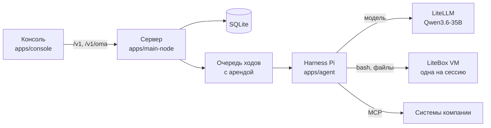

# Конструктор агентов для бэк-офиса

Платформа, на которой компания собирает ИИ-агентов для работы бэк-офиса и запускает их на своих серверах. Агент получает задачу, работает в отдельной виртуальной машине с файлами, программами и системами компании и отдаёт результат. Данные не уходят в чужие облака: модель Qwen идёт через ваш LiteLLM.

API платформы совместим с [Claude Managed Agents](https://platform.claude.com/docs/en/managed-agents/overview) от Anthropic. Консоль на русском.

## Что умеет

- **Агенты.** Агент это инструкция, модель и набор инструментов. Версии агента хранятся, сессия может закрепить версию.
- **Окружения и песочницы.** Каждая сессия работает в своей виртуальной машине LiteBox. В окружении задаются образ, пакеты и сеть.
- **Сессии.** Чат с агентом, поток событий, файлы результата, трасса каждого шага.
- **Инструменты через MCP.** Агенту подключают системы компании: iiko, 1С, CRM. По умолчанию вызов MCP ждёт подтверждения человека.
- **Навыки.** Папка с `SKILL.md` и скриптами. Встроенные навыки для docx, xlsx, pdf, pptx.
- **Секреты.** Хранилища секретов. Агент пользуется ключами, но не видит их в чате.
- **Память.** Хранилища памяти, которые агент читает и пополняет между сессиями.
- **Мультиагенты.** Координатор раздаёт работу сабагентам. У сессии есть лимит токенов и ходов сабагентов.
- **Оценка результата.** Вы задаёте цель и критерии, отдельный проверяющий сверяет работу, агент переделывает до 3 раз.
- **Деплойменты.** Агент, окружение и стартовое сообщение для повторяющейся работы.
- **Помощник.** Собирает агентов, окружения и сессии по описанию задачи. Каждое изменение платформы он показывает карточкой и ждёт подтверждения.

### Что пока не работает

- Расписание деплойментов: cron сохраняется, но запуск по времени не срабатывает. Работает ручной запуск кнопкой «Запустить».
- «Запуски оценки» на нашем сервере: у раннера нет песочницы, задачи падают.
- Postgres: захват исполнения падает с ошибкой `42P18`. Используйте SQLite.
- Проверяющий результат видит события сессии, но не открывает файлы.

План работ в [docs/plans/cma-wave-1.md](docs/plans/cma-wave-1.md).

## Как устроено



1. Консоль и программы ходят в сервер через API `/v1`. Наши расширения живут под `/v1/oma`.
2. Сообщение пользователя попадает в журнал событий сессии и в очередь.
3. Воркер берёт ход с арендой на 30 секунд. Если сервер упал, ход заберёт другой воркер.
4. Harness Pi ведёт цикл: модель думает, вызывает инструмент, смотрит результат, решает, что дальше.
5. Команды и файлы агента живут в виртуальной машине LiteBox своей сессии.
6. Каждое событие хода пишется в журнал. Консоль показывает его сразу через SSE.

Решения по архитектуре: [docs/README.md](docs/README.md), [docs/decisions-2026-10-17.md](docs/decisions-2026-10-17.md).

## Быстрый старт

### Что нужно

- Linux с `/dev/kvm`: на нём работают виртуальные машины LiteBox.
- Node 24 и pnpm 11. Удобно ставить Node через [fnm](https://github.com/Schniz/fnm).
- Доступ к LiteLLM, который отдаёт модель Qwen3.6-35B по API в формате OpenAI.

### Установка

```bash
git clone git@github.com:Nap20192/ai-native-backoffice-v3.git
```

```bash
cd ai-native-backoffice-v3/platform && fnm use 24 && pnpm install
```

### Настройка

Создайте `platform/.env` по образцу `platform/.env.example`. Главные переменные:

| Переменная | Зачем |
|---|---|
| `BETTER_AUTH_SECRET` | ключ сессий входа, длинная случайная строка |
| `PLATFORM_ROOT_SECRET` | ключ шифрования секретов платформы, длинная случайная строка |
| `SANDBOX_PROVIDER=litebox` | песочницы на LiteBox |
| `DATABASE_PATH` | путь к файлу SQLite, по умолчанию от `platform/apps/main-node` |
| `PUBLIC_BASE_URL` | адрес сервера, например `http://localhost:8788` |
| `AUTH_TRUSTED_ORIGINS` | адрес консоли, например `http://localhost:5174` |
| `AUTH_DISABLED=1` | только для разработки: вход без пароля, тенант `default` |

Ключи и токены живут только в `.env`. В git этот файл не попадает.

### Запуск

Сервер:

```bash
cd platform/apps/main-node && set -a && . ../../.env && set +a && PORT=8788 pnpm start
```

Консоль в другом терминале:

```bash
cd platform/apps/console && VITE_API_TARGET=http://localhost:8788 pnpm dev --port 5174
```

Проверка, что сервер жив:

```bash
curl http://localhost:8788/health
```

Откройте http://localhost:5174 и зарегистрируйтесь. Первый пользователь получает своё рабочее пространство.

Модель подключается в консоли: «Карточки моделей», затем новая карточка с адресом вашего LiteLLM, ключом и именем модели. Рабочая карточка в проекте называется `qwen3.6-35b`.

На ноутбуке разработчика сервер удобно запускать в отдельном scope с лимитом памяти, как в `.claude/launch.json`: systemd-oomd иначе может убить соседние процессы.

## Как пользоваться консолью

1. **Окружение.** «Окружения», создайте окружение: образ, пакеты (pip, npm, apt), сеть. Проверьте песочницу кнопкой проверки.
2. **Агент.** «Агенты», «Новый агент»: имя, модель, инструкция, инструменты. Можно начать с шаблона.
3. **Сессия.** «Сессии», новая сессия: агент и окружение. Напишите задачу или приложите файл. Ход агента виден по шагам, файлы результата лежат в панели сессии.
4. **Быстрый старт.** «Сводка», «Быстрый старт»: опишите задачу словами, помощник предложит агента, окружение и первую сессию.
5. **Подтверждения.** Когда агент вызывает инструмент, который ждёт человека, над полем ввода появляется карточка. Изменения платформы показываются с разницей до и после и применяются кнопкой на карточке.
6. **Навыки.** «Навыки»: загрузите папку или zip с `SKILL.md`. Файл начинается с заголовка между строками `---` с полями `name` и `description`. Потом подключите навык к агенту.
7. **Секреты.** «Хранилища секретов»: добавьте токен MCP-сервера. Подключите хранилище к сессии.
8. **Память.** «Хранилища памяти»: создайте хранилище и подключите его к сессии.
9. **Результат.** В сессии «Задать результат…»: цель и критерии. Итог проверки появится в блоке «Оценка результата».
10. **Деплоймент.** «Деплойменты», «Новый деплоймент»: агент, окружение, стартовое сообщение. Запуск кнопкой «Запустить».

## Работа через API

Ключ API создаётся в консоли: «API-ключи». Запросы к `/v1` несут два заголовка: ключ и beta-заголовок контракта.

```bash
export BASE=http://localhost:8788
```

```bash
export KEY=ваш_ключ_из_консоли
```

Создать окружение:

```bash
curl -s $BASE/v1/environments -H "x-api-key: $KEY" -H "anthropic-beta: managed-agents-2026-04-01" -H "content-type: application/json" -d '{"name":"office","config":{"type":"cloud","networking":{"type":"unrestricted"}}}'
```

Создать агента:

```bash
curl -s $BASE/v1/agents -H "x-api-key: $KEY" -H "anthropic-beta: managed-agents-2026-04-01" -H "content-type: application/json" -d '{"name":"Разбор заявок","model":"qwen3.6-35b","system":"Ты разбираешь заявки бэк-офиса.","tools":[{"type":"agent_toolset_20260401"}]}'
```

Создать сессию, подставив id агента и окружения из ответов выше:

```bash
curl -s $BASE/v1/sessions -H "x-api-key: $KEY" -H "anthropic-beta: managed-agents-2026-04-01" -H "content-type: application/json" -d '{"agent":"agent_...","environment_id":"env_..."}'
```

Отправить сообщение:

```bash
curl -s $BASE/v1/sessions/session_.../events -H "x-api-key: $KEY" -H "anthropic-beta: managed-agents-2026-04-01" -H "content-type: application/json" -d '{"events":[{"type":"user.message","content":[{"type":"text","text":"Посчитай итоги по статусам в заявки.csv"}]}]}'
```

Читать события потоком (SSE):

```bash
curl -N $BASE/v1/sessions/session_.../events/stream -H "x-api-key: $KEY" -H "anthropic-beta: managed-agents-2026-04-01"
```

Файлы результата:

```bash
curl -s $BASE/v1/sessions/session_.../outputs -H "x-api-key: $KEY" -H "anthropic-beta: managed-agents-2026-04-01"
```

Правила API:
- Ошибки `/v1` приходят в формате Anthropic: `{"type":"error","error":{"type","message"}}`.
- Чтение и запись отдают `ETag`. Запись с `If-Match` и старой ревизией получает 412.
- Архив или удаление объекта, от которого зависят другие, получает 409 со списком зависимостей.

### SDK

- **TypeScript.** Пакет `@openma/sdk` в `platform/packages/sdk`. Это официальный `@anthropic-ai/sdk` плюс наши расширения в `client.oma`. Примеры в [его README](platform/packages/sdk/README.md).
- **Официальные SDK Anthropic.** Версии для Python и Go работают с `/v1`, если задать `base_url` нашего сервера и ключ. Новые версии SDK не шлют beta-заголовок для files и skills, сервер пока отвечает им 400. Проект своих SDK для Python и Go отложен: [docs/research/sdk-design-2026-10-19.md](docs/research/sdk-design-2026-10-19.md).

### Расширения `/v1/oma`

| Маршрут | Что даёт |
|---|---|
| `/v1/oma/model_cards` | карточки моделей: адрес, ключ и параметры модели |
| `/v1/oma/models` | каталог моделей провайдера |
| `/v1/oma/sessions/:id/trace` | трасса хода: шаги, вызовы модели, токены |
| `/v1/oma/dependencies/:kind/:id` | от чего зависит объект перед архивом или удалением |
| `/v1/oma/sandbox-catalog` | каталог образов песочницы |

Ошибки `/v1/oma` имеют вид `{"error": "..."}`, beta-заголовок там не нужен.

## Структура репозитория

```
platform/                код платформы (копия Open Managed Agents с нашими правками)
  apps/main-node/        сервер Node: API, очередь ходов, песочницы, помощник
  apps/agent/            harness Pi и инструменты агента
  apps/console/          консоль на React, только русский язык
  packages/              общие пакеты: API, домен, хранилища, SDK, MCP, песочница
  sandbox-images/        образы песочниц и их проверки
  skills/builtin/        встроенные навыки: docx, xlsx, pdf, pptx
  assistant/             промпт и справка помощника
docs/                    дизайн, решения, планы волн, исследования
.claude/skills/          скиллы агентов: проверка консоли, правила текста
scripts/                 проверка текстов unslop
```

## Разработка

Правила для людей и агентов лежат в [AGENTS.md](AGENTS.md) и в `AGENTS.md` каждой части: [platform](platform/AGENTS.md), [рантайм агента](platform/apps/agent/AGENTS.md), [консоль](platform/apps/console/AGENTS.md).

Тесты запускаются по пакетам из `platform/`:

| Что | Команда |
|---|---|
| Сервер | `pnpm --filter @open-managed-agents/main-node exec vitest run --config vitest.config.ts` |
| Typecheck сервера | `pnpm --filter @open-managed-agents/main-node typecheck` |
| Консоль | `pnpm --filter managed-agents-console exec vitest run` |
| Typecheck консоли | `pnpm --filter managed-agents-console typecheck` |
| Harness Pi | `pnpm vitest run --config vitest.pi.config.ts` |

- Тяжёлые прогоны идут по одному, через `nice` и `test-slot`, с `--maxWorkers=2`. На ноутбуке иначе не хватает памяти.
- Работа готова, когда зелёные тесты и typecheck, а к отчёту приложено доказательство с живого приложения. Уровни проверки в [docs/verification.md](docs/verification.md). Ход агента проверяет скилл `.claude/skills/verify-agent-console`.
- Тексты для людей пишутся по правилам unslop: `node scripts/unslop-check.mjs --diff`.
- Перед коммитом: `gitleaks git --staged --redact`.
- Коммиты по-английски в стиле Conventional Commits: `feat(console): ...`, `fix(agent): ...`.

## Документация

- [docs/README.md](docs/README.md): карта дизайна и решений.
- [docs/plans/](docs/plans/): планы волн работы.
- [docs/runbook-local.md](docs/runbook-local.md): локальный запуск и известные проблемы.
- [docs/research/](docs/research/): разбор Claude Managed Agents и похожих платформ.

## Лицензия

Apache 2.0, текст в [platform/LICENSE](platform/LICENSE) и [platform/NOTICE](platform/NOTICE). Происхождение кода и список изменений в [platform/ORIGIN.md](platform/ORIGIN.md).
