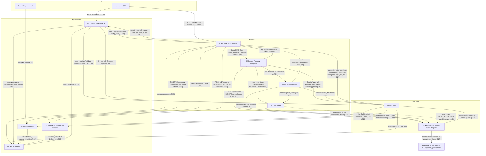

# Документация платформы агентов

Черновик 2, 2026-10-15.

## Карта

| Документ | Что внутри | Когда читать |
|---|---|---|
| [design.md](design.md) | Общий дизайн: объекты, ход сессии, harness, MCP Hub, агенты в консоли, боты, драйверы, Kubernetes, план | Сначала |
| [decisions.md](decisions.md) | 40 решений по стыковке компонентов (D1...D40), общие контракты (`RunTurn`, лимиты, имена, коды ошибок), вопросы владельцу | Перед работой над любым стыком |
| [decisions-2026-10-17.md](decisions-2026-10-17.md) | D41: остался только harness Pi, ACP и `ai-sdk` удалены. D42: Temporal отложен, условия возврата к нему и план на Postgres | Перед работой над harness, очередью ходов и репликами. Главнее design.md и спек 02, 03 |
| [components/](components/) | Спеки 10 компонентов. В начале каждой раздел «0. Согласовано», он главнее остального текста | Когда делаешь компонент |
| [flows/](flows/) | 10 сквозных сценариев. По ним нашли нестыковки, решения в `decisions.md` | Для проверки и приёмочных тестов |

### Компоненты

| № | Спека | Коротко |
|---|---|---|
| 01 | [Runtime API и журнал](components/01-runtime-api.md) | Вход в Runtime, журнал событий в Postgres, SSE, ожидания, Storage |
| 02 | [SessionWorkflow](components/02-session-workflow.md) | Temporal: когда и что запускать, ожидания, outcomes, сабагенты, сон песочницы. Temporal отложен, D42 |
| 03 | [Harness-воркеры](components/03-harness-workers.md) | Один ход: ACP с Claude и Codex, `simple`, восстановление после падения. ACP удалён, остался Pi, D41 |
| 04 | [Песочница](components/04-sandbox.md) | Environment, драйверы `docker` и `kubernetes`, `sandboxd`, сон и пробуждение |
| 05 | [MCP Hub](components/05-mcp-hub.md) | Реестр тулов, права, подтверждения, токен сессии, встроенные серверы |
| 06 | [Vault, egress, шлюз моделей](components/06-vault-egress-models.md) | Секреты, подмена на выходе, бюджеты, маршрут по классу данных |
| 07 | [Control plane агентов](components/07-agent-control-plane.md) | Черновик, версии, публикация, конструктор, консоль |
| 08 | [IAM и тенанты](components/08-iam-tenancy.md) | Кто, в каком тенанте, что можно. Роли, согласования, аудит |
| 09 | [Каналы и боты](components/09-channels-bots.md) | Slack, Telegram, web. Роутер, `send_user`, карточки подтверждений |
| 10 | [Deployments, память, скиллы](components/10-deployments-memory-skills.md) | Расписания и вебхуки, memory stores, пакеты скиллов |

### Сценарии

| № | Сценарий | Главные решения |
|---|---|---|
| 01 | [Создание агента в консоли](flows/01-create-agent.md) | D10...D15, D29, D36 |
| 02 | [Ход в web-чате с падением воркера](flows/02-chat-turn-crash.md) | D1, D4, D6...D9 |
| 03 | [Write-тул с подтверждением через часы](flows/03-write-approval.md) | D2, D16 |
| 04 | [Custom tool и сообщения во время ожидания](flows/04-custom-tool-busy.md) | D2, D3, D17, D18 |
| 05 | [Бот в Slack-треде](flows/05-slack-bot.md) | D30, D31, D32 |
| 06 | [Отчёт по расписанию с outcome и сабагентами](flows/06-scheduled-report.md) | D18, D33, D34, D35 |
| 07 | [Внешний API с секретом из vault](flows/07-secret-egress.md) | D26, D27 |
| 08 | [Новая версия агента при идущих сессиях](flows/08-version-rollout.md) | D21, D22, D23 |
| 09 | [Сон и пробуждение песочницы](flows/09-sandbox-sleep-wake.md) | D24, D25, D26 |
| 10 | [Изоляция тенантов](flows/10-tenant-isolation.md) | D9, D25, D26, D28, D40 |

## Как компоненты связаны

Подписи на стрелках это контракты. Номер решения в скобках ведёт в [decisions.md](decisions.md).

## Как читать решения

1. Нашёл расхождение между спеками: сначала ищи его в [decisions.md](decisions.md), потом в разделе 0 спеки.
2. Общие типы (`RunTurn`, лимиты, имена, коды ошибок) лежат только в приложении A к `decisions.md`. Спеки на них ссылаются.
3. Продуктовые вопросы, где выбран рекомендуемый вариант, собраны в разделе «Вопросы владельцу».
4. Крупные замечания ревью, которые ещё ждут решения (DNS песочницы, повтор хода с песочницей, шина событий, миграции, бэкапы, удаление данных, наблюдаемость, квоты, стоимость, локальный стенд), собраны в конце [decisions.md](decisions.md#замечания-ревью).
