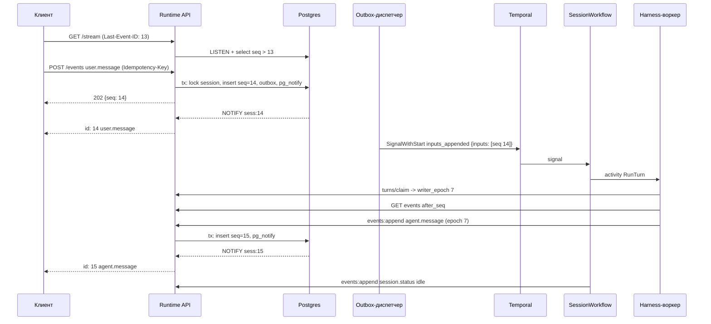
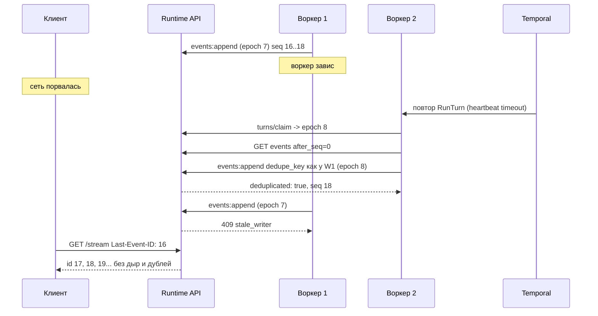

# 01. Runtime API и журнал событий

Черновик 2, 2026-10-15. Опирается на [design.md](../design.md), разделы 2, 3, 6, 11, и на [decisions.md](../decisions.md).

## 0. Согласовано

Этот раздел главнее текста ниже. Подробности и причины в [decisions.md](../decisions.md).

- **Вход в workflow (D1).** Журнал и outbox в одной транзакции, затем сразу попытка отправки, outbox страхует. `user.message`, `user.define_outcome`, `user.interrupt`: Signal-With-Start `inputs_appended {inputs: [{event_id, seq, type, actor_id, priority}]}`. `user.tool_result`: update `submit_tool_result {event_id, seq, tool_use_id, actor_id}`. `user.tool_confirmation`: update `submit_tool_confirmation {event_id, seq, approval_id, tool_use_id, decision, actor_id}`. `POST /terminate`: update `terminate {actor_id, reason}`. Update ID = `event_id`. Отказ валидатора: событие `event.rejected {event_id, code}`.
- **Ожидания (D2).** Таблица `session_waits` в этой базе: `(session_id, wait_id)`, `kind`, `tool_use_id`, `approval_id`, `turn_id`, `turn_actors`, `responder`, `approvers[]`, `expires_at`, `state`, `answered_by`, `answered_at`. Открывается в транзакции записи `agent.custom_tool_use` или `tool.confirmation_required`. Закрывается ответом или синтетическим `tool.result` от 02. Поле `sessions.pending_tool_use_id` убрано. Ответ принимается при открытом ожидании в любом статусе, кроме `terminated`. `409 tool_use_mismatch` несёт `details.reason`: `not_found`, `answered`, `timed_out`, `cancelled`.
- **Очередь вместо 409 (D3).** `409 session_waiting_tool` удалён. `user.message` и `user.define_outcome` в `waiting_tool` дают `202 {queued_behind_tool: true}`.
- **Подтверждение (D16).** `user.tool_confirmation.data = {approval_id, tool_use_id, decision: approve | deny, reason?}`. 01 проверяет, что автор в `approvers` ожидания или имеет право `tools.confirm` (08). Иначе `403 not_approver`.
- **Custom tool (D17).** `user.tool_result.data = {tool_use_id, content[], is_error?}`. Ответить может `responder` ожидания или тот, у кого есть `session.tool_result`.
- **Внутренний API (D6).** `turns/claim {turn_id, attempt, trigger_seqs}`: принимается, только если `(turn_no, attempt)` больше текущего, иначе `409 stale_writer`. 01 считает `turn_actors` по событиям `trigger_seqs` и хранит их в claim. Ответ: `writer_epoch` и `writer_token` (токен 01 на `session_id + turn_id + writer_epoch`). Workload token от 08 не нужен. При claim 01 шлёт эфемерный кадр `agent.message.reset {turn_id, attempt}`. Дельты несут `writer_epoch`, `turn_id`, `message_id`, `offset` и фенсятся. `dedupe_key` без номера попытки.
- **Новые внутренние пути (D6, D2, D31, D35, D18, D34).** `PUT/GET /internal/v1/sessions/{id}/harness-binding` (таблица `harness_bindings` с `harness_version` в этой базе). `GET /internal/v1/sessions/{id}/waits?turn_id=&state=open`. `GET /internal/v1/sessions/{id}/turns/{turn_id}` (claim с `attempt` и `turn_actors`, читает Hub). `GET /internal/v1/event-stream?namespace_id=&binding_id=&types=` (SSE с фильтром по `metadata.channel.binding_id`). `GET /internal/v1/sessions/{id}/usage?tree=true`. `POST /internal/v1/sessions/{id}/subagents`. `POST /internal/v1/files` (Storage, `file_ref`). Системные писатели 02, 05, 06 пишут через `events:append` с `writer: system`, без epoch, с обязательным `dedupe_key`.
- **Создание сессии (D19, D21, D36).** Тело: `agent` (ссылка `name@live`, `agt_...@N`, `platform/agent-builder@live`; без версии = `@live`) или `config_id` (только сервис 07). Шаги: 07 `agent-refs:resolve` → 04 `GetEnvironment` → 08 `session-principals` → 10 `ResolveSessionContext` → транзакция. `ResolveLatestVersion` не используется. Задать `environment_id` в обход конфига нельзя. Отказы: `403 permission_denied`, `409 deployment_owner_disabled`, `422 session_context_failed`.
- **Поля `sessions` (D10, D19, D35).** Добавлены `config_id`, `environment_version`, `owner_actor_id`, `effective_subject`, `parent_session_id`, `root_session_id`, `depth`, `resources`, `limits {budget_usd, ttl_s, merge_window_ms, merge_max_wait_ms}`. `on_behalf_of` это `jsonb {kind, id, external_user_id?}`. Индекс `(namespace_id, agent_id, agent_version) where status <> 'terminated'`, фильтр `GET /v1/sessions?agent_version=` (D22).
- **От чьего имени (D19, D31, D33).** `on_behalf_of` задают сервисы с `act_as` (09, 10). 07 ходит principal-токеном человека. `priority: owner` принимается только от сервиса с `act_as` или от самого `owner_actor_id`. Для `on_behalf_of.kind = deployment` входы пишутся с `actor {kind: system, id: deployment:<id>}`.
- **Отзыв версии (D22).** По `agent.version_recalled` 01 переводит живые сессии с этим `config_id` в `terminated`.
- **Имена (D5, D20).** Префикс id сессии `ses_`. `metadata.channel = {binding_id, thread_id, thread_key}`, `metadata.deployment = {deployment_id, run_id, output}`, `metadata.test`.
- **События (D38).** Новые типы: `session.created`, `event.rejected`, `tool.confirmation_required`, `system.notice`, `session.artifact`, `subagent.waiting`, `sandbox.state`. Необязательное поле `turn_id` в публичной оболочке.

## 1. Назначение и границы

Runtime API это вход в Runtime. Сюда приходят все запросы к сессиям: от консоли, SDK, каналов и deployments. Здесь же живёт журнал событий в Postgres. Журнал нельзя терять (design.md, раздел 1).

Что делает:

- Создаёт сессии и запускает `SessionWorkflow` (через outbox, см. ниже).
- Принимает входные события (`user.*`), пишет их в журнал, отвечает `202`.
- Доставляет события в workflow: signal или update.
- Выдаёт журнал страницами и потоком SSE с возобновлением по `Last-Event-ID`.
- Даёт внутренний API для записи выходных событий (`agent.*`, `tool.*`, `session.status` и др.). Пишут harness-воркеры и activities workflow.
- Назначает `seq` на сессию. Гарантирует порядок и отсутствие дублей.
- Держит проекцию статуса сессии (`sessions.status`) для быстрых проверок и `409`.
- Задаёт общие правила для всего `/v1`: формат ошибок, ключи идемпотентности, пагинация, версия API. Остальные компоненты с REST (07, 10) следуют этим правилам.

Чего НЕ делает:

- Не ведёт ход агента и не решает, когда начинать ход. Это `SessionWorkflow` (02).
- Не запускает harness и песочницы (03, 04).
- Не хранит агентов и версии (07), environments (04), секреты (06), memory stores и deployments (10).
- Не проверяет права на тулы. Это MCP Hub (05).
- Не переписывает и не удаляет события. Компакцию делает harness в памяти (design.md, раздел 2).
- Не хранит большие файлы: вложения в Storage (S3), в событии только ссылка.

Язык: Go, как весь control plane (design.md, раздел 11). Один бинарник, два порта: публичный `:8080` (`/v1`) и внутренний `:8081` (`/internal/v1`).

## 2. Модель данных

Postgres (CloudNativePG). Все id строковые: префикс плюс ULID (`ses_01J...`, `evt_01J...`). ULID сортируется по времени, это удобно для курсоров.

### 2.1. `sessions`

| Поле | Тип | Смысл |
|---|---|---|
| `id` | `text` PK | `ses_<ulid>`, совпадает с Temporal workflow id |
| `namespace_id` | `text` not null | Тенант (08) |
| `agent_id` | `text` not null | Агент (07) |
| `agent_version` | `int` null | Номер версии. `null` только у тестовой сессии на черновике |
| `config_id` | `text` not null | `ver_...` или `tst_...` (D10). Заменяет `draft_snapshot_id` |
| `environment_id`, `environment_version` | `text`, `int` null | Из конфига агента. `null` = без песочницы |
| `status` | `text` not null | `idle`, `running`, `waiting_tool`, `waiting_human`, `terminated` |
| `created_by_kind`, `created_by_id` | `text` | Кто создал: `human`, `agent`, `system` |
| `on_behalf_of` | `jsonb` not null | `{kind: user \| channel \| deployment \| service_account, id, external_user_id?}` (D19) |
| `effective_subject` | `text` not null | Ответ 08 `session-principals` |
| `owner_actor_id` | `text` null | Его сообщение прерывает ход (D31) |
| `parent_session_id`, `root_session_id`, `depth` | `text`, `text`, `int` | Сабагенты (D18). У корня `root_session_id = id`, `depth = 0` |
| `resources`, `limits` | `jsonb` | Файлы для песочницы; `{budget_usd, ttl_s, merge_window_ms, merge_max_wait_ms}` (D35) |
| `metadata` | `jsonb` not null default `{}` | Тред чата, метки. До 16 KiB |
| `title` | `text` null | Для консоли |
| `last_seq` | `bigint` not null default 0 | Последний выданный `seq` |
| `writer_epoch` | `bigint` not null default 0 | Фенсинг воркеров (см. 3.4) |
| `created_at`, `updated_at` | `timestamptz` | |
| `terminated_at` | `timestamptz` null | |

Индексы: `(namespace_id, created_at desc, id desc)` для списка; `(namespace_id, agent_id, created_at desc)`; `(namespace_id, status) where status <> 'terminated'`; GIN по `metadata jsonb_path_ops` для поиска по треду канала.

### 2.2. `session_events`

| Поле | Тип | Смысл |
|---|---|---|
| `session_id` | `text` not null | |
| `seq` | `bigint` not null | С 1, без дыр, на сессию |
| `event_id` | `text` not null unique | `evt_<ulid>` |
| `namespace_id` | `text` not null | Копия для RLS и фильтров |
| `type` | `text` not null | `user.message`, `agent.tool_use` и т.д. |
| `occurred_at` | `timestamptz` not null | Когда случилось у источника |
| `recorded_at` | `timestamptz` not null default `now()` | Когда записали |
| `actor_kind` | `text` not null | `human`, `agent`, `system` |
| `actor_id` | `text` not null | |
| `data` | `jsonb` not null | До 256 KiB |
| `dedupe_key` | `text` null | Ключ идемпотентности записи |
| `turn_id` | `text` null | Ход, в котором событие появилось |

Ключи и индексы:
- `primary key (session_id, seq)`. Хватает для страниц и SSE: `where session_id = $1 and seq > $2 order by seq limit $3`.
- `unique (session_id, dedupe_key) where dedupe_key is not null`; `(namespace_id, type, recorded_at)` для аудита и стоимости по `span.usage`.
- Роли приложения `revoke update, delete on session_events`. Удаление только по сроку хранения отдельной ролью (см. 7).

Партиционирование: на старте нет. Когда таблица вырастет выше ~100 млн строк, переходим на `partition by hash (session_id)`, 16 частей. PK уже содержит ключ партиции.

Публичная оболочка события строго как в design.md: `{event_id, session_id, seq, type, occurred_at, actor, data}`. Поля `dedupe_key`, `turn_id`, `recorded_at` наружу не отдаём (см. открытый вопрос 2).

### 2.3. `idempotency_requests`

Для `POST` запросов, которые создают объекты (`POST /v1/sessions` и любые `POST` в 07, 10).

| Поле | Тип | Смысл |
|---|---|---|
| `namespace_id` | `text` | |
| `principal_id` | `text` | Кто прислал. Ключи разных людей не пересекаются |
| `key` | `text` | Значение заголовка `Idempotency-Key`, 1–255 символов |
| `method`, `path` | `text` | |
| `request_hash` | `bytea` | SHA-256 тела |
| `state` | `text` | `in_progress`, `done` |
| `status_code` | `int` null | |
| `response_body` | `jsonb` null | |
| `created_at`, `expires_at` | `timestamptz` | TTL 24 часа |

PK `(namespace_id, principal_id, key)`. Чистка: задача раз в час удаляет `expires_at < now()` пачками по 10 000.

Для входных событий отдельная таблица не нужна: `Idempotency-Key` пишется в `session_events.dedupe_key` как `api:<principal_id>:<key>`.

### 2.4. `workflow_outbox`

Журнал пишется раньше, чем workflow узнаёт о событии. Чтобы сигнал не потерялся, его кладём в outbox в той же транзакции.

| Поле | Тип | Смысл |
|---|---|---|
| `id` | `bigserial` PK | |
| `session_id` | `text` | |
| `kind` | `text` | `start`, `signal_inputs`, `update_tool_result`, `update_tool_confirmation`, `update_terminate`, `update_spawn_subagent` |
| `payload` | `jsonb` | Маленький: ссылки, id, enum (D1). Без текстов |
| `attempts` | `int` default 0 | |
| `next_attempt_at` | `timestamptz` | |
| `last_error` | `text` null | |
| `delivered_at` | `timestamptz` null | |

Индекс `(next_attempt_at) where delivered_at is null`. Доставленные строки удаляются через 7 дней.

## 3. Контракты

### 3.1. Общие правила `/v1`

**Версия.** Мажорная версия в пути: `/v1`. В рамках `v1` только добавляем: новые поля, новые типы событий, новые эндпоинты. Клиент обязан пропускать незнакомые поля и типы событий. Ломающее изменение = `/v2`, `/v1` живёт ещё 6 месяцев. Ответ всегда несёт заголовок `Runtime-Api-Version: 1.<minor>`.

**Аутентификация.** `Authorization: Bearer <token>`: OIDC access token человека или API-ключ (оба проверяет 08). Каналы и deployments ходят сервисным токеном с правом `act_as`.

**Формат ошибки.** Всегда так:

```json
{"error": {"type": "conflict", "code": "tool_use_mismatch",
           "message": "No open wait for tc_01J9...",
           "request_id": "req_01J9...", "details": {"tool_use_id": "tc_01J9...", "reason": "timed_out"}}}
```

**Коды ответов.**

| Код | `code` | Когда |
|---|---|---|
| `200` | | Чтение |
| `201` | | Сессия создана |
| `202` | | Событие записано в журнал, workflow узнает асинхронно |
| `204` | | SSE: сессия `terminated` и все события уже отданы. Клиент перестаёт переподключаться (так задано в спецификации SSE) |
| `400` | `invalid_request`, `unknown_event_type`, `invalid_cursor` | Плохое тело, тип не из `user.*`, битый курсор |
| `401` | `unauthenticated` | Нет или протух токен |
| `403` | `permission_denied` | Объект виден, но действие запрещено (например, писать в чужую сессию, видимую по роли наблюдателя) |
| `404` | `not_found` | Нет объекта или нет права его видеть. Чужие сессии не отличаем от несуществующих |
| `409` | `session_terminated` | Любое событие в закрытую сессию |
| `409` | `tool_use_mismatch` | Нет открытого ожидания с этим `tool_use_id` или `approval_id`. `details.reason`: `not_found`, `answered`, `timed_out`, `cancelled` |
| `403` | `not_approver` | `user.tool_confirmation` не от согласующего |
| `409` | `idempotency_key_reused` | Тот же ключ, другое тело |
| `409` | `idempotency_in_progress` | Тот же ключ, первый запрос ещё выполняется. С `Retry-After: 1` |
| `409` | `stale_writer` | Внутренний API: воркер со старым `writer_epoch` |
| `413` | `payload_too_large` | `data` больше 256 KiB или больше 20 событий в запросе |
| `422` | `agent_version_not_published`, `environment_not_found` | Ссылки не проходят проверку |
| `422` | `session_context_failed` | 08 или 10 отказали при создании сессии (D19) |
| `409` | `deployment_owner_disabled` | Владелец deployment отключён (D19, D33) |
| `409` | `session_too_large` | Журнал сессии больше лимита (раздел 7) |
| `429` | `rate_limited` | С `Retry-After` в секундах |
| `500` | `internal` | |
| `503` | `journal_unavailable` | Postgres недоступен. С `Retry-After: 2` |

Недоступный Temporal не даёт ошибку клиенту: событие уже в журнале, outbox доставит позже (см. 6).

**Идемпотентность.** Заголовок `Idempotency-Key` разрешён на всех `POST`. Обязателен для каналов и deployments (иначе `400`). Повтор с тем же ключом и тем же телом в течение 24 часов возвращает тот же ответ и тот же код. Повтор с другим телом даёт `409 idempotency_key_reused`.

**Пагинация.** Списки объектов: `?limit=` (по умолчанию 50, максимум 200) и `?cursor=` (непрозрачная base64 строка от `(created_at, id)`). Ответ `{data: [...], next_cursor: "..." | null}`. Журнал: курсор это `seq`, см. ниже.

**Лимиты по умолчанию.** 20 входных событий на запрос. 256 KiB на `data`. 60 `POST .../events` в минуту на человека на сессию. 20 одновременных SSE на человека. Таймаут обычного запроса 10 с.

### 3.2. Публичный REST

| Метод | Путь | Ответ |
|---|---|---|
| `POST` | `/v1/sessions` | `201` сессия |
| `GET` | `/v1/sessions` | `200` список. Фильтры: `agent_id`, `status`, `metadata.<key>` |
| `GET` | `/v1/sessions/{id}` | `200` |
| `PATCH` | `/v1/sessions/{id}` | `200`. Меняются только `title` и `metadata` |
| `POST` | `/v1/sessions/{id}/events` | `202` |
| `GET` | `/v1/sessions/{id}/events` | `200` страница журнала |
| `GET` | `/v1/sessions/{id}/stream` | SSE |
| `POST` | `/v1/sessions/{id}/terminate` | `202` |

Пути `/v1/agents/*` (design.md, раздел 6) реализует 07 по этим же правилам. `POST /v1/agents/{id}/test-sessions` у 07 внутри вызывает создание сессии из этого компонента с `config_id = tst_...` (D10, D36).

**Создать сессию.**

```http
POST /v1/sessions
Idempotency-Key: 7f3c2a10-telegram-thread-991
Content-Type: application/json

{
  "agent": "hr-helper@live",
  "metadata": {"channel": {"binding_id": "chn_01J9...", "thread_id": "thr_01J9...", "thread_key": "tg:77:-100123:root:4567"}},
  "on_behalf_of": {"kind": "channel", "id": "chn_01J9...", "external_user_id": "tg:58123"},
  "owner_actor_id": "usr_01J7...",
  "limits": {"merge_window_ms": 1500, "merge_max_wait_ms": 10000},
  "initial_events": [
    {"type": "user.message", "data": {"content": [{"type": "text", "text": "Сколько у меня дней отпуска?"}]}}
  ]
}
```

```http
HTTP/1.1 201 Created
Location: /v1/sessions/ses_01J9ZQ...

{"id": "ses_01J9ZQ...", "agent_id": "agt_01J9ZK...", "agent_version": 3, "config_id": "ver_01J9ZK...",
 "environment_id": "env_01J9ZM...", "environment_version": 4, "status": "idle", "last_seq": 2,
 "metadata": {"channel": {"binding_id": "chn_01J9...", "thread_id": "thr_01J9...", "thread_key": "tg:77:-100123:root:4567"}},
 "created_at": "2026-10-15T09:12:03.120Z"}
```

Правила: ссылка без версии = `@live` (D21). Шаги до транзакции: 07 `agent-refs:resolve`, 04 `GetEnvironment`, 08 `session-principals`, 10 `ResolveSessionContext` (D19). `on_behalf_of` задаёт только сервисный токен с `act_as`, человек всегда сам за себя. В одной транзакции: строка `sessions`, события `initial_events`, outbox `start`. Статус `idle` в ответе честный: `running` выставит workflow, когда начнёт ход.

**Отправить событие.**

```http
POST /v1/sessions/ses_01J9ZQ.../events
Idempotency-Key: msg-5521

{"events": [{"type": "user.message", "data": {"content": [{"type": "text", "text": "А с учётом переноса?"}]}}]}
```

```http
HTTP/1.1 202 Accepted

{"events": [{"event_id": "evt_01J9ZR...", "seq": 14}]}
```

Разрешённые типы: `user.message`, `user.define_outcome`, `user.tool_result`, `user.tool_confirmation`, `user.interrupt`. Поле `actor` клиент не присылает: сервер берёт его из токена. Для сервисного токена с `act_as` поле `data.author` (человек из чата) обязательно, `actor` = `{kind: human, id: <author>}`. Исключение: сессия с `on_behalf_of.kind = deployment`, там `actor = {kind: system, id: deployment:<id>}` и `data.author` не нужен (D33). `priority: owner` принимается только от сервиса с `act_as` или от самого `owner_actor_id` (D31).

Проверки перед записью (под `select ... for update` строки сессии):

| Тип | Статус сессии | Результат |
|---|---|---|
| любой | `terminated` | `409 session_terminated` |
| `user.message`, `user.define_outcome` | `waiting_tool` | `202 {queued_behind_tool: true}`, outbox `signal_inputs` (D3) |
| `user.message`, `user.define_outcome` | остальные | `202`, outbox `signal_inputs` |
| `user.tool_result` | есть открытое ожидание `custom_tool` с `data.tool_use_id`, автор = `responder` или право `session.tool_result` | `202`, outbox `update_tool_result` |
| `user.tool_confirmation` | есть открытое ожидание с `data.approval_id`, автор в `approvers` или право `tools.confirm` | `202`, outbox `update_tool_confirmation` |
| `user.tool_result`, `user.tool_confirmation` | нет открытого ожидания | `409 tool_use_mismatch` с `reason` |
| `user.tool_confirmation` | автор не согласующий | `403 not_approver` |
| `user.interrupt` | любой, кроме `terminated` | `202`, outbox `signal_inputs` |

Статус сессии для ответов не важен: ожидание может открыться, пока ход ещё `running` (D2). `user.message` в `waiting_human` разрешено: человек может написать, пока ждём другого согласующего.

**Читать журнал.**

```http
GET /v1/sessions/ses_01J9ZQ.../events?after_seq=10&limit=100&types=agent.message,user.message
```

```json
{
  "data": [
    {"event_id": "evt_01J9ZR...", "session_id": "ses_01J9ZQ...", "seq": 14,
     "type": "user.message", "occurred_at": "2026-10-15T09:13:40.002Z",
     "actor": {"kind": "human", "id": "usr_01J8..."},
     "data": {"content": [{"type": "text", "text": "А с учётом переноса?"}]}}
  ],
  "next_after_seq": 14,
  "has_more": false
}
```

`limit` по умолчанию 100, максимум 1000. Есть `before_seq` для чтения с конца (консоль открывает длинную сессию снизу). Фильтр `types` не меняет курсор: `next_after_seq` = `seq` последнего отданного.

### 3.3. SSE-стрим

`GET /v1/sessions/{id}/stream`. Заголовки ответа: `Content-Type: text/event-stream`, `Cache-Control: no-store`, `X-Accel-Buffering: no`. Откуда начинать:
1. Заголовок `Last-Event-ID` (браузер шлёт его сам при переподключении).
2. Иначе `?after_seq=N`.
3. Иначе с `last_seq` на момент подключения (только новые). `?after_seq=0` = весь журнал.

Формат кадра. `id` = `seq`, `event` = тип события, `data` = оболочка JSON:

```
retry: 2000

id: 15
event: agent.message
data: {"event_id":"evt_01J9ZS...","session_id":"ses_01J9ZQ...","seq":15,"type":"agent.message","occurred_at":"...","actor":{"kind":"agent","id":"agt_01J9ZK..."},"data":{"content":[{"type":"text","text":"У вас 14 дней."}]}}

: keepalive

```

Правила:
- Сначала догоняем из Postgres пачками по 500, потом переходим в живой режим. Переход без дыр: подписка на уведомления включается до первого чтения.
- Комментарий `: keepalive` каждые 15 с. Так советует спецификация SSE, чтобы прокси не рвали соединение.
- Соединение живёт до 30 мин, потом сервер закрывает его. Клиент переподключается с `Last-Event-ID` и ничего не теряет.
- Если сессия `terminated` и все события отданы, сервер шлёт последнее событие и закрывает поток. Повторный запрос получает `204`.
- `?include=deltas` включает эфемерные кадры `event: agent.message.delta` без `id`. Они не пишутся в журнал, при переподключении не повторяются. Итоговый текст всегда приходит событием `agent.message` с `seq`.

Механизм доставки внутри кластера:

- Каждая реплика API держит одно отдельное соединение с `LISTEN session_events`.
- Транзакция записи событий вызывает `pg_notify('session_events', '<session_id>:<last_seq>')`. По документации Postgres уведомление уходит только после commit, payload должен быть меньше 8000 байт. Наш payload меньше 64 байт. Одинаковые payload в одной транзакции склеиваются, нам это не мешает.
- Уведомление только будит. Данные подписчик всегда читает из таблицы: `seq > last_sent`. Поэтому потеря или склейка уведомлений не ломает порядок.
- Страховка: каждый подписчик раз в 5 с сам проверяет `sessions.last_seq`. Если соединение `LISTEN` порвалось, после переподключения все подписчики реплики перечитывают хвост.
- Дельты: внутренний `POST .../deltas` делает `pg_notify('session_deltas', ...)` с куском до 4 KiB. Без записи в таблицу.
- Почему не Redis или NATS: на старте на одну зависимость меньше. Предел масштаба см. открытый вопрос 4.

### 3.4. Внутренний API (порт `:8081`, mTLS, для 02, 03, 05, 06, 09, 10)

| Метод | Путь | Кто зовёт | Смысл |
|---|---|---|---|
| `POST` | `/internal/v1/sessions/{id}/turns/claim` | 03 в начале `RunTurn` | Взять право записи: `writer_epoch`, `writer_token`, `turn_actors` |
| `GET` | `/internal/v1/sessions/{id}/turns/{turn_id}` | 05 | Текущий claim: `attempt`, `turn_actors` (для токена Hub) |
| `POST` | `/internal/v1/sessions/{id}/events:append` | 03 (с epoch), 02, 05, 06 (`writer: system`) | Дописать выходные события |
| `POST` | `/internal/v1/sessions/{id}/deltas` | 03 | Эфемерные дельты текста, с `writer_epoch` |
| `GET` | `/internal/v1/sessions/{id}/events?after_seq=` | 02, 03 | Чтение журнала для хода (как публичное, без проверки людей) |
| `GET` | `/internal/v1/sessions/{id}` | 02, 03, 05, 06, 10 | Сессия с `config_id`, `on_behalf_of`, `effective_subject`, `environment_id`, `metadata`, `limits` |
| `GET` | `/internal/v1/sessions/{id}/waits?turn_id=&state=open` | 03 | Открытые ожидания хода (D2) |
| `PUT`, `GET` | `/internal/v1/sessions/{id}/harness-binding` | 03 | Связь с сессией harness, `state_ref`, `harness_version` |
| `POST` | `/internal/v1/sessions/{id}/subagents` | 05 | Создать сессию ребёнка (D18) |
| `GET` | `/internal/v1/sessions/{id}/usage?tree=true` | 10 | Сумма `span.usage` по дереву |
| `GET` | `/internal/v1/event-stream?namespace_id=&binding_id=&types=` | 09 | SSE событий многих сессий канала (D31) |
| `POST` | `/internal/v1/files` | 05, 02 | Положить файл в Storage, получить `file_ref` (D34) |

**Фенсинг.** Когда Temporal повторяет `RunTurn` на другом воркере, старый воркер может быть ещё жив. Новый вызывает `turns/claim` с `{turn_id, attempt, trigger_seqs}`. API принимает claim, только если `(turn_no, attempt)` больше текущего, делает `writer_epoch = writer_epoch + 1`, выдаёт `writer_token` и шлёт эфемерный кадр `agent.message.reset`. Запоздавший claim старой попытки получает `409 stale_writer`. Каждый `events:append` и `deltas` несёт `writer_epoch`. Если он меньше текущего, ответ `409 stale_writer`, воркер должен остановиться.

```http
POST /internal/v1/sessions/ses_01J9ZQ.../events:append
Authorization: Bearer <writer_token: session + turn + epoch>

{
  "writer_epoch": 7,
  "turn_id": "ses_01J9ZQ...:7",
  "events": [
    {"type": "agent.tool_use", "dedupe_key": "ses_01J9ZQ...:7:toolu_01J9ZU:use",
     "occurred_at": "2026-10-15T09:13:42.511Z",
     "actor": {"kind": "agent", "id": "agt_01J9ZK..."},
     "data": {"tool_use_id": "toolu_01J9ZU", "name": "hr__get_vacation_balance", "source": "hub", "input": {"employee_id": "usr_01J8..."}}}
  ]
}
```

```json
{"events": [{"event_id": "evt_01J9ZV...", "seq": 16, "deduplicated": false}], "last_seq": 16}
```

Правила записи: `dedupe_key` обязателен и не содержит номера попытки, повтор с тем же ключом возвращает старый `seq` и `deduplicated: true`, так новый воркер после падения не задваивает события. `session.status` пишет только workflow (02), в той же транзакции обновляются `sessions.status`, `terminated_at`. События `agent.custom_tool_use` и `tool.confirmation_required` (пишет Hub) в той же транзакции открывают строку `session_waits`. Синтетический `tool.result` от 02 с `reason` закрывает её. Типы `user.*` здесь запрещены.

**Алгоритм записи (одна транзакция, `read committed`):**

1. `select last_seq, status, writer_epoch from sessions where id = $1 for update`.
2. Проверить статус и epoch. Для каждого события с `dedupe_key` найти существующее: `select seq ... where session_id = $1 and dedupe_key = any($2)`.
3. Новым событиям выдать `seq = last_seq + 1 ... last_seq + n`, вставить.
4. `update sessions set last_seq = ..., updated_at = now()`.
5. Для входных событий вставить строку в `workflow_outbox`.
6. `select pg_notify('session_events', $id || ':' || $last_seq)`.
7. Commit.

Блокировка строки сессии сериализует записи в одну сессию. Это и есть гарантия `seq` без дыр. Разные сессии не мешают друг другу.

### 3.5. Что отправляем в Temporal (через outbox)

| `kind` | Вызов Temporal | Имя | Payload |
|---|---|---|---|
| `start` | Start workflow, `WorkflowIDConflictPolicy = UseExisting` | `SessionWorkflow`, id = `session_id` | `{session_id}` |
| `signal_inputs` | Signal-With-Start | `inputs_appended` | `{inputs: [{event_id, seq, type, actor_id, priority}]}` (`user.message`, `user.define_outcome`, `user.interrupt`) |
| `update_tool_result` | Update, ждём стадию Accepted, Update ID = `event_id` | `submit_tool_result` | `{event_id, seq, tool_use_id, actor_id}` |
| `update_tool_confirmation` | Update, ждём стадию Accepted, Update ID = `event_id` | `submit_tool_confirmation` | `{event_id, seq, approval_id, tool_use_id, decision, actor_id}` |
| `update_terminate` | Update, Update ID = id запроса | `terminate` | `{actor_id, reason}` |
| `update_spawn_subagent` | Update родителю | `spawn_subagent` | `{tool_use_id, child_session_id, config_id, await}` |

В Temporal не кладём тело события, только ссылки, id, enum и короткие поля (D1). Workflow читает данные из журнала activity. Так payload всегда маленький, а лимиты истории (по умолчанию 50 MB и 51 200 событий у self-hosted) не задевают журнал. Сразу после commit API сам пробует отправить запись, outbox только страхует (D1). Дубли безопасны: signal отбрасывается по `seq <= LastSeenSeq`, update по Update ID.

Signal-With-Start атомарен, поэтому `signal_inputs` заодно поднимает workflow, если `start` ещё не дошёл. Update-With-Start по документации Temporal не атомарен, поэтому для update сначала убеждаемся, что workflow есть.

Если validator update отклонил запрос (гонка: статус в Postgres устарел), outbox пишет событие `event.rejected` с `{event_id, code}`. Обычно `409` отдаёт сама проверка в Postgres.

### 3.6. Типы событий, которые добавляет этот компонент

| Тип | Кто пишет | Смысл |
|---|---|---|
| `event.rejected` | 01 | Входное событие записано, но workflow его не принял |
| `session.created` | 01 | Первое событие сессии, `seq = 1`: агент, версия, environment |

Оба укладываются в оболочку design.md. JSON Schema всех типов лежит в контрактах (design.md, раздел 10, шаг 1). API проверяет `data` входных событий по схеме, выходные проверяет только в тестах и в режиме `strict` (по умолчанию выключен в проде).

## 4. От чего зависит

| От кого | Что берём |
|---|---|
| 08 IAM | Проверка токена (OIDC, API-ключ, principal token), `namespace_id`, `authorize`: `sessions.create`, `sessions.read.*`, `session.write`, `session.act_as`, `session.tool_result`, `tools.confirm`. `session-principals` при создании сессии (D19). Workload token не нужен: `writer_token` выдаёт сам 01 (D6) |
| 07 Control plane | `POST /internal/v1/agent-refs:resolve` (единственный способ узнать версию, D21). `GET /internal/v1/agent-configs/{config_id}` |
| 04 Sandbox | `GetEnvironment(id, version)`: существует и доступен тенанту |
| 10 Context | `ResolveSessionContext` при создании сессии (D19) |
| 02 SessionWorkflow | Тип workflow `SessionWorkflow`, signal `inputs_appended`, updates `submit_tool_result`, `submit_tool_confirmation`, `terminate`, `spawn_subagent`. Workflow сам пишет `session.status` через внутренний API |
| 03 Harness-воркеры | Пишут выходные события через `events:append`, вызывают `turns/claim`, `harness-binding`, `waits` |
| 05 MCP Hub | Пишет `tool.confirmation_required`, `agent.custom_tool_use`, создаёт детей через `subagents`, публикует файлы |
| Storage (S3, владелец этот компонент, D34) | Ссылки на вложения `file_ref` в `data`. API проверяет, что объект принадлежит тенанту |
| Postgres | Таблицы раздела 2, LISTEN/NOTIFY |
| Temporal | Клиент: start, signal, signal-with-start, update |

Кто зовёт нас: консоль и SDK, 09 (каналы шлют `user.message` и читают поток для `send_user`), 10 (deployments создают сессии), 07 (тестовые сессии).

## 5. Ключевые потоки

### 5.1. Сообщение пользователя и ответ потоком



### 5.2. Падение воркера и возобновление клиента



## 6. Отказы и как переживаем

| Что упало | Что видит пользователь | Как восстанавливаемся |
|---|---|---|
| Temporal недоступен | `POST /events` даёт `202`, событие видно в потоке, ответа агента пока нет. Статус остаётся `idle` | Outbox повторяет с backoff: 0.5 с, 1, 2, 4 ... до 30 с, без предела попыток. Алерт, если строка ждёт дольше 60 с |
| Postgres недоступен | `503 journal_unavailable` с `Retry-After: 2`. SSE рвётся, клиент переподключается сам (`retry: 2000`) | CNPG переключает реплику. Readiness-проба API падает, пока нет соединения с primary |
| Реплика API упала | SSE рвётся | Клиент приходит на другую реплику с `Last-Event-ID`, получает хвост из таблицы |
| Порвалось соединение `LISTEN` | Задержка до 5 с | Переподключение с backoff, затем все подписчики реплики перечитывают хвост. Плюс опрос раз в 5 с |
| Ответ `202` потерялся в сети | Клиент не знает, записалось ли | Повтор с тем же `Idempotency-Key` вернёт тот же `seq` |
| Воркер упал посреди хода | Пауза в потоке до heartbeat timeout (задаёт 02) | Новый воркер берёт epoch, дописывает с теми же `dedupe_key`, старый получает `409 stale_writer` |
| Update отклонён validator | Событие `event.rejected` в потоке | Клиент перечитывает статус и повторяет с правильным `tool_use_id` |
| Медленный SSE-клиент | Буфер на подписчика 1000 кадров. Если переполнен, сервер закрывает соединение | Клиент переподключается с `Last-Event-ID` и догоняет из таблицы |
| Очередь NOTIFY заполнена (8 GB по документации) | Транзакции с `pg_notify` падают при commit, `503` | Метрика `pg_notification_queue_usage()`, алерт при 50%. Причина обычно в зависшем слушателе: API держит LISTEN на отдельном соединении без долгих транзакций |
| Outbox доставил дважды | Ничего | Workflow хранит `LastSeenSeq` и отбрасывает входы с `seq` не больше него. Update ID = `event_id`, повтор присоединяется к тому же update (D1) |

## 7. Безопасность

- **Тенанты.** Каждый запрос получает `namespace_id` из токена. Все запросы в SQL идут с `namespace_id`. Дополнительно Postgres RLS: `set local app.namespace_id = ...` в начале транзакции, политика `using (namespace_id = current_setting('app.namespace_id'))` на `sessions` и `session_events`.
- **Чужое = 404.** Нет права `session.read`, значит `404 not_found`. Так нельзя перебирать id.
- **Actor не подделать.** `actor` ставит сервер по токену. `act_as` есть только у сервисных токенов 09 и 10, и только в своём namespace. 07 ходит principal-токеном человека (D36).
- **Внутренний API** слушает отдельный порт, наружу не публикуется (нет в Ingress, NetworkPolicy пускает только pod-ы платформенных сервисов, mTLS). Запись хода требует `writer_token`, который 01 выдаёт при `turns/claim` на `session_id + turn_id + writer_epoch` (D6). Токен одной сессии не пишет в другую. Системные писатели (02, 05, 06) идут по mTLS-идентичности сервиса и пишут только свои типы событий.
- **Неизменяемость.** У роли приложения нет `update` и `delete` на `session_events`. Удаление по сроку хранения (по умолчанию 400 дней, настраивается на namespace) делает отдельная роль `retention`.
- **Персональные данные.** `data` может содержать ПДн. Логи API не пишут `data`, только `type`, `seq`, размеры. Шифрование диска на уровне CNPG и хранилища. Маскирование полей делает Hub до того, как результат тула попадёт в событие (05).
- **SSE в браузере.** `EventSource` не умеет ставить заголовок `Authorization`. Консоль ходит с cookie сессии (`HttpOnly`, `SameSite=Lax`) или через fetch-клиент SSE с заголовком. Токен в query string не принимаем.
- **Лимиты.** Размеры и частоты из 3.1, `429` с `Retry-After`. Защита от раздувания журнала: на сессию не больше 100 000 событий и 1 GB `data`, дальше `409 session_too_large` и предложение начать новую сессию (см. открытый вопрос 6).
- **Секретов в событиях нет.** Песочница их не видит (design.md, раздел 1), значит и в журнал они не попадают. API дополнительно режет строки, похожие на ключи известных провайдеров, только в логах.

## 8. Как тестировать

Строгий TDD: сначала падающий тест. Postgres и Temporal в тестах настоящие: Postgres через testcontainers, Temporal через `temporal server start-dev` или тестовую среду Go SDK.

Первые тесты, по порядку:

1. **`seq` без дыр под конкуренцией.** 50 горутин пишут по 20 событий в одну сессию. Ожидаем `seq` ровно 1..1000, без повторов.
2. **Идемпотентность входа.** Два одинаковых `POST /events` с одним ключом дают один `seq` и одну строку. С другим телом `409 idempotency_key_reused`.
3. **`dedupe_key` воркера.** Повтор `events:append` даёт `deduplicated: true` и старый `seq`.
4. **Фенсинг.** После `turns/claim` запись со старым epoch даёт `409 stale_writer`.
5. **Таблица проверок 3.2.** Табличный тест: каждый тип события на каждом статусе даёт ожидаемый код (`202` или конкретный `409`).
6. **SSE возобновление.** Клиент читает до `seq` 5, рвёт соединение, приходит с `Last-Event-ID: 5`, получает 6..N без дыр и дублей, пока параллельно идёт запись.
7. **Потеря NOTIFY.** Подписчик без уведомлений (отключаем LISTEN) всё равно получает события за 5 с опроса.
8. **Outbox при упавшем Temporal.** Temporal выключен, `POST` даёт `202`. Включаем, signal доходит, workflow видит вход с этим `seq`.
9. **Terminated.** Поток закрывается после последнего события, повторный запрос `204`.
10. **Изоляция тенантов.** Токен namespace A на сессию namespace B получает `404`. RLS проверяется отдельным тестом прямым SQL.

Дальше: контрактные тесты (OpenAPI и JSON Schema событий); сквозной тест приёмки из design.md (раздел 10, шаг 2) с проверкой, что в журнале нет дублей; нагрузочный: 1000 SSE и 500 событий/с на реплику, p99 от commit до кадра меньше 200 мс.

## 9. Открытые вопросы

1. ~~**Шлёт ли API signal сразу или только через outbox.**~~ Решено в D1: сразу, outbox страхует. Предлагаю: сразу после commit пробуем отправить сами, outbox только страховка. Меньше задержка первого токена. Нужно согласовать с 02, что дубли сигналов безопасны.
2. ~~**`turn_id` в публичной оболочке.**~~ Решено в D38: да, необязательное поле. Консоли удобно группировать события по ходу. design.md задаёт оболочку без него. Предлагаю добавить `turn_id` как необязательное поле в `v1`.
3. ~~Где живёт проверка `409`.~~ Решено в D1, D2, D3: проверка в Postgres 01 по `sessions.status` и `session_waits`, validator 02 страхует. Код `session_waiting_tool` удалён.
4. **Предел LISTEN/NOTIFY.** Один канал на все сессии будит все реплики. При десятках реплик или тысячах событий в секунду нужен шардинг каналов или NATS. Порог надо измерить нагрузочным тестом.
5. **Дельты текста через `pg_notify`.** Работает, но нагружает очередь уведомлений. Альтернатива: воркер стримит дельты прямо в API по gRPC, а API раздаёт их подписчикам на своей реплике (нужна маршрутизация по сессии).
6. **Очень длинные сессии.** Бот в канале живёт месяцами. Нужна ли политика «новая сессия на тред после N событий», или continue-as-new в Temporal и без лимита журнала?
7. ~~**Environment как объект.**~~ Решено в D37: Environment у 04, Storage у 01. Кто хранит Environment и его REST: 04 или общий control plane 07? Здесь считается, что 04.
8. ~~**Сабагенты.**~~ Решено в D18: отдельная сессия. Child workflow имеют свою сессию с собственным журналом или пишут в журнал родителя с пометкой? Предлагаю отдельную сессию с `metadata.parent_session_id`, наверх только `subagent.finished`.
9. **Лимит signals на workflow.** В документации self-hosted лимиты указаны для updates (10 в полёте, 2000 всего в истории), для входящих signals явного числа не нашёл (не проверено). Склейка входов в один signal снижает риск, но 02 должен делать continue-as-new с запасом.
