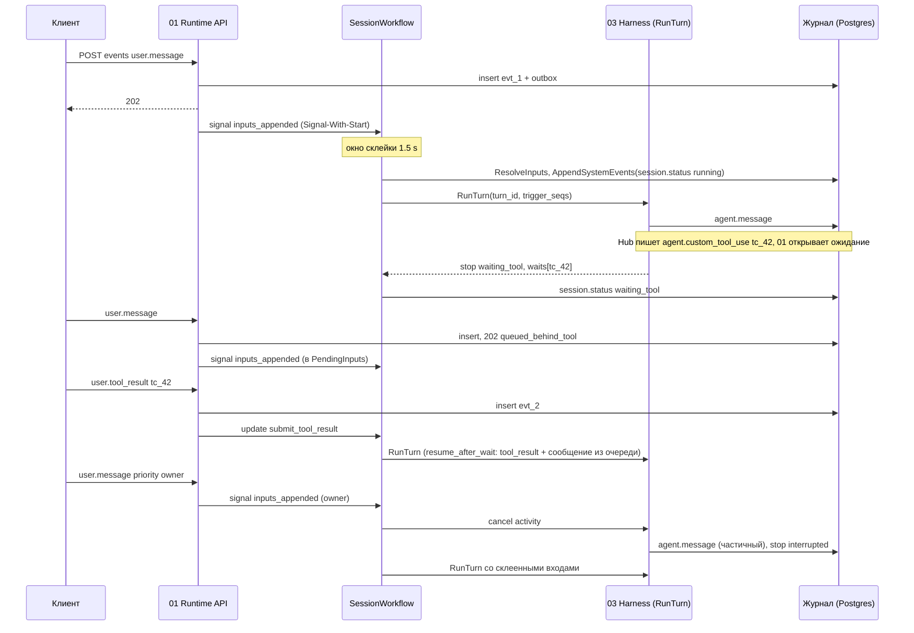
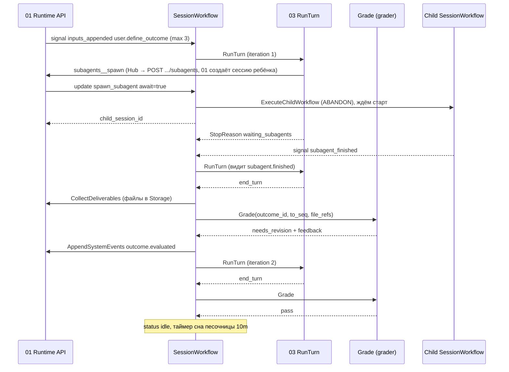

# 02. SessionWorkflow на Temporal

Черновик 2, 2026-10-15. Опирается на `docs/design.md` (разделы 2, 3, 4, 8, 10) и на [decisions.md](../decisions.md).

## 0. Согласовано

Этот раздел главнее текста ниже. Подробности и причины в [decisions.md](../decisions.md).

- **Входы (D1).** Сначала журнал (01), потом Temporal. `user.message`, `user.define_outcome`, `user.interrupt` приходят signal `inputs_appended {inputs: [{event_id, seq, type, actor_id, priority}]}` через Signal-With-Start. Входы с `seq <= LastSeenSeq` отбрасываются. Update `submit_input` и UpdateWithStart убраны. Ответы идут updates `submit_tool_result {event_id, seq, tool_use_id, actor_id}`, `submit_tool_confirmation {event_id, seq, approval_id, tool_use_id, decision: approve | deny, actor_id}`, `terminate {actor_id, reason}`. Update ID = `event_id`. Валидатор только читает состояние.
- **Ожидания (D2).** Таблица `session_waits` и activity `RecordWait` переехали в 01. Workflow держит буфер ранних ответов: update принят до того, как `RunTurn` вернул `waits`, ответ применяется сразу, как ожидание появится. Валидатор `submit_tool_result` и `submit_tool_confirmation` принимает ответ, если ожидание есть в состоянии или ход ещё идёт (01 уже проверил ожидание в Postgres).
- **Очередь в `waiting_tool` (D3).** `user.message` и `user.define_outcome` в `waiting_tool` ложатся в `PendingInputs`. Ход начинается после закрытия всех ожиданий. Вход с `priority: owner` или `user.interrupt` закрывают ожидания синтетическим `tool.result {reason: cancelled}` (для подтверждений ещё `CancelApproval`) и сразу начинают ход.
- **`RunTurn` (D4).** Один контракт из [decisions.md, A1](../decisions.md#a1-runturn). `turn_id = "<session_id>:<turn_no>"`. `TurnInput.turn_actors` из `InputRef.ActorID` (D30). Таймаут из `config.limits.turn_timeout_s` (по умолчанию и максимум 1800 с), `StartToClose = turn_timeout_s + 60 с`. Статус после хода: есть открытое `custom_tool` → `waiting_tool`, иначе `confirmation` → `waiting_human`.
- **Подтверждение (D16).** После `submit_tool_confirmation` activity `DecideApproval(approval_id, decision, actor_id)`, при `approve` activity `ExecuteApprovedCall(approval_id)` на `session-io` (`StartToClose = call_timeout_ms + 30 с`, `409` и `failed` не ретраятся). Затем `tool.result {tool_use_id, approval_id, status, content | file_ref}` с ключом `approval:<id>:result`, он идёт в `trigger_seqs` нового хода с `mode: resume_after_wait`. Таймер ожидания из `expires_at` Hub. Отмена: activity `CancelApproval`. Ход по подтверждению не держится открытым.
- **Сабагенты (D18).** Update `spawn_subagent {tool_use_id, child_session_id, config_id, await}` шлёт 01 (сессию ребёнка создаёт 01). Workflow запускает child workflow или ставит в `PendingChildren`. Лимиты: активных 8, ждущих 32, очередь 50, всего на корень 100. Ребёнок пишет `subagent.finished {child_session_id, status, summary, file_refs[]}` и `subagent.waiting` в журнал родителя. `subagent.started` для `child` пишет 01. Ожидание `await`-детей 2 ч.
- **Песочница (D24).** Update `ensure_sandbox {turn_id}` → `SandboxHandle`, один `Provision`/`Wake` за раз. В `colocated` workflow сам вызывает его перед `RunTurn` и кладёт handle в `TurnInput.sandbox`. Activities 04 на очереди `sandbox-ops`: `Provision`, `Wake`, `Hibernate {sandbox_id, generation}` (отменяемый, ответы `busy`, `already_lost`), `Destroy {sandbox_id, keep_snapshot}`. `SandboxState {SandboxID, Generation, SnapshotRef, HibernateAt, DestroyAt}`. Сроки из версии Environment. `sandbox.state` пишет workflow.
- **Статусы (D33).** `running` держится, пока outcome `active` или ждём `await`-детей. `session.status idle` несёт `reason`: `settled`, `outcome_passed`, `outcome_exhausted`, `grade_failed`, `turn_failed`, `interrupted`. `user.interrupt` без других входов не начинает ход и ставит outcome в `interrupted`.
- **Outcomes (D34).** Перед `Grade` activity `CollectDeliverables` публикует файлы `deliverables`. `Grade` исполняет только `grader-worker` через шлюз 06, модель `outcomes.grader_model`.
- **Конфиг (D10, D21).** `SessionInput` несёт `ConfigID`, `AgentVersion` (номер, для поиска), `OwnerActorID` (из 01), `Limits` из `sessions.limits` и конфига. `LoadSessionConfig` читает `GET /internal/v1/agent-configs/{config_id}` у 07. `GetAgentVersion(agent_id, version)` и «последняя опубликованная» не используются. Под `GetVersion` при старой `config_schema` `LoadSessionConfig` вызывается повторно.
- **Лимиты сессии (D35).** Таймер `limits.ttl_s` → `terminate`. Склейка: `limits.merge_window_ms` и `merge_max_wait_ms` (каналы задают их при создании, роутер сам не склеивает, D31).
- **Отзыв доступа (D27, D22).** При `terminated` activity `RevokeSessionAccess` (06 `DELETE egress-bundle`, 05 отзыв токенов), ретраи без предела. Ожидания закрываются синтетическим `tool.result {reason: cancelled}`.
- **Выкатка (D23).** Две ступени с флагом, обратный replay в CI, `set-ramping-version` и `set-current-version`. Таймер обслуживания: `idle` без ожиданий раз в 7 д делает continue-as-new. Search attributes `ConfigId`, `AgentVersion` (Int), `WfCodeVersion`. Visibility-запрос без `TenantId` платформенный клиент отклоняет (D40).
- **Имена (D5, D28).** `namespace_id` вместо `TenantID`/`tenant_id` (значение `ns_<ULID>`), `tool_use_id`, `approval_id`.

## 1. Назначение и границы

`SessionWorkflow` ведёт одну сессию от создания до `terminated`. Он решает, **когда** и **что** запускать. Сам он не говорит с моделью, не трогает песочницу и не хранит события.

Что делает:

- Держит статус сессии: `idle`, `running`, `waiting_tool`, `waiting_human`, `terminated`.
- Принимает входы (updates и signals), проверяет их и склеивает в один ход.
- Запускает activity `RunTurn` на очереди нужного harness и обрабатывает итог хода.
- Прерывает ход по сообщению владельца или `user.interrupt`.
- Ждёт ответ custom tool и решение человека по подтверждению, с таймаутами.
- Ведёт цикл outcomes: ход, `Grade`, новый ход, не больше `max_iterations`.
- Запускает сабагентов как child workflows и собирает их итоги.
- Держит таймеры сна и удаления песочницы, вызывает `Hibernate` и `Destroy`.
- Делает continue-as-new, пока сессия живёт месяцами.
- Пишет системные события (`session.status`, `outcome.evaluated`, `subagent.*`) через activity в журнал компонента 01.

Чего НЕ делает:

- Не хранит текст сообщений и результаты тулов в истории Temporal. Только ссылки (`event_id`, `seq`).
- Не пишет в журнал напрямую. Только через activities.
- Не проверяет права человека. Это делает Runtime API (01) с помощью 08. Workflow проверяет только состояние сессии.
- Не решает, нужно ли подтверждение. Это решает MCP Hub (05).
- Не исполняет ничего в песочнице. Будит её только через activities 04: в режиме `colocated` перед ходом, в `remote_tools` по update `ensure_sandbox` от воркера (D24, D25).
- Не отправляет ответы в чат. Это `send_user` через Hub и Channel (09).
- Не создаёт расписания. Temporal Schedules принадлежат компоненту 10, он лишь стартует сессии.

Язык: Go, `go.temporal.io/sdk`. Один бинарь `session-wf-worker`.

## 2. Модель данных

### 2.1 Что где хранится

| Данные | Где | Почему |
|---|---|---|
| События сессии (текст, тулы, мысли) | Postgres, журнал 01 | Лимит истории Temporal, SSE, поиск |
| Статус, ожидания, счётчики, ссылки на входы | Состояние workflow (память воркера, восстанавливается из истории) | Нужно для решений, мало весит |
| Ходы (`session_turns`) | Postgres, таблица 02 | Отчёты, стоимость, отладка без Temporal |
| Открытые ожидания (`session_waits`) | Postgres, таблица 01 (D2) | Открываются вместе с событием, консоль читает без queries |
| Проекция статуса `sessions.status` | Postgres, таблица 01 | 01 строит её по событию `session.status` |
| Секреты, токены Hub | Нигде в истории | Токен выпускается внутри activity |

Правило размера: любой payload signal, update или activity не больше 64 KB. Лимит Temporal 2 MB на запрос, 4 MB на транзакцию истории; мы держим запас.

### 2.2 Вход workflow

```go
type SessionInput struct {
    SessionID      string            // "ses_01J...", совпадает с WorkflowID
    NamespaceID    string            // ns_<ULID>
    AgentID        string
    ConfigID       string            // ver_... | tst_..., закреплён на всю жизнь сессии (D10)
    AgentVersion   int               // номер версии, 0 у теста; только для поиска
    HarnessKind    string            // "acp:claude" | "acp:codex" | "simple" | ...
    EnvironmentID  string            // "" если environment: none
    OwnerActorID   string            // из sessions.owner_actor_id (01): его сообщение прерывает ход
    Parent         *ParentRef        // != nil у сабагента
    Limits         Limits
    Carry          *SessionState     // != nil после continue-as-new
}

type ParentRef struct {
    SessionID  string
    ToolUseID  string   // вызов spawn_subagent у родителя
    Depth      int      // 1 у прямого ребёнка
}

type Limits struct {
    MergeWindow          time.Duration // 1500ms, из sessions.limits
    MergeMaxWait         time.Duration // 10s, из sessions.limits
    MaxPendingInputs     int           // 100
    TurnTimeout          time.Duration // config.limits.turn_timeout_s, не больше 30m (D4)
    SubagentAwaitTimeout time.Duration // 2h
    SessionTTL           time.Duration // sessions.limits.ttl_s, 0 = без срока (D35)
    SandboxIdleTTL       time.Duration // из версии Environment (D24)
    SandboxDestroyTTL    time.Duration // из версии Environment (D24)
    MaxTurnsPerRun       int           // 200, потом continue-as-new
    MaxSubagentDepth     int           // 2
    MaxActiveSubagents   int           // 8, ждущие (waiting_*) считаются отдельно: 32
    MaxQueuedSubagents   int           // 50
    MaxOutcomeIterations int           // 10, потолок для max_iterations
    // Сроки ожиданий не здесь: custom tool из custom_tools[].timeout_s, подтверждение из expires_at Hub
}
```

### 2.3 Состояние workflow (переносится через continue-as-new)

```go
type SessionState struct {
    Status          string          // idle | running | waiting_tool | waiting_human | terminated
    LastSeenSeq     int64           // последнее событие, отданное в ход
    PendingInputs   []InputRef      // ждут следующего хода, по порядку приёма
    CurrentTurn     *TurnRef        // != nil пока идёт RunTurn
    Waits           []Wait          // custom tools и подтверждения
    Outcome         *OutcomeState
    Children        map[string]ChildRef // по child session_id
    Sandbox         SandboxState
    SysCounter      int64           // для детерминированных id системных событий
    TurnNo          int64           // сквозной номер хода
    TurnsThisRun    int
    UpdatesThisRun  int
}

type InputRef struct {
    EventID   string  // "evt_..." событие уже в журнале или будет записано API
    Type      string  // user.message | user.define_outcome | user.interrupt | user.tool_result | user.tool_confirmation | subagent.finished | system.wake
    ActorID   string
    Priority  string  // "normal" | "owner"
    AcceptedAt time.Time // workflow.Now
}

type Wait struct {
    Kind       string    // "custom_tool" | "confirmation" | "subagents"
    ToolUseID  string    // id вызова Hub tc_... (D5)
    ApprovalID string    // ap_... | bp_..., только для confirmation
    Approvers  []string  // из TurnResult.waits (Hub)
    Deadline   time.Time // expires_at из TurnResult.waits
    Answered   bool
}
// EarlyAnswers map[string]InputRef: ответы, принятые до того, как RunTurn вернул waits (D2)

type OutcomeState struct {
    OutcomeID     string // = event_id события user.define_outcome
    MaxIterations int    // по умолчанию 3
    Iteration     int
    Status        string // active | passed | exhausted | grade_failed
}

type ChildRef struct {
    ToolUseID string
    Await     bool    // true: родитель ждёт; false: coordinator, итог будит родителя
    Status    string  // running | completed | failed | cancelled
}

type SandboxState struct {
    SandboxID   string
    Generation  int
    SnapshotRef string
    LastKnown   string    // последний ответ activity: ready | hibernated | destroyed | lost
    HibernateAt time.Time // дедлайн сна, таймер пересоздаётся после continue-as-new
    DestroyAt   time.Time
}
```

Лимит размера `SessionState` при continue-as-new: 256 KB. Если больше, workflow пишет `session.status` с `reason: state_too_large` и уходит в `terminated` (защита от ошибки, а не штатный путь).

### 2.4 Таблицы Postgres компонента 02

```sql
CREATE TABLE session_turns (
  session_id     text        NOT NULL,
  turn_no        bigint      NOT NULL,
  namespace_id   text        NOT NULL,
  harness_kind   text        NOT NULL,
  input_from_seq bigint      NOT NULL,
  input_to_seq   bigint      NOT NULL,
  started_at     timestamptz NOT NULL,
  ended_at       timestamptz,
  attempts       int         NOT NULL DEFAULT 1,
  stop_reason    text,       -- значения из decisions.md A1
  outcome_iteration int,
  tokens_in      bigint, tokens_out bigint, cost_micros bigint,
  PRIMARY KEY (session_id, turn_no)
);
```

Таблица пишется только activity `RecordTurn` с `INSERT ... ON CONFLICT DO UPDATE`. Повтор activity безопасен.

## 3. Контракты: что предоставляет

### 3.1 Temporal-адрес

- Namespace Temporal: `agents` (один на установку, тенант в search attribute `TenantId`).
- Workflow type: `SessionWorkflow`. WorkflowID = `session_id`.
- Очередь workflow: `session-wf`.
- Search attributes: `TenantId` (Keyword, значение `ns_<ULID>`, обязателен в каждом visibility-запросе), `AgentId` (Keyword), `ConfigId` (Keyword), `AgentVersion` (Int), `SessionStatus` (Keyword), `ParentSessionId` (Keyword), `WfCodeVersion` (Keyword).

Старт делает только Runtime API (01): outbox `start` (Start с `WorkflowIDConflictPolicy` «использовать существующий») или Signal-With-Start `inputs_appended`, что дойдёт раньше (D1). Signal-With-Start атомарен, Update-With-Start нет (документация Temporal), поэтому UpdateWithStart не используем.

### 3.2 Updates (с валидатором)

Все регистрируются через `workflow.SetUpdateHandlerWithOptions(..., workflow.UpdateHandlerOptions{Validator: ...})`. Runtime API вызывает `client.UpdateWorkflow` с `WaitForStage: Accepted` и таймаутом 5 s. Отказ валидатора не попадает в историю и превращается в HTTP-ответ.

| Update | Payload | Проверки валидатора | Ответ |
|---|---|---|---|
| `submit_tool_result` | `{event_id, seq, tool_use_id, actor_id}` | статус не `terminated`; есть `Wait{kind: custom_tool}` с этим id или ход идёт (тогда ответ в `EarlyAnswers`); ещё не отвечен | `{accepted: true}` |
| `submit_tool_confirmation` | `{event_id, seq, approval_id, tool_use_id, decision: approve\|deny, actor_id}` | есть `Wait{kind: confirmation}` или ход идёт; если `Wait` есть, `actor_id` в `Approvers` (01 уже проверил право `tools.confirm`) | `{accepted: true}` |
| `spawn_subagent` | `{tool_use_id, child_session_id, config_id, await}` | ребёнок есть в `subagents` конфига; глубина `< MaxSubagentDepth`; всего на корень `< 100`; очередь `< 50` | `{status: started\|queued}` |
| `ensure_sandbox` | `{turn_id}` | статус не `terminated` | `SandboxHandle` |
| `terminate` | `{actor_id, reason}` | статус не `terminated` | `{accepted: true}` |

Входы `user.message`, `user.define_outcome`, `user.interrupt` идут signal `inputs_appended` (раздел 3.4). Update ID = `event_id`.

Повтор с тем же `event_id` или `tool_use_id` валидатор не отклоняет, а handler игнорирует. Так ретраи API безопасны.

Коды ответа, которые 01 отдаёт клиенту по отказу валидатора:

| Код ошибки update | HTTP | Когда |
|---|---|---|
| `session_terminated` | 409 | любой вход после `terminated` |
| `tool_use_mismatch` | 409 | нет такого ожидания (`reason: not_found`) или ответ уже принят (`reason: answered`), D2 |
| `not_approver` | 403 | подтверждение не от согласующего |
| `subagent_limit` | 422 | глубина или число детей |
| `invalid_payload` | 422 | неизвестный type, плохие поля |
| таймаут 5 s или Temporal недоступен | `202` клиенту уже отдан, outbox повторит | событие в журнале, доставка позже |

Отказ валидатора 01 записывает событием `event.rejected {event_id, code}`. Клиент видит его в потоке. Обычно до валидатора не доходит: 01 проверяет то же самое по Postgres.

### 3.3 Порядок приёма входа (API + workflow)

1. 01 проверяет права (08) и состояние по Postgres, пишет событие в журнал и строку outbox в одной транзакции, отвечает `202` (D1).
2. 01 сразу шлёт signal `inputs_appended` (Signal-With-Start) или update. Если Temporal недоступен, outbox повторит.
3. Workflow кладёт вход в `PendingInputs` (с `seq <= LastSeenSeq` отбрасывает). Перед ходом activity `ResolveInputs(seqs)` читает события из журнала. Событие там есть всегда, потому что журнал пишется первым.
4. `PendingInputs` полна (100): вход всё равно в журнале. Workflow пишет `event.rejected {code: too_many_pending_inputs}` через `AppendSystemEvents`.

### 3.4 Signals

Signals только для внутренних отправителей, без ответа.

| Signal | Кто шлёт | Payload | Что делает |
|---|---|---|---|
| `inputs_appended` | 01 (Signal-With-Start) | `{inputs: [{event_id, seq, type, actor_id, priority}]}`, type ∈ `user.message`, `user.define_outcome`, `user.interrupt` | Кладёт входы в `PendingInputs`. `priority=owner` принимается, только если `actor_id == OwnerActorID`. Owner или `user.interrupt` во время хода отменяют `RunTurn`, в ожидании закрывают ожидания (D3) |
| `subagent_finished` | child `SessionWorkflow` через `workflow.SignalExternalWorkflow` (RunID пустой, значит текущий run родителя) | `{child_session_id, tool_use_id, status}` | Закрывает `ChildRef`, запускает ребёнка из `PendingChildren`. Итог уже записан ребёнком в журнал родителя как `subagent.finished` (D18). `await=false`: событие будит ход |
| `wake` | 10 (вебхук в живую сессию) | `{event_id, seq, type}` | Как вход без проверок. Только для системных событий |

### 3.5 Queries

Регистрируются `workflow.SetQueryHandler`. Консоль и SSE читают проекцию в Postgres. Queries нужны для отладки и для проверки, что проекция не разошлась.

| Query | Ответ |
|---|---|
| `state` | `{status, turn_no, current_turn:{turn_no, started_at, attempt}, pending_inputs:n, waits:[...], outcome:{...}, children:{...}, sandbox:{state, last_used_at}, run_turns:n}` |
| `waits` | `[{kind, tool_use_id, deadline, approvers}]` |

### 3.6 Системные события, которые пишет workflow

Через activity `AppendSystemEvents` (01). `event_id` детерминированный: `evt_` + hash(`session_id`, `SysCounter`). Повтор activity не дублирует.

| Событие | data |
|---|---|
| `session.status` | `{status, prev_status, reason?, turn_no?, waits?}`; reason у `idle`: `settled`, `outcome_passed`, `outcome_exhausted`, `grade_failed`, `turn_failed`, `interrupted`; прочие: `wait_timeout`, `terminated_by_user`, `version_recalled`, `ttl_expired`, `state_too_large` |
| `outcome.evaluated` | `{outcome_id, iteration, verdict: pass\|needs_revision, feedback, exhausted: bool}` |
| `subagent.finished` | Пишет workflow ребёнка в журнал родителя: `{child_session_id, status, summary (до 16 KiB), file_refs[]}` (D18). `subagent.started` пишет 01 |
| `subagent.waiting` | Workflow ребёнка в журнал родителя: `{child_session_id, tool_use_id, name}` |
| `tool.result` (синтетический) | `{tool_use_id, approval_id?, status: timed_out\|cancelled\|denied, reason: timeout\|cancelled\|denied}` закрывает ожидание в 01 (форма `tool.result` из D38) |
| `tool.result` (одобренный вызов) | `{tool_use_id, approval_id, status, content[] \| file_ref}`, ключ `approval:<id>:result` (D16) |
| `sandbox.state` | `{sandbox_id, state, generation, cold_start_ms?, data_loss?}` по результату activity 04 (D24) |
| `event.rejected` | `{event_id, code}` если вход отклонён внутри workflow |

### 3.7 Task queues

| Очередь | Кто слушает | Что |
|---|---|---|
| `session-wf` | `session-wf-worker` (Go) | `SessionWorkflow` |
| `session-io` | `session-wf-worker` | `ResolveInputs`, `AppendSystemEvents`, `RecordTurn`, `LoadSessionConfig`, `DecideApproval`, `ExecuteApprovedCall`, `CancelApproval`, `CollectDeliverables`, `RevokeSessionAccess` |
| `harness-<kind>` | harness-воркеры 03 | `RunTurn` |
| `grader` | `grader-worker` (Go, этот компонент) | `Grade` |
| `sandbox-ops` | Sandbox-драйвер 04 | `Provision`, `Wake`, `Hibernate`, `Destroy`, `EnsureImage` (D24) |

## 4. От чего зависит

| От кого | Контракт | Как используем |
|---|---|---|
| 01-runtime-api | Start, signal `inputs_appended`, updates через Temporal client; `AppendSystemEvents`, `ReadEvents`; `GET /internal/v1/sessions/{id}` | Входы, системные события |
| 03-harness-workers | Activity `RunTurn(TurnInput) TurnResult` на `harness-<kind>` по контракту [decisions.md, A1](../decisions.md#a1-runturn) | Цикл агента |
| 04-sandbox | Activities `Provision`, `Wake`, `Hibernate {sandbox_id, generation}`, `Destroy {sandbox_id, keep_snapshot}` на `sandbox-ops`; идемпотентны по `(sandbox_id, generation)` | Песочница (D24) |
| 05-mcp-hub | `POST /internal/v1/approvals/{id}/decide`, `/execute`, `/cancel`; отзыв токенов сессии | Подтверждения (D16), отзыв (D27) |
| 06-vault-egress-models | Шлюз моделей для `Grade`; `DELETE /internal/v1/sessions/{id}/egress-bundle` | `Grade`, отзыв доступа |
| 07-agent-control-plane | `GET /internal/v1/agent-configs/{config_id}` | `LoadSessionConfig`: harness, subagents, outcomes, лимиты |
| 08-iam-tenancy | Права проверяет 01 до записи; workflow получает уже проверенный `actor_id` | Владелец и согласующие |
| 09-channels-bots | Ничего напрямую. Роутер шлёт входы через 01, ставит `priority: owner` | Прерывание |
| 10-deployments-memory-skills | `POST /v1/sessions` с `initial_events`; сигнал `wake`; `POST /v1/sessions/{id}/terminate` по таймауту запуска | Старт по расписанию |

Контракт `RunTurn` один на 02 и 03: [decisions.md, приложение A1](../decisions.md#a1-runturn). Старые `TurnInput{FromSeq, ToSeq, NewEventIDs}` и `StopReason custom_tool/confirmation` заменены им.

Токен Hub адаптер получает сам внутри activity (TTL = ход + 5 мин, задаёт Hub, D9). В `TurnInput` его нет, в историю он не попадает.

## 5. Ключевые потоки

### 5.1 Сообщение, custom tool, прерывание



### 5.2 Outcome и сабагент



### 5.3 Правила цикла

Правила склейки:

- Первый вход в `idle` открывает окно `MergeWindow` 1.5 s. Каждый новый вход продлевает окно, но не дальше `MergeMaxWait` 10 s от первого.
- Входы во время хода копятся в `PendingInputs` и уходят следующим ходом одним пакетом.
- `user.interrupt` или вход с `priority=owner` во время хода отменяет `RunTurn`. Ход завершается с `interrupted`. Если есть другие входы, сразу новый ход без окна склейки. Голый `user.interrupt` ход не начинает, outcome становится `interrupted`, статус `idle {reason: interrupted}` (D33).
- `user.interrupt` или owner-вход в `waiting_tool` или `waiting_human`: открытые ожидания закрываются синтетическим `tool.result {reason: cancelled}`, для подтверждения вызывается `CancelApproval`.
- `user.message` и `user.define_outcome` в `waiting_tool` или `waiting_human` принимаются в `PendingInputs` и ждут закрытия ожиданий (D3). Прерывает только владелец или `user.interrupt`.
- Входы разных авторов склеиваются в один ход. `turn_actors` = все авторы, Hub пересекает права (D30).

Outcomes:

- `user.define_outcome` заменяет активный outcome (старый получает `outcome.evaluated` с `exhausted: true`, `feedback: "replaced"`).
- `Grade` вызывается только после `end_turn` и после `CollectDeliverables` (D34). После ожиданий нет, ход не закончен по смыслу. Пока outcome `active`, статус остаётся `running` (D33).
- `max_iterations` по умолчанию 3, потолок 10. Счётчик считает ходы, а не вызовы `Grade`.

Сабагенты:

- Child = тот же `SessionWorkflow` с `Parent != nil`. Сессию ребёнка (строка в 01, права 08, привязки 10) создаёт 01 по `subagents__spawn`, затем update `spawn_subagent` (D18). Слотов нет: ребёнок ждёт в `PendingChildren`.
- `ParentClosePolicy: PARENT_CLOSE_POLICY_ABANDON`. Итог возвращается сигналом `subagent_finished` на WorkflowID родителя, поэтому continue-as-new родителя ничего не ломает. При `terminate` родитель отменяет детей через `workflow.RequestCancelExternalWorkflow`.
- Child завершает workflow после первого `end_turn` (или после прохождения своего outcome). Он не живёт как чат.
- `await=true`: ход родителя кончается с `waiting_subagents`, статус `running`. Ждём всех `await`-детей, таймаут `SubagentAwaitTimeout` 2 h.
- Перед завершением ребёнок пишет `subagent.finished` с `summary` и `file_refs` в журнал родителя (activity `AppendSystemEvents` на сессию родителя), затем signal `subagent_finished`.
- `await=false` (coordinator pattern): главный агент свободен, итог ребёнка приходит как вход и будит ход.

Таймеры:

| Таймер | Старт | Срабатывание |
|---|---|---|
| Wait deadline | `expires_at` из `TurnResult.waits` | синтетический `tool.result {reason: timeout}`, для подтверждения `CancelApproval`, новый ход |
| Сон песочницы | ход закончен и `sandbox_used`, дедлайн `HibernateAt` | `Hibernate`. Ответ `busy`: перенос, потолок 2 h. Ответ `already_lost`: состояние `lost` |
| Удаление песочницы | после `Hibernate`, дедлайн `DestroyAt` | `Destroy {keep_snapshot: true}` |
| Срок сессии | `limits.ttl_s` (D35) | `terminate {reason: ttl_expired}` |
| Обслуживание | `idle` без ожиданий 7 d | continue-as-new (D23) |

Новый ход отменяет таймер сна (`workflow.WithCancel` на контексте таймера). Если `Hibernate` уже идёт, новый вход просит его отмену: Pod удаляется только после подтверждённого снапшота, а `Wake` ждёт `hibernated` или `ready` (D24).

### 5.4 Continue-as-new

Проверка в начале цикла, только когда нет хода и открытых update:

- `workflow.GetInfo(ctx).GetContinueAsNewSuggested()` вернул true, или
- `TurnsThisRun >= 200`, или
- `UpdatesThisRun >= 1500` (лимит Temporal 2000 update на историю), или
- длина истории больше 10 000 событий (порог предупреждения Temporal 10 240).

В новый run уходит `SessionState`, переводим время в абсолютные дедлайны. Таймеры пересоздаются из дедлайнов.

### 5.5 Версионирование кода

- Worker Versioning: `WorkerDeploymentOptions`, `DeploymentName = "session-wf"`, `BuildID = <git sha>`.
- `VersioningBehavior` у `SessionWorkflow`: `AutoUpgrade`. Сессии живут месяцами, держать старые воркеры столько нельзя. Поэтому каждое изменение поведения закрывается патчем `workflow.GetVersion(ctx, "<change-id>", workflow.DefaultVersion, 1)`.
- Патч удаляем, когда в `session-wf` нет run, начатых до него. Continue-as-new раз в 200 ходов и таймер обслуживания раз в 7 d делают это достижимым. Проверка: visibility-запрос по search attribute `WfCodeVersion`.
- Выкатка в две ступени (D23): сборка N+1 несёт `GetVersion` и обе ветки, новая включается флагом конфигурации. Откат = выключить флаг. Current Version откатывается только на сборку, которая знает все change-id. По документации Temporal AutoUpgrade workflow переходят на Current Version и должны быть replay-safe через патчи. Порядок: `temporal worker deployment set-ramping-version --percentage`, затем `set-current-version`.
- Перед выкаткой CI прогоняет replay-тест на сохранённых историях (`worker.NewWorkflowReplayer`), а также обратный: истории N+1 на коде N, и выборку историй прода.
- Harness-воркеры (03) версионируются отдельно: activity не требует детерминизма.

### 5.6 Детерминизм

- Время: только `workflow.Now`, таймеры `workflow.NewTimer`. Никакого `time.Now`, `time.Sleep`.
- Случайность и id: системные id из `SysCounter`, child `session_id` через `workflow.SideEffect`.
- Горутины: только `workflow.Go`, каналы `workflow.Channel`, выбор `workflow.NewSelector`.
- Обход `map` в Go случайный: перед обходом `Children` и `Waits` сортируем ключи.
- Конфиг агента читаем activity `LoadSessionConfig` и кладём в состояние (нужные поля плюс `ConfigID` и `config_schema`). Новый код под `GetVersion` может перечитать его: конфиг неизменяем (D10).
- Никаких логов с текстом сообщений. Логгер `workflow.GetLogger`.

## 6. Отказы и как переживаем

| Что падает | Что видит пользователь | Как восстанавливаемся |
|---|---|---|
| Harness-воркер посреди хода | Поток SSE замирает до 30 s | Heartbeat timeout 30 s. Retry: initial 1 s, x2, max 30 s, 5 попыток. Новый воркер продолжает по журналу (по умолчанию rehydration, `session/load` только при условиях D8). Тулы не повторяются: ключ идемпотентности считает Hub (D7) |
| Все попытки `RunTurn` исчерпаны или non-retryable (`InvalidAgentConfig`, `HarnessAuthFailed`, `BudgetExceeded`, `PolicyDenied`, `StaleWriter`, A1) | `session.status idle, reason: turn_failed` и текст ошибки | Входы хода считаются обработанными. Следующее сообщение начинает новый ход |
| `session-wf-worker` упал | Входы приняты (`202`), ход начнётся позже | Temporal отдаст workflow task другому воркеру, состояние восстановится replay |
| Temporal недоступен | Входы `202`, видны в SSE, ответа агента пока нет | Событие уже в журнале, outbox 01 доставит позже (D1) |
| Postgres недоступен | 503 на входы, ход стоит | Activities ретраятся без лимита попыток, с `ScheduleToClose` 1 h для `session-io` |
| API упал после записи, до отправки в Temporal | Клиент мог не получить 202 | Outbox доставит. Повтор клиента с тем же ключом даёт тот же `seq` |
| Песочница не поднялась | Тул в ходе получает ошибку, агент сообщает | Решает harness и 04. Workflow лишь видит `SandboxUsed=false` |
| `Grade` упал 3 раза | `outcome.evaluated` не пришёл, `session.status reason: grade_failed` | Outcome в `grade_failed`, сессия `idle`. Человек может прислать новый `define_outcome` |
| Child упал | `subagent.finished status: failed` у родителя | Родитель продолжает, агент решает сам |
| Non-determinism после выкатки | Сессия стоит в `running` | Алерт на `WorkflowTaskFailed`. Выключить флаг новой ветки (D23), не откатывать Current Version на сборку без change-id. Прямой и обратный replay в CI ловят это заранее |
| Человек не ответил | По дедлайну синтетический результат | `custom_tool`: `timeout` по `custom_tools[].timeout_s` (24 h). Подтверждение: `timeout` по `expires_at` Hub (72 h), `CancelApproval` |

## 7. Безопасность

- **Нет текста в истории Temporal.** Signals, updates и activities несут только id и seq. Текст, PII и результаты тулов живут в Postgres с правами тенанта. Дополнительно payloads шифруются своим PayloadCodec в data converter (ключ в Secret-драйвере, не в Temporal) (не проверено для нашей версии SDK).
- **Секретов в истории нет.** Токен Hub выпускает адаптер внутри activity, TTL = ход + 5 мин (D9).
- **Права дважды.** API проверяет роль через 08. Валидатор повторно сверяет `actor_id` с `OwnerActorID` и `Approvers` из Hub. Подделать подтверждение, обойдя API, нельзя.
- **Агент не управляет workflow.** Workflow верит только структурным полям `TurnResult`. Текст модели ничего не меняет в статусе. Spawn ограничен списком `subagents` конфига, глубиной 2 и лимитами D18.
- **Изоляция тенантов.** Search attribute `TenantId` обязателен. Доступ к Temporal только у платформенных воркеров и API, mTLS. Консоль не ходит в Temporal напрямую.
- **Входы от каналов это данные.** Workflow не различает текст, он только склеивает ссылки. Роль `owner` ставит роутер 09 по `resolve_actor`, а не по тексту.
- **Квоты.** `MaxPendingInputs` 100 и 429 защищают от флуда в один тред.

## 8. Как тестировать

Строгий TDD. Тест workflow на `testsuite.WorkflowTestSuite` с моками activities (`env.OnActivity`), время через `env.RegisterDelayedCallback`. Updates в тестовой среде через `env.UpdateWorkflow` (не проверено, есть в Go SDK test env по нашим данным).

Первые тесты, по порядку:

1. Первое сообщение: signal `inputs_appended` в `idle` → через 1.5 s один вызов `RunTurn` с этим событием → `session.status running`, затем `idle`.
2. Склейка: три сообщения за 1 s → один `RunTurn` с тремя `trigger_seqs`.
3. Сообщение во время хода не прерывает, уходит следующим ходом.
4. Owner-сообщение во время хода отменяет `RunTurn`, следующий ход сразу.
5. `custom_tool`: `RunTurn` вернул wait → статус `waiting_tool` → `user.message` ложится в очередь, ход не начинается → `submit_tool_result` принят → один новый ход с результатом и сообщением.
5a. Ранний ответ: `submit_tool_result` приходит, пока `RunTurn` ещё идёт → ответ в `EarlyAnswers` → после хода ожидание сразу закрыто, новый ход.
5b. Подтверждение: `submit_tool_confirmation approve` → `DecideApproval` → `ExecuteApprovedCall` → `tool.result` с ключом `approval:<id>:result` → ход `resume_after_wait`.
5c. Повтор `signal inputs_appended` с тем же `seq` не создаёт второго входа.
6. Повторный `submit_tool_result` с тем же `tool_use_id` не запускает второй ход.
7. Таймаут custom tool 24 h → синтетический `tool.result timeout`.
8. Подтверждение не от согласующего → `not_approver`.
9. Outcome: `needs_revision`, `needs_revision`, `pass` при max 3 → три хода, три `Grade`. При max 2 → `exhausted: true`.
10. Сон песочницы: `SandboxUsed` → через 10 m `Hibernate`; новый ход до 10 m отменяет таймер.
11. Continue-as-new: с флагом теста `MaxTurnsPerRun=2` → после 2 ходов новый run с тем же `SessionState`, ожидания и дедлайны живы.
12. Сабагент: `spawn_subagent await=true` → ход ждёт сигнала `subagent_finished` → новый ход. Родитель делает continue-as-new, сигнал ребёнка доходит.
13. `RunTurn` non-retryable → `turn_failed`, сессия `idle`.
14. Replay-тест: истории из тестов 1-13 сохраняем в `testdata/histories/*.json`, `worker.NewWorkflowReplayer` прогоняет их на каждом PR.

Интеграционный (компонент 01 + 02 + адаптер `simple` на dev-сервере Temporal): сценарий приёмки из design.md, раздел 10 п. 2. Убить harness-воркер посреди хода, ход продолжился, тулы не повторились.

## 9. Открытые вопросы

1. ~~**Сообщения через update, а не signal.**~~ Решено в D1: журнал, потом signal. design.md говорит «signal» для сообщений. Чтобы отдать `409` в `waiting_tool` без гонки, вход идёт update со стадией Accepted. Порядок в design.md (журнал, потом signal) меняется на (update, потом журнал). Нужно согласовать с 01.
2. **Steer.** `HarnessAdapter.steer` есть в design.md, но workflow не знает, на каком воркере идёт ход. Пока сообщения не владельца просто ждут следующего хода. Вариант: воркер сам слушает журнал своей сессии и вызывает `steer`. Решить с 03.
3. ~~**Статус ошибки.**~~ Решено в D33: `idle` с `reason`. В списке статусов нет `failed` или `error`. Мы используем `idle` с `reason: turn_failed`. Достаточно ли этого консоли?
4. ~~**`waiting_subagents`.**~~ Решено в D33: остаётся `running`. Пока родитель ждёт детей, статус `running`. Возможно, нужен отдельный статус для UI.
5. ~~**Где обрабатывается `spawn_subagent`.**~~ Решено в D18. Предложение: тул Hub `platform.spawn_subagent` вызывает 01, а 01 шлёт update. Нужно согласовать с 05 и 01.
6. ~~**Namespace Temporal.**~~ Решено в D40: один `agents`, фильтр `TenantId` обязателен. Один `agents` с `TenantId` или namespace на тенанта (как Kubernetes namespace из design.md). Второе изолирует лучше, но усложняет воркеры.
7. **Долгий простой.** Сессия в `idle` годами держит открытый workflow. Нужна ли автоархивация (например, 90 d без входов → `terminated` с возможностью «воскресить» новым run)?
8. ~~**Подтверждение без конца хода.**~~ Решено в D16: ход кончается. Сейчас ход заканчивается на `confirmation`, harness перезапускается после решения. Для быстрых решений (секунды) это лишняя задержка. Можно держать activity открытой до 60 s.
9. **Шифрование payloads.** Нужно ли оно при условии, что в историю идут только id. Проверить, что Temporal Web UI не показывает лишнего.
10. ~~**Поведение `ParentClosePolicy` при continue-as-new.**~~ Проверено ревью по документации Temporal (Child Workflows): дети не переходят в новый run, при continue-as-new к ним применяется их Parent Close Policy, как при закрытии родителя. Поэтому `ABANDON` плюс сигнал на WorkflowID обязательны, `TERMINATE` (по умолчанию) убил бы детей.
