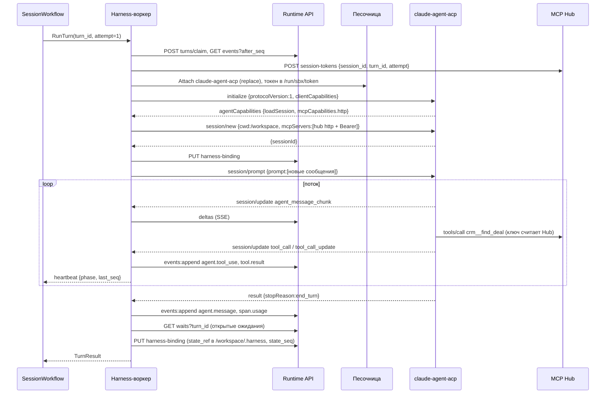
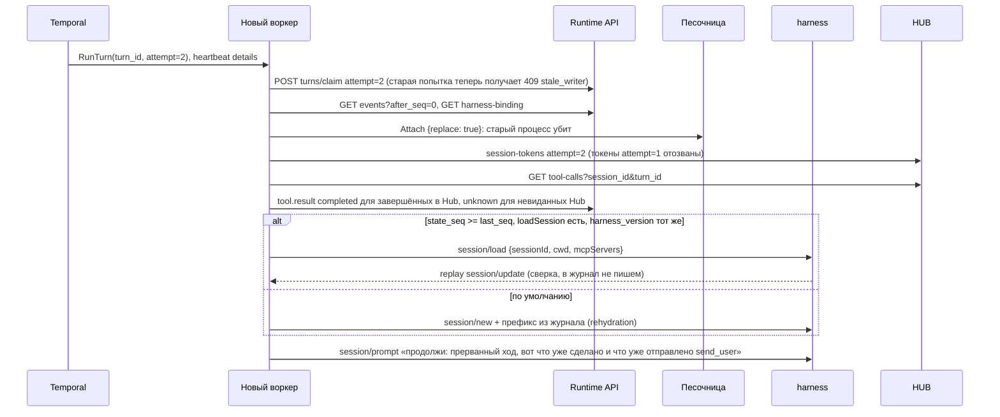

# 03. Harness-воркеры и адаптеры

Черновик 2, 2026-10-15. Основа: `docs/design.md`, разделы 3, 4, 8, и [decisions.md](../decisions.md).

## 0. Согласовано

Этот раздел главнее текста ниже. Подробности и причины в [decisions.md](../decisions.md).

- **`RunTurn` (D4).** Вход и выход строго по [decisions.md, A1](../decisions.md#a1-runturn): `TurnInput {contract_version, session_id, namespace_id, turn_no, turn_id, config_id, harness_kind, trigger_seqs, history_until_seq, turn_actors, mode, outcome_id?, sandbox?}`, `TurnResult {stop_reason, last_seq, waits[], usage, sandbox_used, limit_reason?, error?}`. `waiting` (одно поле) заменено массивом `waits`. `session.status` воркер не пишет: причину лимита он кладёт в `limit_reason`.
- **Журнал (D6).** Только контракт 01: `turns/claim {turn_id, attempt, trigger_seqs}` → `writer_epoch`, `writer_token`; `events:append` с `writer_epoch` и `dedupe_key` без номера попытки; `deltas` с `writer_epoch`, `turn_id`, `message_id`, `offset`; код `409 stale_writer`. Таблица `turn_leases`, путь `events:batch`, заголовки `X-Turn-*`, `client_event_id` и код `stale_attempt` убраны. `harness_bindings` живёт в базе 01, доступ через `PUT/GET .../harness-binding`, поле `harness_version` обязательно.
- **Имена (D5).** `tool_use_id` вместо `tool_call_id`.
- **Конфиг (D10).** `GET /internal/v1/agent-configs/{config_id}` у 07 (версия или тестовый снимок).
- **Токен Hub (D9).** `POST /internal/v1/session-tokens {session_id, turn_id, attempt}`. TTL задаёт Hub: ход + 5 мин. Продления внутри хода нет, ход не длиннее 30 мин. Следующий ход получает новый токен в `session/new` или `session/load`. Тот же токен идёт в шлюз моделей. В `colocated` токен лежит в `/run/sbx/token`, не в env.
- **Идемпотентность (D7).** Заголовок `Idempotency-Key` воркер не ставит. Ключ считает Hub. Поле `idempotency_key` в `agent.tool_use` убрано.
- **Ожидания (D2, D16, D17).** `agent.custom_tool_use` и `tool.confirmation_required` пишет Hub, не воркер. Воркер не отменяет ход на ответе «ждёт подтверждения» или `custom_pending`: модель может закончить ход сама. В конце хода воркер берёт `GET /internal/v1/sessions/{id}/waits?turn_id=&state=open` у 01 и возвращает `waits` и `stop_reason` (`waiting_tool` или `waiting_human`). Повтор одобренного вызова harness не делает: результат придёт в следующем ходе событием `tool.result` из `trigger_seqs`, воркер подаёт его текстом `[tool_result tool_use_id=...]`. Builtin `ask` пишет `tool.confirmation_required` с `approval_id = bp_...` через `events:append`.
- **Восстановление (D8).** Новая попытка: `Attach {replace: true}` убивает старый процесс. Открытые вызовы сверяются с Hub `GET /internal/v1/tool-calls?session_id=&turn_id=`: завершённые получают настоящий `tool.result`, `unknown` только если Hub вызова не видел. Custom tool и подтверждения не закрываются. По умолчанию rehydration из журнала. `session/load` только если `state_seq >= last_seq`, есть `agentCapabilities.loadSession` и `harness_version` совпадает. Prompt продолжения перечисляет уже доставленные `channels__send_user`.
- **Где harness (D25).** `acp:claude` и `acp:codex` всегда `colocated`: процесс в песочнице через `Attach`, `clientCapabilities.fs` и `terminal` = `false`. Песочницу поднимает 02 до хода и передаёт в `TurnInput.sandbox`. В воркере исполняются только `simple` и адаптеры без shell. Транскрипт в `/workspace/.harness` (D24 сохраняет его снапшотом).
- **Сабагенты (D18).** `mode: child` идёт через тул Hub `subagents__spawn`. Воркер пишет `subagent.*` только для `mode: inline`.
- **`Grade` (D34).** Адаптер `simple` для `Grade` не используется, `Grade` исполняет `grader-worker` 02.
- **Права хода (D30).** `turn_actors` воркер передаёт в claim через `trigger_seqs`, а не в Hub: Hub берёт их из 01.
- **Реестр адаптеров (D37).** `GET /internal/v1/harness-adapters` → `[{kind, capabilities}]` для валидации 07.

## 1. Назначение и границы

Harness-воркер исполняет один ход сессии. Он получает от `SessionWorkflow` activity `RunTurn`, поднимает готовый harness (Claude, Codex, ADK, `simple`), кормит его журналом, переводит его поток в наши события и пишет их в журнал. Состояния между ходами воркер не держит.

Что делает:
- Слушает очереди Temporal `harness-<kind>`: `harness-claude`, `harness-codex`, `harness-simple`, позже `harness-adk`, `harness-langgraph`.
- Реализует интерфейс `HarnessAdapter` (драйвер Harness из раздела 8 дизайна).
- Говорит с harness по ACP (`claude-agent-acp`, `codex-acp`) или через SDK (`simple`, ADK, LangGraph).
- Нормализует поток harness в события журнала: `agent.message`, `agent.thinking`, `agent.tool_use`, `tool.result`, `agent.custom_tool_use`, `subagent.*`, `span.usage`.
- Шлёт heartbeat в Temporal и восстанавливает ход после падения воркера.
- Передаёт harness ровно один MCP-сервер: Hub с токеном сессии.
- Применяет лимиты хода: время, число вызовов, токены, размер событий.

Чего НЕ делает:
- Не хранит журнал и не отдаёт SSE. Это 01-runtime-api.
- Не решает, когда начинать ход, не склеивает сообщения, не ждёт человека часами. Это 02-session-workflow.
- Не проверяет права на тулы, не спрашивает подтверждений для MCP-тулов, не видит секретов. Это 05-mcp-hub и 06-vault-egress-models.
- Не создаёт и не усыпляет песочницу сам. Он только просит `SandboxHandle` и запускает в ней процесс через 04-sandbox.
- Не пишет свой агентный цикл. Исключение: адаптер `simple`, это 150 строк цикла «модель, тулы, модель».
- Не выбирает модель и бюджет. Он берёт их из `AgentVersion`, а шлюз моделей их проверяет.

## 2. Модель данных

Воркер сам ничего не хранит в своей базе. Таблица `harness_bindings` живёт в базе Runtime API (01), воркер пишет в неё только через `PUT .../harness-binding` (D6).

### 2.1 `harness_bindings` (база 01, пишет 03)

Связь нашей сессии с сессией внутри harness. Нужна для возобновления.

| Поле | Тип | Смысл |
|---|---|---|
| `session_id` | text, PK | Наша сессия `ses_...` |
| `harness_kind` | text | `acp:claude`, `acp:codex`, `simple`, `adk`, `langgraph` |
| `harness_session_id` | text, null | `sessionId` из ACP `session/new` |
| `harness_version` | text | Версия пакета, например `@agentclientprotocol/claude-agent-acp@x.y.z` |
| `state_ref` | text, null | В `colocated` путь внутри `/workspace/.harness`. В `remote_tools` `file_ref` Storage (01) |
| `state_seq` | bigint | До какого `seq` журнала снимок согласован с журналом |
| `cwd` | text | Рабочая папка в песочнице, по умолчанию `/workspace` |
| `updated_at` | timestamptz | |

### 2.2 Фенсинг хода

Своей таблицы аренды нет. Фенсинг делает 01: `turns/claim {turn_id, attempt, trigger_seqs}` и `writer_epoch` (D6). Запоздавший claim старой попытки и запись со старым epoch получают `409 stale_writer`, воркер убивает свой процесс и выходит.

### 2.3 Вход и выход activity `RunTurn`

Контракт один на 02 и 03: [decisions.md, приложение A1](../decisions.md#a1-runturn). Конфиг воркер читает сам по `config_id`. `stop_reason` из ответа `session/prompt` (`end_turn`, `max_tokens`, `max_turn_requests`, `refusal`, `cancelled`→`interrupted`) переходит в `TurnResult` как есть. `waiting_tool`, `waiting_human`, `waiting_subagents`, `limit` ставит адаптер.

### 2.4 Лимиты хода `TurnLimits` (по умолчанию)

| Поле | По умолчанию | Что при превышении |
|---|---|---|
| `max_turn_duration` | `config.limits.turn_timeout_s`, по умолчанию и максимум 1800 с | `session/cancel`, `stop_reason=limit`, `limit_reason=turn_timeout` |
| `max_tool_calls` | 200 на ход | `session/cancel`, `limit_reason=tool_call_limit` |
| `max_model_requests` | 100 на ход | то же, `limit_reason=model_request_limit` |
| `max_output_tokens_turn` | из AgentVersion, иначе 200 000 | `session/cancel` |
| `max_event_bytes` | 256 KiB | Тело уходит в Storage (`POST /internal/v1/files`), в событии `data.file_ref` |
| `max_tool_output_inline` | 64 KiB | Обрезка в журнале, полный текст в Storage |
| `permission_wait_inline` | 60 с | Builtin `ask`: ход завершается с `waiting_human` (см. 5.2) |
| `idle_stream_timeout` | 120 с без единого `session/update` | Процесс harness считаем зависшим, попытка падает |

Лимиты на деньги и токены за сутки проверяет шлюз моделей (06), а не воркер. Воркер видит отказ шлюза как ошибку модели.

## 3. Контракты, которые предоставляет компонент

### 3.1 Activity `RunTurn` (Temporal)

- Очередь: `harness-<kind>`, kind из `AgentVersion.harness`.
- Таймауты по A1: `StartToClose = turn_timeout_s + 60 с`, `HeartbeatTimeout=30s`, `ScheduleToStart=2m`.
- Retry policy: `InitialInterval=1s`, `BackoffCoefficient=2`, `MaximumInterval=30s`, `MaximumAttempts=5`. Неретраимые типы ошибок: `InvalidAgentConfig`, `HarnessAuthFailed`, `BudgetExceeded`, `PolicyDenied`, `StaleWriter`.
- Heartbeat каждые 5 с, детали:

```json
{ "turn_id": "ses_01J...:7", "attempt": 2, "phase": "streaming",
  "harness_session_id": "acp-7f3c", "last_seq": 1842, "open_tool_uses": ["toolu_9a"], "hub_jti": "8c1e..." }
```

`phase`: `starting`, `sandbox_wait`, `loading`, `streaming`, `waiting_permission`, `finishing`. По heartbeat оператор видит, где застрял ход. При повторе новая попытка читает детали через `activityInfo().heartbeatDetails` (TS, `@temporalio/activity`) или `activity.info().heartbeat_details` (Python).

- Отмена activity из workflow (сообщение владельца, `user.interrupt`) приходит в воркер через heartbeat. Воркер шлёт harness `session/cancel` и ждёт ответ с `stopReason=cancelled` не дольше 10 с, потом убивает процесс.

Пример результата:

```json
{ "stop_reason": "waiting_human", "last_seq": 1907,
  "waits": [{ "kind": "confirmation", "tool_use_id": "tc_01J...", "approval_id": "ap_9f",
              "approvers": ["usr_01J9X", "usr_01J7A"], "expires_at": "2026-10-18T10:00:00Z" }],
  "usage": { "input_tokens": 41230, "output_tokens": 1820, "cost_usd": 0.071 },
  "sandbox_used": true }
```

### 3.2 Интерфейс драйвера `HarnessAdapter`

Совпадает с разделом 4 дизайна. Добавлены `probe` и `dispose`, `steer` и `interrupt` уточнены.

```ts
interface HarnessAdapter {
  kind: string;                                   // "acp:claude", "simple", ...
  probe(): Promise<HarnessCapabilities>;          // при старте воркера и в readiness
  runTurn(input: AdapterTurnInput, emit: Emit, ctl: TurnControl): Promise<TurnResult>;
  steer(session: SessionRef, text: string): Promise<"accepted" | "unsupported">;
  interrupt(session: SessionRef): Promise<void>;
  dispose(session: SessionRef): Promise<void>;    // убить процесс harness, снять снимок state_ref
}

type AdapterTurnInput = {
  session: SessionRef; history: Event[]; newEvents: Event[];
  agent: AgentVersion; mcp: { url: string; token: string };
  sandbox?: SandboxHandle; resume?: ResumeHint; limits: TurnLimits;
};
type ResumeHint = { harness_session_id?: string; state_ref?: string; state_seq: number; last_seq: number };
type TurnControl = { heartbeat(phase: string): void; signal: AbortSignal; deadline: Date };
type Emit = (e: DraftEvent) => Promise<{ seq: number }>;   // пишет через 01, с fencing

type HarnessCapabilities = {
  resume: "native_load" | "native_resume" | "replay_only";
  mcp_http: boolean; steer: boolean; subagents: "native" | "platform_only";
  images: boolean; thinking: boolean;
};
```

Каждая реализация проходит общий набор тестов драйвера (раздел 8). Есть `fake` адаптер со сценарием в YAML для тестов 02.

### 3.3 События, которые воркер пишет в журнал

Все через `emit`. Поле `actor = {kind: "agent", id: <agent_id>}`, для сабагентов `id` сабагента. В `data` всегда есть `turn_id`.

| Событие | Ключевые поля `data` |
|---|---|
| `agent.message` | `message_id`, `content[]`, `final: bool` (D38) |
| `agent.thinking` | `text` или `plan: [{content, status}]`, `kind: "thought" \| "plan"` |
| `agent.tool_use` | `tool_use_id`, `name`, `source: "hub" \| "builtin"`, `kind`, `input` |
| `tool.result` | `tool_use_id`, `status: "completed" \| "failed" \| "cancelled" \| "unknown"`, `content[]` или `file_ref` (D38) |
| `tool.confirmation_required` | Только builtin `ask`: `approval_id: bp_...`, `tool_use_id`, `name`, `input_preview`. Для MCP-тулов пишет Hub |
| `subagent.started` / `subagent.finished` | `subagent_id`, `mode: "inline" \| "child"`, `child_session_id?`, `summary?` |
| `span.usage` | `model`, `input_tokens`, `output_tokens`, `cache_read_tokens`, `cost_usd` |

Поток текста по кусочкам в журнал не пишется. Кусочки уходят в 01 как эфемерные дельты для SSE, в журнал попадает целое `agent.message` на границе: начало вызова тула, конец хода, или 4 KiB текста.

Внутренний запрос записи (в 01, контракт D6):

```http
POST /internal/v1/sessions/ses_01J.../events:append
Authorization: Bearer <writer_token>
{ "writer_epoch": 8, "turn_id": "ses_01J...:7",
  "events": [ { "dedupe_key": "ses_01J...:7:toolu_9a:use", "type": "agent.tool_use",
    "data": { "tool_use_id": "toolu_9a", "name": "crm__find_deal", "source": "hub",
              "input": {"q": "ACME"} } } ] }
```

Ответы: `200 {"events":[{"seq":1843,"deduplicated":false}]}`, `409 stale_writer` (claim у другой попытки, воркер останавливается), `409 session_terminated`, `413` если событие больше лимита без `file_ref`. Повтор с тем же `dedupe_key` даёт `200` с прежним `seq`.

### 3.4 Нормализация ACP в наш журнал

| ACP `session/update` (`sessionUpdate`) | Наше событие |
|---|---|
| `agent_message_chunk` | дельта в SSE, затем `agent.message` |
| `agent_thought_chunk` | дельта, затем `agent.thinking {kind: thought}` |
| `user_message_chunk` | игнор в обычном ходе, используется при replay для сверки |
| `tool_call` | `agent.tool_use` |
| `tool_call_update` со `status: completed \| failed` | `tool.result` |
| `tool_call_update` со `status: in_progress` | heartbeat phase, в журнал не пишется |
| `plan` | `agent.thinking {kind: plan}` |
| `usage_update` | `span.usage` |
| `available_commands_update`, `current_mode_update`, `config_option_update`, `session_info_update` | не пишем, только в лог воркера |
| `compaction_update`, `compaction_summary_chunk` | не пишем: компакция не переписывает журнал, это дело harness |
| `notice` | `agent.thinking {kind: notice}` |

`stopReason` из ответа `session/prompt` (`end_turn`, `max_tokens`, `max_turn_requests`, `refusal`, `cancelled`) переходит в `TurnResult.stop_reason` как есть. Наши `waiting_tool` и `waiting_human` адаптер ставит по открытым ожиданиям хода в 01, `limit` по своим лимитам (D4, D16). `cancelled` становится `interrupted`.

Источник тула: имя с префиксом сервера Hub (`mcp__hub__...` у Claude) даёт `source: hub`, всё остальное `builtin` (Bash, Edit внутри песочницы).

## 4. От чего зависит

| От кого | Что использует |
|---|---|
| 02-session-workflow | Вызов activity `RunTurn` по A1, отмена activity, retry policy. Песочница в `TurnInput.sandbox` (colocated) или update `ensure_sandbox` (remote_tools) |
| 01-runtime-api | `turns/claim`, `events:append`, `deltas`, `GET .../events`, `PUT/GET .../harness-binding`, `GET .../waits` (D6) |
| 07-agent-control-plane | `GET /internal/v1/agent-configs/{config_id}`: harness, модель, инструкции, toolsets, скиллы, сабагенты, подтверждения для builtin-тулов, лимиты |
| 05-mcp-hub | MCP endpoint Streamable HTTP. Выпуск токена `POST /internal/v1/session-tokens {session_id, turn_id, attempt}`. `GET /internal/v1/tool-calls?session_id=&turn_id=` для восстановления |
| 06-vault-egress-models | Шлюз моделей: Anthropic-совместимый base URL для Claude, OpenAI-совместимый для Codex и `simple`. Ответ `402 budget_exceeded`, `429` с `Retry-After` |
| 04-sandbox | `Attach {replace}` для процесса harness, `Exec`, `ReadFile`/`WriteFile`. Хендл `SandboxHandle {sandbox_id, endpoint, generation, token}` |
| 08-iam-tenancy | Ничего напрямую. Права считает Hub |
| 10-deployments-memory-skills | Скиллы закреплённых версий: список файлов, которые воркер кладёт в рабочую папку до старта harness. Память читается через Hub |

## 5. Ключевые потоки

### 5.1 Ход через ACP с `claude-agent-acp`

ACP: JSON-RPC 2.0 по stdio. Методы агента: `initialize`, `authenticate`, `session/new`, `session/load` (если `agentCapabilities.loadSession`), `session/prompt`, уведомление `session/cancel`. Методы клиента (наш воркер): `session/request_permission`, уведомление `session/update`, по желанию `fs/*` и `terminal/*`. Мы объявляем `clientCapabilities.fs` и `terminal` как `false`: harness работает внутри песочницы и сам читает файлы.



Детали запуска:
- Процесс: `claude-agent-acp` из пакета `@agentclientprotocol/claude-agent-acp`, версия закреплена в образе Environment. Окружение: `ANTHROPIC_BASE_URL=<шлюз моделей>`, ключ модели = токен сессии Hub (`aud` включает `models`, D9) в `ANTHROPIC_AUTH_TOKEN` (Claude Code шлёт его как `Authorization: Bearer`, документация Claude Code, Environment variables). `sandboxd` подставляет его из `/run/sbx/token` только в env процесса harness. Что `claude-agent-acp` передаёт env дочернему процессу без изменений, не проверено. Учесть: при `ANTHROPIC_BASE_URL` не на хост Anthropic Claude Code по умолчанию выключает свой MCP tool search (`ENABLE_TOOL_SEARCH=true` включает обратно), у нас tool search делает Hub. Настоящего ключа Anthropic в песочнице нет.
- Для Codex: `codex-acp` (`@zed-industries/codex-acp`, репозиторий переехал в `agentclientprotocol/codex-acp`), `OPENAI_API_KEY=<токен сессии>`, base URL на шлюз (как именно задаётся base URL у Codex, не проверено). Вход через ChatGPT запрещён.
- Hub передаётся в `session/new` и `session/load` одной записью:

```json
{ "type": "http", "name": "hub", "url": "https://hub.internal/mcp",
  "headers": [ { "name": "Authorization", "value": "Bearer st_..." } ] }
```

Если `mcpCapabilities.http=false`, воркер даёт stdio-запись `{name:"hub", command:"/opt/platform/hub-bridge", args:[], env:[...]}`. `hub-bridge` пересылает stdio в HTTP Hub. Других MCP-серверов harness не получает. Конфиги MCP пользователя в образе (`.mcp.json`, настройки Claude) воркер удаляет перед стартом.
- Токен сессии живёт ход + 5 мин (D9). ACP задаёт заголовки MCP один раз в `session/new` или `session/load`, поэтому продления внутри хода нет, а ход не длиннее 30 мин. Следующий ход получает новый токен.

### 5.2 Подтверждения, custom tools и прерывание

- MCP-тулы через Hub: подтверждение решает Hub (D16). Hub отвечает harness «ждёт подтверждения, не повторяй» и сам пишет `tool.confirmation_required`, 01 открывает ожидание. Воркер ход не отменяет. В конце хода он берёт открытые ожидания у 01 и возвращает `waiting_human`. После решения workflow сам исполняет вызов через Hub (`ExecuteApprovedCall`) и кладёт `tool.result` в `trigger_seqs` нового хода. Harness вызов не повторяет.
- Builtin-тулы harness (Bash, Edit в песочнице) приходят как `session/request_permission` с опциями `allow_once`, `allow_always`, `reject_once`, `reject_always`. Политика из `AgentVersion.confirmations.builtin`: `allow` (выбираем `allow_once`), `deny` (`reject_once`), `ask`. При `ask` воркер пишет `tool.confirmation_required {approval_id: bp_...}` (01 открывает ожидание) и ждёт до `permission_wait_inline` (60 с), опрашивая ожидание в 01. Не дождался: отвечает `{outcome: "cancelled"}`, шлёт `session/cancel`, ход кончается `waiting_human`. Разрешение человека запоминается как отпечаток `sha256(tool name + input)`. Когда harness в следующем ходе спросит то же самое, воркер ответит сам.
- Custom tool (D17): Hub отдаёт его harness из встроенного сервера `custom`, сразу отвечает `{custom_pending: true, tool_use_id}` и пишет `agent.custom_tool_use`. Воркер ход не отменяет, в конце хода возвращает `waiting_tool` и `waits`. Ответ клиента `user.tool_result` идёт в `trigger_seqs` следующего хода, воркер подаёт его текстом `[tool_result tool_use_id=...]`. Можно ли вернуть нативный tool result через ACP, не проверено.
- `user.interrupt` и сообщение владельца: workflow отменяет activity, воркер шлёт `session/cancel`. По ACP harness обязан ответить на все ожидающие `session/request_permission` исходом `cancelled` и вернуть `stopReason: cancelled`.
- `steer`: в ACP нет метода дописать сообщение в идущий ход. Для ACP `steer` возвращает `unsupported`, workflow ставит сообщение в очередь на следующий ход. Для Codex через `codex app-server` возможен настоящий steer (не проверено).

### 5.3 Возобновление после падения воркера



Правила:
1. Журнал главнее harness. Если снимок `state_ref` отстаёт от журнала (`state_seq < last_seq`), недостающие события подаются текстом в prompt продолжения.
2. Открытые вызовы (есть `agent.tool_use`, нет `tool.result`) сверяются с Hub (D8). Завершённые получают `tool.result completed` с сохранённым результатом. Не виденные Hub закрываются `tool.result {status: "unknown", content: [{type: "text", text: "worker_restarted"}]}`. Custom tool и подтверждения не трогаются: их ведут ожидания 01. Повторный такой же вызов во второй попытке получает тот же ключ Hub (D7), и Hub вернёт сохранённый результат.
3. Rehydration без снимка: последние события журнала до 60% окна модели, старое заменяется кратким пересказом из последнего события `agent.thinking {kind: summary}`, если оно есть. Harness сам компактит дальше.
4. Для Claude снимок: транскрипт Claude Code (`$CLAUDE_CONFIG_DIR/projects/<cwd>/<id>.jsonl`). `CLAUDE_CONFIG_DIR` указывает в `/workspace/.harness/claude`, папка входит в рабочую папку, которую драйвер песочницы сохраняет в S3 при сне. Резюме по ACP: `session/load` описан в ACP как метод с replay истории через `session/update` при `agentCapabilities.loadSession` (документация ACP, Session Setup). Поддержку у закреплённой версии `claude-agent-acp` проверяем при `initialize` (не проверено). Важно: `cwd` при load должен совпадать с исходным, поэтому `cwd` всегда `/workspace`.

### 5.4 Адаптеры: simple, сабагенты, ADK, LangGraph

**`simple`.**

Свой минимальный цикл на TS: шлюз моделей (OpenAI-совместимый `chat/completions` с `tools`), MCP-клиент к Hub, без песочницы. Цикл: модель, вызовы тулов параллельно до 4, результаты, снова модель, пока нет вызовов или не сработал лимит. Компакция: если история больше 70% окна, старое заменяется кратким пересказом, который пишется в журнал как `agent.thinking {kind: summary}`. Возобновление тривиально: весь контекст строится из журнала. Нужен для тестов и дешёвых ботов. `Grade` исполняет не он, а `grader-worker` 02 (D34).

**Сабагенты.**

Два режима, выбор в `AgentVersion.subagents[].mode`:
- `child` (по умолчанию). Harness вызывает тул Hub `subagents__spawn {agent, task, await}`. Hub зовёт 01, 01 создаёт сессию ребёнка и шлёт update родителю (D18). Тул отвечает `{child_session_id, status: started | queued}`. При `await=false` главный агент свободен, итог приходит событием `subagent.finished` и начинает новый ход. `subagent.started` пишет 01, не воркер.
- `inline`. Встроенные сабагенты harness (Task/Agent у Claude) работают внутри хода. Воркер видит их как `tool_call` с вложенными обновлениями и пишет `subagent.started` и `subagent.finished {mode: inline, summary}`. Внутренние сообщения сабагента в журнал не попадают, только итог. Лимиты хода общие с родителем.

**ADK.**

Отдельный Python-воркер на очереди `harness-adk`. Два пути. Первый: адаптер реализует ADK `SessionService` поверх журнала (`get_session` читает события, `append_event` пишет через `emit`), модель через LiteLLM в шлюзе, MCP через `McpToolset` с адресом Hub. Второй: `temporalio.contrib.google_adk_agents` (плагин `GoogleAdkPlugin`), где цикл ADK сам становится workflow, а вызовы модели и MCP становятся activities. Второй путь ломает правило «один `RunTurn` на ход», поэтому начинаем с первого (не проверено на практике).

**LangGraph.**

Python-воркер `harness-langgraph`. Граф берётся из пакета, закреплённого в AgentVersion. Checkpointer `PostgresSaver` в нашем Postgres, `thread_id = session_id`. Вход хода: новые события как сообщения в state. Узлы с вызовом людей (`interrupt`) переводятся в `waiting_human`. Тулы через MCP-адаптер LangChain к Hub (имена API не проверены).

## 6. Отказы и как переживаем

| Что упало | Что видит пользователь | Как восстанавливаемся |
|---|---|---|
| Pod воркера | Пауза в потоке до 30 с, потом поток продолжается. В SSE `session.status running` не меняется | Heartbeat timeout 30 с, Temporal повторяет попытку, поток 5.3 |
| Процесс harness упал или завис (нет `session/update` 120 с) | То же | Попытка падает с retryable ошибкой, следующая начинает с 5.3 |
| Старый воркер «ожил» после сетевого разрыва | Ничего | Его запись получает `409 stale_writer`, его токен Hub отозван, процесс убит новой попыткой |
| Песочница уснула или пропала посреди хода | Пауза до 1-2 мин | Ошибка `SandboxLost` retryable. Следующая попытка получает новый handle: workflow будит песочницу через `ensure_sandbox`, папка из снапшота |
| Hub недоступен | Агент пишет, что инструмент недоступен | Harness получает ошибку MCP как результат тула. Ход не падает |
| Шлюз моделей `429` | Пауза | Harness ретраит сам. Если ход падает, Temporal ретраит попытку |
| Шлюз моделей `402 budget_exceeded` | Сообщение «бюджет исчерпан», сессия `idle` | Неретраимая ошибка `BudgetExceeded`, `stop_reason=error` |
| Неверный конфиг агента | Ошибка в консоли | `InvalidAgentConfig`, без ретраев |
| 5 попыток подряд упали | `session.status idle {reason: turn_failed}` (пишет 02), кнопка «повторить» | Workflow не начинает ход сам. Новое сообщение начинает новый ход |
| Runtime API недоступен | Поток стоит | `emit` ретраит 30 с с backoff, потом попытка падает. События с `dedupe_key` не дублируются |
| Ход дольше 30 мин | Сообщение «ход прерван по времени» | `stop_reason=limit`. Долгую работу агент должен отдавать сабагенту |

Ход не повторяет записи во внешние системы: только Hub выполняет `write`, и только один раз на свой ключ (D7).

## 7. Безопасность

- В процессе harness нет внешних секретов. Ключ модели равен токену сессии Hub, настоящий ключ подставляет шлюз 06.
- Токен сессии: подпись Hub, claims по D9 (`tid`, `sid`, `turn`, `att`, `cfg`, `act`, `turn_actors`, `test`, `exp` = ход + 5 мин). Утечка токена даёт ровно права этой сессии и только до конца хода. Новая попытка и `terminated` отзывают токен.
- Сеть песочницы закрыта политикой 04: выход только в Hub, шлюз моделей и egress-прокси, DNS закрыт (D26). Воркер это не настраивает, но проверяет при `probe` в тестовом стенде.
- Harness получает только MCP-сервер Hub. Воркер удаляет из образа чужие конфиги MCP и плагинов перед стартом, режим разрешений builtin-тулов задаёт сам.
- Воркер не исполняет текст из журнала как команды. Письма и сообщения из каналов идут в prompt как данные с пометкой источника (`actor`).
- Воркер видит журналы всех тенантов своей очереди. Поэтому внутренний API 01 требует mTLS и `writer_token`, который привязан к `session_id`, `turn_id` и `writer_epoch` (D6). В логах воркера нет текста сообщений, только id и размеры.
- Процесс harness запускается не от root, с лимитами Environment. Чужой код (агенты внешних тенантов) только в RuntimeClass gVisor или Kata.
- Сабагент получает свой токен с правами не шире родителя.

## 8. Как тестировать (TDD)

Первые тесты, по порядку:
1. **Нормализатор ACP.** Таблица 3.4 как табличный тест: запись `session/update` на входе, событие на выходе. Сначала `agent_message_chunk` склеивается в одно `agent.message` на границе `tool_call`.
2. **Fake ACP-агент.** Скрипт на Node, который читает сценарий YAML и отвечает по ACP по stdio. На нём тесты: `initialize` без `mcpCapabilities.http` даёт stdio-мост; `session/cancel` даёт `stopReason: cancelled`; `request_permission` при политике `deny` получает `reject_once`.
3. **Fencing.** Две попытки одного хода пишут события, вторая делает claim, первая получает `409 stale_writer` и останавливается. Запоздавший claim первой попытки тоже получает `409`.
4. **Возобновление.** Сценарий приёмки из плана дизайна: начать ход, убить воркер после второго `tool_call`, проверить, что новая попытка взяла результат завершённого вызова у Hub (`tool.result completed`), счётчик вызовов upstream в fake Hub равен 1, и ход закончен.
5. **Общий набор драйвера `HarnessAdapter`.** Один набор, который гоняется против `fake`, `simple`, `acp:claude`: ответ на простое сообщение, вызов тула Hub, отмена, лимит `max_tool_calls`, возобновление.
6. **Heartbeat.** Тест в Temporal test server с `HeartbeatTimeout=2s`: воркер, который перестал слать heartbeat, получает повтор попытки, детали heartbeat доступны новой попытке.
7. **Интеграция с настоящими harness** (ночью, не на каждый коммит): `claude-agent-acp` и `codex-acp` через шлюз моделей с записанными ответами, проверка версий пакетов.

Тесты гоняются без сети: шлюз моделей и Hub заменены фейками с тем же контрактом.

## 9. Открытые вопросы

1. ~~Где живёт процесс harness.~~ Решено в D25: `colocated`, пока тест 04 №6 не докажет иное. Здесь выбран вариант «внутри песочницы» (Claude Agent SDK исполняет тулы локально). Это противоречит пункту 4 дизайна «песочницу будим только когда нужна»: для `acp:claude` песочница нужна всегда. Смягчаем тёплым пулом. Альтернатива: harness в pod воркера, файлы и терминал через ACP `fs/*` и `terminal/*` клиента. Работает, только если `claude-agent-acp` действительно ходит через них, а не в локальную ФС (не проверено).
2. ~~Поток текста в журнал.~~ Решено в D38: дельты эфемерны. Дизайн говорит «каждое событие сразу в журнал». Мы пишем дельты эфемерно, а в журнал целые сообщения. Нужно согласие 01.
3. ~~Продление токена Hub~~ Решено в D9: токен на весь ход, ход до 30 мин. Продление внутри хода длиннее 15 мин: продлевает Hub по аренде хода или воркер перевыпускает и harness переподключается. ACP не умеет менять заголовки MCP у живой сессии.
4. `claude-agent-acp` явно заявляет `session/resume` с replay, а `session/load` не подтверждён. Надо проверить `agentCapabilities` на закреплённой версии и, возможно, поддержать оба метода.
5. Снимок состояния Claude: хранить JSONL через папку в рабочем каталоге или через `SessionStore` из Claude Agent SDK. Через ACP-обёртку `SessionStore` недоступен, нужен свой форк или настройка.
6. Подтверждение builtin-тулов в режиме `ask` ждёт 60 с внутри хода, потом ход кончается. Не раздражает ли это повторным запуском хода после одобрения.
7. Сабагенты `inline` тратят лимит времени родителя и противоречат coordinator pattern. Может быть, запретить `inline` для ботов в каналах.
8. ~~Нужно ли событие `agent.plan`~~ Решено в D38: `agent.thinking {kind: plan}`. Нужно ли событие `agent.plan` отдельно, или хватит `agent.thinking {kind: plan}`. Это решение по схеме событий (01).
9. Base URL для `codex-acp` и поддержка Responses API шлюзом моделей (06) не проверены.
