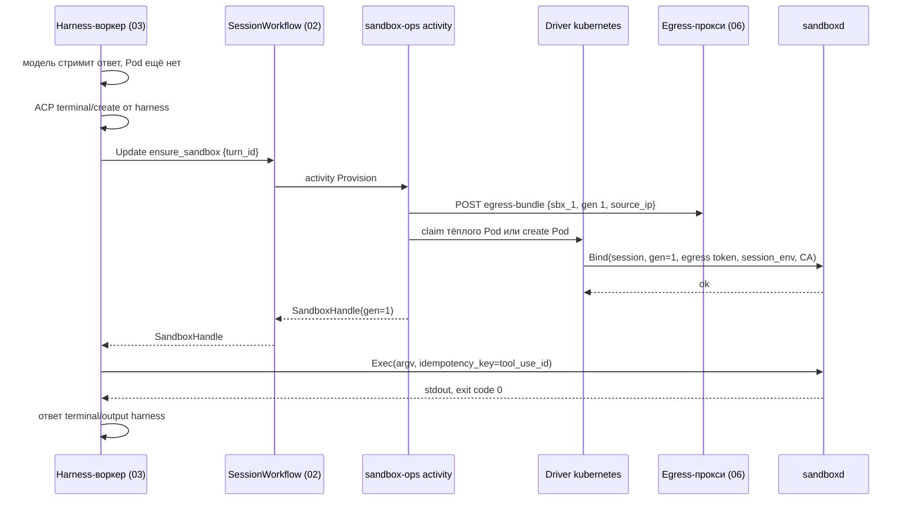
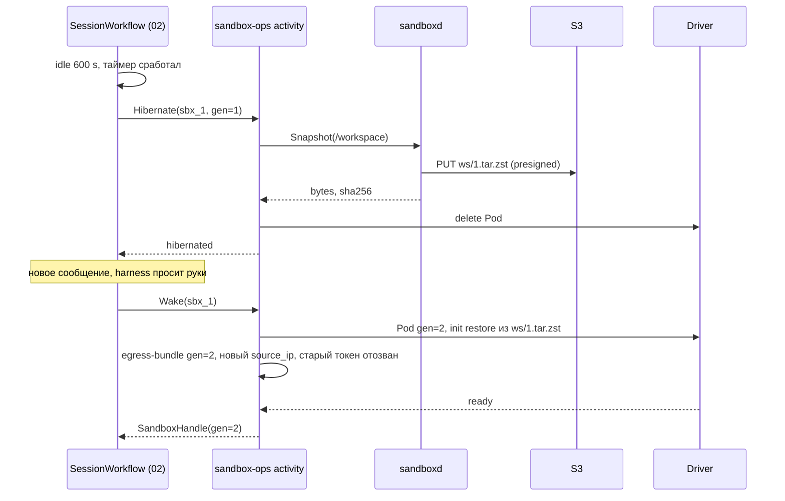

# 04. Песочницы и Sandbox-драйверы

Черновик 2, 2026-10-15. Опирается на [design.md](../design.md), разделы 1, 3, 8, 9, и на [decisions.md](../decisions.md).

## 0. Согласовано

Этот раздел главнее текста ниже. Подробности и причины в [decisions.md](../decisions.md).

- **Режим по умолчанию (D25).** `harness_mode = colocated` для `acp:claude` и `acp:codex`, пока приёмочный тест 8 п. 6 не докажет `remote_tools`. `environment: none` у такого harness означает платформенную среду `platform/min` (без доменов в allowlist). Транскрипт harness в `/workspace/.harness`.
- **Workflow и activities (D24).** Update `ensure_sandbox {turn_id}` описан в 02 и есть там. В `colocated` 02 вызывает его перед ходом сам. Очередь одна: `sandbox-ops`. Сигнатуры: `Provision {session_id, namespace_id, environment_id, environment_version, files?}`, `Wake {sandbox_id}`, `Hibernate {sandbox_id, generation}`, `Destroy {sandbox_id, keep_snapshot}`. `Hibernate` отменяемый, Pod удаляется только после подтверждённого снапшота. `busy_execs > 0` → ответ `busy` (02 переносит таймер, потолок 2 ч). Песочница в `failed` → `already_lost` без ошибки. `ensure_sandbox` после `Destroy`: `Provision` из `keep_snapshot`, пока он жив, иначе пустая папка и `data_loss: true`.
- **`sandbox.state` (D24, D38).** Событие пишет 02 по результату activity, а не контроллер.
- **Процесс harness (D8).** `Attach {replace: true}` убивает живой процесс с тем же `name` и запускает новый. Новая попытка хода всегда так делает.
- **Egress (D26).** Свой контракт `PUT /internal/egress/policies/{sandbox_id}` убран. `Provision` и каждый `Wake` вызывают 06 `POST /internal/v1/sessions/{id}/egress-bundle {sandbox_id, generation, source_ip}`. Ответ: `proxy_url`, egress-токен, `ca_bundle_pem`, `session_env` (placeholder). `Destroy` вызывает `DELETE` того же ресурса. Egress-токен выпускает 06 на `(session_id, sandbox_id, generation)`, `Wake` отзывает старый.
- **Bind (D26).** `Bind` получает `session_id`, `generation`, ключ JWT, egress-токен, `session_env`, `ca_bundle_pem`. `sandboxd` пишет CA в `/run/sbx/ca.pem`, токен Hub в `/run/sbx/token` (`/run/sbx` это emptyDir в памяти), подмешивает `session_env` и `HTTPS_PROXY` во все `Exec` и `Attach`. В spec Pod токенов нет. Известные токены `sandboxd` маскирует в выводе `Exec`. После `Bind` тёплого Pod `sandboxd` делает `Restore` из снапшота. Драйвер `docker` передаёт поля `Bind` через env при `docker run`.
- **Сеть (D26).** Одна NetworkPolicy: выход только на `egress-proxy.platform-system.svc:3128`, `hub.platform-system.svc:443`, `model-gateway.platform-system.svc:443`. DNS из Pod закрыт, имена резолвит прокси. Namespace тенанта `agp-<slug>` (08), а не `tn-<ns>`.
- **Среда (D24).** `HOME=/workspace/.home`, `PYTHONUSERBASE`, `npm_config_prefix` и кеши внутри `/workspace`, кеши исключены из снапшота. Системные пакеты только через `Environment.packages`.
- **Владение (D37).** Environment и версии живут здесь. `environment_versions` только на вставку, сессия закрепляет `(environment_id, version)`. 07 таблиц сред не держит. `GET /internal/v1/sandbox-drivers` → `[{driver, max_resources, isolation[]}]` для валидации 07.
- **stdio-серверы Hub (D26).** Запускаются этим драйвером в профиле `service` в namespace тенанта.
- **Имена (D28).** Пути снапшотов `s3://sbx/<namespace_id>/<session_id>/ws/<generation>.tar.zst`, где `namespace_id` = `ns_<ULID>`.

## 1. Назначение и границы

Песочница это «руки» сессии: изолированная машина с файлами и shell. Компонент даёт платформе один интерфейс драйвера и несколько реализаций (`none`, `docker`, `kubernetes`). Песочницу создают по требованию, усыпляют при простое и выбрасывают без потери важного: рабочая папка уходит в S3, журнал сессии живёт в Postgres (компонент 01).

Что делает:

- Хранит Environment: шаблон песочницы (образ, пакеты, ресурсы, allowlist доменов, драйвер, режим хранения папки).
- Собирает образы Environment и кэширует их по хэшу содержимого.
- Реализует activities `Provision`, `Hibernate`, `Wake`, `Destroy` для `SessionWorkflow` (компонент 02).
- Даёт harness-воркерам (компонент 03) `SandboxHandle`: exec, файлы, поток stdio для harness внутри песочницы.
- Держит тёплый пул готовых Pod.
- Ставит агент `sandboxd` в каждую песочницу. Это единственный процесс, который слушает порт внутри.
- Получает для каждой песочницы egress-bundle у 06 при `Provision` и `Wake` (D26).

Чего НЕ делает:

- Не хранит журнал событий и не решает, когда идёт ход. Это 01 и 02.
- Не хранит и не видит внешних секретов. Секреты подставляет egress-прокси (06).
- Не вызывает MCP-тулы и модели. Песочница видит Hub только через прокси.
- Не выбирает драйвер по желанию агента. Драйвер задаёт оператор установки в Environment.
- Не решает права пользователя. Namespace, квоты и роли приходят из 08.

## 2. Модель данных

Все таблицы в Postgres платформы, схема `sandbox`. Время в `timestamptz`, id это ULID строкой с префиксом.

### `environments`

| Поле | Тип | Смысл |
|---|---|---|
| `id` | text, `env_...` | Id шаблона |
| `namespace_id` | text | Тенант (08), `ns_<ULID>` (D28) |
| `name` | text | Уникально в namespace |
| `driver` | text | `none`, `docker`, `kubernetes` |
| `base_image` | text | Например `ghcr.io/our/sandbox-base:2026.10` с digest |
| `packages` | jsonb | `{"apt": ["git"], "npm": ["typescript@5"], "pip": ["pandas==2.2"]}` |
| `setup_script` | text, nullable | Shell, выполняется при сборке образа, не при старте |
| `resources` | jsonb | `{"cpu": "1", "memory": "2Gi", "disk": "5Gi", "pids": 512}` |
| `network` | jsonb | `{"allow_domains": ["pypi.org", "*.npmjs.org"], "allow_hub": true}` |
| `isolation` | text | `container` или `gvisor`. Для `kubernetes` по умолчанию `gvisor` |
| `workspace` | jsonb | `{"persistence": "s3", "max_bytes": 2147483648, "path": "/workspace"}` |
| `harness_mode` | text | `colocated` (по умолчанию, D25) или `remote_tools` (раздел 3.4) |
| `idle_hibernate_s` | int | По умолчанию 600 |
| `hibernated_ttl_s` | int | Сколько хранить спящую папку. По умолчанию 604800 (7 дней) |
| `warm_pool_size` | int | По умолчанию 0 |
| `version` | int | Растёт при каждой правке |
| `spec_hash` | text | sha256 от нормализованных полей, влияющих на образ |
| `created_by`, `created_at`, `updated_at` | | Аудит |

Правка Environment создаёт новую строку `environment_versions` (только вставка, D37). Сессия закрепляет `environment_id` + `version`. Правка шаблона не трогает живые песочницы.

### `environment_builds`

| Поле | Тип | Смысл |
|---|---|---|
| `spec_hash` | text, PK | Ключ кэша. Одинаковые шаблоны разных тенантов делят образ |
| `image_ref` | text | `registry.internal/sbx/env@sha256:...` |
| `status` | text | `pending`, `building`, `ready`, `failed` |
| `log_url` | text | Лог сборки в S3 |
| `size_bytes` | bigint | |
| `built_at`, `last_used_at` | timestamptz | Для очистки: образ без использования 30 дней удаляется |

### `sandboxes`

| Поле | Тип | Смысл |
|---|---|---|
| `id` | text, `sbx_...` | Id песочницы |
| `session_id` | text, unique where state != `destroyed` | Одна живая песочница на сессию |
| `namespace_id` | text | Тенант, `ns_<ULID>` (D28) |
| `environment_id`, `environment_version` | text, int | Закреплённый шаблон |
| `driver` | text | Копия из Environment |
| `state` | text | `provisioning`, `ready`, `hibernating`, `hibernated`, `waking`, `destroying`, `destroyed`, `failed` |
| `generation` | int | Растёт при каждом пробуждении. Защищает от старых воркеров |
| `driver_ref` | jsonb | `{"pod": "sbx-01j...", "k8s_ns": "agp-acme"}` или `{"container_id": "..."}` |
| `endpoint` | text | `sbx-01j.agp-acme.pod:7070` для `sandboxd` |
| `workspace_snapshot` | text, nullable | `s3://sbx/ns_01J8A.../ses_.../ws/7.tar.zst` |
| `snapshot_bytes` | bigint | |
| `last_activity_at` | timestamptz | Обновляет `sandboxd` heartbeat |
| `error` | jsonb, nullable | `{"code": "image_pull_failed", "message": "..."}` |
| `created_at`, `updated_at` | | |

Переходы `state` идут только через `UPDATE ... WHERE state = $old AND generation = $gen`. Гонки двух activities решает база.

### Структуры в коде (Go)

```go
type SandboxSpec struct {
    SandboxID   string
    SessionID   string
    NamespaceID string
    Env         EnvironmentSnapshot   // поля environments + image_ref
    Generation  int
    Snapshot    *string               // откуда восстановить /workspace
    Egress      EgressBundle          // от 06: proxy_url, egress-токен, ca_bundle_pem, session_env (D26)
    Labels      map[string]string
}

type SandboxHandle struct {
    SandboxID  string
    Endpoint   string   // host:port sandboxd
    Generation int
    Token      string   // JWT для sandboxd, aud=sbx_id, срок 15 мин
}

type Driver interface {
    Provision(ctx context.Context, s SandboxSpec) (SandboxHandle, error)
    Exec(ctx context.Context, h SandboxHandle, r ExecRequest) (ExecStream, error)
    Files(h SandboxHandle) FileAPI            // Read, Write, List, Stat, Delete
    Hibernate(ctx context.Context, h SandboxHandle) (SnapshotRef, error)
    Wake(ctx context.Context, s SandboxSpec) (SandboxHandle, error)
    Destroy(ctx context.Context, sandboxID string) error
    Describe(ctx context.Context, sandboxID string) (DriverStatus, error)
}
```

`Exec` и `Files` у всех драйверов кроме `none` реализованы одинаково: клиент к `sandboxd`. Драйвер отличается только тем, как поднять и убрать машину. Драйвер `none` на всё кроме `Destroy` отвечает `ErrNoSandbox`.

## 3. Контракты

### 3.1 Temporal activities (очередь `sandbox-ops`)

Их вызывает `SessionWorkflow` (02). Все идемпотентны по `(sandbox_id, generation)` (у `Provision` по `session_id`).

| Activity | Вход | Выход | StartToClose | Retry |
|---|---|---|---|---|
| `Provision` | `{session_id, namespace_id, environment_id, environment_version, files?}` | `SandboxHandle` | 120 s, heartbeat 10 s | 5 попыток, backoff 2 s ×2, не повторять `quota_exceeded`, `environment_invalid` |
| `Hibernate` | `{sandbox_id, generation}` | `{status: hibernated \| busy \| already_lost, snapshot?, bytes?}` | 300 s, heartbeat 15 s, отменяемая | 3 попытки |
| `Wake` | `{sandbox_id}` | `SandboxHandle` с `generation+1` | 180 s | 5 попыток |
| `Destroy` | `{sandbox_id, keep_snapshot: bool}` | `{}` | 60 s | бесконечно, backoff до 5 мин |
| `EnsureImage` | `{environment_id, version}` | `{image_ref}` | 30 мин, heartbeat 30 s | 2 попытки |

Если песочница уже в нужном состоянии, activity возвращает текущий handle без побочных эффектов. `Provision` при живой песочнице с той же `session_id` отдаёт её же.

Пример ответа `Provision`:

```json
{"sandbox_id": "sbx_01JAC9...", "endpoint": "10.42.3.17:7070",
 "generation": 1, "token": "eyJhbGciOiJFZERTQSJ9...", "expires_at": "2026-10-15T10:15:00Z"}
```

Кто будит (D24). В `colocated` (по умолчанию для Claude и Codex) workflow вызывает `ensure_sandbox` сам перед `RunTurn`. В `remote_tools` harness-воркер вызывает `SandboxBroker.Acquire(session_id)` при первом обращении к рукам, broker шлёт workflow update `ensure_sandbox`. В обоих случаях только workflow запускает `Provision` или `Wake`, он единственный меняет состояние песочницы.

Таймеры сна живут в workflow: после `idle` через `idle_hibernate_s` запускается `Hibernate`, после `hibernated_ttl_s` запускается `Destroy`. При `terminated` сразу `Destroy` с `keep_snapshot: true` на 7 дней для разбора.

### 3.2 Протокол `sandboxd`

`sandboxd` это статический бинарь на Go, PID 1 через `tini` не нужен, он сам собирает зомби. Слушает gRPC на `:7070`, TLS с сертификатом от внутреннего CA. Каждый вызов несёт `authorization: Bearer <JWT>`. `sandboxd` проверяет подпись (публичный ключ кладётся в Pod при старте), `aud == sandbox_id`, `gen >= текущей`.

```proto
service Sandboxd {
  rpc Bind(BindRequest) returns (BindResponse);          // тёплый Pod получает сессию
  rpc Exec(stream ExecInput) returns (stream ExecOutput);
  rpc ReadFile(ReadFileRequest) returns (stream Chunk);
  rpc WriteFile(stream WriteChunk) returns (WriteFileResponse);
  rpc List(ListRequest) returns (ListResponse);
  rpc Stat(StatRequest) returns (StatResponse);
  rpc Remove(RemoveRequest) returns (RemoveResponse);
  rpc Snapshot(SnapshotRequest) returns (stream SnapshotProgress);
  rpc Restore(RestoreRequest) returns (stream SnapshotProgress);
  rpc Attach(stream AttachInput) returns (stream AttachOutput); // stdio долгого процесса
  rpc Health(HealthRequest) returns (HealthResponse);
}
```

Exec. Первое сообщение `ExecInput.start`:

```json
{"exec_id": "ex_01JAC...", "idempotency_key": "tu_01JAB...:1",
 "argv": ["bash", "-lc", "pytest -q"], "cwd": "/workspace", "env": {"CI": "1"},
 "timeout_ms": 120000, "max_output_bytes": 1048576, "tty": false}
```

Дальше идут `stdin` чанки и `signal` (`SIGINT`, `SIGKILL`). Ответы: `stdout`, `stderr` чанки по 32 KiB, затем `exit {code, signal, timed_out, truncated, duration_ms}`.

Правила exec:

- `timeout_ms` по умолчанию 120 000, максимум 1 800 000. По таймауту SIGTERM, через 5 s SIGKILL всей группы процессов.
- Вывод больше `max_output_bytes` обрезается, в `exit` стоит `truncated: true`, полный вывод пишется в `/workspace/.sbx/out/<exec_id>.log`.
- `idempotency_key` хранится в `/workspace/.sbx/exec.db` 24 часа. Повтор с тем же ключом не запускает команду второй раз, а отдаёт сохранённый `exit` и хвост вывода. Если команда ещё идёт, повтор подключается к её потоку. Это закрывает пункт 6 из раздела 3 design.md.
- Обрыв gRPC-потока команду не убивает. Через 60 s без переподключения процесс получает SIGTERM.

Файлы. Пути только внутри `/workspace` и `/tmp`. Путь нормализуется, `..` и симлинки наружу дают `PERMISSION_DENIED`. Один `ReadFile` до 100 MiB, чанки по 256 KiB. `WriteFile` пишет во временный файл и делает `rename`, поле `if_sha256` даёт оптимистичную блокировку (`FAILED_PRECONDITION` при расхождении).

Attach. Для harness внутри песочницы (режим `colocated`). Воркер вызывает `Attach{argv: ["claude-agent-acp"], name: "harness", replace: true}`. `sandboxd` убивает живой процесс с тем же `name`, если он есть, запускает новый и перекидывает stdin/stdout. Без `replace` повторный `Attach` подключается к живому процессу, но воркер так не делает (D8). Так ACP по stdio идёт поверх gRPC.

Heartbeat. Раз в 30 s `sandboxd` шлёт `POST /internal/sandboxes/{id}/heartbeat` в контроллер с `{generation, busy_execs, workspace_bytes}`. Контроллер обновляет `last_activity_at`.

Коды ошибок gRPC: `UNAUTHENTICATED` (токен), `FAILED_PRECONDITION` (generation устарел, песочница спит), `RESOURCE_EXHAUSTED` (диск, pids, больше 16 одновременных exec), `DEADLINE_EXCEEDED`, `NOT_FOUND`, `PERMISSION_DENIED` (путь).

### 3.3 REST для консоли и конструктора

Отдаёт Runtime API (01) через свой роутер, реализация в этом компоненте. Права проверяет 08.

| Метод | Ответ | Смысл |
|---|---|---|
| `GET /v1/environments` | `200` | Список шаблонов namespace. Используется тулом конструктора `list_environments` |
| `POST /v1/environments` | `201`, `422` при плохом spec | Создать. Сразу ставит `EnsureImage` |
| `PATCH /v1/environments/{id}` | `200`, `409` при чужой `version` | Правка, `version+1` |
| `GET /v1/environments/{id}/build` | `200` | Статус сборки и ссылка на лог |
| `DELETE /v1/environments/{id}` | `204`, `409` если есть живые сессии | |
| `GET /v1/sessions/{id}/sandbox` | `200`, `404` | Состояние песочницы для экрана сессии |
| `GET /v1/sessions/{id}/sandbox/files?path=` | `200`, `409` если спит и `wake=false` | Просмотр файлов из консоли. Из спящей читает снапшот |

Пример создания:

```http
POST /v1/environments
{"name": "py-data", "driver": "kubernetes", "base_image": "sandbox-base:2026.10",
 "packages": {"pip": ["pandas==2.2", "matplotlib"]},
 "resources": {"cpu": "1", "memory": "2Gi", "disk": "5Gi"},
 "network": {"allow_domains": ["pypi.org", "files.pythonhosted.org"]},
 "workspace": {"persistence": "s3"}}

201 {"id": "env_01JAC...", "version": 1, "build": {"status": "building", "spec_hash": "9f2c..."}}
```

### 3.4 Где работает Claude Agent SDK

Agent SDK запускает подпроцесс `claude`, который сам владеет shell, рабочей папкой и транскриптами на локальном диске. Поэтому его встроенные тулы (Bash, Read, Edit) исполняются там же, где процесс. Есть два режима, выбор в `environments.harness_mode`.

| Режим | Где процесс `claude-agent-acp` | Как идут тулы | Плюсы | Минусы |
|---|---|---|---|---|
| `remote_tools` (только после теста 8 п. 6, D25) | В harness-воркере (03) | ACP-клиент объявляет `fs.readTextFile`, `fs.writeTextFile`, `terminal`. Вызовы `fs/read_text_file`, `fs/write_text_file`, `terminal/create`, `terminal/output`, `terminal/wait_for_exit`, `terminal/kill`, `terminal/release` воркер переводит в `ReadFile`, `WriteFile`, `Exec` к `sandboxd` | Ленивое создание работает, первый токен без ожидания Pod | Работает, только если `claude-agent-acp` отдаёт все встроенные тулы через клиентские методы ACP (не проверено). Иначе часть тулов исполнится в воркере |
| `colocated` (по умолчанию) | Внутри песочницы, через `Attach` | Локально, как задумано SDK | Поведение SDK без сюрпризов | Песочница нужна на старте хода, поэтому важен тёплый пул. В песочнице лежит токен сессии к Hub и шлюзу моделей |

Правила для обоих режимов:

- В воркере встроенные тулы SDK, которые трогают локальный диск или shell, отключаются через настройки разрешений SDK. Воркер никогда не исполняет код агента у себя.
- Модель вызывается через `ANTHROPIC_BASE_URL` на шлюз моделей (06), ключа Anthropic в песочнице нет.
- Транскрипт SDK не источник правды. Журнал в Postgres (01) главный, harness получает историю из него (design.md, раздел 1).
- `environment: none` значит драйвер `none` только для harness без встроенных тулов (`simple`, ADK). Для `acp:claude` и `acp:codex` это платформенная среда `platform/min` (D25).

По умолчанию для `claude` и `codex` стоит `colocated` и тёплый пул размера 2 на каждый частый Environment. `remote_tools` включается только после зелёного теста 8 п. 6.

### 3.5 Драйвер `docker` (разработка)

- Сеть `sbx-internal`, создаётся с `internal: true`: у неё нет выхода наружу. В ней только песочницы, egress-прокси и harness-воркеры.
- Контейнер: `--cap-drop ALL`, `--security-opt no-new-privileges`, `--read-only`, `--tmpfs /tmp:size=256m`, `--user 1000:1000`, `--pids-limit` и `--memory`, `--cpus` из Environment.
- `/workspace` это именованный volume `sbx-<id>-ws`. Hibernate делает `Snapshot` в MinIO и удаляет контейнер, volume остаётся до `Destroy`. Wake сначала пробует volume, потом снапшот.
- `isolation: gvisor` включает `--runtime=runsc`, если runtime установлен в daemon. Иначе `Provision` падает с `isolation_unavailable`.
- Тёплый пул не делаем. Старт контейнера на локальной машине около секунды.

### 3.6 Драйвер `kubernetes` (прод)

На каждую песочницу один Pod в namespace тенанта (`agp-<slug>`, из 08). Деплойментов и StatefulSet нет: Pod создаётся напрямую контроллером, `restartPolicy: Never`, у Pod есть ownerReference на объект-якорь сессии (ConfigMap `ses-<id>`), чтобы сборка мусора убрала Pod вместе с якорем.

Ключевые поля Pod:

```yaml
apiVersion: v1
kind: Pod
metadata:
  name: sbx-01jac9...
  namespace: agp-acme
  labels: {app.kubernetes.io/component: sandbox, sbx/session: ses-01jab..., sbx/env-hash: 9f2c}
spec:
  runtimeClassName: gvisor          # RuntimeClass gvisor, handler runsc
  serviceAccountName: sandbox-nobody
  automountServiceAccountToken: false
  enableServiceLinks: false
  restartPolicy: Never
  securityContext: {runAsNonRoot: true, runAsUser: 1000, fsGroup: 1000, seccompProfile: {type: RuntimeDefault}}
  initContainers:
    - name: restore            # sandboxd restore из S3 по presigned URL, если есть снапшот
  containers:
    - name: sandbox
      image: registry.internal/sbx/env@sha256:...
      command: ["/opt/sbx/sandboxd"]
      resources: {requests: {cpu: "250m", memory: 512Mi}, limits: {cpu: "1", memory: 2Gi, ephemeral-storage: 5Gi}}
      securityContext: {allowPrivilegeEscalation: false, readOnlyRootFilesystem: true, capabilities: {drop: [ALL]}}
      env: [{name: HOME, value: /workspace/.home}]   # токенов в spec нет: HTTPS_PROXY и placeholder sandboxd подмешивает в Exec после Bind (D26)
      volumeMounts: [{name: ws, mountPath: /workspace}, {name: tmp, mountPath: /tmp}, {name: run, mountPath: /run/sbx}]
  volumes:
    - {name: ws, emptyDir: {sizeLimit: 5Gi}}   # для persistence=pvc здесь PVC
    - {name: tmp, emptyDir: {medium: Memory, sizeLimit: 256Mi}}
    - {name: run, emptyDir: {medium: Memory, sizeLimit: 1Mi}}   # ca.pem, token
```

- **NetworkPolicy** на namespace тенанта, ставится один раз Helm-чартом. Для Pod с `component=sandbox`: egress только на `egress-proxy` порт 3128, Hub порт 443 и `model-gateway` порт 443 в `platform-system`. DNS закрыт (D26). NetworkPolicy работает на уровне IP и портов (документация Kubernetes), домены проверяет прокси. Ingress только с Pod `harness-worker` и `sandbox-controller` на порт 7070. Связи песочниц между собой нет.
- **ServiceAccount** `sandbox-nobody` без RoleBinding, токен не монтируется.
- **RuntimeClass** `gvisor` с `handler: runsc`, ноды с gVisor помечены и закрыты taint, RuntimeClass несёт `scheduling.nodeSelector` и `tolerations`.
- **ResourceQuota** и **LimitRange** на namespace от 08. `Provision` при отказе квоты возвращает `quota_exceeded`, без повторов.
- **Рабочая папка.** По умолчанию `emptyDir` плюс снапшот в S3 при сне. Для больших репозиториев `persistence: pvc`: PVC `ws-<session>` RWO живёт до `Destroy`, Pod при сне удаляется, при пробуждении монтирует тот же PVC.
- **Тёплый пул.** Контроллер держит `warm_pool_size` Pod на пару `(k8s namespace, image_ref)` с меткой `sbx/state=warm` и без сессии. Claim это PATCH метки `sbx/state=claimed` с `resourceVersion`, конфликт значит Pod забрал другой. Затем `Bind` в `sandboxd` передаёт `session_id`, `generation`, egress-токен, `session_env`, `ca_bundle_pem` и ключ проверки JWT, после чего `sandboxd` делает `Restore` из снапшота, если он есть. Пул в namespace тенанта, поэтому тёплый Pod не переходит между тенантами. Если пуст, обычный Pod.
- **Образы.** `EnsureImage` собирает образ через BuildKit в кластере, пушит в внутренний registry по тегу `spec_hash`. Частые образы предзагружаются на ноды DaemonSet-ом `image-prepuller`. Цель: старт холодного Pod с образом на ноде не больше 5 s, тёплого не больше 1 s.

### 3.7 Событие в журнал

Событие `sandbox.state` пишет workflow 02 по результату activity (D24), этот компонент в журнал не пишет:

```json
{"type": "sandbox.state", "actor": {"kind": "system", "id": "session-workflow"},
 "data": {"sandbox_id": "sbx_01JAC...", "state": "ready", "generation": 2, "cold_start_ms": 3400}}
```

Состояния для пользователя: `provisioning`, `ready`, `hibernated`, `failed`, плюс `data_loss: true` при потере изменений.

## 4. От чего зависит

| Компонент | Что используем |
|---|---|
| 01-runtime-api | Роутинг `/v1/environments`. В журнал пишет 02 |
| 02-session-workflow | Update `ensure_sandbox`, таймеры сна и удаления, событие `sandbox.state`. Мы реализуем activities, workflow их вызывает (D24) |
| 03-harness-workers | Потребитель `SandboxHandle`: `Attach {replace}` для harness, `Exec`, файлы. ACP-клиент с `fs` и `terminal` нужен только для `remote_tools` |
| 05-mcp-hub | Адрес `hub.platform-system.svc` (прямой выход по NetworkPolicy) и токен сессии на ход в `/run/sbx/token` (D9) |
| 06-vault-egress-models | `POST /internal/v1/sessions/{id}/egress-bundle {sandbox_id, generation, source_ip}` в `Provision` и `Wake`, `DELETE` при `Destroy` (D26). Шлюз моделей для `ANTHROPIC_BASE_URL` |
| 07-agent-control-plane | Консоль показывает Environment и состояние песочницы, конструктор зовёт `list_environments` |
| 08-iam-tenancy | Namespace → k8s namespace, ResourceQuota, проверка `environment:write`, ключи подписи JWT для `sandboxd` |
| 10-deployments-memory-skills | Скиллы. В режиме `colocated` воркер кладёт файлы скиллов в `/workspace/.claude/skills` через `WriteFile` |
| Storage-драйвер (S3) | Снапшоты `s3://sbx/<ns>/<session>/ws/<generation>.tar.zst`, presigned URL на 15 мин |

## 5. Ключевые потоки

### 5.1 Первый вызов тула в сессии, режим `remote_tools`



### 5.2 Сон и пробуждение



## 6. Отказы и как переживаем

| Что упало | Что видит пользователь | Как восстанавливаемся |
|---|---|---|
| Pod убит (OOM, нода ушла) | Тул вернул ошибку `sandbox_lost`, агент видит её как результат тула | `sandboxd` пропал, heartbeat нет 90 s. Контроллер ставит `failed`. Следующий `ensure_sandbox` делает `Wake` из последнего снапшота. Потеря только изменений после снапшота, 02 пишет `sandbox.state` с `data_loss: true` |
| Harness-воркер упал посреди exec | Пауза | В `remote_tools` новый воркер повторяет `Exec` с тем же `idempotency_key` и получает результат. В `colocated` новая попытка делает `Attach {replace: true}`, процесс harness перезапускается (D8) |
| `Provision` не уложился в 120 s | «Среда поднимается дольше обычного», затем ошибка | Temporal повторяет. После 5 попыток workflow пишет `sandbox.state {state: failed}` и `system.notice {code: sandbox.unavailable}`, тул получает `sandbox_unavailable`. `agent.message` пишет только harness |
| Образ не собрался | В консоли статус `failed` и лог | Сессии с этим Environment не стартуют песочницу: `environment_invalid`, без повторов |
| Квота namespace | «Достигнут лимит песочниц команды» | `quota_exceeded`, без повторов. Сессия остаётся живой, руки недоступны |
| S3 недоступен при сне | Ничего | `Hibernate` повторяется. Pod не удаляется, пока снапшот не подтверждён |
| Старый воркер с `generation=1` пишет в Pod `generation=2` | Ничего | `sandboxd` отвечает `FAILED_PRECONDITION`, воркер берёт новый handle |
| Контроллер пропустил `Destroy` | Ничего | Сборщик раз в 10 мин сверяет Pod с меткой `component=sandbox` и таблицу `sandboxes`. Pod без живой записи удаляется. Удаление якоря-ConfigMap тоже уносит Pod |
| Egress-прокси лёг | Сеть из песочницы не работает, `curl` получает отказ соединения | Прокси масштабирован на 2+ реплики. Песочница сама не ходит в обход, NetworkPolicy этого не даст |
| Диск папки переполнен | `ENOSPC` в выводе команды | `sizeLimit` у `emptyDir` даёт выселение Pod. Ставим предупреждение на 80% через heartbeat и сообщаем в `sandbox.state` |

## 7. Безопасность

- **Секретов нет.** В песочнице только: egress-токен (работает лишь с IP этого Pod, этой `generation` и только для allowlist сессии), JWT для `sandboxd` (проверяет только сам `sandboxd`), в режиме `colocated` токен сессии к Hub и шлюзу моделей на один ход в `/run/sbx/token` (D9). Токены не в env Pod и маскируются в выводе `Exec`. Внешние ключи остаются в 06.
- **Сеть.** Только через egress-прокси Hub. Прокси проверяет egress-токен, source IP и домен. Для доменов, где нужен секрет, прокси терминирует TLS, CA прокси `sandboxd` пишет в `/run/sbx/ca.pem` при `Bind`. DNS из Pod закрыт, имена резолвит прокси (D26): DNS-туннеля нет.
- **Ядро.** Для `kubernetes` по умолчанию gVisor. `container` разрешён только для доверенных Environment с отметкой администратора.
- **Kubernetes API.** ServiceAccount без прав, токен не монтируется, `enableServiceLinks: false`, нет `hostPath`, нет `hostNetwork`.
- **Процессы.** Не root, все capabilities сброшены, `readOnlyRootFilesystem`, seccomp `RuntimeDefault`, лимит pids.
- **Тенанты.** Pod только в namespace тенанта, тёплый пул не делится. Снапшоты под префиксом тенанта, presigned URL выдаются на один ключ.
- **Доступ к `sandboxd`.** mTLS плюс JWT с `aud=sandbox_id` и `gen`. NetworkPolicy пускает только воркеры и контроллер.
- **Prompt injection.** Всё в `/workspace` недоверенные данные. Контроллер не читает и не исполняет файлы оттуда, кроме служебного `.sbx/exec.db` самого `sandboxd`.
- **Аудит.** Каждый `Exec` даёт запись `{session_id, exec_id, argv_hash, exit_code, duration_ms}` в лог аудита. Сам argv в трассы не пишется без флага Environment `audit_argv`.

## 8. Как тестировать

Строгий TDD. Первые тесты пишутся до кода, порядок такой.

1. **Общий набор контрактных тестов драйвера** `drivertest.Run(t, newDriver)`. Один набор для `fake`, `docker`, `kubernetes`. Первые красные тесты:
   - `Provision` дважды с одним `session_id` возвращает один `sandbox_id`.
   - `Exec` `echo hi` даёт `stdout=hi\n`, `exit=0`.
   - `Exec` с `timeout_ms=500` для `sleep 5` даёт `timed_out=true` меньше чем за 6 s.
   - Повтор `Exec` с тем же `idempotency_key` не запускает команду второй раз (файл-счётчик в `/workspace`).
   - `WriteFile` → `Hibernate` → `Wake` → `ReadFile` возвращает тот же sha256, `generation` вырос.
   - Вызов со старым `generation` даёт `FAILED_PRECONDITION`.
   - `ReadFile("../../etc/passwd")` даёт `PERMISSION_DENIED`.
   - `Destroy` дважды не падает.
2. **Юнит-тесты `sandboxd`** на нормализацию путей, обрезку вывода, убийство группы процессов, хранение ключей идемпотентности.
3. **Тесты сети.** Из песочницы `curl https://example.com` без прокси падает, через прокси к домену вне allowlist получает `403`, к разрешённому `200`. Для `docker` и для `kubernetes` в k3d.
4. **Тесты activities** через Temporal test environment: повтор `Provision` после падения посреди claim не создаёт второй Pod; `Hibernate` не удаляет Pod при ошибке S3.
5. **Ленивое создание.** Сценарий: агент без тулов отвечает, в `sandboxes` нет записи. Агент с тулом создаёт ровно одну.
6. **Приёмка `remote_tools`.** `claude-agent-acp` с ACP-клиентом воркера делает Bash и Edit. Тест проверяет, что команда исполнилась в песочнице (файл появился в Pod), а в файловой системе воркера ничего нет. Этот тест решает выбор режима по умолчанию из 3.4.
7. **Тесты безопасности k8s** в k3d: из Pod нет токена в `/var/run/secrets/kubernetes.io/serviceaccount`, `id -u` не 0, второй Pod не достаёт до первого по 7070.

## 9. Открытые вопросы

1. (D25: до ответа режим `colocated`.) Отдаёт ли `claude-agent-acp` все встроенные тулы (Bash, Read, Edit, Write, Glob, Grep) через клиентские методы ACP `fs/*` и `terminal/*`? Если нет, режим `remote_tools` для Claude невозможен, и design.md (раздел 3, шаг 4: «песочницу будит только когда нужна») верен только для агентов без встроенных тулов. Нужен прототип.
2. Design.md, раздел 8, перечисляет интерфейс `provision, exec, files, hibernate, destroy`. Предлагаю добавить `wake` и `describe` явно и заменить в разделе 3 «Activities `Provision`, `Hibernate`, `Destroy`» на список с `Wake` и `EnsureImage`.
3. ~~Событие `sandbox.state`.~~ Решено в D38, пишет 02 (D24). Нужно согласие 01, иначе статус песочницы показываем только через `GET /v1/sessions/{id}/sandbox`.
4. ~~Идентификация на egress.~~ Решено в D26: egress-токен на generation плюс source IP. токен в URL прокси плюс source IP (предложено здесь) или отдельный sidecar-прокси в Pod. Sidecar надёжнее против подмены IP, но дороже по памяти.
5. ~~DNS.~~ Решено в D26: DNS из Pod закрыт. Даже с CoreDNS есть риск утечки данных через DNS-запросы. Варианты: резолвить имена только на прокси и запретить DNS из Pod совсем. Тогда утилиты без поддержки `HTTPS_PROXY` перестанут работать.
6. ~~Владелец `environments`.~~ Решено в D37: этот компонент. этот компонент или control plane 07. Здесь предложено владеть самим, 07 только показывает.
7. Нужен ли `persistence: pvc` в первой версии или хватает S3. PVC зависит от StorageClass кластера заказчика.
8. Codex через `codex-acp` тоже исполняет тулы локально (не проверено). Нужна та же проверка, что в вопросе 1.
9. Firecracker, E2B, Modal из design.md пока вне объёма. Контрактный набор тестов должен позволить добавить их без правок workflow.
