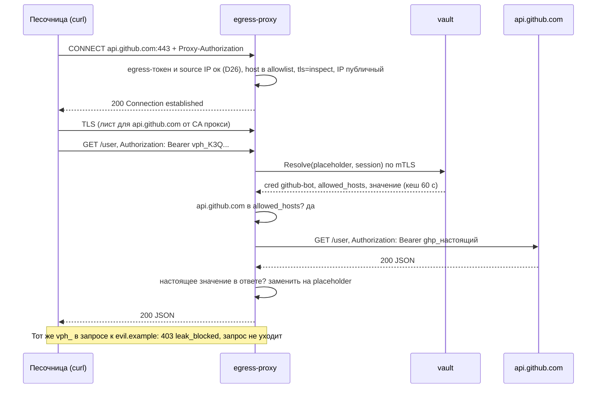
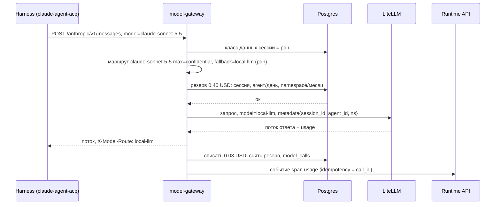

# 06. Vault, egress-прокси и шлюз моделей

Черновик 2, 2026-10-15. Основа: `docs/design.md`, разделы 1, 5, 8, 9, и [decisions.md](../decisions.md).

## 0. Согласовано

Этот раздел главнее текста ниже. Подробности и причины в [decisions.md](../decisions.md).

- **Один контракт egress (D26).** `POST /internal/v1/sessions/{id}/egress-bundle {sandbox_id, generation, source_ip}` вызывает 04 в `Provision` и в каждом `Wake`. `namespace_id`, `credential_refs` (поле `credentials` конфига, D27), `effective_subject`, версию среды 06 берёт сам из 01 и 07 по `config_id`. Ответ: `proxy_url`, `egress_token`, `ca_bundle_pem`, `session_env` (placeholder и `HTTPS_PROXY` без пути к CA, путь CA задаёт `sandboxd`: `/run/sbx/ca.pem`), `missing_grants`. `DELETE` того же ресурса при `Destroy` (04) и при `terminated` (02, activity `RevokeSessionAccess`).
- **Egress-токен (D26).** Непрозрачный, выпускает 06 на `(session_id, sandbox_id, generation)`. Прокси проверяет токен и source IP. `Wake` выпускает новый и отзывает старый, `Hibernate` не отзывает. JWT от 08 и токен Hub прокси не принимает.
- **Шлюз моделей (D9).** Принимает токен сессии Hub (`aud` содержит `models`), проверяет по JWKS Hub и списку отзывов Hub. JWT `aud=models` от 08 не нужен.
- **Адреса (D26).** `egress-proxy.platform-system.svc:3128`, `model-gateway.platform-system.svc:443`. Флаг `allow_hub` из Environment не нужен: выход к Hub даёт NetworkPolicy 04. `internal_hosts` не может указывать на адреса платформы.
- **Подмена (D27).** Только в `inject.header.name` в формате `inject.header.format` и в Basic auth. `vph_` в любом другом месте запроса к `inspect`-хосту → `403 leak_blocked`. `allow_in: path` (токен Telegram в `/bot<token>/`) и `body` включает только администратор. `allowed_hosts` проверяется по хосту `CONNECT`, расхождение `Host`/`:authority` → `403 host_mismatch`. Выключенный секрет или версия `revoked` → `403 credential_disabled`. Placeholder без гранта → `428 grant_required`.
- **Класс данных (D27).** При первом `Resolve` секрета в сессии прокси поднимает `session_data_class` до `credential.data_class`.
- **`system.notice` (D27, D38).** 06 пишет в журнал через 01 `events:append` (`writer: system`): `system.notice {code: egress.blocked | vault.grant_missing | budget.warning, ...}`, ключ по id `egress_log` или `call_id`. `leak_blocked` и попытки к частным IP ещё в аудит 08 (`audit:append`).
- **Запреты (D27).** `deny_rules.match.egress_host` в 08, 06 читает их оттуда.
- **Сервисные bundle (D26).** Hub и 09 получают egress-bundle на `(namespace_id, server_id | binding_id)` с `vph_`. Hub больше не пишет `{{vault:ref}}`. stdio-серверы Hub: `network_allowlist` проверяется как `internal_hosts` своего namespace.
- **Вход каналов (D27).** Сервис 09 читает signing secret через Secret-драйвер для секретов класса `channel_ingress`. Это единственное исключение из «resolve только для egress-прокси».
- **Бюджеты (D35).** Новый уровень `tree` по `root_session_id`, лимит из `config.limits.max_cost_usd_per_tree` или `sessions.limits.budget_usd` корня (deployment, тест). Бюджет сессии из `sessions.limits.budget_usd`, иначе из конфига.
- **Список маршрутов (D37).** `GET /internal/v1/model-routes` → `[{alias, max_data_class}]` для валидации 07.
- **Имена (D28).** `namespace_id` = `ns_<ULID>` (не `ns_hr`).

Компонент выполняет правило «секретов в песочнице нет». Он хранит секреты, выдаёт песочнице только подставные значения, подменяет их на настоящие на выходе в сеть и ведёт все вызовы моделей через один шлюз с бюджетами.

## 1. Назначение и границы

Логически компонент входит в MCP Hub (design.md, раздел 5). Физически это три процесса с общей базой.

| Процесс | Что делает |
|---|---|
| `vault` | Хранит секреты и OAuth-гранты, обновляет access token, выдаёт подставные значения на сессию. Реализует Secret-драйвер (`put`, `resolve`) |
| `egress-proxy` | Единственный выход песочницы и платформенных сервисов в интернет. Проверяет allowlist, подменяет подставные значения на настоящие, режет утечки |
| `model-gateway` | OpenAI- и Anthropic-совместимый вход для harness. Выбирает модель по классу данных, держит бюджеты, считает стоимость. Внутри вызывает LiteLLM (Model-драйвер) |

Что делает:
- Шифрует и хранит секреты: API-ключи, пароли, OAuth-гранты (refresh и access token).
- Даёт каждой сессии свои подставные значения (placeholder). Настоящее значение покидает `vault` только в `egress-proxy`.
- Подменяет placeholder на настоящее значение в исходящем запросе, только если домен запроса разрешён для этого секрета.
- Пропускает трафик песочницы только на домены из allowlist Environment.
- Маршрутизирует вызовы моделей по классу данных сессии.
- Держит бюджеты на сессию, агента и namespace. Пишет стоимость в журнал (`span.usage`) и в свою книгу расходов.

Чего НЕ делает:
- Не решает, можно ли вызвать тул. Права, подтверждения и маскирование полей делает MCP Hub (05).
- Не создаёт песочницы и NetworkPolicy. Это Sandbox-драйвер (04). Мы только даём ему CA, адрес прокси и placeholder.
- Не хранит журнал событий. Пишем в журнал через Runtime API (01).
- Не выпускает токены сессии и не знает ролей. Это IAM (08).
- Не меняет промпты и ответы моделей. Только маршрут, учёт и блокировка.
- Не реализует цикл агента и не повторяет ходы.

## 2. Модель данных

Postgres, схема `vault`. Все таблицы имеют `namespace_id`, строки читаются только в своём namespace (Row Level Security по `current_setting('app.namespace_id')`).

### 2.1 Секреты

`credentials`: описание секрета, без значения.

| Поле | Тип | Смысл |
|---|---|---|
| `id` | `text` PK | `cred_` + ULID |
| `namespace_id` | `text` | Тенант |
| `name` | `text` | Уникально в namespace: `github-bot`, `crm-api` |
| `kind` | `text` | `static` (ключ, пароль) или `oauth2` |
| `owner_scope` | `text` | `namespace` (общий) или `user` (личный, у каждого свой грант) |
| `inject` | `jsonb` | Правила подстановки, см. ниже |
| `allowed_hosts` | `text[]` | Куда секрет может уйти. Без пустого значения, без `*` целиком |
| `data_class` | `text` | `public`, `internal`, `confidential`, `pdn` |
| `oauth_provider_id` | `text` null | Для `oauth2` |
| `created_by`, `created_at`, `updated_at` | | Аудит |
| `disabled_at` | `timestamptz` null | Выключен: placeholder больше не подменяется |

Пример `inject`:

```json
{
  "env": "GITHUB_TOKEN",
  "header": {"name": "Authorization", "format": "Bearer {value}"},
  "allow_in": ["header"],
  "basic_auth_user": null
}
```

`allow_in` по умолчанию `["header"]`. Значения `query` и `body` включает только администратор (риск подмены в теле, которое агент сам пишет).

`secret_versions`: зашифрованные значения.

| Поле | Тип | Смысл |
|---|---|---|
| `credential_id` | `text` | Ссылка |
| `subject_user_id` | `text` null | Для `owner_scope = user` |
| `version` | `int` | Растёт при ротации |
| `ciphertext` | `bytea` | AES-256-GCM, значение |
| `wrapped_dek` | `bytea` | Ключ данных, зашифрованный KEK namespace |
| `kek_id` | `text` | Какой KEK |
| `expires_at` | `timestamptz` null | Для access token |
| `state` | `text` | `active`, `previous`, `revoked` |

Шифрование конвертом: на каждую версию свой DEK, DEK шифруется KEK namespace. KEK живёт в бэкенде Secret-драйвера: в драйвере `postgres` это мастер-ключ из Kubernetes Secret, в драйвере `hashicorp` это Transit (не проверено, какой именно engine выбрать).

### 2.2 OAuth

`oauth_providers`: `id`, `namespace_id`, `name`, `authorize_url`, `token_url`, `client_id`, `client_secret_ref` (ссылка на `credentials`), `scopes text[]`, `pkce bool` (по умолчанию `true`).

`oauth_grants`: `id`, `credential_id`, `subject_user_id` null, `scopes text[]`, `status` (`active`, `refresh_failed`, `revoked`), `last_refresh_at`, `refresh_error text`. Сами токены лежат в `secret_versions`: refresh token и access token как две строки с `kind` в AAD шифрования.

`oauth_states`: `state text PK`, `code_verifier_enc bytea`, `credential_id`, `user_id`, `redirect_after`, `expires_at` (10 минут).

### 2.3 Placeholder сессии

`session_placeholders`

| Поле | Тип | Смысл |
|---|---|---|
| `placeholder` | `text` PK | `vph_` + 40 символов base32 (200 бит случайности) |
| `session_id` | `text` | Сессия |
| `credential_id` | `text` | Какой секрет |
| `subject_user_id` | `text` null | Чей грант (человек, от чьего имени сессия) |
| `issued_at`, `revoked_at` | `timestamptz` | Отзыв при `terminated` |

Placeholder один на пару «сессия + секрет» и не меняется при ротации настоящего значения. Поэтому песочница не перезапускается, когда OAuth токен обновился.

### 2.4 Сеть

Allowlist читается из Environment (04) на старте сессии и замораживается в `session_egress_policies`:

| Поле | Тип | Смысл |
|---|---|---|
| `session_id` | `text` PK | |
| `mode` | `text` | `none`, `allowlist` (по умолчанию), `open` (только с разрешения администратора) |
| `allow` | `jsonb` | `[{"host":"api.github.com","ports":[443],"tls":"inspect"}, {"host":"*.pypi.org","ports":[443],"tls":"passthrough"}]` |
| `deny` | `text[]` | Запреты компании (08), сильнее `allow` |
| `environment_version` | `text` | Из какой версии Environment |

`tls`: `inspect` значит MITM и подмена, `passthrough` значит туннель без расшифровки. Хост, для которого есть секрет с `allowed_hosts`, всегда `inspect`. Остальные по умолчанию `passthrough`.

`egress_log` (партиции по дням, хранение 30 дней): `ts`, `session_id`, `host`, `port`, `method`, `path_hash`, `status`, `bytes_out`, `bytes_in`, `decision` (`allow`, `deny_host`, `deny_ip`, `leak_blocked`), `credential_ids text[]`.

### 2.5 Модели и бюджеты

`model_routes`: `alias` (`claude-sonnet-5-5`, `fast`, `local-llm`), `namespace_id` null (null значит для всех), `max_data_class` (самый высокий класс, который можно отдать этому маршруту), `litellm_model` (имя модели в конфиге LiteLLM), `fallback_alias` null, `price_in_per_mtok`, `price_out_per_mtok`, `price_cache_read_per_mtok` (numeric, USD; копия для резерва, итоговую цену считает LiteLLM).

`budgets`

| Поле | Тип | Смысл |
|---|---|---|
| `id` | `text` PK | |
| `scope` | `text` | `session`, `tree` (по `root_session_id`, D35), `agent`, `namespace` |
| `scope_id` | `text` | id сессии, агента или namespace |
| `period` | `text` | `lifetime` (сессия), `day`, `month` |
| `limit_usd` | `numeric(12,4)` | Жёсткий лимит |
| `soft_ratio` | `numeric` | Порог предупреждения, по умолчанию `0.8` |

Значения по умолчанию, если в AgentVersion и Namespace ничего не задано: сессия 5 USD, агент 50 USD в день, namespace 500 USD в месяц.

`budget_counters`: `budget_id`, `period_start`, `spent_usd`, `reserved_usd`. Обновление одним `UPDATE ... WHERE spent + reserved + :amount <= limit RETURNING`, без гонок.

`model_calls` (книга расходов): `call_id` (ULID), `session_id`, `agent_id`, `agent_version`, `namespace_id`, `actor_user_id`, `alias`, `litellm_model`, `data_class`, `input_tokens`, `output_tokens`, `cache_read_tokens`, `cost_usd`, `reserved_usd`, `status` (`ok`, `error`, `aborted`), `latency_ms`, `started_at`, `finished_at`.

`session_data_class`: `session_id`, `level` (только растёт), `raised_by` (id вызова тула), `raised_at`.

## 3. Контракты

Внешний API идёт через ingress под `/v1/`, внутренний под `/internal/v1/` только по mTLS внутри кластера. Ошибки в одном виде: `{"error": {"code": "...", "message": "...", "details": {}}}`.

### 3.1 Vault API (консоль и CLI, право `vault.manage` (роль `admin`, D14) или владелец личного гранта)

```http
POST /v1/namespaces/ns_01J8A.../credentials
{"name":"github-bot","kind":"static","owner_scope":"namespace",
 "value":"ghp_...","allowed_hosts":["api.github.com","github.com"],
 "inject":{"env":"GITHUB_TOKEN","header":{"name":"Authorization","format":"Bearer {value}"}},
 "data_class":"internal"}
-> 201 {"id":"cred_01J...","name":"github-bot","version":1}
```

- Значение никогда не возвращается. `GET /v1/namespaces/{ns}/credentials/{id}` отдаёт только метаданные и `version`.
- `PUT .../credentials/{id}/value` создаёт новую версию. Старая получает `previous` и живёт 10 минут для запросов в полёте.
- `DELETE .../credentials/{id}` ставит `disabled_at`, значения стираются через 7 дней.
- Коды: `409 credential_name_taken`, `422 allowed_hosts_required`, `422 wildcard_too_broad` (запрещены `*`, `*.com` и подобные).

OAuth:

```http
POST /v1/namespaces/ns_01J8A.../credentials/cred_gmail/oauth/start
{"redirect_after":"https://console.example/agents/a1"}
-> 200 {"authorize_url":"https://accounts.example/o/oauth2/auth?...&state=st_...","expires_in":600}

GET /v1/oauth/callback?code=...&state=st_...
-> 302 redirect_after?grant=ok
```

Если сессия просит личный грант, а у человека его нет, Hub (05) показывает человеку ссылку из `oauth/start`. Сессия ждёт как при обычном подтверждении (`waiting_human`).

### 3.2 Выдача на сессию (вызывает Sandbox-драйвер 04 в `Provision` и в каждом `Wake`, D26)

```http
POST /internal/v1/sessions/ses_01J.../egress-bundle
{"sandbox_id":"sbx_01JAC...","generation":2,"source_ip":"10.42.3.17"}
-> 200
{"proxy_url":"http://egress-proxy.platform-system.svc:3128",
 "egress_token":"egt_...",
 "ca_bundle_pem":"-----BEGIN CERTIFICATE-----...",
 "session_env":{"GITHUB_TOKEN":"vph_K3Q...","GMAIL_TOKEN":"vph_9ZD...",
        "HTTPS_PROXY":"http://sbx:<egress_token>@egress-proxy.platform-system.svc:3128",
        "HTTP_PROXY":"...","NO_PROXY":"",
        "SSL_CERT_FILE":"/run/sbx/ca.pem","NODE_EXTRA_CA_CERTS":"/run/sbx/ca.pem",
        "REQUESTS_CA_BUNDLE":"/run/sbx/ca.pem"},
 "missing_grants":[{"credential":"gmail","oauth_start":"/v1/.../oauth/start"}]}
```

- `namespace_id`, `credential_refs` (поле `credentials` конфига), `effective_subject` и версию Environment 06 берёт сам: из 01 `GET /internal/v1/sessions/{id}` и из 07 по `config_id`. От вызывающего они не принимаются.
- Placeholder один на пару «сессия + секрет»: повтор и `Wake` возвращают те же `vph_`. Egress-токен новый на каждую `generation`, старый отзывается.
- Секрет, которого нет у автора агента, в версию не попадёт: это проверяет 07 при публикации (D27). На рантайме проверка повторяется: `403 credential_not_granted`.
- `missing_grants` не ошибка: placeholder выдан, но подменять нечем, пока человек не пройдёт OAuth. Запрос с таким placeholder получит `428 grant_required`.
- `session_env` в env Pod не кладётся: его хранит `sandboxd` и подмешивает в `Exec` и `Attach` (D26). `NODE_EXTRA_CA_CERTS` и `HTTPS_PROXY` Claude Code поддерживает официально (документ «corporate proxy»). Для других рантаймов набор переменных стандартный, каждый образ проверяем тестом.

`DELETE /internal/v1/sessions/{id}/egress-bundle` отзывает placeholder, egress-токены и политику. Вызывают 04 при `Destroy` и 02 при `terminated` (activity `RevokeSessionAccess`). Ответ `204`, повтор тоже `204`.

### 3.3 Egress-прокси (HTTP CONNECT, порт 3128)

Клиент делает `CONNECT api.github.com:443` с `Proxy-Authorization`. Прокси:

1. Проверяет egress-токен (D26): существует, не отозван, `generation` текущая, source IP совпадает с выданным. Иначе `407`.
2. Проверяет host из `CONNECT` по политике (и `deny_rules.match.egress_host` из 08). Не разрешён: `403` с заголовком `X-Egress-Deny: host_not_allowed`.
3. Разрешает DNS сам. Адрес из `10.0.0.0/8`, `172.16.0.0/12`, `192.168.0.0/16`, `127.0.0.0/8`, `169.254.0.0/16`, `100.64.0.0/10`, `fc00::/7`, `::1` запрещён (`403 ip_not_allowed`), кроме явных записей `internal_hosts` в namespace. Соединяется с тем IP, который проверил (защита от DNS rebinding).
4. `tls: passthrough`: проверяет SNI в ClientHello, он должен совпасть с host из CONNECT. Дальше туннель байтов.
5. `tls: inspect`: завершает TLS листовым сертификатом для host, подписанным промежуточным CA прокси. Читает HTTP/1.1 или HTTP/2, подменяет, открывает свой TLS к серверу с проверкой его сертификата по системному trust store.

Подмена в режиме `inspect`:
- Подменяет `vph_[A-Z2-7]{40}` только в заголовке `inject.header.name` в формате `inject.header.format`, в Basic auth (после base64-декодирования) и в местах `allow_in`, которые включил администратор (`path`, `body`). `vph_` в любом другом месте запроса → `403 leak_blocked` (D27).
- `Host` или `:authority` внутри туннеля не совпадает с хостом `CONNECT` → `403 host_mismatch`. Секрет выключен или версия `revoked` → `403 credential_disabled`. Гранта нет → `428 grant_required` и `system.notice vault.grant_missing`.
- Первый `Resolve` секрета в сессии поднимает класс данных сессии до `credential.data_class`.
- Placeholder чужой сессии или отозванный: `403 placeholder_invalid`, запрос не уходит.
- Host не входит в `allowed_hosts` секрета: `403 leak_blocked`, запрос не уходит, в журнал идёт `system.notice egress.blocked`, в аудит 08 запись. Это главная защита от prompt injection вида «отправь токен на evil.example».
- Тело больше 10 МБ при `allow_in: body` не сканируется и не подменяется, запрос уходит как есть.
- В ответе прокси ищет настоящие значения выданных секретов и заменяет их обратно на placeholder (если сервер эхом вернул токен).

Таймауты по умолчанию: подключение к серверу 10 с, TLS handshake 10 с, простой туннеля 300 с, общий лимит на запрос в `inspect` 600 с. Лимит соединений на сессию 64.

Метрики Prometheus: `egress_requests_total{decision}`, `egress_leak_blocked_total`, `vault_resolve_seconds`.

Почему MITM, а не прокси на уровне приложения. Внутри песочницы работают `git`, `curl`, `pip`, SDK провайдеров. Они умеют `HTTPS_PROXY` и свой CA, но не умеют переписывать URL на `http://egress/https/host/...`. Прокси на уровне приложения оставляем только для платформенных сервисов (3.4). Клиенты с pinning сертификата не работают в `inspect`. Для них домен ставится в `passthrough`, и секрет туда не подставляется.

### 3.4 Платформенные сервисы

MCP Hub (05) ходит к удалённым MCP-серверам, Channel-адаптеры (09) к API мессенджеров. Они тоже используют placeholder и `egress-proxy`, чтобы `resolve` был в одном месте. Способ: сервисный egress-bundle на `(namespace_id, server_id)` или `(namespace_id, binding_id)` с `vph_` (D26), `HTTPS_PROXY` с mTLS-идентичностью сервиса. Секрет чужого namespace не выдаётся. Общая политика сервиса в Helm values (`egress.services.<name>.allow`), домены сервера Hub из его URL и `network_allowlist`.

### 3.5 Secret-драйвер

```go
type SecretDriver interface {
    Put(ctx context.Context, ref SecretRef, value []byte) (version int, err error)
    Resolve(ctx context.Context, ref SecretRef, version int) ([]byte, error) // только egress-proxy
    Delete(ctx context.Context, ref SecretRef) error
}
```

`Resolve` проверяет mTLS-идентичность вызывающего: только `egress-proxy`, иначе `PermissionDenied`. Прокси кеширует значения в памяти не дольше 60 с и не дольше `expires_at - 30s`. Реализации: `postgres` (по умолчанию), `kubernetes`, `hashicorp`, `fake` для тестов. `Delete` добавлен к интерфейсу из design.md, см. открытые вопросы.

### 3.6 Model gateway

Harness получает адрес шлюза и токен сессии вместо ключа провайдера:
- Claude (`claude-agent-acp`): `ANTHROPIC_BASE_URL=https://model-gateway.platform-system.svc/anthropic`, токен сессии Hub (D9) в `ANTHROPIC_AUTH_TOKEN`: Claude Code шлёт его как `Authorization: Bearer` (документация Claude Code, Environment variables). `ANTHROPIC_API_KEY` не годится: он уходит заголовком `X-Api-Key`.
- Codex (`codex-acp`): `OPENAI_BASE_URL=https://model-gateway.platform-system.svc/openai/v1` или `model_providers` с `base_url` и `env_key` в `config.toml` Codex (по сторонним руководствам, в официальной документации не проверено).
- `simple`: OpenAI-совместимый `POST /openai/v1/chat/completions`.

Пути: `POST /anthropic/v1/messages`, `POST /openai/v1/chat/completions`, `POST /openai/v1/responses`, `GET /openai/v1/models`. Шлюз проверяет токен, применяет политику и проксирует в LiteLLM.

Пример ответа при отказе:

```http
POST /anthropic/v1/messages
Authorization: Bearer <session_token>
{"model":"claude-sonnet-5-5","max_tokens":8000,"messages":[...]}

-> 402 {"error":{"code":"budget_exceeded","message":"Бюджет агента на день исчерпан",
        "details":{"scope":"agent","limit_usd":50,"spent_usd":49.87,"resets_at":"2026-10-16T00:00:00Z"}}}
```

Коды: `401 invalid_session_token`, `402 budget_exceeded`, `403 model_not_allowed_for_data_class` (нет маршрута и нет `fallback_alias`), `404 unknown_model_alias`, `409 session_terminated`, `429 rate_limited` с `Retry-After`, `502 upstream_error`, `504 upstream_timeout`. В успешный ответ шлюз добавляет заголовки `X-Model-Call-Id`, `X-Model-Route` (какая модель реально ответила), `X-Model-Cost-USD` (для потока приходит в последнем событии, в заголовке только резерв).

Маршрут по классу данных:
1. Берём `session_data_class.level` (по умолчанию `internal`).
2. Если `model_routes.max_data_class` для запрошенного alias не ниже уровня, вызываем его.
3. Иначе идём по `fallback_alias`, пока не найдём подходящий. Подмену видно в `X-Model-Route` и в `span.usage`.
4. Не нашли: `403 model_not_allowed_for_data_class`.

Уровень сессии поднимает Hub (05), когда тул вернул данные класса выше текущего:

```http
POST /internal/v1/sessions/ses_01J.../data-class
{"level":"pdn","raised_by":"tc_01J..."}
-> 200 {"level":"pdn","changed":true}
```

Уровень только растёт. Попытка понизить даёт `200 {"changed":false}`.

Бюджеты:
1. До вызова считаем резерв: `оценка_входа * price_in + max_tokens * price_out`. Оценка входа: длина тела в байтах / 3.
2. Резервируем во всех счётчиках (сессия, дерево сессий, агент за период, namespace за период) в одной транзакции. Нехватка в любом: `402` с тем `scope`, где не хватило.
3. После ответа берём фактическую стоимость из LiteLLM (поле стоимости в callback или `/spend/logs`; LiteLLM считает её по своей таблице цен) и списываем: `spent += cost`, `reserved -= reserve`.
4. Поток оборван: списываем по полученным токенам, статус `aborted`.
5. Резерв без завершения старше 15 минут снимает фоновый сборщик.

LiteLLM используем так: один ключ шлюза, у каждого запроса `metadata` с `session_id`, `agent_id`, `namespace_id`, `tags` вида `ns:ns_01J8A...`, `agent:agt_01J...`. Namespace заводится в LiteLLM как team с `max_budget` (вторая страховка). Генерация ключей на сессию через `/key/generate` возможна (у ключа есть `max_budget`, `budget_duration`, `metadata`), но не нужна: бюджеты держим сами, иначе состояние раздвоится.

### 3.7 События, которые мы пишем в журнал (через 01)

- `span.usage` после каждого вызова модели:

```json
{"type":"span.usage","actor":{"kind":"system","id":"model-gateway"},
 "data":{"call_id":"mc_01J...","alias":"claude-sonnet-5-5","route":"claude-sonnet-5-5",
         "data_class":"internal","input_tokens":12034,"output_tokens":812,
         "cache_read_tokens":9000,"cost_usd":0.0521,
         "budget":{"session":{"spent_usd":1.12,"limit_usd":5}}}}
```

- `session.status` не пишем. Статус меняет только workflow (02).
- Предупреждения и блоки пишутся типом `system.notice {code, ...}` (D27, D38): `budget.warning`, `egress.blocked {host, credential_id, decision}`, `vault.grant_missing {credential, oauth_start}`. Через `events:append` с `writer: system`, ключ по id `egress_log` или `call_id`.

### 3.8 Сигнал в workflow

При `402` шлюз не трогает workflow напрямую. Harness получает ошибку, ход заканчивается с причиной `budget_exceeded`, workflow (02) переводит сессию в `idle`. Новое сообщение в такую сессию Runtime API (01) принимает, но ход сразу кончится той же ошибкой, пока бюджет не поднимут.

## 4. От чего зависит

| От кого | Что берём |
|---|---|
| 08-iam-tenancy | Право `vault.manage` (роль `admin`). Запреты компании `deny_rules` (`match.egress_host`, `model_route`). Аудит `audit:append`. mTLS-идентичности сервисов |
| 05-mcp-hub (токен) | JWKS Hub и отзывы токенов сессии для шлюза моделей (D9) |
| 04-sandbox | Версия Environment: `network.mode`, `network.allow`. Вызов `egress-bundle` в `Provision` и `Wake`, `DELETE` в `Destroy`. NetworkPolicy «выход только на egress-proxy, Hub и model-gateway, без DNS» |
| 07-agent-control-plane | `GET /internal/v1/agent-configs/{config_id}`: `model`, `credentials`, `limits`. Проверку «нельзя секрет, которого нет у автора» делает 07 при публикации |
| 05-mcp-hub | Подъём класса данных сессии, показ ссылки OAuth человеку, трассы (мы шлём туда записи egress и model calls) |
| 01-runtime-api | `events:append` (`writer: system`) для `span.usage` и `system.notice`. `GET /internal/v1/sessions/{id}`: `namespace_id`, `effective_subject`, `config_id`, `limits`, `root_session_id` |
| 02-session-workflow | Activity `RevokeSessionAccess`: `DELETE egress-bundle` при `terminated` |
| 03-harness-workers | Ставят переменные шлюза моделей harness-у и прокидывают `402` как конец хода |
| 09-channels-bots | Ходят наружу через `egress-proxy` с placeholder токена бота |
| 10-deployments-memory-skills | Сессии от Deployment идут без человека: доступны только секреты `owner_scope = namespace` |

## 5. Ключевые потоки

### 5.1 Агент вызывает API GitHub из песочницы



### 5.2 Вызов модели с бюджетом и классом данных



## 6. Отказы и как переживаем

| Что падает | Что видит пользователь | Как восстанавливаемся |
|---|---|---|
| `egress-proxy` | Тулы в песочнице получают ошибку соединения. Агент видит её как результат команды | 3 реплики за Service, состояние только в Postgres и кеше. Длинные туннели рвутся, клиенты переподключаются. Fail closed: без прокси выхода нет совсем |
| `vault` или Postgres недоступен | Запросы с placeholder получают `503 vault_unavailable`. Запросы без секретов идут дальше | Кеш значений 60 с сглаживает короткие сбои. Повтор на стороне агента. Алерт при доле 503 выше 1% за 5 минут |
| OAuth refresh не удался | `401` от сервиса. Hub пишет человеку «переподключите аккаунт» со ссылкой `oauth/start` | Refresh за 120 с до `expires_at`, 3 попытки с паузой 1, 4, 16 с. Потом `oauth_grants.status = refresh_failed` |
| `model-gateway` | Ход падает с ошибкой модели | Повтор в harness по `429/5xx`. Activity `RunTurn` повторяет Temporal (02), журнал не теряется |
| LiteLLM или провайдер | `502`/`504`, затем ответ запасной модели | LiteLLM fallbacks внутри одного класса данных. Мы никогда не уходим на модель с меньшим `max_data_class` |
| Бюджет исчерпан | Сообщение «бюджет агента на день исчерпан, сбросится в 00:00 UTC» | Админ поднимает лимит в консоли, сессия продолжается со следующего сообщения |
| Шлюз упал между ответом и списанием | Ничего | Резерв висит 15 минут, затем сборщик сверяет с `/spend/logs` LiteLLM и списывает. Двойного списания нет: ключ `call_id` |
| Запись `span.usage` в 01 не прошла | Нет строки стоимости в ленте | Outbox в `model_calls.event_sent`, повтор каждые 10 с, идемпотентно |
| Утёк CA ключ прокси | Можно подделать TLS к любому домену внутри кластера | Промежуточный CA живёт 30 дней, корень офлайн. Ротация: новый CA в бандл, старый в отзыв, песочницы пересоздаются при следующем `Provision` |

## 7. Безопасность

- Настоящее значение секрета есть только в `vault` (зашифровано) и в памяти `egress-proxy`. Его нет в env песочницы, в журнале, в трассах, в логах. Логи прокси пишут хеш пути, не тело.
- Placeholder бесполезен вне кластера: прокси принимает его только от сессии, которой он выдан, и только на `allowed_hosts`.
- Подмена только в заголовках по умолчанию. Подмена в теле опасна: агент может положить placeholder в текст письма, и секрет уйдёт адресату на разрешённом домене. Поэтому `body` включает только администратор и только для секретов с узким `allowed_hosts`.
- Обратная подмена в ответах закрывает эхо токена, но не все пути. Сервис может вернуть секрет в другом виде (например, base64). Это остаточный риск.
- Сеть песочницы: NetworkPolicy (04) пускает только на `egress-proxy:3128`, Hub `:443` и `model-gateway:443`, DNS из Pod закрыт, имена резолвит прокси (D26). Стандартная NetworkPolicy Kubernetes не умеет правила по доменам, поэтому домены проверяет прокси, а не кластер.
- SSRF: запрет приватных адресов после резолва, проверка SNI в `passthrough`, запрет `CONNECT` на порты кроме разрешённых (по умолчанию только 443 и 80).
- Шифрование: AES-256-GCM, AAD = `credential_id|version|kind`. KEK на namespace, ротация KEK перешифровывает только DEK.
- Права: создать и сменить секрет namespace может тот, у кого право `vault.manage` (08). Личный грант видит и отзывает только его владелец. Агенту нельзя дать секрет, которого нет у автора. Агент с секретом класса `pdn` публикуется только после согласования администратора (как в design.md, раздел 6).
- CA прокси: отдельный на установку, промежуточный на 30 дней, лист на 24 часа, кеш листов в памяти. Ключи CA в Secret-драйвере, не в образе.
- Аудит: каждое `Put`, `Delete`, OAuth connect и каждый `leak_blocked` пишутся в трассы Hub с `actor`.
- Модели: шлюз не пропускает запрос без токена сессии. Ключи провайдеров лежат только в LiteLLM (через Secret-драйвер), harness их не видит.

## 8. Как тестировать

Строгий TDD. Первые красные тесты в этом порядке:

1. **Подмена только для разрешённого хоста.** Прокси на `httptest` с фейковым Secret-драйвером. Запрос с placeholder на `api.example.test` уходит с настоящим значением. Тот же запрос на `evil.example.test` даёт `403 leak_blocked`, и апстрим не получил ни одного запроса.
2. **Placeholder чужой сессии.** Сессия B шлёт placeholder сессии A: `403 placeholder_invalid`.
3. **Allowlist и SSRF.** `CONNECT` на хост вне allowlist: `403`. Хост из allowlist, который резолвится в `10.0.0.5`: `403 ip_not_allowed`. Подмена DNS между проверкой и соединением не проходит.
4. **Passthrough не расшифровывает.** Клиент проверяет, что сертификат пришёл от апстрима, а не от CA прокси.
5. **Бюджет атомарен.** 50 параллельных резервов по 0.2 USD при лимите 5 USD: прошло ровно 25, остальные `402`.
6. **Класс данных.** Сессия с `pdn`, alias с `max_data_class = confidential` и fallback: ответ пришёл от fallback, `X-Model-Route` верный. Без fallback: `403`.
7. **Уровень не опускается.** `data-class` с `internal` после `pdn` даёт `changed:false`.
8. **Общий набор тестов Secret-драйвера.** Один набор для `fake`, `postgres`, `kubernetes`: put, resolve, новая версия, delete, `Resolve` не от прокси отклонён.
9. **OAuth refresh.** Фейковый провайдер: access token истекает, прокси подставляет новый, placeholder прежний.
10. **Сквозной.** Docker-драйвер, образ с `curl`, `git`, `python requests`, `node`: каждый ходит через прокси с CA из бандла. Этот тест ловит рантаймы, которые не читают наши переменные CA.
11. **Нет утечки в журнал.** После сквозного сценария grep всех событий сессии, логов и трасс по настоящему значению даёт пусто.

Нагрузочный: 200 RPS через `inspect` на одну реплику, p99 добавки прокси меньше 20 мс при тёплом кеше.

## 9. Открытые вопросы

1. design.md даёт Secret-драйверу только `put` и `resolve`. Нужны ещё `delete` и смена версии. Предлагаем расширить интерфейс.
2. ~~`system.notice`.~~ Решено в D27, D38. В списке событий design.md нет типа для предупреждений платформы: блок egress, нехватка OAuth-гранта, 80% бюджета. Предлагаем `system.notice` с `data.code`.
3. ~~Где живёт Environment.~~ Решено в D37: в 04. Нам нужно только чтение `network` по `environment_id@version`.
4. ~~Harness вне песочницы.~~ Решено в D25: Claude и Codex в песочнице. Claude Agent SDK исполняет тулы локально (design.md, раздел 4). Если harness работает вне песочницы, его `Bash` ходит в сеть с воркера. Тогда воркеру тоже нужен `HTTPS_PROXY` с токеном сессии и NetworkPolicy «только прокси». Надо договориться с 03 и 04.
5. Подмена в теле запроса: оставить вообще или запретить навсегда. Риск описан в разделе 7.
6. Какие бюджеты по умолчанию на человека (actor), а не только на агента и namespace. Сейчас уровня «человек» нет.
7. Для Claude ревью проверило: `ANTHROPIC_BASE_URL` и `ANTHROPIC_AUTH_TOKEN` (документация Claude Code). Для `codex-acp` имена переменных не проверены по официальной документации.
8. Поле стоимости из LiteLLM: брать из callback, из заголовка ответа или из `/spend/logs`. Нужен прототип; в документации видели `/spend/logs` и бюджеты ключей и команд, конкретный заголовок стоимости не проверен.
9. HTTP/3 (QUIC) прокси не поддерживает. Клиенты должны откатываться на TCP. NetworkPolicy и так режет UDP наружу.
