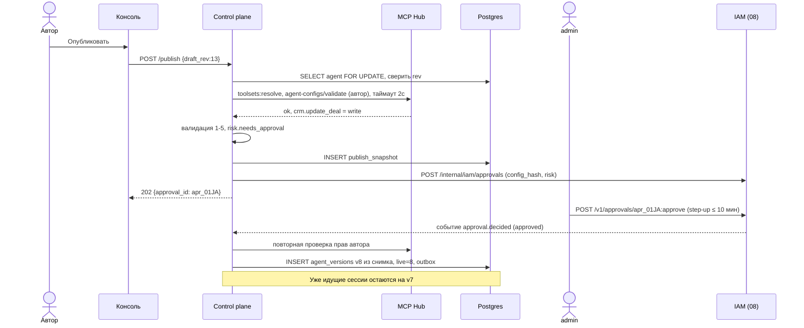
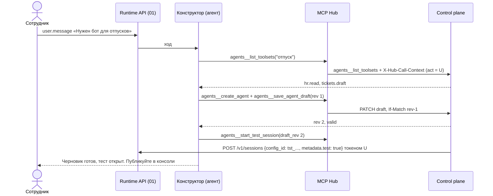

# 07. Агенты на платформе: control plane и консоль

Черновик 2, 2026-10-15. Основа: [design.md](../design.md), разделы 2, 6 и 10 (шаг 5), и [decisions.md](../decisions.md).

## 0. Согласовано

Этот раздел главнее текста ниже. Подробности и причины в [decisions.md](../decisions.md).

- **`config_id` (D10).** Версия `ver_...` и тестовый снимок `tst_...` отдаются одним `GET /internal/v1/agent-configs/{config_id}` (неизменяемый ответ, есть `namespace_id`, `owner_id`, `config_schema`). Пути `agent-versions/{id}` и `test-snapshots/{id}` остаются синонимами.
- **Новые поля `agent/v1` (D10, D17, D18, D22, D27, D34, D35).** `tool_exposure`, `pinned_tools`, `confirmations` (по типу и по тулу, только ужесточают), `max_data_class`, `credentials: [имя vault]`, `custom_tools: [{name, description, input_schema, timeout_s, responder, data_class}]`, `subagents: [{name, ref, description, mode: child | inline, await_default}]`, `outcomes: {grader_model}`, `limits: {turn_timeout_s (≤ 1800), max_cost_usd_per_session, max_cost_usd_per_tree, max_subagent_depth}`, `version_upgrade: never | next_session`. В версии `toolsets: [{name, revision}]`, префикс `hub:` только в YAML.
- **Валидация (D13, D25, D27, D18, D37).** Уровень 2: секреты `credentials` существуют (06). Уровень 3: права автора только через 05 `POST /internal/v1/agent-configs/validate` (Hub зовёт 08), код `author_lacks_access`; секреты есть у автора. Уровень 4: `acp:claude` и `acp:codex` с `environment: none` получают `platform/min`; `await: true` запрещён, если у ребёнка есть `custom_tools`; данные для уровня 4 из 03 `GET /internal/v1/harness-adapters`, 04 `GET /internal/v1/sandbox-drivers`, 06 `GET /internal/v1/model-routes`. `access:check` у Hub не существует и не используется.
- **Ревизии toolset (D12).** При публикации и при создании тестового снимка 07 вызывает 05 `POST /internal/v1/toolsets:resolve` и закрепляет ревизии.
- **Согласование (D15).** Решение хранит 08 (`approvals`, `kind = agent_publish`). Таблица `publish_requests` стала `publish_snapshots` (`id`, `agent_id`, `draft_rev`, `resolved_config`, `config_hash`, `approval_id`, `requested_by`), без статуса решения. `POST /publish` при риске: `202 {approval_id}`. По `approval.decided` (approved) 07 сверяет `config_hash`, заново проверяет права автора и сам создаёт версию. Права пропали: версии нет, событие `agent.publish_failed`. Эндпоинты `/v1/publish-requests/*` убраны: очередь и решения в 08 (`GET /v1/namespaces/{ns}/approvals`, `POST /v1/approvals/{id}:approve`). `self_approval` = `403`. Step-up (`auth_time` не старше 10 мин) проверяет 08.
- **Роли (D14).** `ns_admin` → `admin`, `platform_admin` → `platform_operator`. Права из списка 08.
- **Личность агента (D11).** При `POST /v1/agents` 07 вызывает 08 `POST /internal/iam/agent-principals` (идемпотентно по `agent_id`). Гранты агента в 08 не пишутся: права агента это toolsets конфига.
- **Ссылки (D21).** `null`, `agent`, `agent@live` = `live_version`. 01, 09, 10 зовут только `agent-refs:resolve`. Ссылки `platform/*` разрешены (D36).
- **Отзыв версии (D22).** `POST /v1/agents/{id}/versions/{n}:recall {mode: terminate}` и событие `agent.version_recalled {agent_id, version, config_id}`. Экран версий показывает число живых сессий на версию (01 `GET /v1/sessions?agent_version=`).
- **Тестовые сессии (D36, D35, D16).** 07 создаёт снимок `tst_...` и вызывает 01 `POST /v1/sessions {config_id, metadata.test: true, limits: {budget_usd: 2, ttl_s: 86400}}` principal-токеном нажавшего человека. `write` в тесте идёт с `ask` (Hub читает `test` в токене), карточка пишет «запись реальная».
- **Конструктор (D29, D36).** `platform/agent-builder` и toolset `platform.builder` глобальные (`namespace_id = null`). Встроенный сервер Hub `agents`, тулы `agents__*` (таблица D29). Вызов приходит с `X-Hub-Call-Context`: 07 проверяет подпись Hub, по `act` получает principal token у 08 (`POST /internal/iam/principal-tokens`) и действует от имени человека. `agents__create_agent` идемпотентен по `(session_id, name)`. `agents__save_agent_draft` при `412` отдаёт `isError` с текущим черновиком и `rev`. `agents__start_test_session` принимает `draft_rev`.
- **Environment (D37).** Таблиц `environments` и `environment_versions` здесь нет, владелец 04. 07 показывает среды и проверяет ссылки через API 04.

## 1. Назначение и границы

Компонент хранит агентов и всё, из чего они собираются. Через него человек создаёт агента в консоли, пробует, публикует, откатывает. Остальные компоненты получают от него неизменяемый снимок `AgentVersion` и больше ничего.

Что делает:

- Хранит `Agent`, `Draft`, `AgentVersion`, тестовые снимки, `Preset`, настройки агентов на уровне `Namespace`. Environment хранит 04 (D37).
- Валидирует конфиг агента: схема, ссылки, права автора, политика namespace, риск.
- Публикует черновик в неизменяемую версию. Для `write` и `pdn` хранит снимок и просит согласование у 08 (D15).
- Разрешает ссылку `agent`, `agent@live`, `agent@3` в конкретную версию.
- Откат, сравнение версий, экспорт и импорт YAML, режим `managed_by: git`.
- Реализует встроенный сервер Hub `agents` с тулами агента-конструктора (D29).
- Консоль: веб-приложение поверх публичного API. Своих скрытых ручек у консоли нет.

Чего НЕ делает:

- Не запускает сессии и не хранит события. Это 01-runtime-api и 02-session-workflow. Тестовая сессия создаётся через Runtime API.
- Не проверяет права на каждом вызове тула. Это делает 05-mcp-hub. Мы проверяем права только при сохранении и публикации.
- Не хранит секреты. В конфиге агента только имена ссылок на vault (06).
- Не хранит скиллы и память. Ссылки на них проверяем через 10-deployments-memory-skills.
- Не владеет пользователями, ролями и самим `Namespace`. Это 08-iam-tenancy. У нас только настройки агентов внутри namespace.
- Не создаёт Pod и контейнеры. `Environment` здесь только описание, исполняет его 04-sandbox.

Язык: Go, как весь control plane (design.md, раздел 11). Это модуль `agents` в общем API-процессе, но со своими таблицами. Чужие таблицы он не читает.

## 2. Модель данных

Postgres. Все id это ULID с префиксом (`agt_`, `ver_`, `tst_`, `pst_`, `ps_`). Во всех таблицах есть `namespace_id`. Row-level security включена (`ALTER TABLE ... ENABLE ROW LEVEL SECURITY` и `FORCE ROW LEVEL SECURITY`, чтобы владелец таблицы тоже подчинялся политике). Политика сравнивает `namespace_id` с `current_setting('app.namespace_id')`, которое ставится в начале транзакции (использование `current_setting` в политике (не проверено) по странице RLS, но это обычная функция и должна работать).

### agents

| Поле | Тип | Смысл |
|---|---|---|
| `id` | text PK | `agt_01J...` |
| `namespace_id` | text | Тенант |
| `name` | text | Slug `^[a-z][a-z0-9-]{1,62}$`, уникален в namespace |
| `display_name`, `description` | text | Для консоли |
| `owner_id` | text | Пользователь из 08 |
| `status` | enum | `active`, `archived` |
| `live_version` | int null | Какую версию получают новые сессии по `agent` или `agent@live` |
| `latest_version` | int | Последний выданный номер, 0 если версий нет |
| `managed_by` | enum | `console` или `git` |
| `git_source` | jsonb null | `{repo, path, ref, commit}` при `managed_by=git` |
| `created_at`, `updated_at` | timestamptz | |

### agent_drafts (один на агента)

| Поле | Тип | Смысл |
|---|---|---|
| `agent_id` | text PK | |
| `rev` | int | Растёт на каждое сохранение. Идёт в `ETag` |
| `config` | jsonb | `AgentConfig`, ссылки могут быть без версий |
| `validation` | jsonb | Итог последней проверки (см. раздел 3.5) |
| `base_version` | int null | От какой версии начат черновик. Нужно для diff |
| `updated_by`, `updated_source` | text | `updated_source`: `console`, `constructor`, `import`, `preset` |
| `updated_at` | timestamptz | |

### agent_versions (только вставка)

| Поле | Тип | Смысл |
|---|---|---|
| `id` | text PK | `ver_...` |
| `agent_id`, `version` | text, int | Уникальная пара. Номера 1, 2, 3 без дыр |
| `config` | jsonb | Разрешённый конфиг: у всех ссылок закреплены версии |
| `config_hash` | text | `sha256` от канонического JSON (ключи по алфавиту, без пробелов) |
| `source` | enum | `console`, `import`, `rollback`, `constructor` |
| `rolled_back_from` | int null | Номер версии, копией которой стала эта |
| `risk` | jsonb | `{has_write: bool, max_data_class: "internal", needs_approval: bool}` |
| `approval_id` | text null | Согласование в 08, по которому версия появилась (D15) |
| `notes` | text | Что изменилось, пишет автор |
| `created_by`, `created_at` | | |
| `health` | enum | `ok`, `degraded`. Ставит фоновая перепроверка, сам конфиг не меняется |

Изменить или удалить строку нельзя. Это обеспечено триггером, который бросает ошибку на `UPDATE` конфига и на `DELETE`. Поле `health` единственное, что меняется.

### publish_snapshots

Снимок черновика на момент запроса публикации. Решение по нему хранит 08 (D15).

| Поле | Тип | Смысл |
|---|---|---|
| `id` | text PK | `ps_...` |
| `agent_id`, `draft_rev` | | Какой черновик просят опубликовать |
| `resolved_config`, `config_hash` | jsonb, text | Замороженный конфиг с ревизиями toolsets |
| `risk` | jsonb | Почему нужна заявка: `["write:crm.update_deal", "pdn:hr.read"]` |
| `approval_id` | text | `apr_...` в 08 |
| `requested_by` | text | Автор публикации |

Новая заявка того же агента переводит старую в `superseded` (делает 08).

### test_snapshots

Снимок черновика для тестовой сессии. Не версия, в историю не попадает.

| Поле | Тип | Смысл |
|---|---|---|
| `id` | text PK | `tst_...` |
| `agent_id`, `draft_rev` | | |
| `resolved_config` | jsonb | Как при публикации (с ревизиями toolsets), плюс тестовые ограничения. Id `tst_...` это `config_id` (D10) |
| `session_id` | text | Сессия в 01 |
| `expires_at` | timestamptz | 24 часа |

### environments

Своих таблиц сред нет. Environment и `environment_versions` хранит 04 (D37). Агент ссылается на `env-name@4`. В черновике можно `env-name`, при публикации это станет последней версией по API 04.

### presets

| Поле | Тип | Смысл |
|---|---|---|
| `id` | text PK | `pst_...` |
| `namespace_id` | text null | `null` значит встроенный, виден всем |
| `name`, `title`, `description` | text | `channel-bot`, «Бот в канале» |
| `version` | int | Preset тоже версионируется |
| `variables_schema` | jsonb | JSON Schema 2020-12 переменных |
| `template` | jsonb | `AgentConfig` с местами `{{var}}` только в строковых значениях |
| `recommended_connect` | text | `channel`, `deployment`, `api` |

### namespace_agent_settings

Настройки, которые администратор namespace задаёт для агентов. Сам `Namespace` живёт в 08.

| Поле | Тип | По умолчанию |
|---|---|---|
| `namespace_id` | text PK | |
| `allowed_harnesses` | text[] | `{claude, simple}` |
| `allowed_models` | text[] | Пусто значит все из шлюза 06 |
| `default_model` | text | Задаёт оператор |
| `max_agents` | int | 200 |
| `approval_required_for` | text[] | `{write, pdn}` |
| `test_session_budget_usd` | numeric | 2.00 на тестовую сессию |

### outbox

`id bigserial`, `topic`, `payload jsonb`, `created_at`, `delivered_at`. Пишется в той же транзакции, что и изменение. Раздача описана в 3.4.

### AgentConfig (что лежит в `config`)

```yaml
schema: agent/v1
name: hr-helper
description: Отвечает на вопросы по отпускам
harness: {kind: claude, effort: medium}     # kind: claude | codex | adk | langgraph | simple; в рантайме harness_kind: claude → acp:claude, codex → acp:codex (A1)
model: claude-sonnet-5-5
instructions: |
  ...
personality: {soul: "...", identity: "...", user: "..."}   # SOUL.md, IDENTITY.md, USER.md
toolsets: [hub:hr.read, hub:tickets.draft]   # в версии: [{name: hr.read, revision: 7}, ...] (D12)
pinned_tools: []
tool_exposure: full                           # full | search
max_data_class: confidential
credentials: [github-bot]                     # имена vault (D27)
custom_tools:                                 # D17
  - {name: pick_date, description: "Выбор даты в приложении", input_schema: {type: object}, timeout_s: 86400, responder: client, data_class: internal}
skills: [vacation-policy@2]
subagents:
  - {name: researcher, ref: self, description: "Поиск по базе", mode: child, await_default: false}
  - {name: checker, ref: "policy-checker@3", mode: child, await_default: true}
memory: [{store: "channel:hr", access: read_write}]
environment: none                             # или "py-data@4"
confirmations: {write: ask, irreversible: ask, tools: {tickets__close: review}}   # allow | review | ask | deny, только ужесточают
outcomes: {grader_model: claude-sonnet-5-5}
limits: {turn_timeout_s: 1800, max_cost_usd_per_session: 5, max_cost_usd_per_tree: 20, max_subagent_depth: 2}
version_upgrade: next_session                 # never | next_session (D22)
labels: {team: hr}
```

Конфиг агента для Hub может только ужесточить правило подтверждения (D10). Hub решает сам (design.md, раздел 5).

## 3. Контракты

Все ответы JSON. Ошибки в общем формате 01 (раздел 3.1): `{"error": {"type", "code", "message", "request_id", "details"}}`. Аутентификация и namespace берутся из токена 08. Публичный префикс `/v1`, внутренний `/internal/v1` (только mTLS внутри кластера).

### 3.1 Агенты и черновик

| Метод | Ответ | Ошибки |
|---|---|---|
| `POST /v1/agents` | `201` агент и пустой черновик `rev=1` | `409 name_taken`, `403 forbidden` (нет `agent_builder`), `422 quota_exceeded` |
| `GET /v1/agents?status=active&q=hr&cursor=` | `200` список, страница 50 | |
| `GET /v1/agents/{id}` | `200` агент, `live_version`, сводка рисков | `404` |
| `GET /v1/agents/{id}/draft` | `200`, заголовок `ETag: "rev-12"` | |
| `PATCH /v1/agents/{id}/draft` | `200` новый `rev` и итог проверки | `412 rev_mismatch`, `409 managed_by_git`, `422 invalid_patch` |
| `POST /v1/agents/{id}/draft:validate` | `200` итог проверки | `503 dependency_unavailable` |
| `POST /v1/agents/{id}/draft:reset?from_version=3` | `200` черновик стал копией версии | |
| `POST /v1/agents/{id}:archive` | `200` | `409 has_active_bindings` (есть Channel или Deployment) |

`PATCH` принимает JSON Merge Patch (RFC 7396) и требует `If-Match`. Без заголовка ответ `428 precondition_required`. Черновик сохраняется даже с ошибками валидации. Ошибки показываются, но не блокируют. Блокирует только кривой JSON и размер больше 256 KiB.

```http
PATCH /v1/agents/agt_01J9/draft
If-Match: "rev-12"
Content-Type: application/merge-patch+json

{"toolsets": ["hub:hr.read", "hub:crm.write"]}
```

```json
200 OK  ETag: "rev-13"
{"rev": 13,
 "validation": {"valid": false,
  "errors": [{"path": "/toolsets/1", "code": "author_lacks_access",
              "message": "У вас нет доступа к hub:crm.write"}],
  "warnings": [],
  "risk": {"has_write": true, "max_data_class": "confidential", "needs_approval": true}}}
```

### 3.2 Публикация, версии, откат

| Метод | Ответ | Ошибки |
|---|---|---|
| `POST /v1/agents/{id}/publish` тело `{draft_rev, notes, make_live: true}` | `201` версия, или `202 {approval_id}` (D15) | `412 rev_mismatch`, `422 validation_failed`, `409 unchanged` (хэш равен `live`), `503 dependency_unavailable` |
| `GET /v1/agents/{id}/versions` | `200` список без `config` | |
| `GET /v1/agents/{id}/versions/{n}` | `200` полный конфиг | `404` |
| `GET /v1/agents/{id}/versions/{a}/diff/{b}` | `200` JSON Patch (RFC 6902) и текстовый diff инструкций | |
| `POST /v1/agents/{id}/rollback` тело `{to_version, reason}` | `201` новая версия `source=rollback` | `422 validation_failed`, `202 {approval_id}` если нужна заявка |
| `POST /v1/agents/{id}/live` тело `{version}` | `200` перевели указатель | `404`, `409 version_degraded` без `force` |
| `POST /v1/agents/{id}/versions/{n}:recall` тело `{mode: terminate}` | `202`, событие `agent.version_recalled` (D22) | `404`, `409 is_live` (сначала `POST /live`) |

Очередь заявок и решения живут в 08: `GET /v1/namespaces/{ns}/approvals`, `POST /v1/approvals/{id}:approve`, `:reject` (D15).

Правила:

- Сессия закрепляется за версией при создании. Сессию никто не переводит на другую версию. Правка агента её не задевает.
- `agent` и `agent@live` разрешаются в `live_version` в момент создания сессии. `agent@3` значит ровно версия 3.
- Channel и Deployment хранят ссылку как есть. Если там `@live`, каждая новая сессия берёт текущую live-версию. Если `@3`, остаётся на 3.
- Откат не двигает указатель назад. Он создаёт новую версию N+1 с конфигом старой. История только растёт, аудит простой.
- Откат на версию, которая уже была согласована и у которой тот же `config_hash`, заявки не требует. Но валидация проходит заново: тул мог пропасть из Hub, у автора могли забрать права.
- Утвердить свою заявку нельзя (`403 self_approval`, проверяет 08).

Пример:

```http
POST /v1/agents/agt_01J9/publish
{"draft_rev": 13, "notes": "Добавил CRM", "make_live": true}
```

```json
202 Accepted
{"approval_id": "apr_01JA", "status": "pending",
 "risk": ["write:crm.update_deal"], "expires_at": "2026-10-22T10:00:00Z"}
```

### 3.3 Экспорт, импорт, git

| Метод | Ответ |
|---|---|
| `GET /v1/agents/{id}/export?version=3` или `?draft=true` | `200 application/yaml` |
| `POST /v1/agents/import?mode=draft\|publish&dry_run=true` | `200` итог по каждому документу |
| `POST /v1/agent-configs:validate` | `200` проверка без сохранения (для CI) |
| `POST /v1/agents/{id}:unmanage` | `200`, `managed_by` стал `console` (только владелец или `admin`) |

Формат YAML совпадает с `AgentConfig`. Экспорт версии даёт закреплённые ссылки (`hub:hr.read@7`), экспорт черновика даёт как есть. Id, владелец, `namespace_id` в YAML не попадают. Значений секретов там нет никогда, только имена (`vault:crm-oauth`).

Импорт:

- Тело это один или несколько YAML-документов через `---`. Максимум 50 документов и 1 MiB.
- Агент ищется по `name`. Нет агента, создаётся. Есть, обновляется черновик.
- Заголовки `X-Managed-By: git`, `X-Git-Repo`, `X-Git-Path`, `X-Git-Commit` ставят `managed_by=git` и `git_source`.
- Пока `managed_by=git`, форма в консоли только для чтения. `PATCH draft` из консоли получает `409 managed_by_git`. Тестовый чат работает. Конструктор тоже получает `409` и предлагает человеку снять пометку.
- `mode=publish` после импорта сразу публикует. Если `config_hash` равен live, ответ `unchanged`, новой версии нет. Так повторный прогон CI ничего не плодит.
- Каждый документ обрабатывается в своей транзакции. Ответ перечисляет итог по каждому.

```json
200 OK
{"results": [
  {"name": "hr-helper", "action": "published", "version": 8},
  {"name": "sales-bot", "action": "pending_approval", "approval_id": "apr_01JB"},
  {"name": "broken", "action": "rejected",
   "errors": [{"path": "/model", "code": "model_not_allowed"}]}]}
```

### 3.4 События (outbox)

Публикуются в outbox, раздача через `LISTEN/NOTIFY` и опрос раз в 2 с как страховку. Доставка at-least-once, у события есть `event_id` для дедупликации. Шину (NATS или другую) пока не выбираем, см. открытые вопросы.

| Topic | Payload | Кто слушает |
|---|---|---|
| `agent.created` | `{agent_id, name, owner_id}` | аудит |
| `agent.draft_updated` | `{agent_id, rev, source}` | консоль (живое обновление формы) |
| `agent.version_published` | `{agent_id, version, config_hash, risk}` | 10, 09, аудит |
| `agent.live_changed` | `{agent_id, from, to}` | 09, 10 |
| `agent.publish_failed` | `{agent_id, approval_id, reason}` | автору (права пропали к моменту утверждения) |
| `agent.version_recalled` | `{agent_id, version, config_id}` | 01, 05, 09 (D22) |
| `agent.version_degraded` | `{agent_id, version, reasons[]}` | владельцу агента |
| `agent.archived` | `{agent_id}` | 09, 10 |

### 3.5 Валидация

Один валидатор на всё: сохранение, публикация, импорт, `:validate`, конструктор. Пять уровней, по порядку:

| Уровень | Что проверяет | Коды ошибок |
|---|---|---|
| 1. Схема | JSON Schema `agent/v1` (2020-12). Типы, обязательные поля, enum, длины: инструкции до 64 KiB, личность до 16 KiB на файл | `schema_violation` |
| 2. Ссылки | Toolset есть в Hub, секрет `credentials` есть в 06, скилл и версия есть в 10, memory store есть, environment есть в 04, сабагент `agent@N` существует и не архивный, нет цикла сабагентов | `unknown_toolset`, `unknown_skill`, `unknown_environment`, `unknown_memory_store`, `subagent_cycle` |
| 3. Права автора | Каждый тул из toolsets доступен автору (через 05 `agent-configs/validate`, D13). Секреты `credentials` есть у автора (06). Сабагент-агент тоже должен быть доступен автору | `author_lacks_access` |
| 4. Политика namespace | Harness и модель разрешены. Модель допускает максимальный класс данных toolsets (06). Harness поддерживает нужное: сабагенты, effort (03). Драйвер среды есть у установки (04) | `harness_not_allowed`, `model_not_allowed`, `model_data_class_mismatch`, `harness_capability_missing`, `driver_unavailable` |
| 5. Риск и линт | Считает `risk`. Предупреждения: больше 40 тулов, нет `description`, похожее на секрет значение | `secret_in_config` (ошибка), `too_many_tools`, `missing_description` (предупреждения) |

Таймауты: каждый вызов к соседу 2 с, вся проверка 5 с. Ответы соседей кэшируются на 30 с по ключу (namespace, автор, ref).

При сохранении черновика недоступный сосед даёт предупреждение `refs_unverified`. При публикации это ошибка `503 dependency_unavailable` с `Retry-After: 10`. Публикуем только проверенное.

Секрет ищется регулярками по известным форматам ключей (`sk-`, `ghp_`, `xox`, PEM-заголовок) и по энтропии строк длиннее 32 символов.

### 3.6 Внутренний контракт для runtime

| Метод | Ответ |
|---|---|
| `POST /internal/v1/agent-refs:resolve` `{namespace_id, ref: "hr-helper@live"}` | `200 {agent_id, version, config_id, config_hash}`; `404 agent_not_found`; `409 agent_archived`; `409 no_live_version`. `ref` без версии = `@live`, `platform/*` ищется среди глобальных агентов |
| `GET /internal/v1/agent-configs/{config_id}` | `200` полный разрешённый конфиг версии (`ver_`) или теста (`tst_`). Ответ неизменяем, `Cache-Control: max-age=31536000, immutable`. Тестовый снимок после истечения: `410` |

01 вызывает `resolve` один раз при `POST /v1/sessions` и пишет `agent_id`, `version` и `config_id` в сессию. 02, 03, 05, 06 берут конфиг по `config_id` и держат в кэше.

### 3.7 Агент-конструктор

Конструктор это обычный агент платформы `platform/agent-builder`, глобальный (`namespace_id = null`), сессии в namespace пользователя (D36). Его ставит оператор установки. Свои тулы он получает из встроенного сервера Hub `agents` (toolset `platform.builder`). Hub выдаёт их с правами человека, от чьего имени идёт сессия, и передаёт `X-Hub-Call-Context` (D29).

| Тул | Тип в Hub | Что делает |
|---|---|---|
| `agents__list_toolsets(query)` | read | Toolsets, доступные человеку, с типом и классом данных |
| `agents__describe_toolset(name)` | read | Тулы набора с описаниями |
| `agents__list_skills(query)`, `agents__list_models()`, `agents__list_environments()`, `agents__list_presets()` | read | Каталоги |
| `agents__get_agent_draft(agent_id)` | read | Черновик и `rev` |
| `agents__create_agent(name, preset?, variables?)` | draft | Новый агент с черновиком. Идемпотентно по `(session_id, name)` |
| `agents__save_agent_draft(agent_id, rev, patch)` | draft | Тот же `PATCH`, `updated_source=constructor`. При `412` `isError` с текущим черновиком и `rev` |
| `agents__validate_agent_draft(agent_id)` | read | Итог валидации |
| `agents__start_test_session(agent_id, draft_rev, message)` | draft | Тестовая сессия, отдаёт `session_id` и ссылку |

Публиковать конструктор не может. Тула `publish` у него нет. Публикует человек кнопкой в консоли. Так агент, который прочитал опасный текст, не выпустит агента в работу сам.

Каждое сохранение конструктора видно в консоли как diff с подписью «конструктор». Человек может отменить его кнопкой, это просто новый `PATCH` с прошлым значением.

### 3.8 Тестовые сессии

`POST /v1/agents/{id}/test-sessions` тело `{draft_rev, message?}`, ответ `201 {session_id, stream_url, snapshot_id}`.

- Конфиг черновика проходит валидацию уровней 1-4. При ошибке `422`, тест не стартует.
- Снимок пишется в `test_snapshots` (с ревизиями toolsets), сессия создаётся через 01: `{config_id: tst_..., metadata.test: true, limits: {budget_usd, ttl_s}}` (D35).
- Все `write` в тесте не ниже `ask`: Hub видит `test` в токене (D16). Карточка подтверждения пишет, что запись реальная.
- Бюджет `test_session_budget_usd` (2 доллара) проверяет 06, TTL 24 часа ставит таймер 02.
- Сессия идёт от имени того, кто нажал «Тест»: 07 зовёт 01 его principal-токеном (D36).

### 3.9 Экраны консоли

| Экран | Что видно | API |
|---|---|---|
| Список агентов | Имя, владелец, live-версия, статус, `managed_by`, бейджи «нужно согласование» и «degraded», сессий за 24 ч | `GET /v1/agents`, 01 `GET /v1/sessions?group_by=agent` |
| Создание | Три пути: описать словами (открывает конструктор), выбрать Preset (форма переменных по `variables_schema`), загрузить YAML | `POST /v1/agents`, `POST /v1/presets/{id}:instantiate`, `POST /v1/agents/import` |
| Форма | Слева разделы: основное, мозг, инструкции, личность, инструменты, скиллы, сабагенты, память, среда, подтверждения. Автосохранение через 1 с после ввода. Ошибки валидации прямо у поля по `path`. Сверху счётчик рисков | `GET/PATCH draft`, `draft:validate` |
| Тестовый чат | Справа от формы. Поток событий, свёрнутые вызовы тулов, стоимость и время хода, кнопки разрешить или запретить для `write`. Кнопка «Новый тест» после правки | `test-sessions`, 01 `stream`, 01 `events` |
| Версии | Список, кто и когда, `notes`, `source`. Diff двух версий. Кнопки «Сделать live», «Откатить на эту», «Экспорт YAML» | `versions`, `diff`, `rollback`, `live`, `export` |
| Заявки | Для `admin`: риск, diff с live, кто просит. Утвердить или отклонить с причиной. Счётчик в шапке | 08 `approvals`, 07 `publish_snapshots` для diff |
| Сессии | Сессии агента с фильтром по версии, статусу, каналу, тесту | 01 `GET /v1/sessions?agent_id=&agent_version=` (D22) |
| Трасса сессии | Лента событий журнала, дерево сабагентов, спаны Hub (тул, от чьего имени, решение по правам, стоимость) | 01 `events`, 05 `GET /v1/hub/calls?session_id=` |
| Среды | Список Environment, версии, форма образа, пакетов, доменов, ресурсов | `/v1/environments` |

Консоль работает на ширине от 390 px: на телефоне форма и тест-чат идут вкладками, а не колонками.

Environment имеет CRUD в 04 (`/v1/environments`). Preset: `GET /v1/presets`, `POST /v1/presets` (свой preset, роль `admin`), `POST /v1/presets/{id}:instantiate` `{name, variables}` → `201` агент. Ошибка переменных `422 preset_variables_invalid`.

## 4. От чего зависит

| Компонент | Контракт | Зачем |
|---|---|---|
| 08-iam-tenancy | Проверка токена, роли `agent_builder`, `admin`, `viewer`; `agent-principals`; `approvals` (D15); `principal-tokens` для конструктора (D29) | Кто вызывает, что ему можно, согласование |
| 05-mcp-hub | Каталог toolsets; `agent-configs/validate` (права автора, D13); `toolsets:resolve` (D12); встроенный сервер `agents`; трассы по `session_id` | Уровни 2-3 валидации, конструктор, экран трассы |
| 06-vault-egress-models | `GET /internal/v1/model-routes`; проверка секрета `credentials` и что он есть у автора | Уровни 2-4 |
| 01-runtime-api | `POST /v1/sessions` (с `config_id` для теста, `metadata`, `limits`), `GET /v1/sessions`, `GET /v1/sessions/{id}/events`, SSE `stream` | Тестовый чат, экраны сессий и трасс |
| 03-harness-workers | `GET /internal/v1/harness-adapters` | Уровень 4 |
| 04-sandbox | `GET /internal/v1/sandbox-drivers`, API Environment | Уровни 2 и 4 |
| 10-deployments-memory-skills | Проверка скилла `name@version`, последняя версия скилла; список memory stores и доступ автора | Уровень 2, публикация |
| 02-session-workflow | Нет прямой зависимости | |

## 5. Ключевые потоки

### Публикация с согласованием



### Тестовый чат через конструктор



## 6. Отказы и как переживаем

| Что падает | Что видит пользователь | Как восстанавливаемся |
|---|---|---|
| Postgres | Консоль: «Не удалось сохранить», `503`. Новые сессии не создаются, потому что `resolve` недоступен | Работающие сессии живут: 03 держит конфиг версии в кэше. После подъёма всё продолжается. Автосохранение в консоли держит черновик в памяти вкладки и повторяет через 2, 4, 8 с |
| Hub недоступен | Сохранение работает с предупреждением `refs_unverified`. Публикация `503`, `Retry-After: 10` | Публикация закрыта, пока не проверили права. Fail closed |
| 10 или 06 недоступны | То же, что Hub | То же |
| Два человека правят черновик | Второй получает `412`, консоль показывает diff и кнопку «Взять их версию и повторить мою правку» | Конфликт по полям: если поля разные, консоль сама делает повторный `PATCH` |
| Две публикации одновременно | Одна получает `201`, вторая `412 rev_mismatch` или `409 unchanged` | `SELECT ... FOR UPDATE` на строке агента, уникальный `(agent_id, version)` |
| После публикации тул убрали из Hub или у автора забрали права | Бейдж `degraded` у версии, письмо владельцу | Фоновая перепроверка live-версий раз в час. Сессии не останавливаем: Hub сам откажет в вызове на рантайме. Перевести live на `degraded` версию можно только с `force` |
| Заявка висит | В списке заявок счётчик дней | Через 7 дней 08 ставит `expired`, событие владельцу |
| Конструктор ошибся или упал | В чате ошибка хода (её показывает 01) | Черновик сохраняется после каждого шага. Человек продолжает в форме |
| Тестовая сессия ушла в цикл | Счётчик стоимости в чате, стоп на 2 долларах | Шлюз 06 режет по `limits.budget_usd`, по `ttl_s` 02 делает `terminate` |
| Импорт из CI упал на середине | В ответе итог по каждому документу | Документы независимы. Повторный прогон идемпотентен по `config_hash` |
| Outbox не раздаётся | Консоль не обновляется сама, остальное работает | Опрос раз в 2 с. События с `delivered_at is null` старше 5 мин дают алерт |

## 7. Безопасность

- **Роли (список в 08).** `viewer` читает. `agent_builder` создаёт и правит своих агентов, публикует без рисков. `admin` утверждает заявки (в 08), правит чужих агентов, свои preset и настройки namespace. `platform_operator` правит встроенные presets и `platform/agent-builder`.
- **Не больше прав, чем у автора.** Проверка при сохранении (предупреждение), при публикации и при утверждении (ошибка). Автор публикации это тот, кто нажал «Опубликовать». При утверждении проверяем снова: права могли измениться за неделю.
- **Согласование.** `write`, класс `pdn` или секрет класса `pdn` дают заявку в 08. Утвердить свою нельзя (`403`). Утверждение требует свежего входа: `auth_time` не старше 10 мин, проверяет 08.
- **Конструктор не публикует.** У него нет тула публикации. Его тулы имеют тип `draft` и `read`.
- **Изоляция тенантов.** RLS по `namespace_id` во всех таблицах плюс фильтр в коде. Ссылки на чужие агенты, среды и presets дают `404`, а не `403`, чтобы не раскрывать имена.
- **Секреты.** В конфиге только имена vault. Валидатор отклоняет похожие на секрет значения (`secret_in_config`). Экспорт не содержит id и данных владельца.
- **YAML.** Лимит размера 1 MiB, только безопасный разбор в JSON-совместимые типы, без пользовательских тегов. Лимит на число алиасов и глубину (защита от «billion laughs»). Есть ли такой лимит в выбранной Go-библиотеке, надо проверить (не проверено).
- **Инструкции агента** это данные для модели, а не правила безопасности. Права решает Hub, а не текст промпта.
- **Аудит.** Каждое изменение черновика, публикация, откат, решение по заявке, снятие `managed_by=git` попадают в outbox с `actor`.
- **Неизменяемость версий.** Триггер в базе запрещает `UPDATE` конфига и `DELETE`. `config_hash` пересчитывается при чтении в тестах.

## 8. Как тестировать

Строгий TDD. Сначала падающий тест, потом код. Соседи (05, 06, 08, 10, 01, 03, 04) заменены фейками, которые проходят те же контрактные тесты, что и настоящие.

Первые тесты, в этом порядке:

1. **Схема.** Набор YAML-фикстур `valid/*.yaml` и `invalid/*.yaml` с ожидаемым `code` и `path`. Валидатор уровня 1 проходит все.
2. **Канонический хэш.** Один конфиг с разным порядком ключей даёт один `config_hash`.
3. **Публикация.** Публикация черновика даёт версию 1, затем 2. Конфиг версии не меняется после правки черновика. `UPDATE` версии в базе падает.
4. **Конкуренция.** 20 параллельных публикаций одного `rev`: ровно одна `201`, номера без дыр.
5. **If-Match.** `PATCH` со старым `rev` даёт `412`, без заголовка `428`.
6. **Права автора.** Фейковый Hub не даёт автору `crm.write`: сохранение проходит с ошибкой в `validation`, публикация `422 author_lacks_access`.
7. **Согласование.** Toolset с `write` даёт `202 {approval_id}` и снимок. Фейковое событие `approval.decided` создаёт версию из снимка. Права автора пропали: версии нет, `agent.publish_failed`.
8. **Resolve и закрепление.** `hr-helper` и `@live` дают live, `@3` даёт 3. После публикации v4 старая сессия (фейк 01) продолжает получать v3.
9. **Откат.** Откат на v2 даёт v5 с `config_hash` как у v2 и `rolled_back_from=2`. Без заявки, если v2 согласована.
10. **YAML.** Экспорт и импорт версии дают тот же `config_hash`. Повторный импорт `mode=publish` даёт `unchanged`. `managed_by=git` блокирует `PATCH` из консоли (`409`).
11. **Отказ соседа.** Фейковый Hub отвечает через 3 с: сохранение с `refs_unverified`, публикация `503`.
12. **RLS.** Запрос с `app.namespace_id=A` не видит агентов B даже без фильтра в коде.

Потом:

- **Конструктор.** Сценарий на адаптере `simple` с записанными ответами модели: «бот для отпусков» даёт черновик с `hr.read`, тестовую сессию и ни одной версии.
- **Консоль.** Playwright: создать агента из preset, добавить toolset, увидеть ошибку у поля, пройти тест-чат, опубликовать, откатить. Скриншоты 1280 и 390.
- **Сквозной.** На общем стенде: опубликовать v1, начать сессию, опубликовать v2, убедиться в журнале 01, что старая сессия идёт на v1.

## 9. Открытые вопросы

1. ~~**Toolset версионируется в Hub?**~~ Решено в D12: да, ревизии. Если владелец Hub меняет состав `hr.read`, меняется ли поведение уже опубликованных агентов? Предлагаю, чтобы Hub выдавал ревизию `hr.read@7`, а версия агента её закрепляла. Нужно согласие 05.
2. **Откат как новая версия.** design.md говорит про «откат», но не уточняет механику. Здесь откат создаёт версию N+1. Если нужно просто двигать указатель, есть `POST /live`.
3. ~~**Перевод живой сессии на новую версию.**~~ D22: `version_upgrade: next_session`, `next_turn` позже. Сейчас запрещён. Для бота в канале тред может жить месяцами на старой версии. Нужен ли `POST /v1/sessions/{id}:upgrade` в 01 с правилом «только между ходами»?
4. ~~**Шина событий.**~~ D40: outbox и LISTEN/NOTIFY. Outbox плюс `LISTEN/NOTIFY` хватит на старте. Если 09 и 10 захотят подписки с ретраями, понадобится NATS или аналог. Решение общее для всех компонентов.
5. ~~**Кто владеет skills.**~~ D37: 10. design.md кладёт скиллы в Hub (раздел 5), список компонентов отдаёт их в 10. Здесь считаем, что владелец 10.
6. ~~**`write: allow` в конфиге агента.**~~ D10: только ужесточает. design.md говорит, что подтверждения решает Hub. Тогда поле `confirmations` в агенте только ужесточает. Нужно подтвердить это с 05.
7. **Классы данных и модель.** Проверку «модель допускает класс данных» делаем при публикации. Но шлюз 06 всё равно маршрутизирует на рантайме. Нужна ли статическая проверка или достаточно рантайма?
8. ~~**Где живёт `platform/agent-builder`.**~~ D36: один на установку. Это встроенный агент в каждом namespace или один на установку с сессиями в namespace пользователя? Предлагаю второе.
9. **Библиотека YAML на Go** и её защита от алиас-бомб (не проверено).
10. ~~**Approval-сервис.**~~ D15: решения в 08, подтверждения тулов в Hub. Заявки на публикацию похожи на подтверждения тулов в Hub. Возможно, нужен общий механизм согласований в 08, а не свой здесь.
