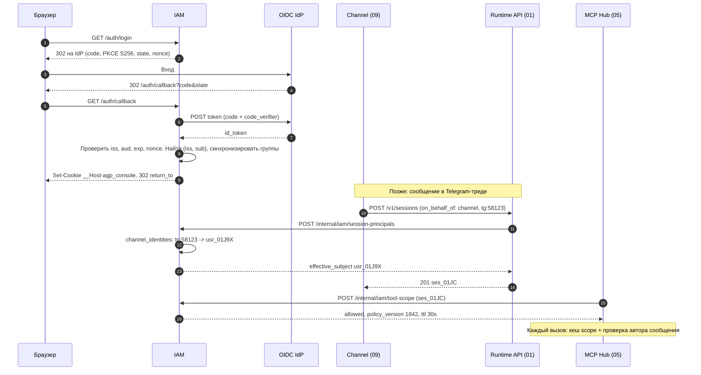
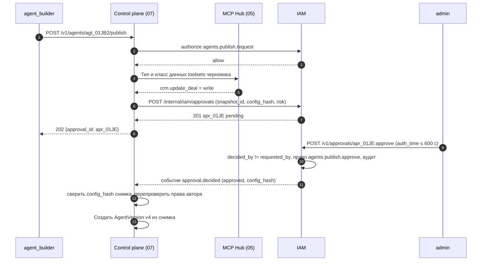

# 08. Идентичность, права и тенанты

Черновик 2, 2026-10-15. Основа: [design.md](../design.md) и [decisions.md](../decisions.md).

## 0. Согласовано

Этот раздел главнее текста ниже. Подробности и причины в [decisions.md](../decisions.md).

- **Единый список ролей и прав (D14).** Только здесь. Роли: `owner`, `admin`, `agent_builder`, `viewer`, системная `platform_operator`. Добавлены права: `hub.rules.manage`, `tools.confirm` (одобрять вызов тула, ресурс `tool:<slug>`), `session.tool_result` (отвечать за custom tool), `session.act_as`, `channels.manage`, `memory.proposals.decide`, `memory.read_personal`, `deployments.run_as`. Имена в других спеках (`ns_admin`, `hub_admin`, `channel_admin`, `platform_admin`) заменены на эти.
- **Права агента (D11).** Гранты `tool_grants` с субъектом `agent:*` убраны. `tool-scope` получает toolsets конфига агента на вход: `{session_id, config_toolsets: [{name, revision}], effective_subject, turn_actors[], toolset_catalog}`. Ответ считает: `deny → потолок тенанта → toolsets агента → effective_subject → каждый turn_actor` (D30). Личность агента создаёт 07 через `POST /internal/iam/agent-principals {agent_id, namespace_id, owner_id}`, идемпотентно по `agent_id`.
- **Проверка автора (D13).** `grants:check-subset` удалён. Hub зовёт `tool-scope` с `subject = author` и без агента.
- **При недоступном IAM (D14).** Правило одно и только здесь: потребитель работает по кешу до `ttl_s` (30 с), затем ещё до 120 с только `read`. Hub своих чисел не держит.
- **Сессия (D10, D19, D33).** `session_principals.agent_version int` заменён на `config_id`. Вход `session-principals`: `{session_id, namespace_id, agent_id, config_id, on_behalf_of: {kind, id, external_user_id?}, initiator}`. Для `deployment` `effective_subject = sa_...`, права SA не шире прав владельца, проверка на каждом запуске.
- **Согласование публикации (D15).** `target = {agent_id, config_hash, snapshot_id}`. `POST /v1/agents/{id}/publish` у 07 отвечает `202 {approval_id}`, повторной публикации автором нет: по `approval.decided` 07 создаёт версию сам. Новая заявка того же агента переводит старую `pending` в `superseded`. `self_approval` = `403`. Утверждение требует `auth_time` не старше 600 с: `GET /auth/login?max_age=600`, claim `auth_time` в principal token. Новое событие `approval.requested` (для очереди в консоли и уведомлений).
- **Principal token для сервисов (D29, D36).** `POST /internal/iam/principal-tokens {sub, ns, aud}` выдаёт token от имени человека. Звать могут только 07, 09, 10 по mTLS и только для `sub` из проверенного контекста вызова Hub.
- **Workload token (D6).** Не нужен: `writer_token` выдаёт 01.
- **Связки аккаунтов чата (D31).** Источник правды `channel_identities` здесь. Способ привязки один: одноразовая ссылка на 15 мин, выдаёт `POST /internal/iam/identity-links {channel_id, external_user_id}`, завершает `GET /v1/identity-links/{token}/complete` после входа человека. Код из 6 цифр убран. 09 только кеширует.
- **Подтверждения вызовов (D16).** Согласующие по умолчанию: `effective_subject`, владелец агента и все с `tools.confirm` на тул. У сессии deployment вместо SA владелец deployment.
- **Запреты (D27).** `deny_rules.match` получает `egress_host`. В аудит идут `leak_blocked` и попытки к частным IP от 06.
- **Имена (D28).** `namespace_id` = `ns_<ULID>` везде (в `tid` токенов, путях S3, столбцах). Slug только для показа и имени namespace Kubernetes `agp-<slug>`.

## 1. Назначение и границы

Компонент отвечает на три вопроса: **кто** действует, **в каком тенанте** и **что ему можно**. Его зовут все остальные компоненты. Сам он ничего не исполняет.

Что делает:

- Хранит субъектов (principals): люди, сервисные аккаунты, личности агентов, каналы и deployments как «от чьего имени».
- Хранит Namespace (тенант) и его жизненный цикл. Даёт событие, по которому Sandbox-драйвер создаёт namespace Kubernetes.
- Хранит единый список ролей и прав платформы, привязки ролей, гранты на toolsets для людей, SA и каналов, запреты компании.
- Отвечает на вопрос «можно ли» (`authorize`) и считает эффективный набор тулов для сессии (`tool-scope`) по toolsets конфига агента.
- Определяет, от чьего имени работает сессия (`acting_as`), и фиксирует это при создании сессии.
- Ведёт согласования публикации опасных агентов (`write` или `pdn`).
- Ведёт аудит: один append-only журнал действий людей, агентов и системы.
- Вход в консоль через OIDC, API-ключи сервисных аккаунтов, внутренние токены субъектов.

Чего НЕ делает:

- Не хранит секреты и OAuth-гранты внешних систем. Это Vault (06).
- Не выдаёт токен сессии для MCP. Его выдаёт Hub (05). IAM только говорит Hub, какой scope разрешён.
- Не размечает тулы (`read/draft/write`, класс данных). Это Hub. IAM хранит только гранты на toolsets и запреты.
- Не проверяет каждый вызов тула сам. Проверку делает Hub, вызывая `authorize` (с кешем).
- Не создаёт объекты Kubernetes. Это Sandbox-драйвер `kubernetes` (04) по событию `namespace.*`.
- Не хранит события сессии. Журнал сессии принадлежит Runtime API (01). Аудит IAM хранит только действия управления и решения прав.
- Не является IdP. Пароли не хранит. Люди входят только через внешний OIDC-провайдер.

## 2. Модель данных

Postgres, схема `iam`. Все id: `text` с префиксом и ULID (`usr_01J...`). Время: `timestamptz`. Каждая таблица тенанта имеет `namespace_id` и политику RLS (раздел 7).

### 2.1 Namespace

| Поле | Тип | Смысл |
|---|---|---|
| `id` | text `ns_...` | |
| `slug` | text, unique | RFC 1123 label: `[a-z0-9]([-a-z0-9]*[a-z0-9])?`, до 50 символов |
| `k8s_namespace` | text, unique | `agp-<slug>`, до 63 символов. Префикс защищает от `kube-*` и имён TLD |
| `display_name` | text | |
| `state` | enum | `provisioning`, `active`, `suspended`, `deleting`, `deleted` |
| `quotas` | jsonb | `{max_sessions_running: 50, max_agents: 200, cpu: "20", memory: "40Gi", monthly_budget_usd: 1000}` |
| `data_class_ceiling` | enum | Максимальный класс данных тенанта, по умолчанию `confidential` |
| `oidc_group_map` | jsonb | `{"okta:hr-admins": "admin"}`: группа IdP → роль |
| `created_by`, `created_at`, `updated_at` | | |

Один тенант = один namespace платформы = один namespace Kubernetes (решение из design.md, раздел 11).

### 2.2 Principals

Одна таблица `principals`, вид в поле `kind`.

| Поле | Тип | Смысл |
|---|---|---|
| `id` | text | `usr_`, `sa_`, `agt_`, `chn_`, `dep_` |
| `kind` | enum | `user`, `service_account`, `agent`, `channel`, `deployment` |
| `namespace_id` | text, null | `null` только у `user`: человек глобален и входит в несколько тенантов |
| `display_name` | text | |
| `status` | enum | `active`, `disabled` |
| `owner_id` | text, null | Кто отвечает: у SA, agent, channel, deployment это человек |
| `created_at`, `disabled_at` | | |

Расширения по видам:

- `user_identities`: `principal_id`, `issuer`, `subject`, `email`, `last_login_at`. Уникален `(issuer, subject)`. Email не ключ: его могут переназначить.
- `api_keys`: `id key_...`, `principal_id` (только `service_account`), `prefix` (8 символов, видны в консоли), `hash` (SHA-256 от 32 случайных байт), `expires_at` (по умолчанию 90 дней), `last_used_at`, `revoked_at`.
- `channel_identities`: `channel_id`, `external_user_id` (id в Telegram или Slack), `principal_id` (человек или `null`), `verified_at`. Это связка «аккаунт в чате ↔ человек платформы».

Личность агента (`agent`) создаёт 07 через `POST /internal/iam/agent-principals` при создании агента (идемпотентно по `agent_id`). Ей нельзя дать роль и гранты. Она нужна для `actor` и аудита. Права агента это toolsets его конфига (D11).

### 2.3 Роли и привязки

Роли встроенные, своих ролей в v1 нет.

| Роль | Что может |
|---|---|
| `owner` | Всё в namespace, плюс управление привязками `owner` и удаление namespace |
| `admin` | Привязки ролей (кроме `owner`), гранты, запреты, согласования, Vault, реестр Hub, чтение аудита |
| `agent_builder` | Создавать агентов, черновики, тестовые сессии, просить публикацию, создавать channels и deployments для своих агентов |
| `viewer` | Читать агентов, версии, свои сессии. Запускать сессии на опубликованных агентах, если есть грант на агента |

Плюс системная роль `platform_operator` вне тенантов: создаёт namespace, приостанавливает, видит здоровье. Данные тенанта не читает.

Права (`permission`) встроенным списком, роль = набор прав:

`namespace.read`, `namespace.manage`, `bindings.manage`, `agents.create`, `agents.edit`, `agents.publish.request`, `agents.publish.approve`, `agents.use`, `sessions.create`, `sessions.read.own`, `sessions.read.all`, `session.write`, `session.act_as`, `session.tool_result`, `tools.confirm`, `channels.manage`, `deployments.manage`, `deployments.run_as`, `hub.servers.manage`, `hub.toolsets.manage`, `hub.rules.manage`, `vault.manage`, `grants.manage`, `memory.proposals.decide`, `memory.read_personal`, `audit.read`.

Это единственный список прав платформы (D14). `admin` имеет все права namespace, кроме привязки `owner`. `agent_builder`: `agents.*` на своих агентов, `sessions.create`, `channels.manage` и `deployments.manage` для своих агентов, `tools.confirm` на вызовы своих агентов. Сервисные аккаунты 09 и 10 имеют `session.act_as`.

`role_bindings`:

| Поле | Тип | Смысл |
|---|---|---|
| `id` | text `rb_...` | |
| `namespace_id` | text | |
| `subject` | text | `usr_...`, `sa_...` или `group:<issuer>/<name>` |
| `role` | enum | |
| `source` | enum | `manual`, `oidc_group` |
| `expires_at` | timestamptz, null | Временный доступ |
| `created_by`, `created_at` | | |

### 2.4 Гранты на тулы и запреты

`tool_grants`: кому какие toolsets можно.

| Поле | Тип | Смысл |
|---|---|---|
| `id` | text `tg_...` | |
| `namespace_id` | text | |
| `subject` | text | user, SA, group, `channel:chn_...`. Субъекта `agent:*` нет (D11) |
| `toolset` | text | `crm.read`, `tickets.draft`, или `*` |
| `max_data_class` | enum | `public` < `internal` < `confidential` < `pdn` |
| `effect_limit` | enum | Предел типа тула: `read`, `draft`, `write` |

`deny_rules`: запреты компании. Запрет сильнее любого гранта.

| Поле | Тип | Смысл |
|---|---|---|
| `id` | text `dr_...` | |
| `namespace_id` | text, null | `null` = на всю установку (ставит `platform_operator`) |
| `match` | jsonb | `{"toolset": "payments.*"}`, `{"tool": "crm.delete_contact"}`, `{"data_class": "pdn", "model_route": "external"}`, `{"egress_host": "*.pastebin.com"}` (D27) |
| `applies_to` | text | `*`, группа, человек, агент |
| `reason` | text | Показывается в отказе |

### 2.5 Acting-as сессии

`session_principals` пишется один раз при создании сессии. Это ответ на вопрос «от чьего имени».

| Поле | Тип | Смысл |
|---|---|---|
| `session_id` | text | Id сессии из 01 |
| `namespace_id` | text | |
| `agent_principal` | text | `agt_...` |
| `config_id` | text | `ver_...` или `tst_...` (D10) |
| `on_behalf_of` | jsonb | `{kind: user|channel|deployment|service_account, id, external_user_id?}` (D19) |
| `effective_subject` | text | Чьи права пересекаются с агентом: человек, SA deployment или канал |
| `initiator` | text | Кто нажал или прислал первое: человек, SA, система |
| `created_at` | | |

### 2.6 Согласования

`approvals`:

| Поле | Тип | Смысл |
|---|---|---|
| `id` | text `apr_...` | |
| `namespace_id` | text | |
| `kind` | enum | `agent_publish` (в v1 единственный) |
| `target` | jsonb | `{agent_id, snapshot_id, config_hash}` (снимок хранит 07, D15) |
| `risk` | jsonb | `{write_tools: ["crm.update_deal"], pdn_toolsets: ["hr.read"]}` |
| `requested_by` | text | |
| `state` | enum | `pending`, `approved`, `rejected`, `expired`, `superseded` |
| `decided_by`, `decided_at`, `comment` | | |
| `expires_at` | timestamptz | По умолчанию `created_at + 7 дней` |

### 2.7 Аудит

`audit_log`, только дописывается. Партиции по месяцам.

| Поле | Тип | Смысл |
|---|---|---|
| `id` | bigint identity | |
| `namespace_id` | text, null | `null` для действий оператора установки |
| `occurred_at` | timestamptz | |
| `actor` | jsonb | `{kind: human|agent|system, id, via}`. Как `actor` в событиях сессии; `via` = `console`, `api_key:key_...`, `session:ses_...` |
| `on_behalf_of` | text, null | |
| `action` | text | `binding.created`, `agent.publish.approved`, `authz.denied`, `apikey.revoked` |
| `target` | text | Id объекта |
| `decision` | enum, null | `allow`, `deny` |
| `details` | jsonb | Без секретов и без тел сообщений |
| `request_id` | text | Для связи с трассами Hub |
| `prev_hash`, `hash` | bytea | SHA-256 цепочка в пределах namespace |

Хранение по умолчанию 400 дней, затем партиция уходит в S3 (Storage-драйвер) и удаляется.

## 3. Контракты: что предоставляет

Внешний REST под `/v1`, внутренний под `/internal/iam` (только mTLS внутри кластера, не через Ingress). Ошибки в одном формате: `{"error": {"code": "permission_denied", "message": "...", "request_id": "req_..."}}`.

Коды: `400 invalid_argument`, `401 unauthenticated`, `403 permission_denied`, `404 not_found` (и для чужого тенанта, чтобы не раскрывать существование), `409 conflict`, `401 step_up_required`, `429 rate_limited`, `503 unavailable`.

### 3.1 Аутентификация

| Метод | Что делает |
|---|---|
| `GET /auth/login?return_to=/agents` | Редирект на IdP: authorization code + PKCE (S256), `state` и `nonce` |
| `GET /auth/callback` | Обмен кода, проверка `id_token`, JIT-создание человека, cookie консоли |
| `POST /auth/logout` | Удалить сессию консоли, вернуть URL выхода IdP, если он есть |
| `GET /v1/me` | Кто я, мои namespace и роли |
| `GET /.well-known/jwks.json` | Публичные ключи внутренних токенов субъектов |

Внутренний токен субъекта (`principal token`) выпускает IAM. Его получают Runtime API и консольный BFF, чтобы звать другие компоненты от имени субъекта. JWT, ES256, жизнь 5 минут. Есть claim `auth_time` (время входа в IdP). `GET /auth/login?max_age=600` заставляет войти заново (step-up для утверждений, D15). Сервисы 07, 09, 10 получают его через `POST /internal/iam/principal-tokens {sub, ns, aud}` для `sub` из проверенного контекста вызова Hub (D29).

```json
{"iss": "agp-iam", "sub": "usr_01J9X", "ns": "ns_01J8A", "kind": "user",
 "roles": ["agent_builder"], "aud": ["runtime", "agents"], "auth_time": 1792059400,
 "exp": 1792060000, "jti": "pt_01J..."}
```

Пример `GET /v1/me`:

```json
{"principal": {"id": "usr_01J9X", "kind": "user", "display_name": "Анна К."},
 "namespaces": [{"id": "ns_01J8A", "slug": "hr", "roles": ["agent_builder", "viewer"]}]}
```

### 3.2 Проверка прав

`POST /internal/iam/authorize`. Главный метод. Зовут 01, 05, 07, 09, 10.

```json
{"subject": "usr_01J9X", "namespace_id": "ns_01J8A",
 "permission": "agents.publish.request", "resource": "agt_01JB2"}
```

```json
{"decision": "allow", "reason": "role:agent_builder", "policy_version": 1842, "ttl_s": 30}
```

Отказ: `{"decision": "deny", "reason": "no_binding"}`. Ответ всегда `200`. Код `403` формирует вызывающий.

`POST /internal/iam/tool-scope`. Зовёт Hub при выдаче токена сессии, при промахе кеша и при проверке автора (тогда `session_id` нет, `subject = author`, агента нет, D13). Считает пересечение: toolsets конфига агента ∩ права `effective_subject` ∩ права каждого `turn_actor` ∩ нет запрета ∩ потолок тенанта (D11, D30).

```json
{"session_id": "ses_01JC", "namespace_id": "ns_01J8A",
 "config_toolsets": [{"name": "crm.read", "revision": 7}, {"name": "crm.write", "revision": 2}],
 "effective_subject": "usr_01J9X", "turn_actors": ["usr_01J9X", "usr_01JB4"],
 "toolset_catalog": [
  {"toolset": "crm.read", "effect": "read", "data_class": "confidential"},
  {"toolset": "crm.write", "effect": "write", "data_class": "confidential"}]}
```

```json
{"allowed": [{"toolset": "crm.read", "max_data_class": "confidential", "effect_limit": "read"}],
 "denied": [{"toolset": "crm.write", "reason": "subject_lacks_grant", "subject": "usr_01J9X"}],
 "policy_version": 1842, "ttl_s": 30}
```

`policy_version` растёт на любой правке привязок, грантов и запретов в namespace. Hub держит кеш по `(session_id, policy_version)`.

`grants:check-subset` удалён (D13). Проверку «агенту нельзя дать тулы, которых нет у автора» делает Hub через `tool-scope` с `subject = author`.

### 3.3 От чьего имени работает сессия

`POST /internal/iam/session-principals`. Зовёт Runtime API (01) до записи сессии.

```json
{"session_id": "ses_01JC", "namespace_id": "ns_01J8A",
 "agent_id": "agt_01JB2", "config_id": "ver_01JB3",
 "on_behalf_of": {"kind": "channel", "id": "chn_01JD",
                  "external_user_id": "tg:58123"},
 "initiator": "chn_01JD"}
```

```json
{"effective_subject": "usr_01J9X", "resolved_via": "channel_identity",
 "metadata": {"tenant": "ns_01J8A", "acting_as": "usr_01J9X"}}
```

Правила выбора `effective_subject`:

| `on_behalf_of.kind` | `effective_subject` | Если не нашли |
|---|---|---|
| `user` | Сам человек. Нужен `agents.use` на агента | `403` |
| `service_account` | Сам SA (вызов по API-ключу) | `403` |
| `channel` | Человек из `channel_identities`, если связка проверена. Иначе сам канал (`chn_...`) со своими грантами | Канал. Его гранты по умолчанию только `read` и `internal` |
| `deployment` | SA deployment (`sa_...`, создаётся с deployment). Права SA не шире прав `owner_id` deployment на момент запуска | `409 deployment_owner_disabled` |

Для `channel` правило «тред = сессия» означает: в общем треде пишут разные люди. `effective_subject` фиксируется по первому автору. Авторы входов хода (`turn_actors`) считает 01 при claim хода, Hub кладёт их в токен (D30). Итог: права = агент ∩ subject сессии ∩ каждый автор хода. Если `effective_subject` отключён, 09 открывает новый `generation` треда (D31).

### 3.4 Управление

| Метод | Право | Что делает |
|---|---|---|
| `POST /v1/namespaces` | `platform_operator` | Создать тенант, вернуть `202`, `state: provisioning` |
| `PATCH /v1/namespaces/{ns}` | `namespace.manage` | Квоты, отображаемое имя, карта групп OIDC |
| `POST /v1/namespaces/{ns}:suspend` | `platform_operator` | Новые сессии `403 namespace_suspended`, идущие ходы доживают |
| `DELETE /v1/namespaces/{ns}` | `owner` | `deleting`, через 7 дней `deleted` |
| `GET/POST/DELETE /v1/namespaces/{ns}/role-bindings` | `bindings.manage` | Привязки |
| `GET/POST/DELETE /v1/namespaces/{ns}/tool-grants` | `grants.manage` | Гранты |
| `GET/POST/DELETE /v1/namespaces/{ns}/deny-rules` | `grants.manage` | Запреты |
| `POST /v1/namespaces/{ns}/service-accounts` | `bindings.manage` | SA |
| `POST /v1/service-accounts/{id}/keys` | `bindings.manage` | Ключ, показывается один раз: `agp_sk_<prefix>_<secret>` |
| `POST /internal/iam/identity-links` | 09 | Одноразовая ссылка привязки аккаунта в чате, 15 минут (D31) |
| `GET /v1/identity-links/{token}/complete` | сам человек после входа | Создать `channel_identities` |
| `GET /v1/namespaces/{ns}/audit?action=&actor=&from=&to=&cursor=` | `audit.read` | Аудит, страница 200 записей |

Нельзя снять последнего `owner`: `409 last_owner`. Нельзя выдать роль выше своей: `403 escalation`.

### 3.5 Согласование публикации

| Метод | Кто зовёт | Что делает |
|---|---|---|
| `POST /internal/iam/approvals` | 07 | Создать запрос `{agent_id, snapshot_id, config_hash, risk}`. Если для этого `config_hash` уже есть `pending`, вернуть его (`200`), иначе `201` и старая `pending` того же агента в `superseded` |
| `GET /v1/namespaces/{ns}/approvals?state=pending` | консоль | Очередь администратора |
| `POST /v1/approvals/{id}:approve` / `:reject` | `agents.publish.approve` (`admin`, `owner`), `auth_time` не старше 600 с | Решение с комментарием. Иначе `401 step_up_required` |
| `GET /internal/iam/approvals/{id}` | 07 | Проверка перед публикацией |

Правила:
- Решает не автор (`requested_by != decided_by`), иначе `403 self_approval`. Если в namespace один `admin`, решает `owner` или `platform_operator`.
- Одобрение привязано к `config_hash` снимка. Новая заявка того же агента переводит старую в `superseded`. 07 при создании версии сверяет хеш, при расхождении `409 approval_stale`.
- 07 отвечает на `publish` кодом `202 {approval_id}`. После `approval.decided` (approved) 07 создаёт версию сам, автору повторять не нужно (D15).

### 3.6 События

IAM пишет события в таблицу outbox в той же транзакции. Отдельный процесс доставляет их подписчикам (01, 04, 05, 07, 09) через HTTP-вебхук внутри кластера с повтором. Формат конверта как у событий сессии, но вне журнала сессии: `{event_id, type, occurred_at, namespace_id, actor, data}`.

| Тип | Подписчики | `data` |
|---|---|---|
| `namespace.created` / `.suspended` / `.deleting` | 04, 01, 05 | `{namespace_id, k8s_namespace, quotas}` |
| `policy.changed` | 05 | `{namespace_id, policy_version}` |
| `principal.disabled` | 01, 05, 09, 10 | `{principal_id, kind}` |
| `apikey.revoked` | 01 | `{key_id}` |
| `approval.requested` | консоль, 09 (по желанию) | `{approval_id, agent_id, requested_by, risk}` |
| `approval.decided` | 07 | `{approval_id, state, agent_id, config_hash}` |

### 3.7 Аудит как сервис

`POST /internal/iam/audit:append`: другие компоненты пишут свои управленческие действия (публикация, создание Vault-секрета, регистрация MCP-сервера). Пакет до 100 записей, ответ `202`. Трассы вызовов тулов остаются в Hub. В аудит IAM Hub пишет только отказы и подтверждения `write`.

## 4. От чего зависит

| От кого | Что использует |
|---|---|
| 01-runtime-api | Id сессии и событие `user.message` с полем `author`. Подписка на `principal.disabled` для остановки сессий |
| 04-sandbox | Driver `kubernetes`: по `namespace.created` создаёт Namespace, ResourceQuota, NetworkPolicy, метки Pod Security. Отвечает `POST /internal/iam/namespaces/{ns}:provisioned` |
| 05-mcp-hub | Каталог toolsets с типом и классом данных, toolsets конфига агента и `turn_actors` во входе `tool-scope` |
| 06-vault-egress-models | Ключ подписи внутренних токенов и ключ шифрования `oidc client_secret` через Secret-драйвер |
| 07-agent-control-plane | Создаёт личность агента (`agent-principals`), запрашивает согласование, получает principal token для конструктора |
| 09-channels-bots | `resolve_actor` канала даёт `external_user_id` автора |
| 10-deployments-memory-skills | Создаёт deployment и его SA через IAM. Даёт `owner_id` |
| Внешний OIDC-провайдер | Discovery-документ, JWKS, `id_token` с `iss`, `sub`, `aud`, `exp`, `iat`, `nonce`. Группы приходят в нестандартном claim (имя задаётся в конфиге, по умолчанию `groups`) |
| Postgres | Таблицы, RLS, outbox |

## 5. Ключевые потоки

### 5.1 Вход в консоль и сессия из чата



### 5.2 Согласование публикации опасного агента



## 6. Отказы и как переживаем

| Что упало | Что видит пользователь | Как переживаем |
|---|---|---|
| IAM недоступен | Новые сессии: `503 unavailable`, консоль: «Сервис прав недоступен» | Единое правило для всех потребителей (D14): кеш `tool-scope` до `ttl_s` (30 с), затем ещё до 120 с только для `read`. `draft` и `write` без свежего ответа запрещены (fail closed). Ход агента получает `tool.result` с ошибкой `authz_unavailable`, а не падает |
| OIDC IdP недоступен | Новый вход: страница «Провайдер входа недоступен, повторите позже» | Уже открытые консольные сессии живут до своего срока. API-ключи работают |
| JWKS IdP сменился | Первый вход после ротации | При неизвестном `kid` перечитать JWKS, не чаще раза в 60 с |
| Sandbox-драйвер не создал namespace Kubernetes | Тенант в `provisioning`, сессии с песочницей `409 namespace_not_ready` | Сессии без песочницы (`environment: none`) работают. Повтор события с backoff до 1 ч, алерт через 15 мин |
| Доставка outbox-событий | Задержка отзыва прав до 30 с | Hub всё равно истекает кеш по `ttl_s`. Outbox повторяет с backoff до 24 ч |
| Человек отключён (`principal.disabled`) | Его консоль: `401` при следующем запросе | Hub отзывает токены его сессий (D9), Runtime API шлёт `user.interrupt` в его сессии и запрещает новые, 09 открывает новый `generation` треда (D31). Deployments владельца переходят в `paused` (10), пока не назначат нового владельца |
| Владелец deployment потерял грант | Запуск по расписанию: событие `session.status` с причиной | Права SA deployment ≤ прав владельца на момент запуска. Запуск без нужных тулов ведёт к отказу в Hub, а не к расширению прав |
| Согласование просрочено | В консоли «Запрос истёк» | `expired` через 7 дней, автор создаёт новый |
| Запись аудита не прошла | Действие не выполняется, `503` | Аудит управленческих действий пишется в той же транзакции, что и само действие |

## 7. Безопасность

- **Изоляция тенантов в базе.** На каждой таблице с `namespace_id`: `ALTER TABLE ... ENABLE ROW LEVEL SECURITY` и `FORCE ROW LEVEL SECURITY` (иначе владелец таблицы обходит RLS). Политика `USING (namespace_id = current_setting('app.namespace_id'))`. Сервис ставит `SET LOCAL app.namespace_id` в начале транзакции. Роль приложения без `BYPASSRLS`. Отдельная роль `iam_operator` для действий оператора.
- **Изоляция в Kubernetes.** Namespace `agp-<slug>`. Метки `pod-security.kubernetes.io/enforce: restricted`, ResourceQuota из `quotas`, NetworkPolicy по умолчанию запрещает выход, кроме egress-прокси `:3128`, Hub `:443` и шлюза моделей `:443`, DNS закрыт (D26, владелец политики 04). Создание namespace только у драйвера, у людей прав нет. Для выбора объектов использовать неизменяемую метку `kubernetes.io/metadata.name`.
- **Агенту нельзя шире автора.** Hub проверяет через `tool-scope` с `subject = author` при сохранении черновика, публикации и утверждении (D13). При каждом вызове права всё равно пересекаются с `effective_subject`, поэтому даже старая версия агента не даёт больше, чем у человека сейчас.
- **Запреты сильнее грантов.** Порядок вычисления: deny → потолок тенанта → toolsets конфига агента → грант субъекта → грант каждого автора хода.
- **Нет эскалации.** Роль можно выдать только не выше своей. `owner` выдаёт только `owner`.
- **Четыре глаза.** Опасного агента публикует не тот, кто просил. Одобрение привязано к хешу черновика.
- **Консоль.** Cookie `__Host-agp_console`: `Secure`, `HttpOnly`, `SameSite=Lax`, `Path=/`. Простой 30 мин, абсолютный срок 12 ч. CSRF: токен в заголовке `X-CSRF-Token` для всех изменяющих запросов.
- **OIDC.** Только authorization code + PKCE S256. Проверка `iss`, `aud`, `exp`, `nonce`, подписи по JWKS. Ключ человека `(iss, sub)`, а не email. Группы IdP только добавляют привязки с `source: oidc_group`, ручные не трогают. При входе привязки из групп пересчитываются.
- **API-ключи.** Показываются один раз. В базе только SHA-256 и префикс. Срок 90 дней, предупреждение за 14 дней. Сканер утечек ищет префикс `agp_sk_`.
- **Внутренние токены.** ES256, 5 минут, `aud` обязателен. Ключ подписи ротируется раз в 30 дней, старый живёт в JWKS ещё 1 день.
- **404 вместо 403** для объектов чужого тенанта.
- **Аудит неизменяем.** Роль приложения имеет только `INSERT` и `SELECT` на `audit_log`. Цепочка хешей проверяется ночной задачей.
- **Данные не инструкции.** Текст из чата не может поменять `effective_subject`. Связка аккаунта чата с человеком только через одноразовую ссылку и вход в портал (D31).

## 8. Как тестировать

Строгий TDD. Первыми пишутся тесты, которые ломаются без компонента.

1. **Таблица решений `authorize` и `tool-scope`.** Табличный тест на чистой функции без базы: роль × право, грант × deny × потолок × автор сообщения. Первый красный тест: агент с `crm.write`, человек только с `crm.read` → `crm.write` в `denied`.
2. **Изоляция RLS.** Интеграционный тест на настоящем Postgres (testcontainers): данные `ns_A` не видны при `app.namespace_id = ns_B`, даже владельцу таблиц. Тест, что роль приложения не имеет `BYPASSRLS`.
3. **Права автора.** `tool-scope` с `subject = author` отдаёт `denied` для каждого лишнего toolset.
4. **Согласование.** Сам себе одобрить нельзя (`403`). Без свежего `auth_time` `401 step_up_required`. Новая заявка переводит старую в `superseded`. Просрочка через фейковые часы. Идемпотентность повторного запроса.
5. **Acting-as.** Канал без связки → `chn_...` с правами канала. Deployment с отключённым владельцем → `409`. Чужой автор в общем треде сужает права.
6. **OIDC.** Фейковый IdP в тесте (свой маленький сервер с JWKS): неверный `nonce`, чужой `aud`, просроченный `exp`, неизвестный `kid` → вход отклонён. Повторный вход того же `(iss, sub)` с новым email не создаёт второго человека.
7. **Эскалация и последний owner.** `admin` не выдаёт `owner`. Снятие последнего `owner` → `409`.
8. **Outbox.** Событие `policy.changed` появляется ровно один раз при сбое доставки.
9. **Аудит.** Каждый изменяющий метод API пишет запись. Подмена записи ломает проверку цепочки.
10. **Контракт с Hub и 04.** Общие тесты контракта на фейковых реализациях из раздела 8 design.md. Для `kubernetes` проверка в k3d: namespace создан с меткой `restricted` и ResourceQuota.

## 9. Открытые вопросы

1. Кто создаёт объекты Kubernetes для тенанта: Sandbox-драйвер (04) или отдельный контроллер namespace? Здесь выбрано 04, потому что у него уже есть права в кластере.
2. ~~Права в общем треде канала.~~ Решено в D30: пересечение с каждым автором хода. пересекать с автором каждого сообщения (выбрано здесь) или только с первым автором? Первое безопаснее, но агент может вести себя по-разному для разных людей в одном треде.
3. Нужны ли свои роли в v1 или хватит четырёх встроенных?
4. Где граница аудита IAM и трасс Hub: сейчас Hub пишет в аудит только отказы и подтверждения `write`. Достаточно ли этого для служб безопасности?
5. ~~Deployment: права SA.~~ Решено в D33: пересчёт на каждый запуск. Deployment: права SA фиксировать на момент создания или пересчитывать на каждый запуск по текущим правам владельца (выбрано)? Второе может молча ломать расписания.
6. Нужен ли отдельный IdP для внешних клиентов (тенанты-клиенты, а не команды)? Тогда `issuer` на namespace, а не на установку.
7. Design.md говорит «Namespace платформы = namespace Kubernetes». Предлагаю имя Kubernetes с префиксом `agp-`, не равное slug, чтобы избежать `kube-*` и имён публичных TLD. Это небольшое уточнение правила.
8. Квоты: кто их применяет. ResourceQuota покрывает CPU и память песочниц, но `max_sessions_running` и бюджет должны проверять 01 и шлюз моделей (06). Нужен общий контракт квот.
