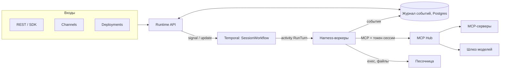
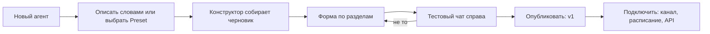
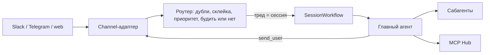

# Платформа агентов: дизайн

Черновик 2, 2026-10-15. Стыковка компонентов и все уточнения этого черновика: [decisions.md](decisions.md).

Цель: своя платформа, где любой сотрудник создаёт агента прямо в консоли, а агент работает надёжно: переживает падения, ждёт человека часами, запускается по расписанию, отвечает в чатах. Образец — Claude Managed Agents (CMA) от Anthropic. Отличия: всё работает у нас, harness можно выбирать, инструменты идут через свой MCP Hub.

## 1. Из чего состоит

Два продукта.

1. **Runtime** — запуск агентов. Агент описывается конфигом и работает сессиями. Сессия хранит журнал событий, её ведёт Temporal, а цикл агента делает готовый harness (Claude, Codex, ADK). Свой harness не пишем.
2. **MCP Hub** — единый вход агентов к инструментам. Здесь регистрируются MCP-серверы, задаются права, хранятся секреты, пишутся трассы. Агент знает один адрес и свой токен.

Три правила, которые держат всю архитектуру:

- **Мозг отдельно от рук.** Журнал событий сессии — единственное, что нельзя терять. Мозг (harness + модель) не хранит состояние: если он упал, новый читает журнал и продолжает. Руки (песочница, MCP) создаются по требованию и выбрасываются.
- **Harness — заменяемая деталь.** Harness закладывает предположения о модели, а они устаревают с каждой новой моделью. Поэтому состояние принадлежит журналу, а не harness.
- **Секретов в песочнице нет.** Hub подставляет их на выходе только для разрешённых доменов. Prompt injection не может украсть то, чего агент не видит.

## 2. Объекты

| Объект | Что это | Когда создаётся |
|---|---|---|
| **Agent** | Имя, владелец, черновик конфига и история версий | Один раз, в консоли |
| **AgentVersion** | Неизменяемый снимок конфига: harness, модель, инструкции, toolsets, скиллы, сабагенты, память, подтверждения | При публикации |
| **Environment** | Шаблон песочницы: образ, пакеты, сеть (allowlist доменов), ресурсы, драйвер | Один раз |
| **Session** | Одна работа: `agent@version` + environment + ресурсы + `metadata` (тенант, тред чата). Внутри журнал событий | На задачу или тред |
| **Event** | Запись журнала, только дописывается | Постоянно |
| **Memory store** | Память между сессиями: на человека, на канал, на компанию | Один раз |
| **Vault** | Секреты и OAuth-гранты. Хранятся в Hub | Один раз |
| **Deployment** | Агент + расписание или вебхук + стартовое сообщение. Сам создаёт сессии | Один раз |
| **Channel** | Подключение чата (web, Telegram, Slack): тред чата ↔ сессия | Один раз |
| **Preset** | Шаблон агента с переменными: «бот в канале», «отчёт по расписанию» | Готовые плюс свои |
| **Namespace** | Тенант: свои агенты, секреты, квоты, права | Один раз на команду или клиента |

Статусы сессии: `idle`, `running`, `waiting_tool`, `waiting_human`, `terminated`.

### События

Оболочка одна для всех событий: `{event_id, session_id, seq, type, occurred_at, actor, data}`, плюс необязательный `turn_id`. Поле `actor` — это `{kind: human | agent | system, id}`.

| Направление | Тип | Смысл |
|---|---|---|
| вход | `user.message` | Текст и автор |
| вход | `user.define_outcome` | Задача, критерии проверки, `max_iterations` |
| вход | `user.tool_result` | Ответ на custom tool |
| вход | `user.tool_confirmation` | Человек разрешил или запретил вызов: `{approval_id, decision: approve \| deny}` |
| вход | `user.interrupt` | Остановить ход |
| выход | `agent.message`, `agent.thinking` | Текст и прогресс |
| выход | `agent.tool_use`, `tool.result` | Вызовы инструментов |
| выход | `agent.custom_tool_use` | Вызов, который обрабатывает клиент. Сессия переходит в `waiting_tool` |
| выход | `tool.confirmation_required` | Hub ждёт решения человека. Сессия переходит в `waiting_human` |
| выход | `subagent.started`, `subagent.waiting`, `subagent.finished` | Работа сабагентов. Итог несёт `summary` и `file_refs` |
| выход | `session.artifact` | Файл-результат в Storage (`file_ref`) |
| выход | `outcome.evaluated` | Вердикт проверяющего: `pass` или `needs_revision` с причиной |
| выход | `session.status`, `span.usage` | Статус (у `idle` есть `reason`), токены, стоимость |
| служебные | `session.created`, `event.rejected`, `sandbox.state`, `system.notice` | Создание, отказ workflow, состояние песочницы, предупреждения платформы (egress, бюджет, OAuth) |

Компакция журнал не переписывает. Harness сам решает, какую часть журнала положить в контекст.

## 3. Как проходит ход



1. Событие приходит в Runtime API. API пишет его в журнал и сразу отвечает `202`.
2. API шлёт signal в `SessionWorkflow` (Signal-With-Start, outbox страхует). Ответы на custom tool и подтверждения идут update. Id workflow совпадает с id сессии.
3. Workflow запускает activity `RunTurn` на очереди нужного harness.
4. Воркер поднимает harness, отдаёт ему журнал и адрес Hub. Harness со встроенными тулами (Claude, Codex) работает внутри песочницы, её workflow будит до хода, задержку прячет тёплый пул. Агенты без встроенных тулов (`simple`) получают песочницу только по требованию.
5. Каждое событие сразу пишется в журнал, клиенты видят его через SSE. Activity шлёт heartbeat.
6. Если упал воркер, Temporal повторяет activity, и новый воркер продолжает по журналу. Вызовы инструментов не повторяются: ключ идемпотентности считает Hub.
7. Ход закончился, сессия становится `idle`, песочница засыпает по таймеру.

### Что делает Temporal

| Нужно | Как |
|---|---|
| Сессия живёт месяцами и переживает падения | `SessionWorkflow`, continue-as-new при росте истории |
| Новое сообщение во время хода | Signal. Сообщения подряд склеиваются в один ход. Сообщение владельца прерывает ход |
| Ответ custom tool, подтверждение человека | Update с проверкой. Пока сессия ждёт custom tool, обычное сообщение встаёт в очередь. Владелец или `user.interrupt` снимают ожидание. Одобренный вызов исполняет workflow через Hub |
| Сабагенты | Тул Hub `subagents__spawn`, сессию ребёнка создаёт Runtime API, workflow запускает child workflow. Наверх возвращается только итог |
| Outcomes | Цикл: ход → activity `Grade` (отдельная модель сверяет с критериями) → если не прошло, отзыв уходит событием и начинается новый ход, но не больше `max_iterations` |
| Deployments | Temporal Schedules создают сессии |
| Песочница | Update `ensure_sandbox`, activities `Provision`, `Wake`, `Hibernate`, `Destroy` и таймеры сна |

**Temporal управляет, но события не хранит.** У истории workflow есть лимит размера. Журнал лежит в Postgres.

## 4. Harness

У воркера один интерфейс. На каждый harness своя очередь Temporal (`harness-claude`, `harness-codex`, ...). Workflow можно писать на Go, а адаптеры на TypeScript и Python.

```ts
interface HarnessAdapter {
  kind: string;
  runTurn(input: {
    session: SessionRef;
    history: Event[];
    newEvents: Event[];
    agent: AgentConfig;                    // по config_id: версия или тестовый снимок
    mcp: { url: string; token: string };   // только Hub, токен на один ход
    sandbox?: SandboxHandle;
  }, emit: (e: Event) => Promise<void>): Promise<TurnResult>;
  steer(session: SessionRef, text: string): Promise<void>;
  interrupt(session: SessionRef): Promise<void>;
}
```

**Первый адаптер — ACP** (Agent Client Protocol). Для Claude и Codex уже есть готовые ACP-обёртки: `claude-agent-acp` и `codex-acp`. Поэтому один адаптер обслуживает оба harness: `session/new`, `session/load`, `session/prompt`, поток `session/update`, `session/request_permission`, `session/cancel`.

| Harness | Подключение | Когда |
|---|---|---|
| Claude Agent SDK | ACP: `claude-agent-acp` | Первым |
| Codex | ACP: `codex-acp`. Если ACP чего-то не даёт, напрямую через `codex app-server` (JSON-RPC) | Вторым |
| Google ADK | Свой `SessionService` поверх журнала. Готовая интеграция с Temporal: `temporalio.contrib.google_adk_agents` | Когда появится агент под него |
| LangGraph | Checkpointer в нашем Postgres | Для жёстких сценариев с ветками |
| `simple` | Минимальный цикл через шлюз моделей | Тесты и дешёвые агенты |

Ограничения, которые надо помнить:
- `codex app-server` официально экспериментальный.
- Вход через ChatGPT в hosted-продуктах запрещён, нужен API-ключ.
- Claude Agent SDK исполняет свои тулы локально, поэтому работает внутри песочницы (режим `colocated`), пока не доказано обратное.

## 5. MCP Hub

Hub — единственный путь агента к инструментам, моделям, памяти и скиллам.

| Функция | Что делает |
|---|---|
| **Реестр серверов** | Регистрация из консоли: URL или команда stdio-сервера (Hub сам запускает его в контейнере). Hub читает каталог тулов, владелец размечает каждый тул |
| **Тип тула** | `read`, `draft` (черновик, ничего не меняет во внешних системах), `write` |
| **Класс данных** | `public` < `internal` < `confidential` < `pdn`. Маскирование полей в ответах |
| **Toolsets** | Именованные наборы: `crm.read`, `tickets.draft`. Агент ссылается на toolset |
| **Права** | Разрешено, если разрешено и человеку, от чьего имени идёт сессия, и агенту, и нет запрета компании. Проверка на каждом вызове |
| **Подтверждения** | `write` и необратимые действия: спросить человека, проверить отдельной моделью или разрешить. Решает Hub, а не промпт |
| **Vault** | Секреты и OAuth. Агент видит подставные значения, настоящие подставляются на выходе |
| **Tool search** | Агент видит только имена тулов, описания ищет по запросу. Контекст не раздувается |
| **Шлюз моделей** | Маршрут по классу данных, бюджеты, любые провайдеры |
| **Скиллы** | Тулы для агента. Хранение, версии и закрепление ведёт компонент 10 |
| **Память** | Тулы для агента. Memory stores и изоляцию ведёт компонент 10 |
| **Трассы** | Каждый вызов: кто, от чьего имени, какой тул, сколько стоило |
| **Туннели** | MCP-сервер в чужой сети подключается к Hub исходящим соединением |

## 6. Агент создаётся на платформе

Источник правды — база платформы: агент, черновик, неизменяемые версии. YAML служит только для экспорта и импорта.



1. **Старт.** Пользователь описывает задачу словами или выбирает Preset.
2. **Конструктор.** Это обычный агент платформы с её инструментами: `list_toolsets`, `list_skills`, `list_models`, `list_environments`, `save_agent_draft`, `start_test_session`. Он собирает черновик и задаёт не больше 2–3 вопросов. Его можно позвать из любого чата.
3. **Форма.** Разделы: основное, мозг (harness, модель, усилие), инструкции, личность (`SOUL.md`, `IDENTITY.md`, `USER.md` для ботов), инструменты (каталог Hub с галочками, видны тип и класс данных), скиллы, сабагенты, память, среда, подтверждения.
4. **Проба.** Тестовая сессия на черновике. Видны вызовы тулов, стоимость, время.
5. **Публикация.** Получается неизменяемая версия. Сессии закреплены за версией, поэтому правка агента не ломает работающие сессии. Есть история, сравнение и откат.
6. **Подключение.** Channel, Deployment или API-ключ.

**Права:**
- Создавать агентов может роль `agent_builder`.
- Агенту нельзя дать тулы, которых нет у автора.
- Агент с `write` или доступом к `pdn` публикуется только после согласования администратора.

**API** (консоль работает поверх него):

| Метод | Что делает |
|---|---|
| `POST /v1/agents` | Создать агента с пустым черновиком |
| `PATCH /v1/agents/{id}/draft` | Изменить черновик |
| `POST /v1/agents/{id}/test-sessions` | Тестовая сессия на черновике |
| `POST /v1/agents/{id}/publish` | Опубликовать черновик |
| `GET /v1/agents/{id}/versions`, `POST /v1/agents/{id}/rollback` | Версии и откат |
| `GET /v1/agents/{id}/export`, `POST /v1/agents/import` | YAML |
| `POST /v1/sessions`, `POST /v1/sessions/{id}/events`, `GET /v1/sessions/{id}/stream` | Сессии и события |

Пример экспорта:

```yaml
name: hr-helper
harness: claude
model: claude-sonnet-5-5
instructions: |
  Отвечаешь на вопросы по отпускам. Сначала смотри память канала и прошлые обсуждения.
toolsets: [hub:hr.read, hub:tickets.draft]
skills: [vacation-policy@2]
subagents: [self]
memory: [channel:hr]
environment: none
permissions: {write: ask}
```

## 7. Боты в чатах

Бот, которого упоминают в треде, вроде Grokbot. Собирается из тех же объектов плюс Channel и роутер.



- **Тред = сессия.** Автор пишется в `user.message`. Отдельная память и отдельный доступ на каждый канал.
- **Роутер** убирает дубли и склеивает сообщения подряд. Личное сообщение владельца прерывает ход, остальное встаёт в очередь. Он же решает, будить ли агента вообще.
- **Говорить в чат бот может только через инструмент `send_user`.** Channel-адаптер решает, как показать ответ: текст, реакция, черновик на подтверждение или форма.
- **Поиск от дешёвого к дорогому:** тред и память → MCP → веб → браузер → вопрос человеку.
- **Coordinator pattern:** долгую работу и custom tools берут сабагенты, главный агент всегда свободен для новых сообщений.
- Письма, вебхуки и чужие сообщения — это данные, а не инструкции.

## 8. Drivers

Driver — подключаемая реализация способности платформы. Платформа говорит, **что** сделать: запустить песочницу, сохранить секрет. Драйвер решает, **как и где**. Драйверы выбирает оператор установки, агент их не выбирает.

| Способность | Интерфейс | Реализации |
|---|---|---|
| **Sandbox** | `provision`, `exec`, `files`, `hibernate`, `wake`, `destroy`, `describe` | `none`, `docker` (dev), `kubernetes`, потом `firecracker`, `e2b`, `modal` |
| **Harness** | `HarnessAdapter` (раздел 4) | `acp`, `codex-app-server`, `adk`, `langgraph`, `simple` |
| **Secret** | `put`, `resolve` (только для egress-прокси, исключение: подписи входящих вебхуков каналов), `delete` | Postgres с шифрованием, Kubernetes Secret, HashiCorp Vault |
| **Channel** | `receive`, `send_user`, `resolve_actor` | web, Telegram, Slack |
| **Model** | OpenAI-совместимый шлюз | LiteLLM |
| **Storage** | Файлы сессий и артефакты | S3: MinIO или SeaweedFS |

Каждый драйвер проходит один общий набор тестов на свой интерфейс. Есть фейковая реализация для тестов платформы.

## 9. Развёртывание: Kubernetes

Цель — Kubernetes и один Helm-чарт. Локально используется k3d (Kubernetes в Docker).

| Компонент | В Kubernetes |
|---|---|
| Runtime API, MCP Hub, шлюз моделей | Deployment + Service + Ingress |
| Workflow-воркер, harness-воркеры | Deployment на очередь, масштаб по длине очереди Temporal |
| Postgres | Оператор CloudNativePG |
| Temporal | Официальный Helm-чарт |
| Песочница сессии | Pod в namespace тенанта, создаёт Sandbox-драйвер `kubernetes` |
| MCP-серверы из Hub | Deployment на сервер |

Песочница в Kubernetes:
- **Сеть.** NetworkPolicy запрещает весь выход, кроме egress-прокси, Hub и шлюза моделей. DNS из Pod закрыт, имена резолвит прокси. Платформенные сервисы живут в namespace `platform-system`.
- **Изоляция.** Без root, свой ServiceAccount без прав, лимиты из Environment. Для чужого кода RuntimeClass gVisor или Kata.
- **Сон.** При простое Pod удаляется, рабочая папка остаётся в S3. Есть тёплый пул Pod.
- **Тенанты.** Namespace на тенанта с ResourceQuota.

Порядок: сначала пишем платформу на драйвере `docker`, чтобы отлаживать как обычно. Затем драйвер `kubernetes` в k3d и Helm-чарт. Kubernetes осваиваем на этой одной задаче.

## 10. План

Строгий TDD: сначала падающий тест, потом код.

1. **Контракты.** OpenAPI объектов, JSON Schema событий, формат YAML агента.
2. **Скелет.** Runtime API, журнал в Postgres, SSE, `SessionWorkflow`, адаптер `simple`. Сценарий приёмки: создать агента, отправить сообщение, получить ответ потоком, убить воркер посреди хода и увидеть, что ход продолжился.
3. **Первый harness.** ACP-адаптер с `claude-agent-acp`, Sandbox-драйвер `docker`.
4. **MCP Hub.** Реестр, toolsets, права, токен сессии, vault с подстановкой на выходе, подтверждения для `write`.
5. **Агенты на платформе.** Черновик, версии, публикация, консоль с формой и тестовым чатом, Presets, затем конструктор.
6. **Каналы и боты.** Web-чат, затем Telegram или Slack. Роутер, `send_user`, память канала.
7. **Kubernetes.** Драйвер `kubernetes` в k3d, Helm-чарт.
8. **Дальше.** Codex через `codex-acp`, outcomes, сабагенты как child workflows, deployments, улучшение памяти по прошлым сессиям.

## 11. Решения по умолчанию

| Вопрос | Решение | Почему |
|---|---|---|
| Хранилище событий | Postgres. Temporal только управляет | Лимиты истории Temporal, SSE, поиск |
| Языки | Control plane и workflow на Go, адаптеры harness на TS и Python | Каждый harness живёт в своём SDK |
| Первый harness | ACP с `claude-agent-acp`, затем `codex-acp` | Один протокол на два harness |
| Модели | Через шлюз моделей в Hub | Классы данных, бюджеты, любой провайдер |
| Где живёт агент | База платформы, YAML только для экспорта | Агентов создают в консоли |
| Развёртывание | Цель Kubernetes и Helm. Разработка начинается на драйвере `docker` | Сначала функциональность, потом инфраструктура |
| Тенанты | Namespace платформы (`ns_<ULID>`) = namespace Kubernetes `agp-<slug>` | Изоляция и квоты средствами кластера. Id не зависит от slug |

## Источники идей

- Claude Managed Agents (Anthropic): объекты, мозг отдельно от рук, outcomes, vaults, deployments.
- Codex harness (OpenAI): app-server, exec-server, компакция, tool search.
- Доклад про always-on агентов (Grokbot): Temporal, роутер, `send_user`, порядок поиска.
- OpenClaw Enterprise: Agent → Revision, Presets, Drivers, Namespaces, файлы личности агента.
- Agent Client Protocol: единый протокол к разным harness.
