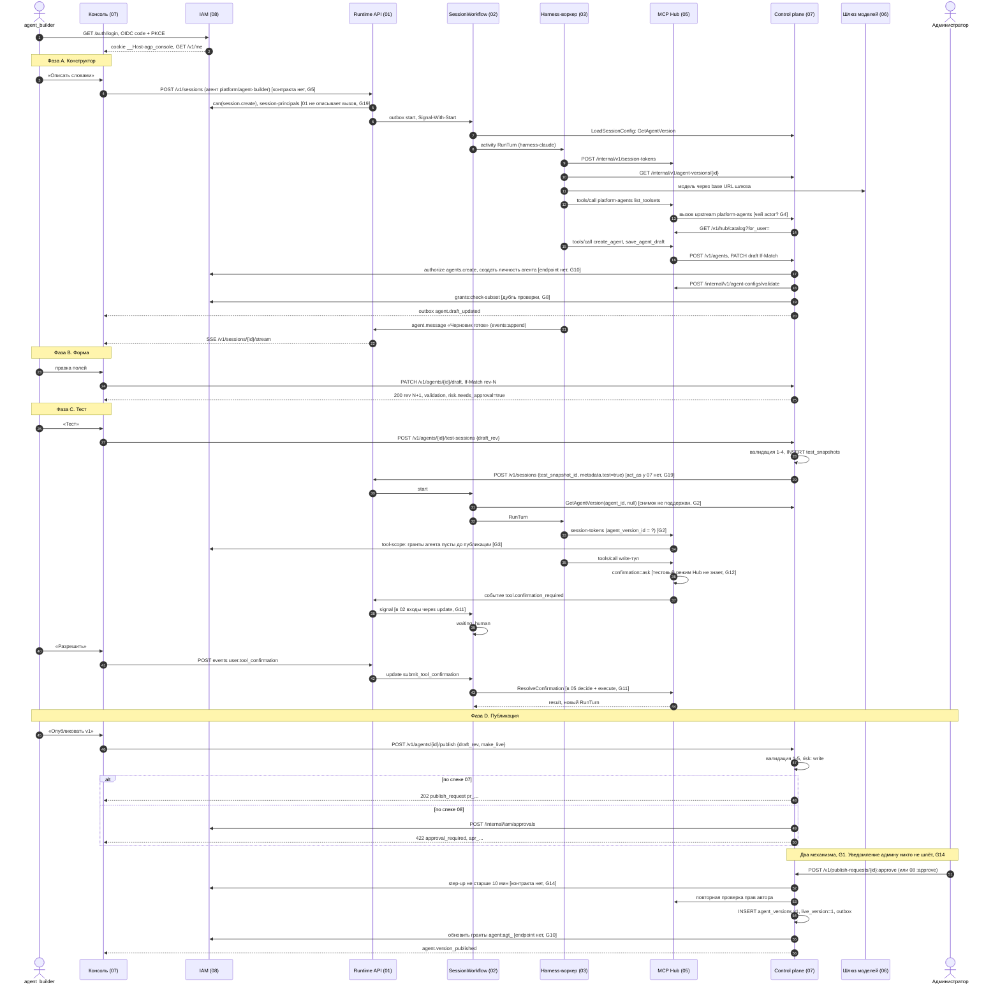

# Сценарий 01. Создание агента в консоли

Черновик 1, 2026-10-15. Проверка стыков компонентов на сквозном сценарии. Основа: [design.md](../design.md) и спеки `docs/components/*.md`.

> **Статус.** Это разбор спек до [decisions.md](../decisions.md). Выводы «не проходит» и найденные нестыковки относятся к старым спекам. Они сведены в решения D1...D40, актуальный путь описан в разделах «0. Согласовано» спек. Для приёмочных тестов берите шаги отсюда, а контракты из спек и приложения A к decisions.md.

## 1. Сценарий коротко

Сотрудник с ролью `agent_builder` описывает агента словами. Агент-конструктор собирает черновик и подбирает toolsets из Hub. Сотрудник правит форму и запускает тестовую сессию на черновике. Потом нажимает «Опубликовать v1». В агенте есть `write`-тул, поэтому публикация уходит на согласование администратору. Администратор утверждает, появляется версия 1, она становится live.

Участники: консоль и control plane (07), IAM (08), Runtime API (01), SessionWorkflow (02), harness-воркеры (03), MCP Hub (05), шлюз моделей (06), скиллы (10). Песочница (04) в сценарии не нужна: у агента `environment: none`.

Итог проверки: **сценарий на текущих спеках не проходит**. Пять мест блокируют путь целиком: два механизма согласования, тестовая сессия на черновике, права агента до публикации, личность человека в тулах конструктора и сам запуск конструктора. Подробности в разделе 5.

## 2. Диаграмма

## 3. Шаги

| # | Шаг | Компонент | Контракт | Данные |
|---|---|---|---|---|
| 1 | Вход в консоль | 08 | `GET /auth/login`, `GET /auth/callback`, `GET /v1/me` | OIDC code + PKCE S256, cookie `__Host-agp_console`, роли в namespace |
| 2 | Открыть конструктор | консоль → 01 | Нет. Предполагается `POST /v1/sessions` с агентом `platform/agent-builder` | `agent_id`, `agent_version`, `initial_events: [user.message]` |
| 3 | Зафиксировать «от чьего имени» | 01 → 08 | `can(session.create)`; `POST /internal/iam/session-principals` описан только в 08 | `on_behalf_of: {kind: user, id}` |
| 4 | Старт workflow | 01 → 02 | outbox `start`, Signal-With-Start, `SessionWorkflow` id = session_id | `session_id`, ссылки на события |
| 5 | Конфиг сессии | 02 → 07 | activity `LoadSessionConfig` → `GetAgentVersion(agent_id, version)` | harness, лимиты, сабагенты |
| 6 | Ход конструктора | 02 → 03 | activity `RunTurn` на `harness-claude` | `TurnInput{SessionID, TurnNo, AgentID, AgentVersion, FromSeq, ToSeq}` |
| 7 | Токен для Hub | 03 → 05 | `POST /internal/v1/session-tokens` | 03 шлёт `{session_id, turn_id, ttl_s}`, 05 ждёт ещё `agent_version_id`, `run_as`, `tenant_id` |
| 8 | Подключить Hub к harness | 03 | ACP `session/new` с `mcpServers: [{type: "http", name: "hub", url, headers}]` (проверено по документации ACP, нужен `mcpCapabilities.http`) | Bearer токен сессии |
| 9 | Подбор toolsets | harness → 05 → 07 → 05 | `tools/call list_toolsets` (toolset `platform.builder`), внутри `GET /v1/hub/catalog?for_user=` | запрос, список с `kind` и `data_class` |
| 10 | Создать агента | harness → 05 → 07 | `create_agent` → `POST /v1/agents`; 08 `authorize agents.create` | `name`, черновик `rev=1`, `updated_source=constructor` |
| 11 | Сохранить черновик | harness → 05 → 07 | `save_agent_draft` → `PATCH /v1/agents/{id}/draft`, `If-Match` | JSON Merge Patch (RFC 7396) |
| 12 | Валидация 1-5 | 07 → 05, 08, 06, 10, 03, 04 | 05 `POST /internal/v1/agent-configs/validate`; 08 `grants:check-subset`; список моделей 06; скиллы 10; возможности harness 03; драйверы 04 | `validation`, `risk {has_write, max_data_class, needs_approval}` |
| 13 | Ответ сотруднику | 03 → 01 → консоль | `events:append`, SSE `GET /v1/sessions/{id}/stream` | `agent.message` |
| 14 | Правка формы | консоль → 07 | `GET/PATCH /v1/agents/{id}/draft`, outbox `agent.draft_updated` | `rev`, ошибки по `path` |
| 15 | Тестовая сессия | консоль → 07 → 01 | `POST /v1/agents/{id}/test-sessions {draft_rev}` → `test_snapshots` → `POST /v1/sessions` | 07 пишет `test_snapshot_id`, 01 хранит `draft_snapshot_id`, `metadata.test=true` |
| 16 | Ход теста | 02 → 03 → 05 | `RunTurn`, `session-tokens`, `/mcp` | конфиг снимка вместо версии (не описано) |
| 17 | Вызов `write` в тесте | 05 → 01 → 02 | Hub ставит `approvals.pending`, пишет `tool.confirmation_required` | `approval_id`, `arguments_preview`, `mode` |
| 18 | Сотрудник разрешает | консоль → 01 → 02 → 05 | `user.tool_confirmation` → update `submit_tool_confirmation` → `ResolveConfirmation` (02) или `decide` + `execute` (05) | `tool_use_id` или `approval_id`, `decision` |
| 19 | Публикация | консоль → 07 | `POST /v1/agents/{id}/publish {draft_rev, notes, make_live}` | `risk: ["write:..."]` |
| 20 | Заявка | 07 (или 08) | 07: `publish_requests`, `202`. 08: `POST /internal/iam/approvals`, `422 approval_required` | снимок `resolved_config`, `config_hash` или `draft_hash` |
| 21 | Уведомить админа | ? | outbox `agent.publish_requested`, подписчика нет | |
| 22 | Утверждение | админ → 07 (или 08) | `POST /v1/publish-requests/{id}:approve` (роль `ns_admin`) или `POST /v1/approvals/{id}:approve` (роль `admin`) | step-up, `decided_by != requested_by` |
| 23 | Версия v1 | 07 | `INSERT agent_versions`, `live_version=1`, скиллы через 10 `POST /v1/skills/resolve`, outbox `agent.version_published` | `config_hash`, закреплённые ссылки |
| 24 | Гранты агента | 07 → 08 | «07 переписывает гранты при публикации» (08), endpoint не описан | `agent:agt_...` → toolsets |
| 25 | Аудит | 07 → 08 | `POST /internal/iam/audit:append` | actor, действие, цель |

## 4. Отказы

| Что упало или пошло не так | Где описано | Что происходит | Дыра |
|---|---|---|---|
| Hub, 08, 06 или 10 недоступны при сохранении | 07 §3.5, §6 | Черновик сохраняется с `refs_unverified` | Нет |
| Они же недоступны при публикации | 07 §6 | `503 dependency_unavailable`, `Retry-After: 10`, fail closed | Нет |
| Конструктор и форма правят черновик одновременно | 07 §6 | Консоль получает `412`, показывает diff | Поведение тула `save_agent_draft` при `412` не описано (G17) |
| Конструктор упал посреди хода | 07 §6, 03 | Черновик сохранён после каждого шага. Ход повторяет Temporal | `create_agent` при повторе хода может создать второго агента: ключ идемпотентности Hub зависит от порядка вызовов (05 §9 п. 3) |
| Тест ушёл в цикл | 07 §3.8 | Стоп на 2 USD, TTL 24 ч | Ни 06, ни 01 не принимают эти лимиты от 07 (G13) |
| Человек не ответил на подтверждение в тесте | 02, 05 | 72 ч, затем `approval_expired` | Нет |
| Заявка висит 7 дней | 07, 08 | `expired`, событие владельцу | Два таймера в двух компонентах (G1) |
| Админ утверждает свою заявку | 07, 08 | `409 self_approval` (07) или `403 self_approval` (08) | Разные коды (G1) |
| Между заявкой и утверждением у автора забрали права | 07 §7 | Повторная проверка при утверждении, отказ | Нет |
| Версия создана в 07, а запись грантов в 08 не прошла | нигде | Агент live, но Hub отказывает во всех тулах или ходит по старым грантам | Двойная запись без outbox (G10) |
| Тул в Hub поменял схему после публикации | 05 §6, 07 §6 | `needs_review`, версия `degraded` | Состав toolset не закреплён (G7) |

## 5. Найденные нестыковки

### Блокеры

**G1. Два механизма согласования публикации.** 07 ведёт `publish_requests`: публикация отвечает `202`, утверждение `POST /v1/publish-requests/{id}:approve` сразу создаёт версию, роль `ns_admin`, привязка к `draft_rev` и `config_hash`, новая заявка вытесняет старую. 08 ведёт `approvals`: публикация отвечает `422 approval_required`, админ утверждает `POST /v1/approvals/{id}:approve`, роль `admin`, автор потом повторяет `publish`, привязка к `draft_hash`, правка черновика вытесняет заявку. Коды `self_approval` разные (`409` и `403`). Консоль не знает, что вызывать.
Предложение: один владелец. Хранилище решений в 08 (`approvals`, `kind=agent_publish`), снимок конфига в 07. `publish` отвечает `202 {approval_id}`. По событию `approval.decided` 07 сам создаёт версию из замороженного `resolved_config` (сверка `config_hash`), без повторного нажатия. `publish-requests` в 07 убрать или сделать чтением поверх 08. Правило вытеснения одно: новая заявка или правка черновика.

**G2. Тестовая сессия на черновике не доходит до рантайма.** 07 создаёт `test_snapshots` и передаёт `test_snapshot_id`, 01 хранит `draft_snapshot_id` и `agent_version = null`. Дальше никто снимок не понимает: 02 `LoadSessionConfig` зовёт `GetAgentVersion(agent_id, version)`, `TurnInput.AgentVersion int`; 03 читает только `GET /internal/v1/agent-versions/{id}`; Hub выпускает токен с `agent_version_id` и берёт права агента из `agent-versions`; 08 `session-principals` требует `agent_version int`.
Предложение: ввести общее понятие `config_id` (`ver_...` или `tst_...`). 07 отдаёт оба по одному адресу `GET /internal/v1/agent-configs/{config_id}` в одной форме. В 01 поле `config_id` вместо пары `agent_version`/`draft_snapshot_id`, в `TurnInput`, токене Hub (`agv`) и `session_principals` тоже `config_id`. Имя поля одно во всех спеках.

**G3. У агента нет прав до публикации.** 08 `tool-scope` пересекает права человека с грантами `agent:agt_...`, а эти гранты 07 пишет только при публикации. Значит в тестовой сессии все тулы агента получат отказ. Плюс два источника прав агента: Hub берёт toolsets из AgentVersion (05 §4), IAM из `tool_grants` агента.
Предложение: права агента = toolsets из его конфига (версии или снимка), их Hub передаёт в `tool-scope` как вход. `tool_grants` для `agent:*` убрать. В 08 остаётся человек, запреты и потолок тенанта.

**G4. Тулы конструктора не знают, от чьего имени работают.** `platform-agents` это upstream за Hub. Hub вырезает `Authorization` и не пересылает токен (05 §7), а другого способа передать человека нет. 07 при этом должен проверить `agents.create`, записать `updated_by`, проверить права автора и создать тестовую сессию от имени человека. 09 упоминает «подписанный контекст вызова» для встроенных серверов, но 05 его не определяет, и транспорт `builtin` в 05 описан только для `platform`, `memory`, `skills`.
Предложение: в 05 определить контракт встроенного upstream: заголовок `X-Hub-Call-Context` (JWS, EdDSA, ключи Hub, `aud` = конкретный сервер, claims `tid`, `sid`, `act`, `agv`, `call_id`, TTL 60 с). 07 проверяет подпись и по `act` берёт у 08 principal token. Зарегистрировать `platform-agents` как `builtin`.

**G5. Нет контракта запуска конструктора.** Консоль «открывает конструктор», но где живёт `platform/agent-builder` и как создать его сессию, не сказано (07 §9 п. 8 открыт). 01 требует `agent_id` в namespace сессии, 07 `resolve` работает внутри namespace, таблицы Hub имеют `tenant_id not null`, значит toolset `platform.builder` надо заводить в каждом тенанте.
Предложение: агент и toolset платформы глобальные (`namespace_id = null`), 07 `agent-refs:resolve` и 01 разрешают глобальные ссылки `platform/*` только для чтения. Консоль создаёт сессию `POST /v1/sessions {agent_ref: "platform/agent-builder@live", metadata: {purpose: "builder"}}`. В Hub встроенные серверы и toolsets с `tenant_id = '*'`.

### Важные

**G6. Форма AgentVersion для Hub не совпадает с AgentConfig.** Hub ждёт `{toolsets, pinned_tools, tool_exposure, confirmation_overrides, max_data_class}`. В AgentConfig есть `confirmations` по типу (`write: ask`), нет `pinned_tools`, `tool_exposure`, переопределений по тулу, а `max_data_class` лежит в отдельном поле `risk`. Имена toolsets в 07 с префиксом `hub:`, в 05 и 08 без него.
Предложение: добавить поля в схему `agent/v1` или описать проекцию в 07 для Hub. Префикс `hub:` убрать из хранения, оставить только в YAML.

**G7. Toolset не закрепляется в версии.** 07 хочет `hub:hr.read@7`, у Hub есть `toolsets.version`, но нет неизменяемых ревизий и нет API разрешить ревизию. `allowed()` смотрит текущий состав. Публикация v1 не фиксирует, какие тулы утвердил админ: владелец toolset потом добавит `write`-тул без согласования.
Предложение: в 05 таблица `toolset_revisions` (только вставка), `POST /internal/v1/toolsets:resolve` для 07 при публикации, `allowed()` берёт состав закреплённой ревизии.

**G8. Проверка прав автора сделана трижды.** 07 зовёт у Hub «`access:check`» (такого метода нет), 05 даёт `agent-configs/validate` с кодом `author_lacks_tool`, 08 даёт `grants:check-subset` с кодом `author_effect_limit_read`, 07 отдаёт пользователю `author_lacks_access`.
Предложение: 07 зовёт только 05 `agent-configs/validate`, 05 внутри спрашивает 08. Один словарь кодов в контрактах (design.md §10, шаг 1).

**G9. Hub зовёт несуществующий метод IAM.** 05 ждёт `POST /v1/iam/check-batch` и права вида `tool:<slug>:<kind>`. 08 даёт `POST /internal/iam/authorize` (права из фиксированного списка, `tool:*` там нет) и `POST /internal/iam/tool-scope`.
Предложение: Hub использует `tool-scope` с кешем по `policy_version`. Из 05 убрать `check-batch`.

**G10. Личность и гранты агента в 08 без endpoint.** 08 говорит, что 07 создаёт личность агента и переписывает гранты. Внутреннего метода нет, публичный `tool-grants` требует `grants.manage`. Запись в две базы без outbox: версия может стать live без грантов.
Предложение: `POST /internal/iam/agent-principals` (идемпотентно по `agent_id`) при `POST /v1/agents`. Если G3 принят, гранты агента не нужны. Иначе `PUT /internal/iam/agent-principals/{id}/grants {version}` через outbox 07, `live_version` двигается после подтверждения.

**G11. Цикл подтверждения описан по-разному.** 05: Runtime по `tool.confirmation_required` шлёт signal, затем «Update `user.tool_confirmation`», workflow зовёт `decide` и activity `ExecuteApprovedCall` (`execute`). 02: входы только через updates, update называется `submit_tool_confirmation`, `decision: allow|deny`, activity `ResolveConfirmation`, а `ExecuteApprovedCall` в списке activities нет. 01 сверяет `pending_tool_use_id`, а Hub выдаёт `approval_id`. 02 ждёт `Approvers` «из Hub», но в событии Hub их нет. 05 проверяет «вправе ли человек подтверждать» через 08, а такого права в 08 нет.
Предложение: событие Hub `{approval_id, tool_use_id, approvers[], expires_at}`. 01 переводит его во внутренний update `open_confirmation` (не signal), 02 пишет `Wait`. Решение: `decision: approve|deny` везде. В 02 добавить activity `ExecuteApprovedCall` на очереди `session-io`. В 08 право `tools.confirm` (по умолчанию `on_behalf_of` сессии).

**G12. Hub не знает, что сессия тестовая.** 07 обещает «все `write` в тесте принудительно `ask`», но Hub считает режим по тулу, агенту и правилам компании. `metadata.test` он не читает.
Предложение: Hub при выпуске токена берёт `metadata.test` из 01 `GET /internal/v1/sessions/{id}` и ставит claim `test: true`. Правило в `confirmation()`: при `test` режим не ниже `ask` для `write` и `irreversible`. В трассе вызовов флаг `test`.

**G13. Лимиты теста некуда передать.** Бюджет 2 USD и TTL 24 ч задаёт 07, но 06 берёт бюджет сессии из AgentVersion, а 01 и 02 не имеют таймера жизни сессии.
Предложение: в `POST /v1/sessions` поле `limits {budget_usd, ttl_s}`. 01 создаёт бюджет в 06 (`POST /internal/v1/budgets {scope: session}`), 02 ставит таймер и по нему `terminate`.

**G14. Администратор не узнаёт о заявке, step-up не определён.** `agent.publish_requested` уходит в outbox 07 «для уведомлений админу», но подписчика нет: ни 09, ни консоль не описаны. 07 требует «свежий вход не старше 10 мин» от 08, у 08 нет ни `max_age`, ни `auth_time` в principal token.
Предложение: в 08 `GET /auth/login?max_age=600` (параметр OIDC `max_age`), `auth_time` в principal token, 07 сверяет при утверждении. Уведомления: бейдж и очередь в консоли по событию плюс опционально `send_user` в личный канал админа через 09.

**G19. 07 не может создать сессию от имени человека.** 01: `on_behalf_of` задаёт только сервисный токен с `act_as`, и `act_as` есть только у 09 и 10. 07 создаёт тестовую сессию сам. Ещё 01 не описывает вызов `session-principals` в 08, хотя 08 говорит, что 01 его делает. Тип `on_behalf_of` в 01 `text`, в 08 объект `{kind, id}`.
Предложение: дать `act_as` сервису 07 только для `metadata.test=true` или передавать principal token человека (5 мин) из консоли. В 01 добавить шаг `session-principals` до записи сессии, тип `on_behalf_of` взять из 08.

### Мелкие

**G15. Имена ролей расходятся.** 07: `ns_admin`, `platform_admin`. 08: `admin`, `owner`, `platform_operator`. 05: `hub_admin`, `tool_owner`, которых в 08 нет.
Предложение: единый список ролей и прав в 08, остальные спеки ссылаются на него.

**G16. Каталог по чужому пользователю.** `GET /v1/hub/catalog?for_user=u_5` позволяет спросить права другого человека.
Предложение: брать пользователя из токена. `for_user` разрешить только `admin`.

**G17. Гонка конструктора и формы.** `save_agent_draft` при `412` не описан. `start_test_session(agent_id, message)` без `draft_rev`, а REST требует `draft_rev`: тест может пойти не на ту ревизию, что видит человек.
Предложение: при `412` тул возвращает `isError` с текущим черновиком и `rev`. Добавить `draft_rev` в `start_test_session`.

**G18. Повтор `create_agent` после падения хода.** Ключ идемпотентности Hub строится из порядка вызовов в ходе (05 §9 п. 3). Новый ход может дать второй `create_agent` с другим именем.
Предложение: `create_agent` идемпотентен по `(session_id, name)` на стороне 07. Решить общий вопрос `tool_use_id` в `_meta` вместе с 03.

**G20. Внутренний API 01 назван в 03 иначе.** 03: `events:batch`, `turn-lease`, `harness-binding`. 01: `events:append`, `turns/claim`. 03 шлёт в `session-tokens` только `{session_id, turn_id, ttl_s}`.
Предложение: выровнять имена по 01. Hub сам берёт `agent_version_id` и `run_as` из 01, это записать в 05 явно.

**G21. Валидация уровня 4 опирается на неописанные методы.** 07 ждёт реестр адаптеров от 03 (там только `probe()` внутри воркера), список драйверов от 04 и список моделей с классами данных от 06 (06 даёт `GET /openai/v1/models` без классов, классы лежат в `model_routes`).
Предложение: `GET /internal/v1/harness-adapters` (03 публикует `probe` в общую таблицу), `GET /internal/v1/sandbox-drivers` (04), `GET /internal/v1/model-routes` (06).

**G22. Тест исполняет настоящие `write`.** После «Разрешить» в тестовом чате запись идёт в боевую систему. Это осознанно, но человек может не понять.
Предложение: в карточке подтверждения теста явная пометка «это реальная запись в <сервер>». Позже режим `dry_run` для тулов, у которых владелец его объявил.

## 6. Что проверено по внешним источникам

- ACP: запись MCP-сервера `type: "http"` с `name`, `url`, `headers[{name, value}]` и возможность `mcpCapabilities.http` есть в документации протокола (agentclientprotocol.com, Session Setup). Способа поменять `headers` после `session/new` документация не описывает.
- Temporal Go: `workflow.SetUpdateHandlerWithOptions` с `UpdateHandlerOptions{Validator}` и `client.UpdateWorkflow` с `WaitForStage: client.WorkflowUpdateStageAccepted` есть в документации (docs.temporal.io, Message passing).
- OIDC `max_age` и claim `auth_time` для step-up (не проверено в рамках этой работы, стандарт OpenID Connect Core).
