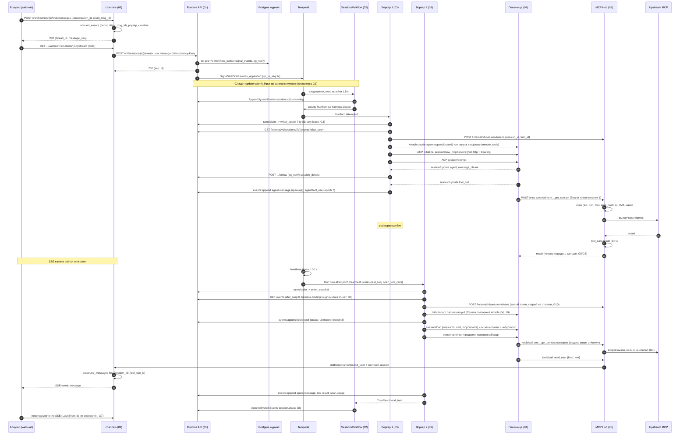

# Сценарий 02. Ход в web-чате с падением воркера

Черновик 1, 2026-10-15. Проверка спек `docs/components/01`–`09` на одном сквозном сценарии.

> **Статус.** Это разбор спек до [decisions.md](../decisions.md). Выводы «не проходит» и найденные нестыковки относятся к старым спекам. Они сведены в решения D1...D40, актуальный путь описан в разделах «0. Согласовано» спек. Для приёмочных тестов берите шаги отсюда, а контракты из спек и приложения A к decisions.md.

## 1. Сценарий

1. Человек пишет в web-чат бота (канал `web`, компонент 09).
2. Сообщение попадает в session и запускает ход.
3. Агент вызывает read-тул через MCP Hub (например `crm__get_contact`).
4. Агент пишет ответ потоком.
5. Посреди хода pod harness-воркера убивают.
6. Ожидание: ход продолжается на другом воркере. Read-тул второй раз во внешнюю систему не уходит. Клиент чата переподключает SSE и не теряет и не дублирует события.

Итог проверки: **сценарий на текущих спеках не проходит.** Главные причины:
- 01 и 02 по-разному описывают, как вход попадает в workflow.
- 02 и 03 по-разному описывают activity `RunTurn`.
- 01 и 03 по-разному описывают внутренний API журнала и фенсинг.
- Ключ идемпотентности тула описан тремя разными способами, и harness не может его передать. После падения read почти наверняка выполнится второй раз.
- Web-чат (09) показывает только сообщения `send_user`, поток текста туда не доходит, а у SSE канала нет правил возобновления.

## 2. Последовательность

Путь ниже собран из спек. Где спеки расходятся, выбран вариант 01 и 03, а расхождение записано в разделе 5.

## 3. Шаги

| # | Компонент | Контракт | Данные |
|---|---|---|---|
| 1 | Браузер → 09 | `POST /v1/channels/{binding_id}/web/messages`, портальная сессия 08 + CSRF | `conversation_id`, `client_msg_id`, `text` |
| 2 | 09 | `inbound_events` PK `(binding_id, dedup_key=client_msg_id)`, роутер (дедуп, склейка 1500/5000 мс, wake) | `thread_key = web:{conversation_id}` |
| 3 | 09 → 01 | `POST /v1/sessions` при первом сообщении треда, `Idempotency-Key: {binding_id}:{thread_key}:{generation}` | `metadata {tenant_id, channel_binding_id, thread_id}`, `on_behalf_of` |
| 4 | 09 → 01 | `POST /v1/sessions/{id}/events`, сервисный токен с `act_as` | `user.message`, `data.author`, `data.channel {..., delivery: queue}`, `data.context` |
| 5 | 01 | Транзакция: `select ... for update`, `seq`, `workflow_outbox(signal_events)`, `pg_notify('session_events')` | `202 {event_id, seq}` |
| 6 | 01 → Temporal | Outbox: `SignalWithStart` `events_appended {up_to_seq}` | только `seq` |
| 7 | 02 | Склейка 1.5 s (макс. 10 s), `ResolveInputs`, `session.status running` через activity | `InputRef{event_id}` |
| 8 | 02 → 03 | Activity `RunTurn` на `harness-<kind>`, HeartbeatTimeout 30 s, retry 1 s ×2 до 30 s, 5 попыток | `TurnInput` (02) или `RunTurnInput` (03), см. G2 |
| 9 | 03 → 01 | `POST /internal/v1/sessions/{id}/turns/claim` | `{turn_id, attempt}` → `writer_epoch` |
| 10 | 03 → 01 | `GET /internal/v1/sessions/{id}/events?after_seq=` | история хода |
| 11 | 03 → 05 | `POST /internal/v1/session-tokens` | `{session_id, turn_id, agent_version_id, run_as, tenant_id, ttl_s}` → JWT EdDSA с `sid`, `turn` |
| 12 | 03 → harness | ACP `initialize`, `session/new {cwd, mcpServers:[{type: http, name: hub, url, headers}]}`, `session/prompt` | Hub с Bearer токеном |
| 13 | harness → 03 | ACP `session/update`: `agent_message_chunk`, `tool_call`, `tool_call_update` | поток |
| 14 | 03 → 01 | `POST .../deltas` (эфемерно, `pg_notify session_deltas`), `events:append` с `writer_epoch` и `dedupe_key` | `agent.message` на границе, `agent.tool_use` |
| 15 | harness → 05 | `POST /mcp` `tools/call`, Streamable HTTP | Hub: JWT, ключ `(sid, turn, tool, args_hash, n)`, IAM check-batch, маски, `tool_calls` |
| 16 | 05 → upstream | Через egress-прокси 06 с подстановкой `{{vault:...}}` | аргументы |
| 17 | Temporal | Heartbeat timeout 30 s, повтор попытки на другом воркере | heartbeat details `{turn_id, attempt, last_seq, open_tool_calls}` |
| 18 | 03 (W2) → 01 | `turns/claim` → `writer_epoch + 1`; старые записи получают `409 stale_writer` | |
| 19 | 03 (W2) | Восстановление 5.3: закрыть открытые вызовы `tool.result {status: unknown}`, `session/load` или rehydration, `session/prompt` «продолжи» | `ResumeHint` |
| 20 | harness → 05 → 09 | `send_user {kind: text}` через встроенный сервер `platform.channels` | outbox `idempotency_key = {session_id}:{tool_use_id}` |
| 21 | 09 → браузер | SSE `event: message` с `data.seq` (`channel_messages.seq`) | текст ответа |
| 22 | 03 → 02 | `TurnResult` | `stop_reason`, `last_seq`, `usage` |
| 23 | 02 → 01 | `session.status idle` | |
| 24 | Браузер → 09 | Переподключение SSE | правила возобновления не описаны |

## 4. Отказы

| Что падает | Что описано в спеках | Чего не хватает |
|---|---|---|
| Pod воркера (сам сценарий) | 02 и 03: heartbeat timeout 30 s, повтор `RunTurn`. 01: новый `writer_epoch`, старый получает `409` | Вызов, который Hub успел выполнить, теряется: W2 пишет `unknown` (G5). Повтор read не гарантированно гасится (G4). Старый токен Hub жив (G10) |
| Процесс harness в песочнице пережил воркер (`colocated`) | 03: убить по pid. 04: повторный `Attach` подключается к живому процессу | Противоречие (G6). Неясно, буферизует ли `sandboxd` вывод без клиента |
| Зомби W1 после сетевого разрыва | `events:append` с epoch 7 → `409 stale_writer` | Дельты не фенсятся (G9). Медленный `turns/claim` от W1 может прийти после W2 и забрать epoch (G3) |
| SSE Runtime API рвётся | `Last-Event-ID` = `seq`, догон из таблицы, NOTIFY только будит, опрос 5 s | Дельты прошлой попытки уже показаны, сброса нет (G9) |
| SSE канала (09) рвётся | Ничего | Нет `id:` в кадрах и правила `Last-Event-ID` (G7) |
| `send_user` после повтора | 09: «повторный `send_user` с тем же `tool_use_id` outbox не отправит» | Новая попытка даёт новый `tool_use_id`, Hub его не знает (G8) |
| Все 5 попыток упали | 02: `session.status idle, reason: turn_failed` | 09 не описывает, что видит человек в web-чате в этом случае |
| Hub недоступен во время повтора | 03: ошибка MCP как результат тула | Нормально |

## 5. Найденные нестыковки

### G1. Вход в workflow описан двумя несовместимыми способами (blocker, 01, 02)
01: журнал, затем outbox, затем `SignalWithStart` signal `events_appended {up_to_seq}`; старт через `start` с `UseExisting`. 02: сначала update `submit_input` со стадией Accepted, потом запись в журнал; signals только `subagent_finished` и `wake`; старт через `UpdateWithStartWorkflow`. Signal `events_appended` в 02 не обрабатывается, значит сообщение из web-чата ход не начнёт.
**Предложение.** Выбрать одну схему и записать в обе спеки. Для чата проще схема 01: журнал → outbox → `SignalWithStart events_appended`, 409 по проекции статуса в Postgres, гонку закрывает `event.rejected`. 02 добавляет handler `events_appended` и читает `event_id` через `ResolveInputs`. Если нужен update, 01 убирает outbox для `user.message`.

### G2. Контракт `RunTurn` расходится (blocker, 02, 03)
02: `TurnInput {TurnNo, FromSeq, ToSeq, NewEventIDs}`, `StopReason: custom_tool | confirmation | interrupted | waiting_subagents`, `TurnTimeout 2h`. 03: `RunTurnInput {turn_id, trigger_seqs, history_until_seq, sandbox, mode}`, `stop_reason: waiting_tool | waiting_human | cancelled | limit | error`, `StartToClose 30m`. Нет общего `turn_id`, хотя на нём держатся claim, токен Hub и ключ идемпотентности.
**Предложение.** Одна схема в контрактах (design.md, раздел 10, шаг 1). `turn_id = {session_id}:{turn_no}` детерминированно в workflow. Один список `stop_reason`. Один таймаут хода.

### G3. Внутренний API журнала и фенсинг расходятся (blocker, 01, 03)
03 зовёт `POST .../turn-lease`, `POST .../events:batch` с заголовками `X-Turn-Id`, `X-Turn-Attempt` и `client_event_id`, ждёт `409 stale_attempt`, пишет `PUT/GET .../harness-binding`, таблицы `turn_leases` и `harness_bindings`. 01 даёт `turns/claim`, `events:append` с `writer_epoch` в теле и `dedupe_key`, `409 stale_writer`, без harness-binding и без этих таблиц. Ещё: 01 на каждый `claim` просто делает `epoch + 1`. Запоздавший claim попытки 1 после claim попытки 2 отберёт право записи у живой попытки. 03 использует `tool_call_id`, 01, 02 и 09 используют `tool_use_id`.
**Предложение.** Взять контракт 01 и дописать в него: `PUT/GET /internal/v1/sessions/{id}/harness-binding`, проверку монотонности claim (`(turn_no, attempt)` больше текущего, иначе `409 stale_writer`). Одно имя поля `tool_use_id`. `dedupe_key` без номера попытки, например `{turn_id}:{tool_use_id}:use`.

### G4. Ключ идемпотентности тула не определён, read повторится (blocker, 02, 03, 05)
02: ключ = `tool_use_id`. 03: заголовок `Idempotency-Key = session_id:turn_id:sha256(name+input)`. 05: Hub сам строит `(sid, turn, tool, args_hash, n)`, заголовок не читает, и в открытом вопросе 3 говорит, что harness не передаёт `tool_use_id`. ACP задаёт заголовки MCP один раз в `session/new`, поэтому harness не может ставить ключ на каждый вызов. Откуда берётся `n` и сбрасывается ли он на новой попытке, нигде не сказано. Если `n` считать по строкам `tool_calls`, повтор read в попытке 2 получит `n=2` и снова уйдёт во внешнюю систему.
**Предложение.** Записать в 05 один алгоритм: ключ `(sid, turn, tool, args_hash, n)`, где `n` считается по вызовам этой попытки (`attempt` в claim токена), а при совпадении ключа с вызовом прошлой попытки Hub возвращает сохранённый `result`. 02 и 03 ссылаются на это правило. Тест: убить воркер после `tool_call`, в fake upstream счётчик вызовов read = 1.

### G5. Новая попытка выбрасывает готовый результат тула (major, 03, 05)
Hub успел выполнить read и сохранил `tool_calls.result` на 24 ч. W2 по правилу 03 пишет `tool.result {status: unknown}`. Модель видит потерю и вызывает тул снова. Это противоречит цели «без повторного вызова».
**Предложение.** Hub даёт `GET /internal/v1/tool-calls?session_id=&turn_id=` (mTLS). W2 перед закрытием открытых вызовов спрашивает Hub. Завершённый вызов → `tool.result {status: completed, output}` из Hub. Идущий вызов → ждать до таймаута. `unknown` только если Hub вызова не видел.

### G6. Что делать с живым процессом harness: убить или переподключиться (major, 03, 04)
03: `clientCapabilities.fs` и `terminal` = `false`, harness всегда в песочнице, при восстановлении убить процесс по pid. 04: по умолчанию `remote_tools` (harness в воркере, fs и terminal через ACP), в `colocated` повторный `Attach` с тем же `name` подключается к живому процессу. При `remote_tools` процесс и транскрипт Claude умирают вместе с pod воркера. При `colocated` неясно, куда уходит вывод ACP, пока клиента нет.
**Предложение.** Одно правило для обоих режимов: после падения процесс harness всегда убивается, восстановление идёт через журнал и Hub (G5). `Attach` в 04 получает флаг `replace: true`. Режим по умолчанию выбрать по прототипу из 04 (открытый вопрос 1) и записать в 03 те же capabilities.

### G7. У SSE web-чата нет правил возобновления (major, 09, 01)
09 описывает `GET .../web/conversations/{cid}/stream` только тремя примерами кадров. Нет поля `id:`, нет `Last-Event-ID`, нет догона из таблицы. Статус «thinking» берётся из потока тенанта, который 01 не даёт (09, открытый вопрос 1).
**Предложение.** В 09: `id:` = `channel_messages.seq` для `message`, догон по `Last-Event-ID` из `channel_messages` и `outbound_messages`, кадры `status` без `id`. Источник статусов: 01 добавляет `GET /internal/v1/streams?namespace=&metadata.channel_binding_id=` или 09 держит SSE 01 на каждую активную сессию. Решение записать в 01.

### G8. После повтора `send_user` уйдёт в чат дважды (major, 05, 09, 03)
Outbox 09 дедуплицирует по `{session_id}:{tool_use_id}`. Hub не знает `tool_use_id` harness (05, открытый вопрос 3). Попытка 2 генерирует новый вызов с новым текстом, ключ другой, сообщение дублируется. Утверждение 09 в разделе 6 («повторный `send_user` outbox не отправит») неверно.
**Предложение.** В подписанном контексте Hub → 09 передавать `idempotency_key` Hub вместо `tool_use_id`. W2 в prompt продолжения перечисляет уже доставленные `send_user` из журнала (`tool.result` с `delivered: true`). Тест 09 №7 переписать на сценарий с повтором попытки.

### G9. Эфемерные дельты не фенсятся и не сбрасываются (major, 01, 03)
`POST .../deltas` не проверяет `writer_epoch`. Зомби W1 может слать дельты после claim W2. Дельты попытки 1 уже на экране, попытка 2 пишет текст заново, клиент склеит оба. Признака «попытка сменилась» в потоке нет.
**Предложение.** `deltas` несут `writer_epoch`, `turn_id`, `message_id`, `offset` и проходят ту же проверку epoch. На `turns/claim` 01 шлёт эфемерный кадр `agent.message.reset {turn_id, attempt}`. Клиент отбрасывает несохранённые дельты хода. Итог всегда событие `agent.message` с `seq`.

### G10. Токен Hub попытки 1 не отзывается (major, 03, 05)
W2 выпускает новый токен на тот же `turn`, старый (TTL 15 мин в 03, 1 ч в 05) остаётся валидным. Живой процесс harness попытки 1 может делать вызовы, включая `write`, в том же пространстве ключей.
**Предложение.** В токен добавить claim `attempt`. При выпуске токена с большим `attempt` Hub отзывает токены той же `(sid, turn)` с меньшим. Либо W2 вызывает `POST /internal/v1/session-tokens/revoke {jti}` по `jti` из heartbeat details.

### G11. Нет выпуска workload token для внутреннего API (minor, 01, 03, 08)
01: workload token с `session_id` и `turn_id` выпускает 08 и продлевает с heartbeat. В 08 такого эндпоинта нет. 03 говорит только про mTLS.
**Предложение.** Добавить в 08 `POST /internal/iam/workload-tokens {session_id, turn_id, attempt}` или убрать токен из 01 и проверять `turn_id` по claim.

### G12. Разные TTL и лимиты хода (minor, 02, 03, 04, 05)
Токен Hub: 15 мин (03, 04), 1 ч по умолчанию (05), `TurnTimeout` 2 ч (02). Длина хода: 30 мин (03), 2 ч (02).
**Предложение.** Одна таблица лимитов в контрактах: ход 30 мин, токен = длина хода + 5 мин, продление внутри хода по живой аренде.

### G13. Снимок `state_ref` не подходит для восстановления посреди хода (minor, 03, 04)
`state_ref` пишется только в конце хода. При `session/load` из старого снимка harness не знает о `tool_call` текущего хода, а живой транскрипт в песочнице содержит вызов без результата. Поддержка `session/load` у `claude-agent-acp` не проверена, по ACP load требует `agentCapabilities.loadSession`, а `session/resume` историю не повторяет.
**Предложение.** Для упавшей попытки по умолчанию rehydration из журнала. `session/load` только если `state_seq >= last_seq` из heartbeat details. Проверка `loadSession` на закреплённой версии.

### G14. `session.status` пишет не только workflow (minor, 01, 03)
01: `session.status` пишет только 02. 03 при лимитах пишет `session.status` с причиной `tool_call_limit`.
**Предложение.** 03 возвращает причину в `TurnResult`, событие пишет 02.

## 6. Что проверено по внешней документации

- ACP: `session/load` принимает `sessionId`, `cwd`, `mcpServers` и повторяет историю через `session/update`. Разрешён только при `agentCapabilities.loadSession`. `session/resume` историю не повторяет. HTTP MCP-сервер в ACP принимает `headers` (agentclientprotocol.com, Session Setup).
- Temporal: при пропуске heartbeat попытка падает по Heartbeat Timeout и повторяется по Retry Policy. Детали heartbeat доступны следующей попытке. Отмена activity доходит только через heartbeat (docs.temporal.io, Detecting Activity failures).
- SSE: браузер при переподключении шлёт `Last-Event-ID`, кадры без `id` его не меняют (спецификация HTML, не перепроверено в этой сессии).
- Поддержка `session/load` в `claude-agent-acp` (не проверено).
