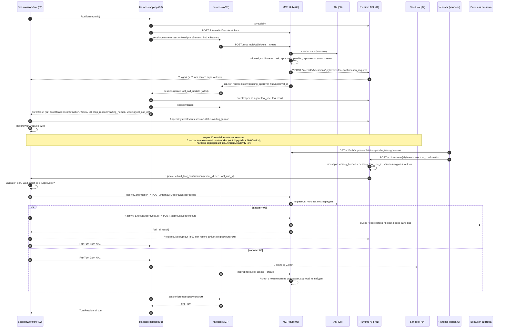

# Поток 03. Write-тул с подтверждением через несколько часов

Черновик 1, 2026-10-15. Проверка спек 01, 02, 03, 04, 05, 08, 09 на одном сквозном сценарии.

> **Статус.** Это разбор спек до [decisions.md](../decisions.md). Выводы «не проходит» и найденные нестыковки относятся к старым спекам. Они сведены в решения D1...D40, актуальный путь описан в разделах «0. Согласовано» спек. Для приёмочных тестов берите шаги отсюда, а контракты из спек и приложения A к decisions.md.

## 1. Сценарий

Агент в ходе хочет создать заявку во внешней системе. Это `write` тул, например `tickets__create`. Hub решает, что нужен человек (`confirmation = ask`). Ход заканчивается, session ждёт. Проходит 5 часов. За это время выкатили новые версии `session-wf-worker`, harness-воркеров и Hub. Песочница уснула. Человек открывает консоль и подтверждает. Вызов во внешнюю систему выполняется ровно один раз. Агент получает результат и продолжает работу.

Вывод проверки: **на текущих спеках сценарий не проходит.** Три спеки описывают три разных способа выполнить одобренный вызов. Сущность ожидания не доходит до workflow нужной формой. Есть риск двойной записи при падении Hub посреди вызова.

## 2. Путь, как он описан в спеках

Диаграмма собрана из 05 (поток 5.2), 02 (Updates, Waits), 01 (проверки входа, outbox) и 03 (5.2, TurnResult). Пунктиром с пометкой «?» отмечены шаги, для которых контракта нет или он противоречит другой спеке.

## 3. Шаги

| # | Компонент | Контракт | Данные |
|---|---|---|---|
| 1 | 02 → 03 | activity `RunTurn` на `harness-<kind>` | 02: `TurnInput{SessionID, TurnNo, FromSeq, ToSeq, NewEventIDs}`; 03: `RunTurnInput{turn_id, agent_version_id, trigger_seqs, history_until_seq}`. Формы не совпадают |
| 2 | 03 → 01 | `POST /internal/v1/sessions/{id}/turns/claim` (01) или `POST .../turn-lease` (03) | `{turn_id, attempt}` → `writer_epoch` |
| 3 | 03 → 05 | `POST /internal/v1/session-tokens` | `{session_id, turn_id, agent_version_id, run_as, tenant_id, ttl_s}`. TTL: 3600 с (05), 900 с (03), `TurnTimeout` 2 h (02) |
| 4 | harness → 05 | `POST /mcp` `tools/call` | имя тула, аргументы, Bearer. 03 добавляет заголовок `Idempotency-Key`, 05 его не описывает и строит ключ сам из `(sid, turn, tool, args_hash, n)` |
| 5 | 05 | политика `allowed()` и `confirmation()` | `write → ask`. Строка `approvals{session_id, turn_id, tool_id, arguments, arguments_hash, mode=ask, status=pending, expires_at=+72h, idempotency_key}` |
| 6 | 05 → 01 | `POST /internal/v1/sessions/{id}/events` | `tool.confirmation_required{approval_id, tool, kind, irreversible, arguments_preview, mode}`, ключ `hub:<call_id>:<type>`. В 01 такого пути нет, есть `events:append` только для 02 и 03 |
| 7 | 05 → harness | ответ `tools/call` | `isError: true`, `_meta.hub/decision=pending_approval`, `_meta.hub/approval_id`, текст «Не повторяй вызов» |
| 8 | 03 → 01 | `events:append` | `agent.tool_use{tool_call_id, name, source: hub, kind, input, idempotency_key}`, `tool.result{status: failed}`. Поле `requires_confirmation` и `approval_id` из `_meta` воркер должен достать сам, как именно не описано |
| 9 | 03 → harness | ACP `session/cancel` | ход останавливается |
| 10 | 03 → 02 | `TurnResult` | 03: `stop_reason=waiting_human, waiting{kind: confirmation, tool_call_id}`. 02 ждёт `StopReason=confirmation, Waits[{ConfirmationID, Approvers, Deadline}]` |
| 11 | 02 → 01 | activity `AppendSystemEvents`, `RecordWait` | `session.status{waiting_human, waits}`; 01 в той же транзакции ставит `sessions.status`, `pending_tool_use_id`. Строка `session_waits` с таймером 72 h |
| 12 | 02 → 04 | `Hibernate` через 10 мин | песочница спит, рабочая папка и `state_ref` в S3 |
| 13 | выкатка | 02: Worker Versioning `AutoUpgrade`, патчи `GetVersion`, replay-тест. 03: activity без детерминизма. 05: состояние в Postgres | workflow ждёт в таймере и handler-е update, открытых activity нет |
| 14 | консоль → 05 | `GET /v1/hub/approvals?status=pending&assignee=me` | список approvals. В строке нет `tool_use_id`, нужного для шага 15 |
| 15 | консоль → 01 | `POST /v1/sessions/{id}/events` `user.tool_confirmation` | `Idempotency-Key`, `data` (поля не заданы: `tool_use_id`? `approval_id`? `decision: allow\|deny`?). `actor` из токена |
| 16 | 01 | проверка под `for update` | статус `waiting_human` и id совпадает с `pending_tool_use_id` → журнал, outbox `update_tool_confirmation` |
| 17 | 01 → 02 | Update `submit_tool_confirmation`, стадия Accepted | 01 шлёт `{event_id, seq, tool_use_id}`. 02 ждёт `{event_id, tool_use_id, decision, actor_id}` |
| 18 | 02 | validator | открытый `Wait{kind: confirmation}`, `actor_id ∈ Approvers` |
| 19 | 02 → 05 | activity `ResolveConfirmation(confirmation_id, decision, actor_id)` → `POST /internal/v1/approvals/{id}/decide` | `{decision: approve\|deny, actor{kind, id}}` → `200 {status}`, `403`, `409` |
| 20 | 02 → 05 | activity `ExecuteApprovedCall` → `POST /internal/v1/approvals/{id}/execute` | есть только в 05. В 02 такой activity нет |
| 21 | 05 → upstream | вызов через egress-прокси (06) | замороженные аргументы, `{{vault:ref}}` подставляет egress |
| 22 | 05 → 02 | ответ execute | `{call_id, result}`. Повтор даёт тот же результат |
| 23 | 02 → 01 | запись результата | 05 рисует `tool.result` в журнал. В 02 `tool.result` только синтетический (`timeout`, `cancelled`, `denied`) |
| 24 | 02 → 03 | `RunTurn` turn N+1 | ход должен увидеть результат. Песочница спит: кто будит, не описано в 02 |
| 25 | 03 | `session/load` по `state_ref` или rehydration | после выкатки версия harness может отличаться от той, что писала снимок |
| 26 | 03 → 02 | `TurnResult end_turn` | статус `idle`, таймер сна песочницы |

## 4. Отказы

| Что случилось | Что описано в спеках | Чего не хватает |
|---|---|---|
| Человек не ответил | 02: через 72 h синтетический `tool.result denied`. 05: `expired` по таймеру workflow. 09: карточка истекает через 24 h | Три разных срока. Workflow не вызывает `CancelConfirmation` по таймауту, Hub узнаёт об истечении только по своему `expires_at` |
| `user.interrupt` во время ожидания | 02: синтетический `tool.result cancelled`, `CancelConfirmation`, статус `idle` | В 05 нет эндпоинта отмены approval. `CancelConfirmation` никуда не ведёт |
| Человек подтвердил дважды (две вкладки) | 01: идемпотентность по ключу; 02: повтор `tool_use_id` игнорируется; 05: `decide` второй раз → `409` | Разные `Idempotency-Key` дают два события в журнале. Второе отклонит validator, 01 запишет `event.rejected`. Работает, но журнал содержит лишнее событие |
| Подтверждает не тот человек | 02: `not_approver` 403; 05: `decide` → 403 через 08 | `Approvers` в workflow взять неоткуда (шаг 10). Действие в 08 для права «подтвердить вызов тула» не определено |
| Падение `session-wf-worker` во время ожидания | 02: replay на другом воркере | Ок |
| Выкатка `session-wf-worker` с изменённым handler `submit_tool_confirmation` | 02: `AutoUpgrade` + `GetVersion` + replay-тест | Ок, если патч на каждое изменение. Заметка: validator читает только состояние, без activity (так требует Temporal) |
| Hub упал посреди `execute`, upstream вызов ушёл | 05: повтор `execute` возвращает тот же `result`, `409` если статус не `approved` | Статуса `executing` нет. После падения статус остаётся `approved`, повтор вызовет upstream второй раз. Двойная запись |
| Upstream ответил после таймаута Hub | 05: `write` в `unknown`, повтор только через человека | Не описано, что получает workflow и агент: ошибка activity, ретрай или `tool.result unknown` |
| Activity `ExecuteApprovedCall` упала или истекла | нигде | Нет очереди, таймаутов, retry policy. Upstream `call_timeout_ms` до 600 с |
| Права человека отозваны за 5 часов | 05: `decide` проверяет право подтверждать | `execute` не пересчитывает `allowed()`: `principal.disabled`, новые запреты компании, `needs_review` тула. Вызов уйдёт со старым разрешением |
| OAuth-грант человека истёк за 5 часов | 06: Vault хранит гранты | Не описано, что `execute` делает при `oauth_grant_missing`: approval в `failed`, что увидит агент |
| Песочница спит при новом ходе | 03: `SandboxLost` retryable, «workflow будит песочницу» | 02 не вызывает `Wake` и не знает `ensure_sandbox` из 04 |
| Новая версия harness не читает старый снимок | 03: если `state_ref` не грузится, rehydration из журнала | Ок, но нет правила «версия harness в `harness_bindings` не совпала → сразу rehydration» |

## 5. Найденные нестыковки

1. **Блокер. Кто выполняет одобренный вызов.** 05: workflow вызывает activity `ExecuteApprovedCall` → `/approvals/{id}/execute`. 02: такой activity нет, есть только `ResolveConfirmation`. 03: Hub выполнит вызов, когда harness повторит его в новом ходе. Вариант 03 сломан: ключ идемпотентности содержит `turn_id`, у нового хода он другой, Hub создаст новый approval. Плюс Hub прямо пишет модели «Не повторяй вызов». **Предложение:** принять вариант 05. В 02 добавить activity `ExecuteApprovedCall(approval_id)` на очереди `session-io` (или отдельной `hub-exec`), `StartToClose = call_timeout_ms + 30 s`, ретраи без лимита на сетевые ошибки, неретраимые `409 not_approved`, `failed`. В 03 убрать пункт про повтор вызова harness-ом.

2. **Блокер. Как ожидание попадает в workflow.** 05: Hub пишет `tool.confirmation_required` в 01, Runtime шлёт signal. 01: нет пути `/internal/v1/sessions/{id}/events`, нет вида outbox для этого события, внутренний API открыт только для 02 и 03. 02: ожидание приходит из `TurnResult.Waits` с `ConfirmationID` и `Approvers`. 03: `TurnResult.waiting` один и без `confirmation_id`. **Предложение:** один путь через `TurnResult`. Воркер (03) читает `_meta.hub/approval_id` из результата тула и кладёт в `TurnResult.waits[] = {kind: confirmation, tool_call_id, approval_id, approvers, deadline}`. Hub отдаёт `approvers` и `expires_at` в `_meta`. Событие `tool.confirmation_required` пишет воркер через `events:append`, а не Hub. Signal от Runtime убрать. Если ACP не передаёт `_meta` из MCP-ответа в `tool_call_update` (не проверено), воркер берёт данные из `GET /internal/v1/approvals?session_id=&turn_id=` Hub (добавить).

3. **Блокер. Update не несёт решение и автора.** 01 шлёт `submit_tool_confirmation` с `{event_id, seq, tool_use_id}`, тело в Temporal не кладёт. 02 validator ждёт `decision` и `actor_id`, а читать журнал validator не может: в Temporal validator не мутирует состояние и не вызывает activity. **Предложение:** 01 добавляет в payload `actor_id` и `decision` (это id и enum, не ПДн). Правило «в Temporal только ссылки» уточнить: id и enum разрешены.

4. **Major. Возможна двойная запись при падении Hub в `execute`.** В `approvals.status` нет `executing`. **Предложение:** перед вызовом upstream `UPDATE approvals SET status='executing' WHERE id=$1 AND status='approved'` и запись `tool_calls` с `idempotency_key = approval:<id>`. Повтор `execute` в статусе `executing` ждёт lock или отдаёт `202 in_progress`. Если процесс умер в `executing`, статус `unknown`, upstream не вызываем, агент получает `tool.result{status: unknown}`, человек решает. Передавать upstream заголовок идемпотентности, если тул его поддерживает (отметка владельца в разметке).

5. **Major. Разные идентификаторы одного ожидания.** 01: `pending_tool_use_id`; 02: `tool_use_id` + `ConfirmationID`; 05: `approval_id`; 09: `confirmation_id`; 03: `tool_call_id`. В `approvals` нет `tool_use_id`, консоль не может собрать запрос к 01. **Предложение:** одно имя `approval_id` в событиях и `data.approval_id` + `data.tool_use_id` в `user.tool_confirmation`. В `hub.approvals` добавить `tool_use_id` (берётся из `_meta` вызова или из `agent.tool_use`). Описать схему `user.tool_confirmation.data = {approval_id, tool_use_id, decision: approve|deny, reason?}` в 01.

6. **Major. Разные значения решения.** 02: `allow|deny`; 05: `approve|deny`; 09: `allow: true`. **Предложение:** `approve|deny` везде.

7. **Major. Результат одобренного вызова не доходит до агента.** 02 пишет только синтетический `tool.result`. Нет события с настоящим результатом, нет правила для больших результатов (64 KiB в 03, 1 МиБ в 05), нет `dedupe_key`. В модели первый вызов уже закрыт ошибкой `pending_approval`. **Предложение:** 02 пишет через `AppendSystemEvents` событие `tool.result{tool_call_id, approval_id, status: completed|failed|unknown, output|ref}` с `dedupe_key = approval:<id>:result`, выход уже замаскирован Hub. Это событие входит в `trigger_seqs` нового хода. 03 подаёт его в prompt текстом «одобренный вызов X выполнен, результат: ...».

8. **Major. `execute` не пересчитывает права через часы.** **Предложение:** `execute` повторяет `allowed()` (человек ∩ агент ∩ запреты ∩ потолок, `approved_hash`). При отказе approval в `failed` с `hub/deny_code`, workflow пишет `tool.result failed`. Также проверить `session_revocations` и что session не `terminated`.

9. **Major. Нет права «подтвердить вызов» в IAM.** 08 описывает approvals только для публикации агентов. 01 «проверяет роль через 08», 05 `decide` → 403 «через 08», но действие не названо. **Предложение:** в 08 действие `tool_call:approve` на ресурс `tool:<slug>`, по умолчанию `run_as` сессии и владелец агента. Hub считает `approvers` при создании approval этим правилом и отдаёт список в `_meta`.

10. **Major. Отмена approval.** 02 вызывает `CancelConfirmation`, в 05 нет эндпоинта. **Предложение:** `POST /internal/v1/approvals/{id}/cancel` → `cancelled`/`expired`, идемпотентно, `409` если уже `executing|executed`. Workflow зовёт его по `user.interrupt`, по таймауту и при `terminate`.

11. **Major. Сроки ожидания не совпадают.** 02 и 05: 72 h. 09: 24 h, и канал сам «шлёт отказ в Hub» мимо workflow. **Предложение:** срок задаёт Hub (`expires_at`), workflow ставит таймер по нему, канал только показывает срок. Канал не шлёт отказ в Hub, а пишет `user.tool_confirmation deny` через 01 или ничего не делает.

12. **Major. Песочницу после сна никто не будит.** 02 вызывает только `Hibernate` и `Destroy`. 04 ждёт Update `ensure_sandbox`, 03 пишет «workflow будит». **Предложение:** в 02 добавить activity `Wake(session_id)` перед `RunTurn`, если `Sandbox.State = hibernated` и harness требует песочницу (`acp:claude` всегда). Update `ensure_sandbox` описать в 02 или убрать из 04.

13. **Major. Контракт `RunTurn` расходится.** Входы (`TurnNo/FromSeq/ToSeq` против `turn_id/trigger_seqs/history_until_seq`), `stop_reason` (`confirmation` против `waiting_human`), `Waits[]` против `waiting`. Аренда хода: `turns/claim` + `writer_epoch` (01) против `turn-lease` + `(turn_id, attempt)` (03). Путь записи: `events:append` + `dedupe_key` (01) против `events:batch` + `client_event_id` (03). **Предложение:** один IDL `RunTurn` в 02 (protobuf или JSON Schema), 03 его реализует. Имена путей и полей брать из 01.

14. **Minor. Гонка «быстрое подтверждение».** Между ответом Hub и записью `session.status waiting_human` 01 отвечает `409 tool_use_mismatch`: статус ещё `running`. На 5 часах не важно, на секундах важно. **Предложение:** 01 принимает `user.tool_confirmation` в `running`, если approval с таким id `pending` в Hub, и кладёт его в outbox. 02 буферизует решение до открытия Wait.

15. **Minor. Несколько write-вызовов в одном ходе.** 01 хранит один `pending_tool_use_id`, 02 хранит список `Waits`. **Предложение:** в 01 `pending_tool_use_ids text[]` или проверка по таблице `session_waits`.

16. **Minor. Ключ идемпотентности.** 03 шлёт `Idempotency-Key` заголовком, 05 его не принимает и строит ключ из `(sid, turn, tool, args_hash, n)`. **Предложение:** Hub принимает ключ от воркера только через hub-bridge или `_meta`, harness его не задаёт. Для approval ключ = `approval:<id>`.

17. **Minor. TTL токена сессии.** 05: 3600 с, 03: 900 с, 02: `TurnTimeout` 2 h. На этот сценарий не влияет: новый ход берёт новый токен. **Предложение:** одно значение в 05, остальные ссылаются.

18. **Minor. Совместимость снимка harness после выкатки.** **Предложение:** в `harness_bindings` хранить версию пакета harness. Если версия изменилась, сразу rehydration из журнала без `session/load`.

## 6. Что проверено по документации

- Temporal: validator update только читает состояние и возвращает ошибку, не мутирует и не вызывает activity. Источник: docs.temporal.io/develop/go/message-passing.
- Поддержка ACP-обёрткой передачи `_meta` из ответа MCP в `tool_call_update`: не проверено.
