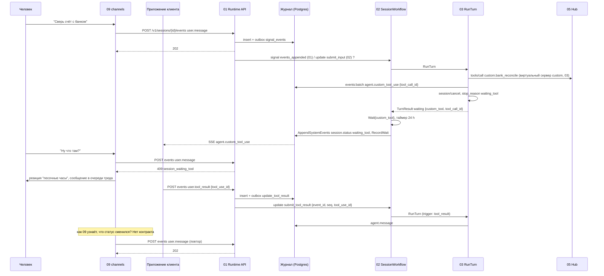

# 04. Custom tool и сообщения во время ожидания

Черновик 1, 2026-10-15. Проверка спек 01, 02, 03, 05, 07, 09 на сквозном сценарии.

> **Статус.** Это разбор спек до [decisions.md](../decisions.md). Выводы «не проходит» и найденные нестыковки относятся к старым спекам. Они сведены в решения D1...D40, актуальный путь описан в разделах «0. Согласовано» спек. Для приёмочных тестов берите шаги отсюда, а контракты из спек и приложения A к decisions.md.

## Сценарий

Агент вызывает custom tool. Его исполняет внешнее приложение клиента, а не Hub. Пока приложение не прислало `user.tool_result`, человек пишет ещё одно сообщение.

Разбираем три ветки:

- **A. Прямой путь.** Сессия в `waiting_tool`, новое `user.message` получает `409 session_waiting_tool`. Канал (09) держит сообщение у себя и шлёт позже.
- **B. Очередь.** Что нужно поменять, чтобы сообщение не отбивалось, а вставало в очередь.
- **C. Coordinator pattern.** Custom tool вызывает сабагент (child workflow). Главный агент свободен и отвечает человеку.

Участники: клиентское приложение (CA), канал (09), Runtime API (01), SessionWorkflow (02), harness-воркер (03), MCP Hub (05), control plane (07).

## Диаграмма: ветка A (как описано в спеках)



## Диаграмма: ветка C (coordinator pattern)

```mermaid
sequenceDiagram
    participant U as Человек
    participant CH as 09 channels
    participant API as 01 Runtime API
    participant P as 02 WF родителя
    participant PH as 03 RunTurn родителя
    participant HUB as 05 Hub
    participant C as 02 WF ребёнка
    participant CHH as 03 RunTurn ребёнка
    participant CA as Приложение клиента
    U->>CH: "Сверь счёт с банком"
    CH->>API: user.message
    API->>P: вход
    P->>PH: RunTurn
    PH->>HUB: platform.spawn_subagent {agent, task} (03)
    HUB->>API: ? (02: update spawn_subagent через 01; 03: signal от Hub)
    API->>P: update spawn_subagent {await:false}
    P->>C: ExecuteChildWorkflow (ABANDON)
    P-->>PH: child_session_id
    PH->>HUB: send_user "Принял, сверяю"
    PH-->>P: end_turn, статус idle
    C->>CHH: RunTurn
    CHH->>CHH: agent.custom_tool_use в журнал ребёнка
    CHH-->>C: waiting_tool
    Note over CA: CA подписан на SSE родителя и не видит журнал ребёнка
    U->>CH: "А ещё проверь март"
    CH->>API: user.message в сессию родителя
    API-->>CH: 202 (родитель idle)
    P->>PH: RunTurn, отвечает человеку
    CA->>API: user.tool_result в сессию ребёнка
    API-->>CA: 404, у ребёнка нет строки в sessions (01, открытый вопрос 8)
    C->>CHH: RunTurn после результата
    CHH-->>C: end_turn
    C->>P: signal subagent_finished {result_event_id}
    P->>PH: RunTurn (вход subagent.finished)
    PH->>HUB: send_user "Сверка готова"
```

## Таблица шагов

Ветка A, затем отличия ветки C.

| Шаг | Компонент | Контракт | Данные |
|---|---|---|---|
| 1 | 09 → 01 | `POST /v1/sessions/{id}/events`, `Idempotency-Key` обязателен | `user.message`, `data.author`, `data.channel` |
| 2 | 01 | Проверка статуса под `select ... for update`, запись в `session_events`, `workflow_outbox` kind `signal_events` | `seq`, `event_id` |
| 3 | 01 → 02 | По 01: Signal-With-Start `events_appended {up_to_seq}`. По 02: update `submit_input {event_id, type, actor_id, priority}` до записи | Противоречие, см. G1 |
| 4 | 02 → 03 | Activity `RunTurn` на `harness-<kind>` | 02: `TurnInput{FromSeq, ToSeq, NewEventIDs}`; 03: `RunTurnInput{turn_id, trigger_seqs, mode}` (G4) |
| 5 | 03 → 05 | MCP `tools/call` в Hub, виртуальный сервер `custom` (только в 03) | имя тула, `input`, `Idempotency-Key` |
| 6 | 03 → 01 | `POST /internal/v1/sessions/{id}/events:batch` (03) или `events:append` (01) | `agent.custom_tool_use {tool_call_id, name, input}` |
| 7 | 03 | `session/cancel` по ACP, `TurnResult.stop_reason = waiting_tool`, `waiting {kind: custom_tool, tool_call_id}` | один ожидаемый вызов |
| 8 | 02 | `Wait{kind: custom_tool}`, таймер `CustomToolTimeout` 24 h, activities `AppendSystemEvents`, `RecordWait` | `session.status {status: waiting_tool, waits}` |
| 9 | 01 | Та же транзакция обновляет `sessions.status`, `pending_tool_use_id` | id вызова |
| 10 | 01 → CA | `GET /v1/sessions/{id}/stream` (SSE, `Last-Event-ID`) | `agent.custom_tool_use` |
| 11 | 09 → 01 | `POST events user.message` | `409 session_waiting_tool` с `waiting[]` |
| 12 | 09 | Сообщение остаётся в очереди треда, реакция «песочные часы» | Как узнать смену статуса, не описано (G6) |
| 13 | CA → 01 | `POST events user.tool_result` | `data.tool_use_id`, результат |
| 14 | 01 → 02 | outbox `update_tool_result` → update `submit_tool_result` (стадия Accepted) | 01: `{event_id, seq, tool_use_id}`; 02 ждёт ещё `actor_id` (G5) |
| 15 | 02 → 03 | Новый `RunTurn`, результат идёт «как текст» в следующий ход | `trigger_seqs` с `user.tool_result` |
| 16 | 09 → 01 | Повтор отложенного `user.message` | `202` |
| C1 | 03 → 05 | `platform.spawn_subagent {agent, task}` (03) | В 05 такого тула нет (G9) |
| C2 | ? → 02 | update `spawn_subagent {tool_use_id, agent_ref, task_event_id, await}` | Кто зовёт: 01 или Hub, не решено |
| C3 | 02 | `ExecuteChildWorkflow`, `PARENT_CLOSE_POLICY_ABANDON`, событие `subagent.started` | `child_session_id` |
| C4 | 02 ребёнка → 03 | `RunTurn`, `agent.custom_tool_use` в журнал ребёнка | Журнал ребёнка отдельный |
| C5 | 09 → 01 → 02 родителя | `user.message`, родитель `idle`, приём `202` | Главный агент отвечает |
| C6 | CA → 01 | `user.tool_result` в сессию ребёнка | Строки ребёнка в `sessions` нет (G10) |
| C7 | 02 ребёнка → 02 родителя | signal `subagent_finished {child_session_id, tool_use_id, result_event_id, status}` | Только ссылка на событие в чужом журнале (G12) |
| C8 | 02 родителя → 03 | `RunTurn` с входом `subagent.finished` | Ход родителя |

## Отказы

| Что случилось | Что описано в спеках | Чего не хватает |
|---|---|---|
| Приложение клиента не ответило 24 h | 02: синтетический `tool.result {content: timeout}`, новый ход | Приложение не получает отмену. Поздний ответ даст `409 tool_use_mismatch`, а побочный эффект у клиента уже случился |
| `user.interrupt` в `waiting_tool` | 02: ожидание закрывается `tool.result cancelled`, статус `idle` | Нет сигнала приложению «вызов отменён». 01 шлёт signal `interrupt`, а у 02 такого signal нет (G1) |
| Приложение прислало результат дважды | 01: `Idempotency-Key`; 02: повтор `tool_use_id` игнорируется | Работает |
| Два приложения ответили на один вызов | 02: `tool_use_already_answered` 409 | Работает, но кто вправе отвечать, не задано (G5) |
| Результат пришёл раньше, чем 02 записал `waiting_tool` | Не описано | Гонка, 409 или `event.rejected` (G3) |
| Воркер упал между `agent.custom_tool_use` и возвратом `TurnResult` | 03: повтор хода, открытые вызовы закрываются `tool.result unknown` | Custom tool закроется как `unknown`, хотя приложение уже работает. Повтор может выдать второй `agent.custom_tool_use` с тем же id (G8) |
| 01 упал после update и до записи (по порядку 02) | 02: `ResolveInputs` ждёт 60 s, `input_lost` | Порядок 01 обратный, см. G1 |
| Temporal недоступен | 01: событие в журнале, outbox ретраит. 02: `503`, событие не пишется | Два разных поведения для клиента (G1) |
| Ребёнок ждёт custom tool дольше `TurnTimeout` родителя при `await=true` | 02: родитель ждёт детей до `TurnTimeout` 2 h, ребёнок ждёт 24 h | Нет правила, что делать родителю (G13) |
| Родитель `terminate` | 02: `RequestCancelExternalWorkflow` детям | Ребёнок в `waiting_tool` закрывается, приложению никто не говорит |
| Канал не дождался смены статуса | 09: очередь треда | Нет события или потока, на который 09 подписан (G6) |

## Найденные нестыковки

**G1. Приём входа: signal после журнала (01) или update до журнала (02). Блокер.**
01 пишет событие, потом outbox шлёт signal `events_appended`, `interrupt`, `terminate`. 02 ждёт update `submit_input`, `terminate` и не знает signals `events_appended` и `interrupt`. Порядок обратный, имена разные.
Предложение: один контракт в 01 и 02. Взять порядок 01 (журнал, outbox), а в 02 оставить updates как способ доставки: outbox вызывает `submit_input {event_id, seq, type, actor_id, priority}` и `submit_tool_result`. Проверку `409` делать в 01 по проекции, а validator в 02 только страхует; при отказе 01 пишет `event.rejected`. `interrupt` и `terminate` сделать updates в обеих спеках.

**G2. Где определяется custom tool. Блокер.**
03 говорит, что Hub отдаёт custom tool из виртуального сервера `custom`. 05 говорит, что Hub custom tools не исполняет, и сервера `custom` в реестре нет. В `AgentConfig` (07) нет поля для custom tools. Не описано, как воркер отличает custom tool от обычного вызова и что Hub отвечает на `tools/call`.
Предложение: поле `custom_tools: [{name, description, input_schema, timeout_s}]` в `AgentConfig` 07 с проверкой схемы. Hub 05 отдаёт их как builtin-сервер `custom` и на `tools/call` сразу отвечает служебным результатом `{custom_pending: true, tool_call_id}`. Воркер видит его по префиксу `mcp__hub__custom__` и делает шаг 7. Записать это в 03 и 05 одинаково.

**G3. Гонка: результат быстрее статуса. Мажор.**
`agent.custom_tool_use` пишет воркер, а `waiting_tool` и `pending_tool_use_id` пишет 02 только после конца `RunTurn`. Быстрое приложение получает событие по SSE и шлёт `user.tool_result`, пока статус `running`. 01 вернёт `409 tool_use_mismatch`, а validator 02 не найдёт `Wait`.
Предложение: 01 при `events:append` события `agent.custom_tool_use` в той же транзакции ставит `pending_tool_use_id`. Проверка 01 для `user.tool_result`: есть `agent.custom_tool_use` с этим id и нет результата, статус любой кроме `terminated`. 02 принимает ранний результат в буфер `EarlyResults` и закрывает `Wait` сразу при его создании.

**G4. Разные формы `RunTurn` в 02 и 03. Мажор.**
02: `TurnInput{FromSeq, ToSeq, NewEventIDs}`, `StopReason custom_tool | confirmation | waiting_subagents`, `Waits []`. 03: `RunTurnInput{turn_id, trigger_seqs, mode}`, `stop_reason waiting_tool | waiting_human`, одно поле `waiting`. Поле id вызова: `tool_use_id` в 01 и 02, `tool_call_id` в 03.
Предложение: одна схема в общем пакете контрактов. `waits` массивом, единое имя `tool_use_id`, единые значения `stop_reason`.

**G5. Кто вправе прислать `user.tool_result`. Мажор, безопасность.**
01 требует только `session.write`. 02 не проверяет `actor_id` для tool result, а 01 его и не передаёт. Любой участник треда или сервис с `act_as` может подсунуть результат за приложение клиента.
Предложение: в описании custom tool (G2) поле `responder` (service account или principal). 08 даёт действие `session.tool_result`. 01 проверяет его и передаёт `actor_id` в update. Результат помечается как данные, не инструкции, и проходит маскирование Hub (как результаты MCP-тулов).

**G6. 409 в канале: 09 не узнаёт, когда повторить. Мажор.**
09 держит сообщение в очереди «пока статус не сменится». Для этого 09 нужен поток по тенанту с фильтром `metadata.channel_binding_id`. 01 даёт только SSE на одну сессию. Прямой клиент API вообще без очереди: сообщение теряется, если он не повторит сам.
Предложение (см. G7): убрать `409` для `user.message`. Если `409` остаётся, 01 добавляет `GET /v1/stream?filter=metadata.channel_binding_id` и событие `session.status` в нём, а 09 повторяет по нему.

**G7. 409 противоречит coordinator pattern и приоритету владельца. Мажор.**
design.md говорит «остальное встаёт в очередь» и «сообщение владельца прерывает ход». В `waiting_tool` 02 отбивает даже владельца. 09 шлёт `delivery: interrupt` только при `running`. Хранить сообщения снаружи сессии хуже: их нет в журнале, агент про них не знает.
Предложение: вариант «очередь». В `waiting_tool` `user.message` принимается (`202`), пишется в журнал и ложится в `PendingInputs`. Следующий ход начинается после результата или таймаута и видит всё вместе. Сообщение владельца или `user.interrupt` закрывают ожидание синтетическим `cancelled` и сразу запускают ход. Код `session_waiting_tool` оставить только как флаг в ответе `202` (`queued_behind_tool: true`), чтобы канал поставил «песочные часы».

**G8. Падение воркера после `agent.custom_tool_use`. Мажор.**
По 03 новая попытка закрывает открытые вызовы `tool.result unknown`. Для custom tool это неверно: приложение уже работает. Модель при повторе вызовет тул ещё раз, появится второй `agent.custom_tool_use`.
Предложение: при восстановлении воркер не закрывает `agent.custom_tool_use`, а сразу возвращает `waiting_tool` с этим id. `client_event_id` для `agent.custom_tool_use` = `tool_use_id`, повтор не создаёт второе событие.

**G9. Нет пути для `spawn_subagent`. Блокер для ветки C.**
03: harness зовёт тул Hub `platform.spawn_subagent`, Hub шлёт signal. 02: это update `spawn_subagent` от 01, открытый вопрос 5. 05: в builtin-серверах только `send_user`, `memory`, `skills`. Нет внутреннего эндпоинта 01 для этого.
Предложение: тул `platform__spawn_subagent {agent, task, await}` в 05. Hub вызывает `POST /internal/v1/sessions/{id}/subagents` в 01, 01 пишет событие задачи и шлёт update `spawn_subagent`. Ответ тула `{child_session_id}`.

**G10. У ребёнка нет строки в `sessions`. Блокер для ветки C.**
02 стартует child workflow сам, 01 об этом не знает (открытый вопрос 8 в 01). Журнал ребёнка, SSE ребёнка и `POST events` в ребёнка дают `404`. Приложение не может отправить результат.
Предложение: создавать ребёнка через 01 (шаг G9): 01 вставляет строку `sessions` с `metadata.parent_session_id`, `on_behalf_of` родителя и `session.created`, затем 02 запускает child workflow с этим id.

**G11. Приложение не видит custom tool ребёнка. Мажор.**
Приложение подписано на сессию, с которой работает. Журнал ребёнка отдельный, наверх идёт только `subagent.finished`. Как приложение узнаёт `agent.custom_tool_use` ребёнка, не описано.
Предложение: 02 ребёнка при `waiting_tool` пишет в журнал родителя событие `subagent.waiting {child_session_id, tool_use_id, name}` (без input). Или 01 даёт поток по тенанту с фильтром `metadata.parent_session_id`. Ответ приложение шлёт в сессию ребёнка.

**G12. Итог ребёнка не доходит до контекста родителя. Мажор.**
`subagent_finished` несёт только `result_event_id` из журнала ребёнка. Воркер родителя читает только журнал родителя. 02 пишет `subagent.finished` без текста.
Предложение: 02 ребёнка кладёт итог (до 16 KiB, больше через `ref`) в `subagent.finished.data.summary` журнала родителя. Либо 01 разрешает воркеру родителя читать событие ребёнка по `parent_session_id`.

**G13. Режим сабагента и таймауты не сходятся. Мажор.**
07 не даёт полей `mode` и `await` в `subagents`, хотя 03 читает `subagents[].mode`, а 02 ждёт `await`. При `await=true` родитель ждёт `TurnTimeout` 2 h, а ребёнок ждёт custom tool 24 h. Ребёнок держит слот из 8 активных детей сутки.
Предложение: в 07 `subagents[]: {name, ref, mode: child|inline, await: bool}`. Валидатор 07 запрещает `await=true` для агента с custom tools у ребёнка. Слот ребёнка в `waiting_tool` не считается активным, либо лимит отдельный.

**G14. Родитель не может управлять ребёнком. Мажор.**
Человек пишет «отмени сверку». Главный агент свободен, но нет тула, чтобы отменить ребёнка или дописать ему задачу.
Предложение: тулы `platform__subagent_cancel {child_session_id}` и `platform__subagent_message {child_session_id, text}` в 05, через 01 они дают `user.interrupt` и `user.message` в сессию ребёнка с `actor: agent`.

**G15. `subagent.started` пишут двое. Минор.**
02 пишет `subagent.started` через `AppendSystemEvents`, 03 тоже пишет `subagent.started {mode: child}`. В журнале два события.
Предложение: для `mode: child` пишет только 02, воркер пишет только `inline`.

**G16. Отмена и таймаут не доходят до приложения. Минор.**
Синтетический `tool.result` (`timeout`, `cancelled`) лежит в журнале, но у приложения нет явного контракта. Поздний ответ получает `409 tool_use_mismatch` без причины.
Предложение: в ответе `409` поле `reason: timed_out | cancelled` из `session_waits.state`. В документации клиента: слушать `tool.result` с `is_error` по своему `tool_use_id`.

**G17. Висящий MCP-вызов в harness. Минор.**
Harness ждёт ответа на `tools/call` в Hub, а воркер отменяет ход. В следующем ходе результат идёт «как текст». Модель видит отменённый вызов и отдельное сообщение. Это работает, но формат не задан и разный у harness.
Предложение: с G2 Hub отвечает сразу (`custom_pending`), а воркер в следующем ходе подаёт результат как блок `[tool_result tool_use_id=...]` единым шаблоном из 03. Нативный tool result через ACP невозможен, потому что ACP не даёт клиенту дописать результат в чужой вызов (не проверено).

## Итог

На текущих спеках сценарий не проходит. Ветка A ломается на G1 (несовпадение приёма входа) и G2 (custom tool нигде не определён), ветка C ещё на G9 и G10. Если принять G7 (очередь вместо `409`), отпадает G6 и упрощается 09.
