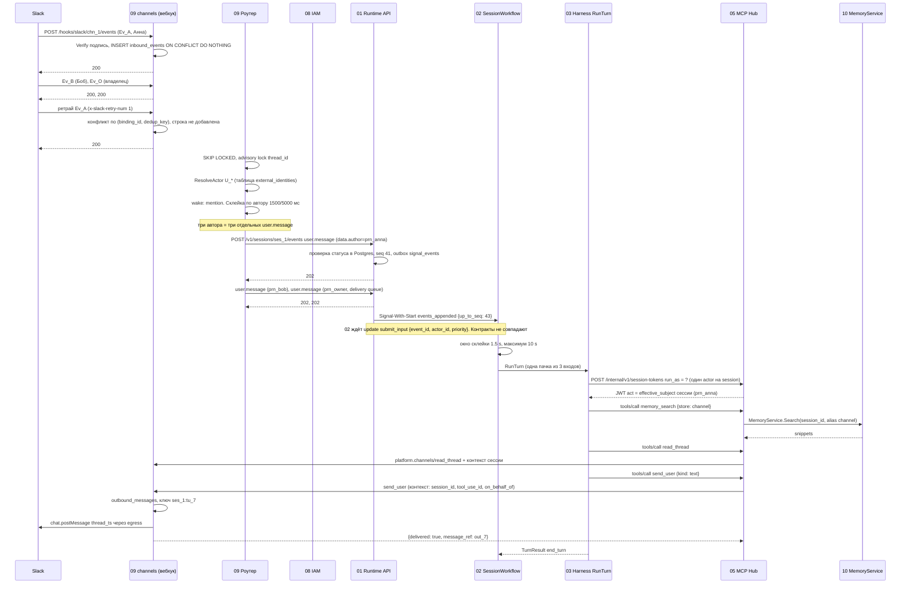

# Поток 05. Бот в Slack-треде

Черновик 1, 2026-10-15. Сквозная проверка спек 01, 02, 03, 05, 08, 09, 10.

> **Статус.** Это разбор спек до [decisions.md](../decisions.md). Выводы «не проходит» и найденные нестыковки относятся к старым спекам. Они сведены в решения D1...D40, актуальный путь описан в разделах «0. Согласовано» спек. Для приёмочных тестов берите шаги отсюда, а контракты из спек и приложения A к decisions.md.

## 1. Сценарий

Бот `@hrbot` подключён к Slack через binding `chn_1` (`access_mode: author`). Тред уже есть, session `ses_1` в статусе `idle`.

За 5 секунд бота упоминают три человека:

| Время | Автор | Кто это | Текст |
|---|---|---|---|
| t=0.0 s | `U_ANNA` → `prn_anna` | Обычный сотрудник, первый автор треда | «@hrbot когда выплата отпускных?» |
| t=1.2 s | `U_BOB` → `prn_bob` | Сотрудник с меньшими правами | «@hrbot и мне скажи» |
| t=2.0 s | `U_OWNER` → `prn_owner` | Владелец бота (`owner_principal_id`) | «@hrbot стоп, ответь по регламенту из памяти» |

Slack повторно доставляет событие Анны (ретрай `x-slack-retry-num: 1`, тот же `event_id`).

Бот читает память канала (`memory_search` по store `channel`), смотрит прошлые обсуждения и отвечает в тред через `send_user`.

Вопросы проверки: дедуп, склейка, приоритет владельца, автор, от чьего имени агент ходит в Hub.

## 2. Диаграмма

## 3. Шаги

| # | Компонент | Контракт | Данные |
|---|---|---|---|
| 1 | Slack → 09 | `POST /hooks/slack/chn_1/events` | Тело события, `X-Slack-Signature`, `X-Slack-Request-Timestamp` |
| 2 | 09 вебхук | `ChannelDriver.Verify`, `Receive` | HMAC-SHA256, окно 5 мин; нормализованный `InboundEvent` с `dedup_key = event_id` |
| 3 | 09 вебхук | `INSERT inbound_events ON CONFLICT DO NOTHING`, ответ `200` за 300 мс | PK `(binding_id, dedup_key)`, `state = new` |
| 4 | 09 вебхук | Ретрай Ev_A | Тот же `event_id`, конфликт PK, строка не появляется, ответ `200` |
| 5 | 09 роутер | `SELECT ... FOR UPDATE SKIP LOCKED`, advisory lock на `thread_id` | Строгий порядок внутри треда |
| 6 | 09 роутер | `ResolveActor` по `external_identities` | `U_ANNA → prn_anna`, `U_BOB → prn_bob`, `U_OWNER → prn_owner` |
| 7 | 09 роутер | `wake_policy.mention` | Все три упоминают бота, будим |
| 8 | 09 роутер | Склейка (раздел 5.3, шаг 5) | Окно 1500 мс по одному автору. Три разных автора, три пачки |
| 9 | 09 роутер | Приоритет владельца (шаг 6) | Только личное сообщение владельца даёт `interrupt`. В треде у владельца `delivery: queue` |
| 10 | 09 → 01 | `POST /v1/sessions/ses_1/events` (сервисный токен с `act_as`) | `user.message`, `data.author`, `data.channel {binding_id, thread_id, thread_key, external_msg_ids[], wake_reason, delivery}`, `data.context`. `Idempotency-Key` обязателен, но формула ключа в 09 не задана |
| 11 | 01 | Проверка статуса под `select ... for update`, запись в `session_events`, outbox `signal_events` | `actor = {kind: human, id: data.author}`, seq 41..43, ответ `202` |
| 12 | 01 → 02 | Outbox: Signal-With-Start `events_appended {up_to_seq}` | Только seq. Ни `actor_id`, ни `priority` |
| 13 | 02 | Склейка `MergeWindow 1.5 s`, `MergeMaxWait 10 s` | `PendingInputs` с тремя `InputRef`. 02 при этом ждёт update `submit_input`, а не signal |
| 14 | 02 → 03 | Activity `RunTurn` | 02 шлёт `TurnInput {FromSeq, ToSeq, NewEventIDs}`; 03 ждёт `RunTurnInput {session.actor, trigger_seqs, history_until_seq}` |
| 15 | 03 → 05 | `POST /internal/v1/session-tokens` | `{session_id, turn_id, agent_version_id, run_as, tenant_id, ttl_s}`. `run_as` один на session |
| 16 | 03 | ACP `session/new` или `session/load` с `mcpServers: [{type: http, name: hub, headers: Authorization}]` | Только Hub |
| 17 | 05 | `allowed(call)`: `iam.check(run_as, ...)` ∩ агент ∩ запреты ∩ потолок класса | `run_as` из токена. Автор текущего сообщения в формуле не участвует |
| 18 | 05 → 10 | `memory_search {query, stores: [channel]}` → `MemoryService` | `session_id` из токена, снимок `session_bindings` |
| 19 | 05 → 09 | `read_thread {limit: 50}` через встроенный сервер | Сообщения треда в `<untrusted_message>` |
| 20 | 05 → 09 | `send_user {kind: text, reply_to: latest}` | Подписанный контекст: `session_id, tenant_id, agent_id, tool_use_id, on_behalf_of` |
| 21 | 09 | `outbound_messages`, ключ `{session_id}:{tool_use_id}` | `ChannelDriver.Send` → Slack `chat.postMessage` с `thread_ts` через egress-прокси |
| 22 | 09 → 05 → 03 | Результат тула | `{delivered: true, message_ref: out_7}` |
| 23 | 03 → 02 | `TurnResult {StopReason: end_turn}` | 02 пишет `session.status idle` |

## 4. Разбор вопросов сценария

**Дедуп.** Работает на входе. Ретрай Slack несёт тот же `event_id` (так в доках Slack описан идентификатор события; явной фразы про ретраи нет), PK `(binding_id, dedup_key)` гасит его. Дыры: Slack может прислать одно сообщение двумя событиями (`app_mention` и `message.channels`) с разными `event_id`, если бот подписан на оба (не проверено); нет ключа идемпотентности на шаге 09 → 01.

**Склейка.** Её делают два места: роутер (1500/5000 мс, по автору) и workflow (1500 мс / 10 s, всех подряд). Три автора у роутера не склеиваются, у workflow склеиваются в один ход. Худшая задержка до хода 5 s + 10 s = 15 s.

**Приоритет.** Владелец пишет в треде, значит по 09 это `delivery: queue`. По 02 «сообщение владельца прерывает ход». Даже если роутер решит иначе, 01 не умеет передать `priority` в workflow. Владелец в этом сценарии ничего не прерывает, его «стоп» идёт в общую пачку.

**Автор.** Каждое событие в журнале имеет свой `actor` (из `data.author`). В ход попадают три автора сразу. Кто «текущий автор» для инструкции и прав, не определено.

**От чьего имени в Hub.** Токен Hub несёт один `act` (= `run_as` сессии, по 08 это первый автор треда, Анна). 08 обещает «агент ∩ subject сессии ∩ автор сообщения», но ни токен (05), ни `RunTurnInput` (03), ни `TurnInput` (02) автора хода не несут. Итог: Боб получает ответ с правами Анны.

## 5. Отказы

| Отказ | Что происходит по спекам | Дыра |
|---|---|---|
| Ретрай Slack пришёл, пока первое событие ещё `new` | PK конфликт, второй строки нет | Нет |
| Postgres `channels` недоступен при вебхуке | `503`, Slack повторит (сразу, через 1 и 5 мин) | Нет |
| `channels` упал посреди окна склейки | Событие остаётся в `inbound_events` | Не описано, где живёт таймер окна и в каком `state` событие ждёт. Риск: после рестарта окно начинается заново или пачка уходит дважды |
| Ответ `202` от 01 потерялся, роутер повторяет | 01 вернёт тот же `seq`, если ключ тот же | Формула `Idempotency-Key` для `POST /events` в 09 не задана. Если ключ случайный, сообщение уйдёт дважды |
| 01 записал событие, Temporal недоступен | Outbox повторяет signal без предела | По 02 событие без принятого update не пишется вообще. Два разных порядка |
| Валидатор 02 отклонил вход (гонка статуса) | 01 пишет `event.rejected` | 09 не читает `event.rejected`, человек не узнает, что его сообщение потеряно |
| Воркер упал после `chat.postMessage`, ход перезапущен | 03 закрывает вызов `unknown`, модель может вызвать `send_user` снова | Ключ outbox `{session_id}:{tool_use_id}`, а ключ Hub `session_id:turn_id:sha256(name+input)`. После rehydration `tool_use_id` новый, текст может отличаться → второе сообщение в тред |
| `send_user` вернул `rate_limited` | Агент получает `retry_after_s` | Нормально |
| Сессия в `waiting_tool` | 01 даёт `409`, роутер ставит «песочные часы» и держит очередь треда | Что значит «уйдёт, когда статус сменится»: нет подписки 09 на смену статуса (поток тенанта не существует в 01) |
| Hub не смог выпустить токен (`403` у `run_as`, например Анну отключили) | `RunTurn` падает | Нет правила: сменить subject на следующего автора или закрыть session. Боб и владелец остаются без ответа |

## 6. Найденные нестыковки

1. **[blocker] Доставка входа в workflow: signal или update.** 01 пишет в журнал и шлёт Signal-With-Start `events_appended {up_to_seq}`. 02 ждёт update `submit_input {event_id, type, actor_id, priority}` до записи в журнал и стартует через UpdateWithStart. Предложение: принять схему 01 (журнал, затем signal через outbox), но расширить payload signal до списка `{event_id, seq, type, actor_id, priority}`. Валидацию `waiting_tool` оставить в Postgres 01, а отказ workflow превращать в `event.rejected`, который читает и 09.
2. **[blocker] Права в общем треде.** Токен Hub несёт один `act`, а 08 требует пересекать с автором сообщения. В склеенном ходе авторов несколько. Предложение: 02 кладёт в `TurnInput` `turn_actors[]` (из `InputRef.ActorID`), 03 передаёт их в `POST /internal/v1/session-tokens`, токен получает claim `turn_actors`, `allowed()` в 05 считает `агент ∩ subject ∩ каждый из turn_actors`. Если авторы с разными правами, 02 не склеивает их в один ход, а режет пачку по автору (или берёт минимум прав).
3. **[blocker] Личная память первого автора видна всем в треде.** 10 привязывает store `person` по `principal_id` сессии один раз при создании. В треде Анны Боб может получить ответ из памяти Анны. Предложение: для сессий с `metadata.channel_binding_id` и не-DM тредом шаблон `person` не привязывать; либо привязывать на ход только при единственном авторе, равном subject.
4. **[major] Приоритет владельца не доходит до workflow.** 09 ставит `delivery: interrupt` только для лички владельца, 02 прерывает по `priority=owner`, 01 не умеет передать `priority`, а `OwnerActorID` в `SessionInput` ниоткуда не берётся (в `sessions` 01 нет поля владельца, start payload `{session_id}`). Предложение: `POST /v1/sessions` принимает `owner_actor_id` (09 кладёт `owner_principal_id` binding), 01 хранит его и отдаёт в start; `POST /events` принимает `priority` только от сервисного токена с `act_as`; 09 явно решает, прерывает ли владелец ход в общем треде (по сценарию нужно: да).
5. **[major] Двойная склейка с разными окнами.** 09: 1500/5000 мс по автору; 02: 1500 мс / 10 s по всем. Предложение: склейку делает только 02. Роутер отправляет каждое сообщение сразу (или склеивает только правки одного сообщения), `coalesce_*` переносится из binding в `Limits` сессии.
6. **[major] Нет ключа идемпотентности на `POST /v1/sessions/{id}/events` из роутера.** 01 требует ключ для каналов, 09 его не задаёт. Предложение: `Idempotency-Key = {binding_id}:{sha256(sorted dedup_keys)}`; при одном сообщении `{binding_id}:{event_id}`. Плюс дедуп по `(thread_key, external_msg_id)`, чтобы одно сообщение Slack, пришедшее двумя событиями (`app_mention` и `message`, не проверено), не будило дважды.
7. **[major] Ключ идемпотентности `send_user` не совпадает с ключом Hub.** 09 `{session_id}:{tool_use_id}`, 03/05 `session_id:turn_id:sha256(name+input)`. После падения воркера модель зовёт `send_user` с новым `tool_use_id` и другим текстом. Предложение: Hub передаёт в 09 свой `idempotency_key`; 09 дополнительно хранит «последний ответ хода» и при `tool.result unknown` для `send_user` отдаёт модели уже отправленный текст вместо повторной отправки. Отдельно: harness (Claude Agent SDK через ACP) не ставит свой заголовок на каждый вызов тула (не проверено), поэтому ключ должен считать сам Hub из claims токена и аргументов.
8. **[major] Несовпадение входа `RunTurn`.** 02 `TurnInput {FromSeq, ToSeq, NewEventIDs, OutcomeID}`, 03 `RunTurnInput {session.actor, turn_id, trigger_seqs, history_until_seq, mode}`. Предложение: один тип в общем пакете контрактов, с `turn_id`, `trigger_seqs`, `turn_actors[]`.
9. **[major] Две таблицы связок автора.** 09 `external_identities` + ссылка привязки 15 мин; 08 `channel_identities` + код 6 цифр 10 мин и `session-principals` с `external_user_id`. Предложение: источник истины 08 (`channel_identities`), 09 только кеширует и вызывает `/internal/iam/...:resolve`; один способ привязки.
10. **[major] Формат `on_behalf_of` и создание subject.** 01 принимает `on_behalf_of` строкой `usr_...`; 08 ждёт `{kind: channel, id, external_user_id}`; 09 при создании сессии `on_behalf_of` не передаёт; 01 в зависимостях не зовёт `session-principals` и `ResolveSessionContext`, хотя 08 и 10 этого ждут. Предложение: 01 при `POST /v1/sessions` зовёт 08 `session-principals`, затем 10 `ResolveSessionContext`; поле `on_behalf_of` в 01 становится объектом как в 08.
11. **[major] Имена в metadata.** 09 пишет `{channel_binding_id, thread_id}`, 10 ищет `channel_id`, пример 01 `{channel_id, thread_ref}`, 05 читает `metadata.channel`. Без `channel_id` 10 пропускает привязку `channel`, и `memory_search` по каналу вернёт `store_not_bound`. Предложение: одно имя `metadata.channel = {binding_id, thread_id, thread_key}`, 10 берёт `binding_id`.
12. **[major] Нет инструмента «прошлые обсуждения».** `read_thread` видит только текущий тред, консолидация памяти раз в сутки и опциональна. Предложение: тул `platform.channels/search_threads {query, limit}` по `channel_messages` своего binding (тип `read`, класс данных не выше потолка канала), с обёрткой `<untrusted_message>`.
13. **[major] Подписанный контекст вызова встроенного сервера не описан в 05.** 09 опирается на заголовок с `session_id, tool_use_id, on_behalf_of`, 05 его не определяет. Ещё 05 называет сервер `platform` и тул `platform__send_user`, 09 называет `platform.channels` и даёт также `read_thread`. Предложение: в 05 описать заголовок (JWS от Hub, `aud = channels`, TTL 60 s) и единые имена сервера и тулов.
14. **[minor] Поток событий для 09.** Статусы и `event.rejected` 09 должен видеть по всем сессиям тенанта, а 01 даёт SSE только на одну сессию. Предложение: `GET /internal/v1/streams/tenant?metadata.channel.binding_id=...`.
15. **[minor] Формат `user.message`.** 01: `data.content[]`; 09 и 02: `data.text`. Предложение: схема 01 (`content[]`) и `data.channel` как расширение.
16. **[minor] `memory_write` по умолчанию `ask`.** 05: `write → ask`, 10: подтверждение не нужно. Для бота в канале каждое запоминание будет ждать человека. Предложение: в 10 разметить memory тулы как `draft` или задать `confirmation: allow` в каталоге.
17. **[minor] TTL токена сессии.** 03: 15 мин, 05: по умолчанию 3600 с. Предложение: одно значение и правило продления в 05.
18. **[minor] Отказ при отключённом subject.** Нет правила, что делает тред, если `effective_subject` (первый автор) заблокирован. Предложение: 08 шлёт `principal.disabled`, 09 начинает новый `generation` треда с subject следующего автора.

## 7. Итог

Сценарий на текущих спеках не проходит. Дедуп ретрая Slack работает. Не стыкуются доставка входа (signal против update), приоритет владельца, права нескольких авторов в одном ходе и привязка памяти.
