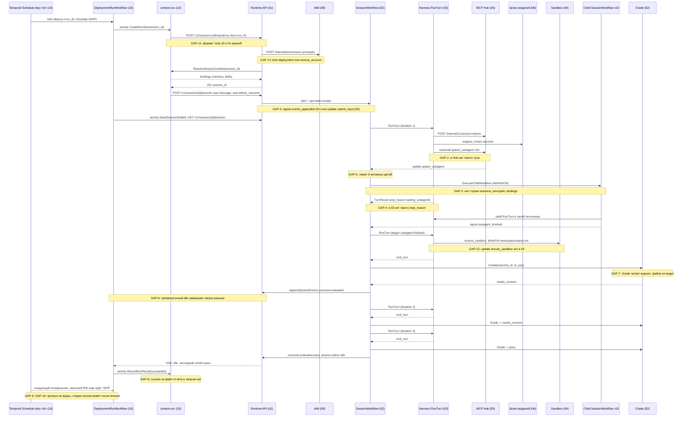

# Поток 06. Отчёт по расписанию с outcome и сабагентами

Черновик 1, 2026-10-15. Проверка спек 01-10 на сквозном сценарии. Спеки не правились, здесь только разбор и предложения.

> **Статус.** Это разбор спек до [decisions.md](../decisions.md). Выводы «не проходит» и найденные нестыковки относятся к старым спекам. Они сведены в решения D1...D40, актуальный путь описан в разделах «0. Согласовано» спек. Для приёмочных тестов берите шаги отсюда, а контракты из спек и приложения A к decisions.md.

## 1. Сценарий

Deployment `weekly-clients-report` каждый понедельник в 9:00 запускает сессию. Задача: собрать отчёт по 10 клиентам.

1. Temporal Schedule стартует запуск.
2. Запуск создаёт сессию от имени service account deployment и передаёт стартовое сообщение и outcome с критериями.
3. Главный агент раздаёт работу сабагентам: по одному на клиента.
4. Сабагенты возвращают итоги. Главный агент пишет отчёт файлом в `/workspace`.
5. Проверяющий (`Grade`) дважды отвечает `needs_revision`, на третий раз `pass`.
6. Запуск считается успешным, отчёт доступен владельцу.
7. Особый случай: прошлый запуск ещё идёт, когда наступает следующий понедельник.

Вывод проверки: **сценарий на текущих спеках не проходит**. Главные разрывы: нет пути вызова сабагента от агента до workflow, child-сессия не регистрируется в 01, у отчёта-файла нет контракта, а проверяющий не видит файл. Детали в разделе 5.

## 2. Диаграмма

Показан путь так, как он должен работать. Пунктирные заметки `GAP-N` отмечают места, где контракта нет или он противоречит другой спеке.

## 3. Шаги

| # | Компонент | Контракт | Данные |
|---|---|---|---|
| 1 | 10 | Temporal Schedule `dep-<deployment_id>`, cron `0 9 * * 1`, `Overlap` из `overlap_policy` (по умолчанию `skip`), `CatchupWindow` 10 мин | Старт `DeploymentRunWorkflow` id `deprun-<run_id>` на очереди `ctx-deployments` |
| 2 | 10 | activity `CreateRunSession` | `run_id`, шаблон `message_template` с `run.scheduled_at`, `run.window_start`; `outcome` из `ctx.deployments` |
| 3 | 10 → 01 | `POST /v1/sessions` | В 10: `agent: "agt@N"`, `environment_id`, `on_behalf_of: sa_...`, `resources`, `metadata{deployment_id, run_id, output}`, `idempotency_key` в теле. В 01: `agent_id`, `agent_version`, `on_behalf_of`, `initial_events`, ключ в заголовке `Idempotency-Key`. Не совпадает, GAP-11 |
| 4 | 01 → 07 | `ResolveLatestVersion(agent_id)` если версия не задана | В 07 это `live_version` через `POST /internal/v1/agent-refs:resolve` |
| 5 | 01 → 08 | `POST /internal/iam/session-principals` | `on_behalf_of {kind, id}`. 01 хранит `on_behalf_of` строкой, GAP-13 |
| 6 | 01 → 10 | `rpc ResolveSessionContext` | `session_id`, `principal_id` = SA. Привязка `person` пропускается. Ответ в `ctx.session_bindings`. В списке зависимостей 01 этого вызова нет, GAP-15 |
| 7 | 01 | Транзакция: `sessions`, `session.created` seq 1, outbox `start` | `201 {id, status: idle}` |
| 8 | 10 → 01 | `POST /v1/sessions/{id}/events` с `user.message` и `user.define_outcome` | В 10 actor `{kind: system}`. В 01 для сервисного токена с `act_as` нужен `data.author`, actor становится `human`. GAP-11 |
| 9 | 01 → 02 | outbox `signal_events` → Signal-With-Start `events_appended {up_to_seq}` | В 02 такого signal нет: входы идут update `submit_input` до записи в журнал, старт через `UpdateWithStartWorkflow`. GAP-3 |
| 10 | 10 → 01 | activity `AwaitSessionSettled`: `GET /v1/sessions/{id}/stream` с `Last-Event-ID`, heartbeat 10 с, таймаут `run_timeout_s` (1800 с) | Ждёт `session.status` `idle` или `terminated` |
| 11 | 02 | Окно склейки 1.5 с, `ResolveInputs`, `LoadSessionConfig` (07 `GetAgentVersion`) | Outcome: `OutcomeState{max_iterations: 3}` |
| 12 | 02 → 03 | activity `RunTurn` на `harness-<kind>` | 02 шлёт `TurnInput{FromSeq, ToSeq, NewEventIDs, OutcomeID}`. 03 ждёт `RunTurnInput{turn_id, trigger_seqs, history_until_seq, mode}`. GAP-4 |
| 13 | 03 → 01 | `turns/claim`, `GET /internal/v1/sessions/{id}/events`, запись событий | 01: `events:append` с `writer_epoch`, `409 stale_writer`. 03: `events:batch` с `X-Turn-Attempt`, `409 stale_attempt`. GAP-4 |
| 14 | 03 → 05 | `POST /internal/v1/session-tokens` | `run_as` = SA. TTL: 02 говорит `TurnTimeout` 2 ч, 03 говорит 15 мин, 05 по умолчанию 3600 с. GAP-4 |
| 15 | 03 → 10 | `GET /internal/skills/bundles/{sha256}` | Скиллы из `session_bindings.skills` в `.claude/skills` |
| 16 | 03 → 06 | `POST /anthropic/v1/messages` с токеном сессии | Резерв бюджета сессии, `span.usage` в журнал |
| 17 | 03 → 05 | `tools/call platform.spawn_subagent {agent, task}` x10 | Тула нет в каталоге 05. GAP-1 |
| 18 | 05 → 02 | По 03: «Hub шлёт signal». По 02: update `spawn_subagent {tool_use_id, agent_ref, task_event_id, await}` с проверкой «ход идёт сейчас» | Канала 05 → 02 нет ни в одной спеке. GAP-1 |
| 19 | 02 | `ExecuteChildWorkflow`, `ParentClosePolicy` ABANDON, `child session_id` через `SideEffect` | Детей 10, лимит `MaxActiveSubagents` 8: 9-й и 10-й получают `subagent_limit` (422). GAP-5 |
| 20 | 02 child | Свой `RunTurn`, своя песочница, свой токен | Для child нет строки `sessions` в 01, нет `session_principals`, нет `session_bindings`. Запись событий и выпуск токена Hub упадут с 404. GAP-2 |
| 21 | 03 → 02 | `TurnResult` родителя | 02 ждёт `waiting_subagents` при `await=true`. 03 говорит, что `spawn` сразу отвечает `started` и агент свободен (это `await=false`). GAP-4 |
| 22 | child → 02 | signal `subagent_finished {child_session_id, tool_use_id, result_event_id, status}` | Ссылка на событие в журнале ребёнка. Как родитель читает чужой журнал, не описано. GAP-2 |
| 23 | 03 → 04 | `SandboxBroker.Acquire(session_id)` → Update `ensure_sandbox` → `Provision` или `Wake` | Update `ensure_sandbox` нет в списке 02. Файлы `resources` deployment сюда не доходят. GAP-12 |
| 24 | 03 → 04 | ACP `fs/write_text_file` → `sandboxd WriteFile /workspace/report.md` | Файл остаётся в песочнице родителя. Контракта «результат-файл» нет. GAP-8 |
| 25 | 02 → G | activity `Grade(outcome_id, to_seq)` на очереди `grader` | Читает журнал до `to_seq`. Содержимое файла не в журнале. Кто исполняет Grade: 02 (Go `grader-worker`) или 03 (адаптер `simple`). GAP-7 |
| 26 | 02 → 01 | `AppendSystemEvents outcome.evaluated {verdict: needs_revision, feedback}` | Новый ход iteration 2. Статус между ходами не описан. GAP-6 |
| 27 | 02 | Iteration 3: `Grade` → `pass` | `outcome.evaluated pass`, `session.status idle`, таймер сна песочницы 10 мин |
| 28 | 10 | activity `RecordRunResult` | `deployment_runs.status = succeeded`, `consecutive_failures = 0`, outbox `deployment.run.finished {run_id, status, cost_usd}`. Файла отчёта в записи нет. GAP-8 |
| 29 | 10 | Следующий понедельник при живом `DeploymentRunWorkflow` | `SKIP`: Temporal не стартует workflow. Строки в `deployment_runs` нет. GAP-9 |
| 30 | 10 → 01 | Таймаут запуска: `user.interrupt` | По 02 interrupt во время хода сразу начинает новый ход. Сессия работает дальше, а следующий запуск уже не перекрывается. GAP-10 |

## 4. Отказы

| Что упало | Что происходит по спекам | Дыра |
|---|---|---|
| Temporal недоступен в 9:00 | Schedule догоняет в пределах `CatchupWindow` 10 мин, старше пропуск. По документации Temporal значение по умолчанию год, 10 ставит своё | Пропуск виден только в описании Schedule. В `deployment_runs` не попадает |
| `context-svc` упал в `CreateRunSession` | Повтор activity, `Idempotency-Key=run_id`, сессия одна | 10 кладёт ключ в тело, 01 читает заголовок. При буквальном чтении спек повтор создаст вторую сессию (GAP-11) |
| 01 упал между update и журналом | По 02: `ResolveInputs` ждёт 60 с, `input_lost` | По 01 порядок обратный (журнал, потом outbox). Обе схемы вместе не работают (GAP-3) |
| Сабагент упал | `subagent.finished status: failed`, родитель продолжает | Отчёт без одного клиента. Grade может это не заметить, если критерий не требует 10 разделов |
| Лимит 8 детей | `422 subagent_limit` | Агент получает ошибку тула. Повтор позже не описан (GAP-5) |
| Ход длиннее лимита | 03: 30 мин `StartToClose`, `stop_reason=limit`. 07: `turn_timeout_s` 900. 02: `TurnTimeout` 2 ч | Три разных числа. Ожидание детей при `await=true` 02 ограничивает `TurnTimeout` |
| Grade упал 3 раза | `grade_failed`, сессия `idle` | 10 считает успехом только `pass`, значит `failed` с `outcome_failed`. Это корректно, но error_code в 10 не перечислен |
| Outcome исчерпан (3 раза `needs_revision`) | `outcome.evaluated exhausted: true` | В 10 нет отдельного кода, попадёт в `...` |
| Бюджет исчерпан | `402`, `BudgetExceeded`, сессия `idle` | Сабагенты это отдельные сессии со своим лимитом `max_cost_usd_per_session` 5. Общего бюджета на запуск нет (GAP-14) |
| Запуск дольше `run_timeout_s` | `user.interrupt`, `timed_out` | Сессия не останавливается (GAP-10). Счётчик автопаузы: считать ли `timed_out` сбоем, не решено (10, вопрос 3) |
| Prev run ещё идёт | `SKIP` | Пропуск не записан, владелец не знает, что отчёта за неделю нет (GAP-9) |
| `cancel_other` | Temporal отменяет `DeploymentRunWorkflow` и ждёт отмены | В 10 нет обработчика отмены, который завершает сессию. Старая сессия живёт рядом с новой |
| Владелец deployment отключён | 08: deployments в `paused`, `409 deployment_owner_disabled` | Работает, если 01 передаёт `kind: deployment` (GAP-13) |
| Песочница родителя спит или удалена | Hibernate через 10 мин, Destroy через 7 д с `keep_workdir` | Отчёт живёт в рабочей папке. После очистки снапшота файла нет (GAP-8) |

## 5. Найденные нестыковки

### GAP-1. Нет пути вызова сабагента (blocker; 02, 03, 05, 01)

03 говорит: harness вызывает тул Hub `platform.spawn_subagent`, Hub шлёт signal в workflow. В каталоге 05 такого тула нет, есть только `platform__send_user`, `memory__*`, `skills__*`. В 02 это update `spawn_subagent` с проверкой «ход идёт сейчас», и в 02 же открытый вопрос 5: кто его шлёт. У 01 нет эндпоинта для этого. В 05 нет клиента Temporal.

Предложение: встроенный тул Hub `platform__spawn_subagent {agent, task, await}`. Hub зовёт `POST /internal/v1/sessions/{id}/subagents` в 01 (с `tool_use_id` и токеном хода). 01 пишет событие задачи в журнал и шлёт update `spawn_subagent`. Ответ тула: `{child_session_id}`.

### GAP-2. Child-сессия не регистрируется (blocker; 02, 01, 08, 10, 05)

02 запускает child через `ExecuteChildWorkflow` сам. Но child должен иметь строку `sessions` в 01 (иначе `events:append` и `GET /internal/v1/sessions/{id}` дают 404), запись `session_principals` в 08 (от чьего имени), `session_bindings` в 10 (память, скиллы), и Hub при выпуске токена проверяет сессию через 01. Ни один шаг не описан. Итог ребёнка приходит как `result_event_id` из чужого журнала, а токен хода родителя читает только свою сессию.

Предложение: сессию ребёнка создаёт 01 в рамках GAP-1 (одна транзакция: `sessions` с `parent_session_id`, `root_session_id`, `on_behalf_of` родителя, `session.created`), зовёт 08 и 10 так же, как для обычной сессии. 08: `effective_subject` ребёнка = родителя. 10: привязки ребёнка = его `AgentVersion.memory`, но доступ не шире родителя, по умолчанию только чтение. Child workflow стартует с этим id. `subagent.finished` у родителя несёт `summary` (до 64 KiB) и список `file_ref`, а не только ссылку на чужой журнал.

### GAP-3. Доставка входов: 01 и 02 описывают разные механизмы (blocker; 01, 02, 10)

01: журнал, потом outbox, Signal-With-Start `events_appended {up_to_seq}`, signals `interrupt` и `terminate`, старт через start с `UseExisting`. 02: update `submit_input` до записи в журнал, `UpdateWithStartWorkflow`, signals только `subagent_finished` и `wake`, `terminate` это update. Одну схему реализовать нельзя без отказа от другой. 10 к тому же шлёт стартовое сообщение отдельным запросом, а 02 ожидает первое сообщение в одном вызове со стартом.

Предложение: принять схему 01 (журнал первым, outbox), потому что она не теряет вход при падении Temporal. 02 добавляет signal `events_appended {up_to_seq}` и читает типы входов из журнала в `ResolveInputs`. Проверка `409` остаётся в Postgres, validator update нужен только для `tool_result` и `tool_confirmation`. 10 передаёт `user.message` и `user.define_outcome` в `initial_events` одного `POST /v1/sessions`, тогда первый ход сразу видит outcome.

### GAP-4. Контракт `RunTurn` и записи событий расходится (major; 02, 03, 01, 05, 07)

- Вход: 02 `TurnInput{FromSeq, ToSeq, NewEventIDs, OutcomeID}`, 03 `RunTurnInput{turn_id, trigger_seqs, history_until_seq, mode}`.
- `stop_reason`: 02 `custom_tool | confirmation | waiting_subagents`, 03 `waiting_tool | waiting_human | cancelled | limit | error`, без `waiting_subagents`.
- Сабагенты: 02 при `await=true` кончает ход с `waiting_subagents`, 03 говорит, что агент свободен сразу.
- Таймаут хода: 02 2 ч, 03 30 мин, 07 `turn_timeout_s: 900`.
- Токен Hub: 02 TTL = 2 ч, 03 15 мин, 05 3600 с (максимум 4 ч).
- Запись: 01 `events:append` + `writer_epoch` + `409 stale_writer`; 03 `events:batch` + `X-Turn-Attempt` + `turn_leases` + `409 stale_attempt`.

Предложение: одна схема в `contracts/` (JSON Schema и Go/TS типы), владелец 03. `stop_reason` как объединение, `waiting_subagents` добавить. Таймаут хода берётся из `AgentVersion.limits.turn_timeout_s`, не больше 30 мин, `StartToClose` ставит 02 из него. TTL токена = таймаут хода плюс 5 мин. Фенсинг один: `writer_epoch` из 01, `turn_leases` убрать.

### GAP-5. 10 клиентов больше лимита 8 активных детей (major; 02, 05, 07)

`MaxActiveSubagents` 8. Девятый `spawn_subagent` получает `422 subagent_limit`. Агенту не сказано, когда повторить, а повторять он может только в новом ходе.

Предложение: workflow держит очередь `PendingChildren` и стартует ребёнка, когда освобождается слот. Ответ тула: `{child_session_id, status: queued}`. Лимит на очередь (например 50) и общий лимит детей на корневую сессию. В пресете «отчёт по расписанию» (07) указать этот лимит.

### GAP-6. Запуск может завершиться на промежуточном `idle` (major; 02, 10)

`AwaitSessionSettled` ждёт `idle` или `terminated`. 02 не говорит, какой статус между `end_turn` и `Grade`, и между `needs_revision` и следующим ходом. Если workflow пишет `idle` после каждого хода, запуск закроется после первой итерации с `failed` (вердикт не `pass`). То же при `await=false`: главный агент кончает ход, сабагенты ещё работают, сессия `idle`.

Предложение: 02 держит `running`, пока outcome `active` или есть активные дети. `session.status idle` несёт `reason: settled | outcome_passed | outcome_exhausted | turn_failed`. 10 ждёт `idle` с причиной из этого списка и смотрит последний `outcome.evaluated`.

### GAP-7. Проверяющий не видит отчёт-файл (major; 02, 03, 04, 06)

`Grade(outcome_id, to_seq)` читает журнал. Отчёт лежит файлом в `/workspace` песочницы. В журнале только `agent.tool_use` с вызовом записи и, возможно, обрезанный ввод. Ещё неясно, кто исполняет `Grade`: 02 говорит `grader-worker` на Go в очереди `grader`, 03 говорит адаптер `simple`. Модель проверяющего в `AgentConfig` (07) не задана.

Предложение: outcome получает поле `deliverables: [{path: "/workspace/report.md"}]`. Перед `Grade` workflow вызывает activity `CollectDeliverables` (04 `ReadFile`, загрузка в Storage, `file_ref` в событие `session.artifact`). `Grade` получает `file_ref` и текст файла (до лимита). Исполнитель `Grade` один: `grader-worker` 02 через шлюз 06. Модель проверяющего: поле `outcomes.grader_model` в `AgentConfig`, класс данных не ниже класса сессии.

### GAP-8. Нет контракта «результат запуска это файл» (major; 01, 04, 10, 09)

Отчёт остаётся в рабочей папке родителя. Владелец видит его только через `GET /v1/sessions/{id}/sandbox/files` в консоли, пока снапшот жив. `deployment_runs` и `deployment.run.finished` ссылок на файлы не несут. `deployment.output` знает только канал для `send_user`. Файлы сабагентов лежат в их песочницах и родителю не видны.

Предложение: тип события `session.artifact {file_ref, path, sha256, size, media_type}`, пишет 03 по тулу Hub `platform__publish_file {path}` или 02 через `CollectDeliverables`. Файл копируется в Storage (S3) с тенантом и сроком хранения как у журнала. `deployment_runs.artifacts jsonb` и поле `artifacts` в `deployment.run.finished`. `send_user` умеет вложить `file_ref`. Ребёнок публикует свои файлы так же, родитель получает их `file_ref` в `subagent.finished`.

### GAP-9. Пропуск запуска при `skip` не виден (major; 10)

По документации Temporal при `Skip` новый workflow просто не стартует. `DeploymentRunWorkflow` не создаётся, строки `deployment_runs` нет, `consecutive_failures` не растёт. Владелец не узнает, что отчёта за неделю нет. Счётчик пропусков у Schedule есть в описании (поле в `ScheduleInfo`, имя не проверено), но 10 его не читает.

Предложение: для расписаний тоже идти через `DeploymentDispatcherWorkflow` (Schedule с `ALLOW_ALL` стартует короткий dispatch, перекрытие решает dispatcher и пишет `deployment_runs.status = skipped`). Либо job сверки читает счётчик пропусков из `Describe` и пишет строки `skipped`. Событие `deployment.run.skipped` владельцу.

### GAP-10. Таймаут запуска не останавливает сессию, перекрытие не защищает (major; 10, 02)

При таймауте 10 шлёт `user.interrupt` и закрывает запуск. По 02 interrupt во время хода отменяет `RunTurn` и сразу начинает новый ход. Outcome остаётся `active`, цикл продолжается. Перекрытие считается по `DeploymentRunWorkflow`, который уже завершён. Следующий понедельник стартует вторую сессию рядом с первой: двойной расход, два отчёта. `cancel_other` отменяет только `DeploymentRunWorkflow`, обработчика отмены, который останавливает сессию, в 10 нет. `run_timeout_s` 1800 по умолчанию меньше реального времени: 3 итерации, 10 сабагентов, ходы до 30 мин.

Предложение: в 02 `user.interrupt` не начинает новый ход, если нет других входов, и ставит outcome в `interrupted`. 10 при таймауте шлёт `POST /v1/sessions/{id}/terminate` (или настраиваемо `on_timeout: interrupt | terminate`, по умолчанию `terminate` для расписаний). Обработчик отмены `DeploymentRunWorkflow` (через `ctx.Done()` в activity) делает то же. Для пресета отчёта `run_timeout_s` по умолчанию 4 ч, при создании предупреждение, если `run_timeout_s` меньше `max_iterations x turn_timeout_s`.

### GAP-11. Тело создания сессии у 10 и 01 разное (major; 10, 01)

10: `agent: "agt@4"`, `idempotency_key` в теле, `resources`, отдельный `POST events`, actor `{kind: system}`. 01: `agent_id` и `agent_version`, ключ в заголовке `Idempotency-Key`, поля `resources` нет, есть `initial_events`. По 01 сервисный токен с `act_as` обязан передать `data.author`, и actor станет `human`. Это противоречит 10, где вход нарочно `system`, чтобы Hub и роутер не считали его словами владельца.

Предложение: 10 шлёт `Idempotency-Key: <run_id>` заголовком, `agent_id` + `agent_version` (или ссылку `agent@live`, которую 01 разрешает через 07 `agent-refs:resolve`), `initial_events`. 01 добавляет поле `resources` и правило: для `on_behalf_of.kind = deployment` actor входов `{kind: system, id: "deployment:<id>"}`, `data.author` не нужен.

### GAP-12. Ресурсы deployment и `ensure_sandbox` не доходят до песочницы (major; 01, 02, 04, 10)

04 создаёт песочницу лениво: harness зовёт `SandboxBroker.Acquire`, тот шлёт update `ensure_sandbox` в workflow. В 02 такого update нет. `resources` deployment (`/inputs/*.pdf`) должны попасть в `Provision` как файлы, но 01 их не принимает, `SessionInput` 02 их не несёт.

Предложение: 02 добавляет update `ensure_sandbox {turn_id} → SandboxHandle`. 01 хранит `resources` в `sessions`. `LoadSessionConfig` читает их и передаёт в `SandboxSpec.files` при первом `Provision`.

### GAP-13. От чьего имени идёт сессия deployment (major, безопасность; 01, 08, 10, 05)

01 хранит `on_behalf_of` строкой. 08 ждёт `{kind, id}` и для `kind: deployment` сам находит SA и проверяет, что права SA не шире прав владельца. 10 передаёт `sa_...`, то есть по 08 это `kind: service_account`, и проверка «не шире владельца» не срабатывает. 05 в открытом вопросе предлагает `run_as` = владелец. Три разных ответа.

Предложение: `on_behalf_of: {kind: "deployment", id: "dep_..."}` везде. 08 возвращает `effective_subject = sa_...` с проверкой владельца на каждый запуск. Hub получает `run_as` из `GET /internal/v1/sessions/{id}`, где лежит уже `effective_subject`.

### GAP-14. Нет общего бюджета на запуск и дерево сессий (major; 06, 07, 10, 02)

06 держит бюджеты на сессию, агента и namespace. Каждый сабагент это отдельная сессия со своим `max_cost_usd_per_session`. 10 детей по 5 USD плюс родитель плюс `Grade`. При перекрытии запусков (GAP-10) расход удваивается. `cost_usd` в `deployment_runs` берётся из `span.usage` только своей сессии, траты детей не попадают.

Предложение: в 06 уровень бюджета `root_session_id` (дерево), `session_tree` лимит из `AgentVersion.limits.max_cost_usd_per_tree`. В deployment поле `max_cost_usd_per_run`. 10 считает `cost_usd` по дереву (01 даёт сумму `span.usage` по `root_session_id`).

### GAP-15. Создание сессии в 01 не зовёт 08 и 10 (minor; 01, 08, 10)

08 пишет, что 01 зовёт `POST /internal/iam/session-principals` до записи сессии. 10 пишет, что 01 зовёт `ResolveSessionContext`. В разделе зависимостей и в алгоритме создания 01 ни того, ни другого нет. Порядок и поведение при отказе (`failed_precondition` у 10, `409 deployment_owner_disabled` у 08) не описаны.

Предложение: в 01 шаги создания: resolve версии (07), `GetEnvironment` (04), `session-principals` (08), `ResolveSessionContext` (10), затем транзакция. Отказ 08 → `403` или `409`, отказ 10 → `422 session_context_failed`. Повтор с тем же ключом идемпотентен, потому что оба вызова идемпотентны по `session_id`.

### GAP-16. Описание сабагентов в `AgentConfig` неполное (minor; 07, 03, 02)

03 ждёт `AgentVersion.subagents[].mode` (`child | inline`). 02 ждёт `await` в `spawn_subagent`. В `AgentConfig` 07 у сабагента только `name`, `ref`, `description`. Также 01, 10 говорят «последняя опубликованная версия», а 07 вводит `live_version`, это не одно и то же.

Предложение: `subagents: [{name, ref, description, mode: child, await_default: true}]` в схеме 07. Термин «последняя опубликованная» заменить на `@live` во всех спеках.

### GAP-17. Память и скиллы сабагентов не определены (minor; 10, 02)

Открытый вопрос 8 в 10. Для отчёта по клиентам ребёнок может читать память клиента, но не должен писать в `company` store без proposal. Без решения поведение зависит от реализации.

Предложение: см. GAP-2. Ребёнок получает привязки из своего `AgentVersion.memory`, пересечённые с привязками родителя, запись только `propose`.
