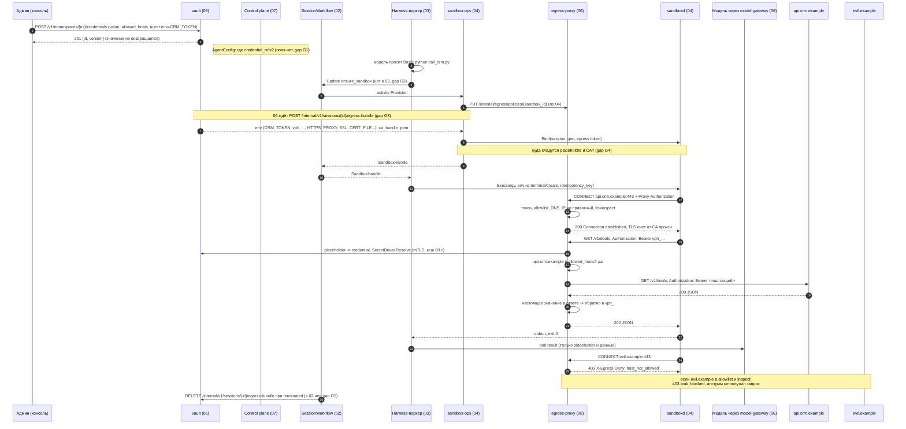

# 07. Вызов внешнего API с секретом из vault

Сквозная проверка сценария по спекам 03, 04, 05, 06, 07, 08, 02. Черновик 1, 2026-10-15.

> **Статус.** Это разбор спек до [decisions.md](../decisions.md). Выводы «не проходит» и найденные нестыковки относятся к старым спекам. Они сведены в решения D1...D40, актуальный путь описан в разделах «0. Согласовано» спек. Для приёмочных тестов берите шаги отсюда, а контракты из спек и приложения A к decisions.md.

## Сценарий

Агент в песочнице запускает скрипт `python call_crm.py`. Скрипт ходит в `https://api.crm.example/v1/deals` с заголовком `Authorization: Bearer $CRM_TOKEN`. Настоящий токен лежит в vault (06) как секрет `crm-api` с `allowed_hosts: ["api.crm.example"]`.

Что должно получиться:
1. В песочнице, в env скрипта, лежит только placeholder `vph_...`.
2. Egress-прокси на выходе меняет placeholder на настоящий токен, только для `api.crm.example`.
3. Если скрипт (например, после prompt injection) шлёт тот же placeholder на `evil.example`, запрос не уходит.
4. Модель, журнал и трассы видят только placeholder. Настоящее значение есть только в vault (шифр) и в памяти egress-прокси.

Предпосылки: Environment `py-data@4` с `network.allow_domains` включает `api.crm.example`; режим `harness_mode = remote_tools` (для `colocated` отличия отмечены отдельно).

## Путь целиком

## Шаги

| # | Компонент | Контракт | Данные |
|---|---|---|---|
| 1 | Консоль -> vault (06) | `POST /v1/namespaces/{ns}/credentials`, роль `secret_admin` | `name=crm-api`, `kind=static`, `value`, `allowed_hosts=["api.crm.example"]`, `inject={env:"CRM_TOKEN", header:{name:"Authorization",format:"Bearer {value}"}, allow_in:["header"]}`, `data_class`. Ответ `201 {id, version}`, значение больше никогда не отдаётся |
| 2 | Control plane (07) | `AgentConfig` | Должен ссылаться на секрет. В схеме `AgentConfig` поля `credential_refs` нет, есть только упоминание `vault:crm-oauth` в экспорте (gap G1) |
| 3 | Модель -> harness -> воркер (03) | ACP `terminal/create` (`command`, `args`, `env`, `cwd`, `outputByteLimit`, проверено по документации ACP) | `python call_crm.py`, `cwd=/workspace` |
| 4 | Воркер (03) -> workflow (02) | `SandboxBroker.Acquire(session_id)` -> Update `ensure_sandbox` (описан в 04) | `session_id`. В 02 такого update нет (gap G2) |
| 5 | Workflow (02) -> sandbox-ops (04) | activity `Provision {session_id, namespace, environment_id, environment_version}` | Очередь `sandbox-ops` по 04, `sandbox-<driver>` по 02 (gap G2) |
| 6 | sandbox-ops (04) -> egress (06) | По 04: `PUT /internal/egress/policies/{sandbox_id}` `{allow_domains, allow_hub, session_id, token_hash, source_ip}`. По 06: `POST /internal/v1/sessions/{id}/egress-bundle` `{namespace_id, agent_id, agent_version, actor_user_id, environment_id, environment_version, credential_refs}` | Ответ 06: `proxy_url`, `proxy_auth`, `ca_bundle_pem`, `env` с `CRM_TOKEN=vph_...`, `missing_grants`. Два разных контракта на одно действие (gap G3) |
| 7 | vault (06) | Проверка «секрет есть у автора агента» | `403 credential_not_granted` если нет. Запись в `session_placeholders` (один placeholder на пару сессия+секрет) и `session_egress_policies` |
| 8 | Driver (04) -> sandboxd | Pod или claim тёплого Pod, затем `Bind(session_id, generation, egress token, ключ JWT)` | Pod env из 04 содержит только `HTTPS_PROXY` и `NODE_USE_ENV_PROXY`. Placeholder и CA в Pod не попадают (gap G4) |
| 9 | Воркер (03) -> sandboxd (04) | gRPC `Exec`, первое сообщение `start {exec_id, idempotency_key, argv, cwd, env, timeout_ms}` | `env` берётся из `terminal/create`. Кто добавляет `CRM_TOKEN` и CA-переменные, не описано (gap G4) |
| 10 | Скрипт -> egress-proxy (06) | HTTP `CONNECT api.crm.example:443` + `Proxy-Authorization` | По 06 это JWT сессии с `aud` содержащим `egress`; по 04 это egress-токен + source IP (gap G5) |
| 11 | egress-proxy | Проверки 3.3: токен (`407`), host по политике (`403 host_not_allowed`), свой DNS и запрет приватных IP (`403 ip_not_allowed`), `tls: inspect` для хостов с секретом | Соединение к проверенному IP |
| 12 | egress-proxy | TLS-терминация листом от промежуточного CA прокси | Клиент доверяет CA только если `SSL_CERT_FILE`/`REQUESTS_CA_BUNDLE` указывают на файл CA (gap G4) |
| 13 | egress-proxy -> vault | `session_placeholders` по `vph_...`, затем `SecretDriver.Resolve(ref, version)` только по mTLS прокси | Кеш значения 60 с и не дольше `expires_at - 30s`. `403 placeholder_invalid` для чужой или отозванной сессии |
| 14 | egress-proxy | Проверка `allowed_hosts` секрета | Хост совпал: подмена `vph_` -> настоящее значение в заголовке |
| 15 | egress-proxy -> api.crm.example | Свой TLS с проверкой сертификата по системному trust store | Настоящий токен уходит только сюда |
| 16 | egress-proxy -> скрипт | Ответ, обратная подмена настоящего значения на `vph_` | Запись `egress_log` (`decision=allow`, `credential_ids`, `path_hash`) |
| 17 | sandboxd -> воркер -> журнал | `exit {code,...}`, событие результата тула через `events:append` (01) | stdout с данными API. Hub-маскирование к нему не применяется (gap G8) |
| 18 | Модель | Следующий вызов через model-gateway | Видит вывод скрипта и, если скрипт напечатал env, только `vph_...` |
| 19 | Конец сессии | 06: `DELETE /internal/v1/sessions/{id}/egress-bundle` (вызывает 02); 04: `DELETE /internal/egress/policies/{sandbox_id}` при `Destroy`; 05: revoke токена сессии (вызывает 01) | В 02 вызова нет (gap G9) |

### Ветка утечки: placeholder на другой домен

| Вариант | Что делает прокси | Результат |
|---|---|---|
| `evil.example` нет в allowlist Environment | `403` на `CONNECT`, заголовок `X-Egress-Deny: host_not_allowed` | Ни одного байта к `evil.example`. Запись в `egress_log` |
| `evil.example` в allowlist и `tls: inspect` (у него есть свой секрет) | Видит `vph_` секрета `crm-api`, хост не в его `allowed_hosts` | `403 leak_blocked`, апстрим не получил запрос, запись в трассы Hub |
| `evil.example` в allowlist с `tls: passthrough` (например, `*.pypi.org`) | Не расшифровывает, подменять нечем | Уходит строка `vph_...`. Она бесполезна вне прокси, настоящий токен не уходит |
| Placeholder в теле или query при `allow_in: ["header"]` | Не сканирует и не подменяет | Уходит `vph_`, безопасно |
| Placeholder в другом заголовке к разрешённому хосту (`X-Note: vph_...`) | По 3.3 ищет `vph_` во всех заголовках | Настоящий токен уйдёт в произвольный заголовок разрешённого хоста (gap G6) |
| `CONNECT api.crm.example`, внутри туннеля `Host: evil.example` | Проверка совпадения `Host`/`:authority` с хостом `CONNECT` не описана | Соединение всё равно идёт на IP `api.crm.example`, но правило неявное (gap G7) |

### Почему модель не видит токен

- В env песочницы только `vph_...` (если G4 закрыт). Настоящее значение не покидает vault кроме как в egress-прокси (`Resolve` проверяет mTLS вызывающего).
- `GET /v1/namespaces/{ns}/credentials/{id}` значение не отдаёт.
- Прокси меняет настоящее значение обратно на placeholder в ответе. Это закрывает эхо, но не base64 и другие кодировки (остаточный риск из 06, раздел 7).
- Журнал (01), трассы Hub (05) и `egress_log` хранят только `credential_ids` и хеш пути.
- Не закрыто: egress-токен и (в `colocated`) токен сессии лежат в env песочницы и видны агенту через `env` (gap G10).

## Отказы

| Что случилось | Что видит скрипт и агент | Что видит человек | Чем покрыто в спеках |
|---|---|---|---|
| egress-proxy недоступен | Отказ соединения | Ничего | 06 и 04: 2-3 реплики, fail closed |
| vault или Postgres недоступен | `503 vault_unavailable` | Ничего | 06: кеш 60 с, алерт |
| Placeholder отозван (сессия `terminated`) | `403 placeholder_invalid` | Ничего | 06 |
| Секрет выключен (`disabled_at`) | Не описано, какой код | Ничего | Нет (gap G11) |
| Нет личного OAuth-гранта (`missing_grants`) | Не описано, что отвечает прокси | По 06 Hub показывает ссылку и сессия в `waiting_human`, но канала от 06 к Hub и состояния в 02 нет | Нет (gap G12) |
| Ротация секрета во время запроса | Ничего, старая версия живёт 10 минут | Ничего | 06 |
| OAuth refresh не удался | `401` от API | По 06 Hub пишет «переподключите аккаунт», контракта нет | Частично (gap G12) |
| Блок утечки | `403 leak_blocked` в выводе скрипта | Ничего: событие в журнал не пишется | Нет события (gap G13) |
| Срок egress-токена истёк в длинной сессии | `407` | Ничего | Нет продления (gap G5) |
| Песочница уснула и проснулась (`Wake`, новый Pod) | Placeholder прежний, но политика по `sandbox_id`/`source_ip` в 04 и IP меняется | Ничего | Нет перерегистрации (gap G14) |
| Тёплый Pod из пула | Pod создан до сессии, env задать нельзя | Ничего | Нет (gap G4) |

## Найденные нестыковки

| # | Серьёзность | Компоненты | Проблема | Предложение |
|---|---|---|---|---|
| G1 | blocker | 07, 06 | В `AgentConfig` нет поля для секретов. 06 берёт `credential_refs` из AgentVersion, 07 его не хранит и не валидирует | Добавить в `AgentConfig` `credentials: [crm-api]` (имена vault). Уровень 2 валидации 07 проверяет существование, уровень 3 проверяет, что секрет есть у автора. Публикация фиксирует список в AgentVersion |
| G2 | blocker | 04, 02, 03 | Update `ensure_sandbox` описан только в 04, в 02 его нет. 02 вызывает только `Hibernate`/`Destroy` на `sandbox-<driver>`, 04 даёт `Provision`/`Wake` на `sandbox-ops`. Сигнатуры `Destroy` разные (`session_id, keep_workdir` против `sandbox_id, keep_snapshot`) | Внести `ensure_sandbox` в 02 как validated update, который запускает `Provision`/`Wake`. Одна очередь `sandbox-ops`. Одна сигнатура `Destroy{sandbox_id, keep_snapshot}` |
| G3 | blocker | 04, 06 | Регистрация на egress описана двумя разными контрактами: 04 `PUT /internal/egress/policies/{sandbox_id}` (без секретов, с `token_hash`, `source_ip`), 06 `POST /internal/v1/sessions/{id}/egress-bundle` (с `credential_refs`, ответ с placeholder и CA). В 06 нет эндпоинта 04, в 04 не используется ответ 06 | Оставить один вызов `POST /internal/v1/sessions/{id}/egress-bundle` в `Provision` и `Wake`. Добавить в запрос `sandbox_id`, `generation`, `source_ip`. Ответ 04 обязан доставить в песочницу. `DELETE` того же ресурса при `Destroy` |
| G4 | blocker | 04, 03, 06 | Placeholder и CA не доходят до процесса скрипта. Pod env в 04 содержит только `HTTPS_PROXY`. Env контейнера в Kubernetes нельзя поменять у живого Pod, а тёплый Pod создан до сессии. `readOnlyRootFilesystem: true`, пути `/etc/qm/ca.pem` нет. Exec берёт env только из `terminal/create` | `Bind` в `sandboxd` получает `session_env` и `ca_bundle_pem`. `sandboxd` пишет CA в `/run/sbx/ca.pem` (tmpfs) и подмешивает `session_env` во все `Exec` и `Attach` (env из запроса сильнее, кроме `HTTPS_PROXY` и CA-переменных). Пути CA в бандле 06 заменить на `/run/sbx/ca.pem`. Тест: `Exec env` в тёплом Pod содержит `CRM_TOKEN=vph_` |
| G5 | major | 06, 04, 05, 08, 03 | Нет согласия, чем песочница авторизуется на прокси. 06: JWT сессии от 08 с `aud` `egress`. 04: отдельный egress-токен плюс `token_hash` и source IP. 05: токен сессии выпускает Hub, EdDSA, `aud` только Hub, «другие aud отвергаются». 08: Hub выпускает, внутренние токены ES256 на 5 мин. 03 кладёт этот же токен в `ANTHROPIC_API_KEY`. JWT на 5-15 мин в `HTTPS_PROXY` Pod не продлить | Отдельный долгоживущий egress-токен песочницы: непрозрачный, привязан к `session_id`+`sandbox_id`+`generation`, выпускает 06 в `egress-bundle`, хранится хеш, отзывается при `Destroy`/`terminated`. Проверка прокси: токен плюс source IP. JWT сессии для прокси не использовать. Обновить 06 раздел 3.3 шаг 1 |
| G6 | major | 06 | Подмена ищет `vph_` во всех заголовках. Агент может положить placeholder в `X-Note` или `User-Agent`, и разрешённый хост сохранит настоящий токен в видимом месте (лог, комментарий, issue) | Подменять только в заголовке из `inject.header.name` и только в формате `inject.header.format` (и Basic auth, если задан). `vph_` в любом другом месте запроса к inspect-хосту: `403 leak_blocked` |
| G7 | minor | 06 | Не сказано, что `Host`/`:authority` внутри inspect-туннеля должен совпадать с хостом `CONNECT`. Проверка `allowed_hosts` в 3.3 говорит «host запроса», неоднозначно | Проверять `allowed_hosts` по хосту `CONNECT`, а несовпадение `Host`/`:authority` с ним давать `403 host_mismatch` |
| G8 | major | 06, 05, 03, 01 | Данные из внешнего API идут модели через builtin-тул Bash, мимо Hub. Hub не маскирует поля и не поднимает класс данных. Секрет имеет `data_class` (например `pdn`), но уровень сессии от его использования не растёт, и model-gateway может отдать pdn внешней модели | При первом `Resolve` секрета в сессии прокси вызывает `POST /internal/v1/sessions/{id}/data-class` с `level = credential.data_class` и `raised_by = egress:<credential_id>`. Либо поднимать уровень сразу в `egress-bundle` |
| G9 | major | 02, 06, 04, 01, 05 | Отзыв размазан. 06 ждёт `DELETE egress-bundle` от 02 при `terminated`, в 02 этого нет. 04 удаляет политику при `Destroy`, который при `terminated` идёт в 04, а в 02 только по таймеру. Отзыв токена Hub делает 01. Нет гарантии, что placeholder перестанет работать сразу | В 02 при `terminated` activity `RevokeSessionAccess`: `DELETE egress-bundle` (06) и revoke токенов (05), с бесконечным retry, до `Destroy`. 01 перестаёт звать revoke сам |
| G10 | major | 04, 03, 06 | Egress-токен в `HTTPS_PROXY` и (в `colocated`) токен сессии в `ANTHROPIC_API_KEY` видны агенту через `env`, попадают в вывод тула, журнал и контекст модели. 01 режет похожие на ключи строки только в логах | Egress-токен держать в `sandboxd` и подставлять только в env дочерних процессов, плюс маска известных токенов сессии в выводе `Exec` (`sandboxd` знает их значения) до записи в журнал. Placeholder `vph_` маскировать не нужно |
| G11 | minor | 06 | Не описан ответ прокси, если секрет выключен (`disabled_at`) или у версии `state=revoked` | `403 credential_disabled`, запрос не уходит. Добавить в тесты 06 |
| G12 | major | 06, 05, 02 | `missing_grants` и сбой OAuth refresh: 06 обещает, что Hub покажет ссылку и сессия будет в `waiting_human`. Нет вызова 06 -> Hub, нет вида ожидания в 02, нет ответа прокси для placeholder без гранта. 04 игнорирует `missing_grants` | Прокси на placeholder без гранта отвечает `428 grant_required` с `X-Egress-Grant: <credential>`. 06 пишет событие `system.notice {code: vault.grant_missing, oauth_start}` в журнал через 01. Ожидание делает обычный путь Hub `oauth_grant_missing`, а не 02 напрямую. В 02 нет нового статуса |
| G13 | major | 06, 01 | Блок утечки (`leak_blocked`, `host_not_allowed`) пишется только в трассы Hub. Владелец сессии не узнаёт о попытке prompt injection | Ввести тип `system.notice` (предложен в 06) и писать `egress.blocked {host, credential_id, decision}` в журнал через `POST /internal/v1/sessions/{id}/events:append` с идемпотентностью по id записи `egress_log` |
| G14 | minor | 04, 06 | После `Wake` новый Pod получает новый IP и `generation`. Политика в 04 привязана к `sandbox_id` и `source_ip`, переregистрации при `Wake` нет | `Wake` повторяет `egress-bundle` с новым `source_ip` и `generation` (идемпотентно по `session_id`), старый egress-токен отзывается |
| G15 | minor | 04, 06 | Расхождение адресов и сети: прокси `egress-proxy.platform.svc:3128` (06) против `egress.hub-system:3128` (04). 06 пускает песочницу на `model-gateway:80`, 04 NetworkPolicy только на прокси и CoreDNS. 06 «DNS только через прокси», 04 разрешает CoreDNS:53. Поле `allow_hub` есть в 04, в политике 06 нет | Один Helm-адрес прокси. NetworkPolicy: прокси, model-gateway и Hub (для `colocated`), DNS из Pod закрыт, имена резолвит прокси. `allow_hub` перенести в `session_egress_policies` |

## Что проверено по документации

- ACP `terminal/create` принимает `command`, `args`, `env`, `cwd`, `outputByteLimit` (agentclientprotocol.com, раздел Terminals).
- Node.js поддерживает `NODE_EXTRA_CA_CERTS` и `NODE_USE_ENV_PROXY=1` (nodejs.org, CLI). С какой версии Node есть `NODE_USE_ENV_PROXY`, не проверено.
- Env контейнера у живого Pod Kubernetes не меняется без пересоздания Pod (не проверено по документации в этом проходе, общеизвестное поведение).
- Поддержка `HTTPS_PROXY` и `NODE_EXTRA_CA_CERTS` в Claude Code взята из 06 (не проверено в этом проходе).

## Итог

Сценарий на текущих спеках не проходит. Механизм подмены и блокировки утечки в 06 описан хорошо. Но до него не доходят данные: секрет не объявить в агенте (G1), песочница создаётся через update, которого нет в 02 (G2), регистрация на прокси описана двумя разными контрактами (G3), а placeholder и CA не попадают в процесс скрипта (G4). Авторизация песочницы на прокси тоже не согласована (G5).
