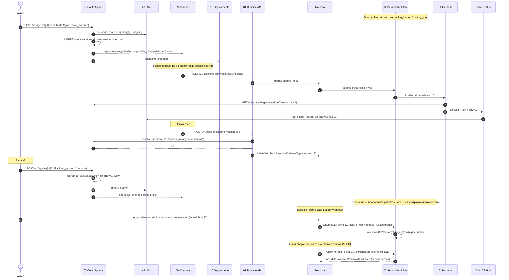

# Flow 08. Новая версия агента при идущих сессиях

Черновик 1, 2026-10-15. Проверка спек 01, 02, 03, 05, 07, 08, 09, 10 на одном сквозном сценарии.

> **Статус.** Это разбор спек до [decisions.md](../decisions.md). Выводы «не проходит» и найденные нестыковки относятся к старым спекам. Они сведены в решения D1...D40, актуальный путь описан в разделах «0. Согласовано» спек. Для приёмочных тестов берите шаги отсюда, а контракты из спек и приложения A к decisions.md.

## 1. Сценарий

Агент `hr-helper` работает на v2. В канале Slack и в deployments идут 50 сессий на v2. Часть из них ждёт человека: `waiting_human` (подтверждение write, до 72 h) и `waiting_tool` (custom tool, до 24 h).

1. Автор публикует v3 с `make_live: true`.
2. Новые сессии стартуют. Старые продолжают жить, в их треды приходят новые сообщения.
3. Через час находят баг в v3. Делают откат на v2.
4. Отдельно: выходит новая сборка кода `SessionWorkflow` (не агента, а самой платформы), и её тоже нужно уметь откатить.

Вопросы сценария:

- На какой версии каждая сессия после публикации и после отката.
- Что видит новое сообщение в старом треде.
- Как обновить и откатить код `SessionWorkflow`, не сломав workflow, которые неделями ждут человека.

## 2. Короткий ответ по спекам как есть

| Группа сессий | Версия после публикации v3 | Версия после отката |
|---|---|---|
| 50 сессий, начатых на v2 (включая ждущие) | v2. Сессия закреплена при создании (07, 3.2; 02, `SessionInput.AgentVersion`) | v2 |
| Сессии, созданные после v3 по `@live` | v3 | **v3 навсегда.** Сессию никто не переводит на другую версию (07, 3.2). Механизма отзыва версии нет |
| Новые сессии после `POST /rollback {to_version: 2}` | | v4 (копия конфига v2, `source=rollback`). Если откат делали через `POST /live {version: 2}`, то 01, 09 и 10 всё равно возьмут v3, см. gap G1 |
| Сабагенты | Версия из `AgentVersion.subagents` родителя (`agent@N`) | Не меняется |
| Новое сообщение в старом треде | Идёт в ту же session (09, роутер шаг 7), значит на её старую версию. В группе это навсегда, в личке до `dm_session_idle_h` (12 h) | Тред с v3 продолжает работать на v3 с багом |

Код `SessionWorkflow`: `AutoUpgrade` и патчи `workflow.GetVersion` (02, 5.5). Ждущие workflow переходят на новую сборку на следующей workflow task. Это работает для выкатки. Откат сборки по спеке 02 описан как «откат `BuildID`», но для `AutoUpgrade` это небезопасно (gap G6).

## 3. Диаграмма

## 4. Шаги

| Шаг | Компонент | Контракт | Данные |
|---|---|---|---|
| 1 | 07 | `POST /v1/agents/{id}/publish` | `{draft_rev, notes, make_live:true}` → `201` v3 или `202` заявка (если write/pdn) |
| 2 | 07 → 08 | «Обновить гранты agent» (08, 2.2 и диаграмма 5.x) | Гранты личности агента переписываются под toolsets v3. Отдельного REST в спеке 08 нет |
| 3 | 07 | outbox `agent.version_published`, `agent.live_changed` | `{agent_id, version, config_hash, risk}`, `{agent_id, from:2, to:3}`. Слушатели по 07: 09, 10 |
| 4 | 09 | роутер, шаг 7 | `threads.session_id` есть → событие идёт в старую session. Новая session только если треда нет или DM молчал 12 h |
| 5 | 09 → 01 | `POST /v1/sessions/{id}/events` | `user.message` с `data.channel` |
| 6 | 01 → 02 | update `submit_input` (02, 3.2) / signal `events_appended` (01, раздел 4) | `{event_id, type, actor_id, priority}`. Две спеки расходятся, это общий gap, не про версии |
| 7 | 02 → 03 | activity `RunTurn` на `harness-<kind>` | 02: `TurnInput{AgentID, AgentVersion int}`; 03 ждёт `RunTurnInput{agent_version_id string}` |
| 8 | 03 → 07 | `GET /internal/v1/agent-versions/{version_id}` | Неизменяемый конфиг, кэш навсегда |
| 9 | 03 → 05 | MCP `tools/call` с токеном сессии | Токен несёт `agv` (05) / `agent_version` (03) |
| 10 | 05 → 08 | `POST /internal/iam/tool-scope` | Права агента = гранты личности агента. Они уже под v3 |
| 11 | 09/10 → 01 | `POST /v1/sessions` | `agent_version: null` (09, 10) |
| 12 | 01 → 07 | `ResolveLatestVersion(agent_id)` (01) / `POST /internal/v1/agent-refs:resolve {ref}` (07) | 01 ждёт «последнюю опубликованную», 07 отдаёт `live_version`. Имена методов разные |
| 13 | 01 → T | `UpdateWithStartWorkflow` | `SessionInput{AgentVersion: 3}`. В `sessions` пишется `agent_version int`, `version_id` не хранится |
| 14 | 07 | `POST /v1/agents/{id}/rollback` | `{to_version:2, reason}` → `201` v4 (`source=rollback`), повторная валидация 5 уровней, `422` если тул пропал |
| 14a | 07 | `POST /v1/agents/{id}/live` | `{version:2}` → `200`, указатель на v2. Быстрее, но см. G1 |
| 15 | 07 → 09, 10 | `agent.live_changed` | `{from:3, to:4}`. В спеках 09 и 10 обработчика нет |
| 16 | оператор → Temporal | `temporal worker deployment set-current-version` | Новый `BuildID` у `DeploymentName=session-wf` |
| 17 | Temporal → 02 | следующая workflow task | `AutoUpgrade` workflow переходит на Current Version перед следующей задачей, даже если долго спал (документация Temporal, Worker Versioning) |
| 18 | 02 | `workflow.GetVersion(ctx, id, DefaultVersion, 1)` | Старые истории идут по старой ветке, новые по новой |
| 19 | 02 | continue-as-new (200 ходов / 1500 updates / suggested) | Только в цикле, когда есть активность |
| 20 | оператор → Temporal | `set-current-version` на прежний BuildID | Откат. Workflow, которые уже записали команды новой ветки, не проходят replay на старом коде |

## 5. Отказы

| Что случилось | Что происходит по спекам | Чего не хватает |
|---|---|---|
| Баг в v3, а сессии на v3 активны | Работают дальше на v3. Hub отдаёт тулы по `toolsets(v3)` | Нет «отзыва версии»: ни остановить, ни перевести, ни отменить ждущие подтверждения v3 (G2) |
| Сессия v3 ждёт подтверждения write | Согласующий может нажать «разрешить», Hub выполнит вызов от бажной версии | Карточка не показывает версию, нет массовой отмены (G2) |
| Откат через `rollback` не проходит валидацию (тул убрали из Hub, у автора забрали права) | `422 validation_failed` или `202` заявка | Нет аварийного пути без повторной валидации; `POST /live` спасает только по ссылке `@live` (G1) |
| Откат через `POST /live {version:2}` | `live_version=2`, но последняя опубликованная = v3 | 01, 09, 10 разрешают `null` как «последнюю опубликованную» → новые сессии снова на v3 (G1) |
| Публикация v3 убрала toolset | 07 переписывает гранты агента под v3 | Сессии v2 теряют тул на рантайме, хотя их конфиг его содержит (G3) |
| Откат кода `SessionWorkflow` | 02: «Откат `BuildID` или патч» | Для `AutoUpgrade` откат Current Version требует, чтобы старый код проходил replay новых историй. Без этого сессии встают в `WorkflowTaskFailed`, включая ждущие людей (G6) |
| Новый код не совместим с `RunTurn` старых harness-воркеров | 02: «03 версионируется отдельно» | Нет правил совместимости `TurnInput`/`TurnResult` между версиями (G8) |
| Idle-сессия месяцами не делает continue-as-new | Патч нельзя удалить, пока жив run до него (02, 5.5) | Патчи копятся вечно (G7) |
| Сессия на v3 стала `terminated` (её остановили), в тред пишут дальше | 01 отвечает `409 session_terminated` | 09 не создаёт новую session на этот ответ, сообщение теряется (G5) |

## 6. Найденные нестыковки

### G1. Что значит «версия не указана» (blocker)

- 07: `agent` и `@live` разрешаются в `live_version`. Откат через `POST /live` двигает указатель.
- 01: «`agent_version` не задан = последняя опубликованная», зависимость `ResolveLatestVersion(agent_id)`.
- 09 (`channel_bindings.agent_version null`) и 10 (`deployments.agent_version null`): тоже «последняя опубликованная».
- После `POST /live {version:2}` последняя опубликованная всё ещё v3. Каналы и расписания продолжают создавать сессии на бажной версии.

Предложение. Одно правило во всех спеках: `null` = `@live`. 01 вызывает только `POST /internal/v1/agent-refs:resolve` из 07 (убрать `ResolveLatestVersion` и `GetAgentVersion(agent_id, version)` из 01 и 02). 09 и 10 хранят ref строкой (`hr-helper@live` или `@3`), как написано в 07, 3.2.

### G2. Нет отзыва бажной версии для живых сессий (blocker)

Откат влияет только на новые сессии. Сессии, созданные на v3, живут на v3 месяцами (боты в группах). Они ждут подтверждений, которые могут исполнить бажный write. 05 упоминает «07 при отзыве версии агента» вызывает revoke токенов, но в 07 такой операции нет.

Предложение. В 07 добавить `POST /v1/agents/{id}/versions/{n}:recall {mode, reason}`, событие `agent.version_recalled`. `mode`:
- `terminate`: 01 находит сессии по `(agent_id, agent_version)` и шлёт `terminate`; 05 отзывает токены по `agent_version_id` и отменяет pending approvals; 09 правит карточки на «отменено».
- `upgrade_on_next_turn`: сессия переходит на live-версию на границе хода (см. G4).
Ждущие подтверждения v3 закрываются `CancelConfirmation` и синтетическим `tool.result cancelled`. В карточке подтверждения (09) показывать версию агента.

### G3. Гранты агента не привязаны к версии (major)

08: у личности агента «только гранты на toolsets, которые 07 переписывает при публикации версии». 05 считает `tool ∈ toolsets(agent_version)` и вызывает `tool-scope` в 08, где порядок «грант агента» один на агента. Публикация v3 без toolset X ломает X у сессий v2. Откат на v4 ломает новые тулы у сессий v3. Пока живут сессии нескольких версий, грант один.

Предложение. В 08 гранты агента хранить по `(agent_principal, agent_version)` или считать как объединение по версиям с живыми сессиями. Hub передаёт `agent_version` в `tool-scope`. Проще: убрать грант агента из 08 и опираться на `toolsets(agent_version)` из неизменяемой версии плюс проверку автора при публикации.

### G4. Нельзя перевести сессию на другую версию (major)

07 запрещает переход прямо. Для бота в группе «сессия навсегда» значит, что исправление не дойдёт до треда никогда. 09 открывает новую session только по `dm_session_idle_h` в личке.

Предложение. Политика в `channel_bindings` и в агенте: `version_upgrade: never | next_session | next_turn`. Для `next_turn` 02 получает update `switch_version {version, version_id}`, принимает его только в `idle`, меняет `AgentVersion` в состоянии, вызывает `LoadSessionConfig`, пишет событие `session.version_changed`. 01 обновляет `sessions.agent_version`, 08 `session_principals.agent_version`, 03 сбрасывает `state_ref` и делает rehydration из журнала (снимок harness от старых инструкций не годится). Для `next_session` 09 при `agent.live_changed` начинает новый `generation` треда на следующем сообщении.

### G5. Terminated session и старый тред (major)

09 не обрабатывает `409 session_terminated` от 01. После `recall` или ручного `terminate` следующее сообщение в треде упрётся в 409 и уйдёт в `failed` inbox.

Предложение. В роутере 09: на `409 session_terminated` создать новую session с `generation+1` и тем же сообщением. Ключ идемпотентности `{binding_id}:{thread_key}:{generation}` уже это поддерживает.

### G6. Откат кода SessionWorkflow при AutoUpgrade (major)

Документация Temporal: `AutoUpgrade` workflow переходит на новую Current Version перед следующей задачей и должен быть replay-safe через patching, в том числе при откате. 02 в таблице отказов предлагает «откат `BuildID`». Если новая ветка уже записала команды в историю (ждущий 72 h workflow проснулся по таймеру на новом коде), старый код их не воспроизведёт.

Предложение. Описать в 02 правило выкатки в два шага:
1. Сборка N+1 содержит `GetVersion` и обе ветки, но новая ветка выключена флагом из `LoadSessionConfig` или `SideEffect`. Её можно катить и откатывать на N.
2. Включение ветки делается конфигом, без новой сборки. Откат = выключить флаг (новые решения идут по старой ветке, уже записанные остаются).
Откат Current Version разрешён только на сборку, которая знает все `change-id` текущей. CI проверяет это replay-тестом: истории, записанные на N+1, прогоняются на N (обратный replay). Выкатку делать через `set-ramping-version` на малый процент, затем `set-current-version`. Истории для replay брать не только из тестов, но и выборкой из прода (в них только id, PII нет).

### G7. Патчи нельзя удалить у долгих idle-сессий (minor)

02 удаляет патч, когда нет run, начатых до него, и полагается на continue-as-new раз в 200 ходов. Idle-сессия без входов не делает continue-as-new никогда. Visibility-запрос по BuildId помечен (не проверено).

Предложение. В 02 таймер обслуживания: раз в 7 d в `idle` без ожиданий делать continue-as-new. Для поиска старых run добавить search attribute `WfCodeVersion` (свой Keyword), а не полагаться на системные атрибуты.

### G8. Контракт RunTurn расходится и не версионирован (major)

- 02: `TurnInput{AgentID, AgentVersion int, FromSeq, ToSeq, NewEventIDs}`, `StopReason` = `custom_tool | confirmation | waiting_subagents | interrupted`.
- 03: `RunTurnInput{agent_version_id string, trigger_seqs, history_until_seq, mode}`, `stop_reason` = `waiting_tool | waiting_human | cancelled | ...`.
- 01 хранит `sessions.agent_version int`, а 03 и 05 работают с `version_id` (`av_3`). Откуда 02 возьмёт `version_id`, не описано.
Workflow и harness-воркеры выкатываются независимо, значит вход и выход activity должны переживать смешанные версии.

Предложение. Один IDL для `RunTurn` в `contracts/` с полем `contract_version`. В `sessions` (01) и `SessionInput` (02) хранить и `agent_version`, и `agent_version_id`. Правило: в `TurnInput` и `TurnResult` только добавляем поля, незнакомые поля игнорируем; удаление поля через новый тип activity (`RunTurnV2`).

### G9. Не видно, сколько сессий на какой версии (minor)

У 02 search attributes `TenantId, AgentId, SessionStatus, ParentSessionId`, без версии. У 01 индекс `(namespace_id, agent_id, created_at)`, без версии. Для отката и recall нужен ответ «сколько живых сессий v3 и какие ждут людей».

Предложение. Search attribute `AgentVersion` (Int) в 02. Индекс `(namespace_id, agent_id, agent_version) where status <> 'terminated'` в 01. `GET /v1/sessions?agent_id=&agent_version=&status=` и счётчик в экране «Версии» консоли 07.

### G10. Конфиг в состоянии workflow после смены кода (minor)

02 читает конфиг один раз `LoadSessionConfig` и хранит «только нужные поля». Новый код может требовать поле, которого нет в сохранённом состоянии ждущих сессий.

Предложение. Хранить в состоянии `version_id` и `config_schema`. Новый код под `GetVersion` повторно вызывает `LoadSessionConfig`, если `config_schema` старый. Конфиг версии неизменяем, повтор безопасен.

### G11. Окружение и harness при откате (minor)

04 закрепляет `environment_id + version` за сессией, но в `sessions` (01) нет `environment_version`, а 01 разрешает задать `environment_id` при создании мимо версии агента. Версия `claude-agent-acp` зашита в образ Environment (03). Откат агента с другим Environment поднимет другую версию harness, а `harness_bindings.state_ref` от старой версии может не подойти к `session/load`.

Предложение. В `sessions` хранить `environment_version`, брать её из AgentVersion (07). 03 при расхождении `harness_bindings.harness_version` и текущего образа не делает `session/load`, а идёт через rehydration из журнала.
