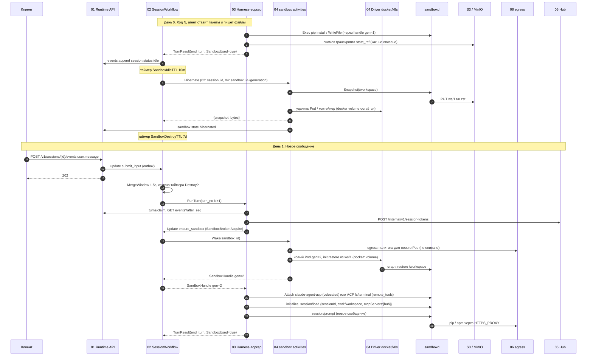

# 09. Сон и пробуждение песочницы

Проверка архитектуры на сквозном сценарии. Черновик 1, 2026-10-15.

> **Статус.** Это разбор спек до [decisions.md](../decisions.md). Выводы «не проходит» и найденные нестыковки относятся к старым спекам. Они сведены в решения D1...D40, актуальный путь описан в разделах «0. Согласовано» спек. Для приёмочных тестов берите шаги отсюда, а контракты из спек и приложения A к decisions.md.

Участники: 01-runtime-api, 02-session-workflow, 03-harness-workers, 04-sandbox, 05-mcp-hub, 06-vault-egress-models.

## 1. Сценарий

1. Агент (harness `acp:claude`) в долгой session ставит пакеты (`pip install`, `npm install`) и создаёт файлы в `/workspace`.
2. Ход кончается, session `idle`. Через 10 минут простоя workflow усыпляет песочницу. Session простаивает ещё 2 часа и дольше.
3. Через день приходит новое сообщение. Агент продолжает работу с теми же файлами и пакетами.

Разбираем два драйвера: `docker` (разработка) и `kubernetes` (прод). Внешние факты проверены по документации:

- Kubernetes: данные `emptyDir` удаляются вместе с Pod ("When a Pod ceases to exist, Kubernetes destroys ephemeral volumes", kubernetes.io, Volumes). Значит, без снапшота файлы теряются.
- Temporal Go: update handler может вызывать activities и ждать таймеры; validator задаётся через `workflow.SetUpdateHandlerWithOptions`; перед continue-as-new нужно дождаться `workflow.AllHandlersFinished` (docs.temporal.io, message passing).
- ACP: `session/load` доступен, только если `initialize` вернул `agentCapabilities.loadSession = true`. Параметры `sessionId`, `cwd`, `mcpServers`. Agent обязан проиграть всю беседу через `session/update` (agentclientprotocol.com, Session Setup).
- Поддержка `session/load` в `claude-agent-acp` на нашей версии (не проверено, так же отмечено в 03).

## 2. Последовательность

## 3. Шаги

| Шаг | Компонент | Контракт | Данные |
|---|---|---|---|
| 1 | 03 → 04 | `sandboxd.Exec`, `WriteFile` через `SandboxHandle` | argv, `idempotency_key`, `cwd=/workspace`, JWT `aud=sbx_id, gen=1` |
| 2 | 03 | `files.put` снимка транскрипта, `PUT .../harness-binding` | `state_ref`, `state_seq`, `harness_session_id` |
| 3 | 03 → 02 | результат activity `RunTurn` | `TurnResult{StopReason=end_turn, LastSeq, SandboxUsed=true}` |
| 4 | 02 → 01 | activity `AppendSystemEvents` (`events:append`) | `session.status {idle}` |
| 5 | 02 | таймер `SandboxIdleTTL` (02: из Limits, 04: `idle_hibernate_s` Environment) | 600 s |
| 6 | 02 → 04 | activity `Hibernate` | 02: `Hibernate(session_id)` на `sandbox-<driver>`; 04: `{sandbox_id, generation}` на `sandbox-ops` |
| 7 | 04 → sandboxd → S3 | `Snapshot` | `s3://sbx/<ns>/<session>/ws/1.tar.zst`, sha256, bytes |
| 8 | 04 Driver | k8s: удалить Pod; docker: удалить контейнер, volume `sbx-<id>-ws` оставить | `sandboxes.state=hibernated` |
| 9 | 04 → 01 | `POST /internal/sessions/{id}/events` | `sandbox.state {hibernated}` |
| 10 | 02 | таймер `SandboxDestroyTTL` 7 d | дедлайн в state (поля нет) |
| 11 | Клиент → 01 | `POST /v1/sessions/{id}/events` | `user.message`, `Idempotency-Key` |
| 12 | 01 → 02 | update `submit_input` через outbox | `InputRef{event_id}` |
| 13 | 02 → 03 | activity `RunTurn` на `harness-claude` | `TurnInput{TurnNo, FromSeq, ToSeq, NewEventIDs}` |
| 14 | 03 → 01, 05 | `turns/claim`, `GET events`, `POST /internal/v1/session-tokens` | `writer_epoch`, история, токен Hub |
| 15 | 03 → 02 | `SandboxBroker.Acquire` → Update `ensure_sandbox` | `session_id` |
| 16 | 02 → 04 | activity `Wake` | `{sandbox_id}` → handle `generation+1` |
| 17 | 04 → 06 | k8s: новая регистрация egress для нового Pod (контракта нет) | 04: `PUT /internal/egress/policies/{sandbox_id}`; 06: `POST /internal/v1/sessions/{id}/egress-bundle` |
| 18 | 04 Driver | k8s: Pod с init `restore` по presigned URL; docker: сначала volume, потом снапшот | `ws/1.tar.zst` |
| 19 | 02 → 03 | ответ Update | `SandboxHandle{id, endpoint, generation=2, token}` |
| 20 | 03 → sandboxd | `Attach{argv:[claude-agent-acp], name:harness}` (colocated) | stdio по gRPC |
| 21 | 03 → harness | ACP `initialize`, `session/load` или `session/new` + rehydration | `sessionId`, `cwd=/workspace`, `mcpServers=[hub]` |
| 22 | 03 → harness | ACP `session/prompt` | новые события |
| 23 | harness → 06 | HTTPS через `HTTPS_PROXY` | пакеты, домены из allowlist |
| 24 | 03 → 02 | `TurnResult{SandboxUsed=true}` | цикл с шага 5 |

## 4. Отказы

| Что упало | Что описано в спеках | Чего не хватает |
|---|---|---|
| S3 недоступен при `Hibernate` | 04: Pod не удаляется, `Hibernate` ретраится 3 раза | Что делает 02 после 3 неудач: песочница остаётся `awake`, таймер не перезапускается |
| Сообщение пришло, пока идёт `Hibernate` | 02: «Hibernate никогда не идёт параллельно с ходом» | Нет правила: ход ждёт конца `Hibernate` (до 300 s × 3) или отменяет его |
| `Wake` не уложился (180 s × 5) | 04: тул получает `sandbox_unavailable` | `RunTurn` держит heartbeat с `phase=sandbox_wait`, но `StartToClose=30m` и время `Wake` до 15 мин не согласованы |
| Снапшот битый или пропал | 04: `Wake` «из последнего снапшота» | Нет проверки sha256 при restore и нет события `data_loss` для этого случая |
| Pod убит до сна (OOM) | 04: `failed`, следующий `ensure_sandbox` делает `Wake` из последнего снапшота, `data_loss: true` | Вся работа после прошлого сна потеряна; периодических снапшотов нет |
| `session/load` не поддержан | 03: rehydration из журнала | Пакеты и файлы целы, но агент теряет внутренний контекст harness; ок как запасной путь |
| Воркер с handle `gen=1` после пробуждения | 04: `FAILED_PRECONDITION`, воркер берёт новый handle | Как воркер берёт новый handle (повторный `ensure_sandbox`) не описано в 03 |
| Прошло больше 7 d | 02: `Destroy(keep_workdir=true)`; 04: `keep_snapshot` | Что делает `ensure_sandbox` после `destroyed`: `Provision` с пустой папкой или restore из сохранённого снапшота |

## 5. Найденные нестыковки

1. **[blocker] Нет пути пробуждения в 02.** 04 опирается на Update `ensure_sandbox` и activities `Provision`/`Wake`, которые вызывает workflow. В 02 нет ни этого update, ни этих activities, ни состояния `waking`. Предложение: добавить в 02 update `ensure_sandbox(session_id) -> SandboxHandle` с validator «session не terminated», который сериализует вызовы (один `Provision`/`Wake` за раз, остальные ждут результата) и отменяет таймеры сна и удаления.
2. **[blocker] Разные сигнатуры и очереди activities.** 02: `Hibernate(session_id)`, `Destroy(session_id, keep_workdir)` на `sandbox-<driver>`. 04: `Hibernate{sandbox_id, generation}`, `Destroy{sandbox_id, keep_snapshot}` на `sandbox-ops`. Предложение: принять вариант 04 (идемпотентность по `(sandbox_id, generation)`), очередь `sandbox-<driver>`, и хранить в `SandboxState` 02 поля `SandboxID`, `Generation`, `SnapshotRef`.
3. **[major] `SandboxState` в 02 беднее машины состояний 04.** 02: `none|awake|hibernated|destroyed`; 04: `provisioning, ready, hibernating, hibernated, waking, destroying, destroyed, failed`. При `failed` (OOM) 02 думает, что песочница `awake`, и через 10 мин зовёт `Hibernate` мёртвого Pod. Предложение: 02 держит только `{SandboxID, Generation}`, а правду о состоянии берёт из результата activities; `Hibernate` на `failed` возвращает `already_lost` без ошибки.
4. **[major] Гонка «сообщение во время Hibernate».** Таймер сработал, `Hibernate` идёт (до 15 мин с ретраями), пришло сообщение, стартует ход, воркер зовёт `ensure_sandbox`. Правила нет. Предложение: `Hibernate` идёт как отменяемая activity; новый вход запрашивает отмену; 04 делает `Hibernate` атомарным (Pod удаляется только после подтверждённого снапшота), а `Wake` дожидается `hibernated` или `ready` по `UPDATE ... WHERE state`.
5. **[major] Установленные пакеты не переживают сон.** Сохраняется только `/workspace`. Root FS read-only (`readOnlyRootFilesystem`, docker `--read-only`), пользователь 1000, `/tmp` в памяти. `apt install` невозможен, `pip install --user` и `npm -g` идут в `$HOME`, который нигде не задан, и либо падают, либо пишут в `/tmp` и пропадают. Предложение: в 04 зафиксировать `HOME=/workspace/.home`, `PYTHONUSERBASE`, `npm_config_prefix`, `PIP_CACHE_DIR` внутри `/workspace` (кэши исключать из снапшота), а системные пакеты ставить только через `Environment.packages`. Сказать об этом агенту в системной подсказке.
6. **[major] Противоречие о месте harness.** 03: `clientCapabilities.fs/terminal = false`, harness живёт в песочнице. 04: по умолчанию `remote_tools`, harness в воркере с `fs`/`terminal = true`. От этого зависит, где лежит транскрипт: в `/workspace/.harness/claude` (едет в снапшоте) или на диске воркера (теряется, нужен `state_ref`). Предложение: одно решение в обеих спеках через `environments.harness_mode`; в 03 описать обе ветки.
7. **[major] Снимок `state_ref` без контракта хранения.** 03 «files.put снимок в S3», но `FileAPI` 04 пишет только в `/workspace` и `/tmp`, а у воркера нет контракта на S3. При этом в `colocated` транскрипт уже лежит в `/workspace` и едет в снапшот: два источника, неясно какой главный. Предложение: в `colocated` `state_ref` = путь внутри `/workspace` (без копии в S3), в `remote_tools` воркер пишет в Storage-драйвер 06 (`file_ref`) и сохраняет ключ в `harness_bindings`.
8. **[major] Egress после пробуждения.** 04 при `Provision` зовёт `PUT /internal/egress/policies/{sandbox_id}` с `source_ip`, а 06 даёт `POST /internal/v1/sessions/{id}/egress-bundle` с `proxy_auth` из токена сессии (TTL до 4 h). У нового Pod другой IP, а токен через день истёк. `Wake` не обновляет ни политику, ни токен, поэтому `pip install` после пробуждения получит отказ. Предложение: один контракт (`egress-bundle` из 06), повторный вызов в каждом `Wake`, выдача свежего egress-токена с `generation`, а не токена Hub; при `Hibernate` политика не отзывается, при `Destroy` отзывается.
9. **[major] Перезапуск harness после пробуждения не описан как обычный путь.** 03 описывает `session/load` только при падении воркера. После сна процесс harness умер, а новый ход начинается как обычный. Предложение: в 03 первый шаг каждого хода: `Attach` (новый процесс или живой), если процесс новый, то `initialize` и `session/load` по `harness_bindings`, при `loadSession=false` rehydration. Проверить `session/load` на закреплённой версии `claude-agent-acp`.
10. **[minor] Два источника TTL.** 02 берёт `SandboxIdleTTL` из Environment, а `SandboxDestroyTTL` фиксирует в 7 d; 04 задаёт `hibernated_ttl_s` в Environment. Предложение: оба значения читать в `LoadSessionConfig` из закреплённой версии Environment.
11. **[minor] Дедлайн удаления не в `SessionState`.** После continue-as-new таймеры «пересоздаются из дедлайнов», но в `SandboxState` есть только `LastUsedAt`. Предложение: добавить `HibernateAt`, `DestroyAt`.
12. **[minor] Путь записи `sandbox.state`.** 04 пишет в `POST /internal/sessions/{id}/events`, у 01 есть только `/internal/v1/sessions/{id}/events:append`, типа `sandbox.state` нет в каталоге 01. Ещё 03 пишет в `events:batch` с `X-Turn-Id`, а 01 даёт `events:append` с `writer_epoch`. Предложение: единый `events:append`; системные события песочницы пишет 02 через `AppendSystemEvents` по результату activity с детерминированным id.
13. **[minor] Фоновые процессы при сне.** Таймер считает от конца хода, но `sandboxd` знает `busy_execs` (долгий `npm install`, dev-сервер). `Hibernate` убьёт их молча. Предложение: `Hibernate` при `busy_execs > 0` возвращает `busy`, 02 переносит таймер; жёсткий потолок 2 h.
14. **[minor] Docker без `Bind`.** В docker нет тёплого пула и `Bind`; как контейнер `gen=2` узнаёт generation, ключ JWT и egress-токен, не описано. Предложение: передавать их через env при `docker run`, как поля `Bind`.
15. **[minor] Тёплый Pod при `Wake`.** Init `restore` есть только у нового Pod. Если `Wake` берёт тёплый Pod из пула, нужен вызов `sandboxd.Restore` после `Bind`. Описать в 04.
16. **[minor] Токен Hub в `colocated`.** 04: воркер обновляет токен в `/run/sbx/token`, но root FS read-only и тома `/run` нет. Предложение: класть в `/tmp/.sbx/token` или смонтировать отдельный `emptyDir` `/run/sbx`.
17. **[minor] После 7 d.** Не сказано, что делает `ensure_sandbox` в `destroyed`: новый `Provision` с пустой папкой или restore из сохранённого снапшота. Предложение: `Provision` с `Snapshot` из `keep_snapshot`, пока снапшот жив, иначе пустая папка и `sandbox.state {data_loss: true}`.
