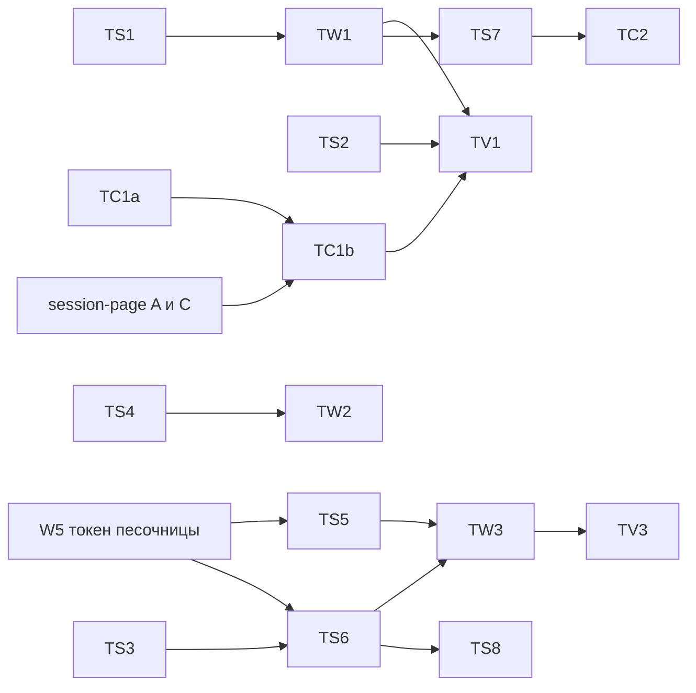

# Трейс работы агента

> **2026-10-17.** Остался только harness Pi, решение D41 в [decisions-2026-10-17.md](../decisions-2026-10-17.md). Части про ACP-агентов (`harness_start`, `acp_prompt`, `agent_step`, раздел 2.3, OTel агентов в VM) и `ai-sdk` больше не действуют. Новых спанов ACP проектор не пишет, а уже записанные спаны `acp_prompt` консоль показывает.

Владелец: «главное, чтобы был трейс работы агента». План даёт каждой сессии трейс. Это дерево на общей шкале времени: ход, внутри вызовы модели, вызовы инструментов, сабагенты и их ходы, подготовка песочницы, ожидание пользователя. У каждого узла есть длительность, статус, ошибка и детали. Трейс строится для любого harness: встроенный цикл Pi, ACP-агенты в песочнице (Claude Code, Codex, Gemini и другие), свои harness. Полнота зависит от того, что сообщает harness. Минимум без участия harness дают сервер и раннер (раздел 2.5). Цены и стоимость в трейсе не считаем.

Сокращения путей: `P/` это `platform/`, `M/` это `P/apps/main-node/`, `H/` это `P/apps/agent/src/harness/`, `C/` это `P/apps/console/src/`, `CS/` это `C/components/session/`, `V/` это `.claude/skills/verify-agent-console/`.

Главные решения:

1. Трейс хранится в таблицах `trace_spans` и `trace_turns`. Спаны пишут наблюдатель исполнения в драйвере сессии (ход, попытки старта, паузы, все сырые кадры), обёртка зависимостей раннера (фазы песочницы), восстановление по истории и с волны 3 приёмник OTLP (OpenTelemetry самих агентов).
2. Публичный поток событий `/v1/sessions/:id/events` не меняем. Трейс отдаёт отдельный маршрут `GET /v1/oma/sessions/:id/trace` с постраничной выдачей и потоком изменений.
3. Сервер хранит трейс в готовом виде. Слияние, правку статусов и перенос узлов сервер пишет в таблицу. Клиент применяет строки по `span_id` и `version` и удаляет строки с `deleted`.
4. Первая волна даёт трейс встроенного цикла Pi без OTel: наблюдатель, проектор, таблицы, маршрут, восстановление после сбоя, вкладка «Трейс», проверки в скилле.
5. OTel агентов приходит третьей волной, после токена сессии песочницы (W5).

## 1. Модель трейса

### 1.1 Трейс и спаны

Трейс равен сессии. `trace_id` сессии это первые 16 байт sha256 от id сессии в hex (32 знака), поэтому он одинаков во всех ходах, в экспорте и в `TRACEPARENT` для агента. Корень трейса это сама сессия, отдельной строки для неё нет.

Ход равен исполнению, то есть одной строке `managed_session_executions`. Воркер собирает принятые события в пачку по полосе (`sessionExecutionEventBatches`, `P/packages/session-runtime-contract/src/coordination.ts:181-205`). Id исполнения равен id первого события пачки, кроме `system.message`. Ход открывается до первой попытки старта песочницы, поэтому у неудачного старта тоже есть ход.

| Вид (`kind`) | Подпись в консоли | Родитель | Начало и конец |
|---|---|---|---|
| `turn` | Ход | нет (верхний уровень) или `subagent` | начало: вызов `accept` драйвера сессии, до первой попытки старта. Конец: кадр закрытия своего потока (`session.status_idle` или `status_terminated` у основного потока, `session.thread_status_idle` или `_terminated` у потока сабагента), `session.error` с `exhausted` того же потока, иначе завершение исполнения (отмена, исчерпание попыток старта). Ход потока сабагента открывает его `session.thread_status_running` |
| `sandbox` | Песочница | `turn` | одна попытка старта в драйвере, по строке на попытку |
| `sandbox_phase` | Выдача VM, Рабочая папка, Входы сессии, Старт VM, Пакеты окружения | `sandbox` | обёртки функций раннера и хук LiteBox |
| `harness_start` | Запуск агента | `turn` | ACP: процесс, `initialize`, `session/new` или `resume`, восстановление состояния |
| `acp_prompt` | Ход агента ACP | `turn` | пара `span.model_request_*` от `AcpTranslator` |
| `agent_step` | Шаг агента | `acp_prompt` | спан агента из OTel, например `claude_code.interaction` |
| `model_call` | Вызов модели | `turn` (в том числе ход потока) или `agent_step` | `span.model_request_start` и `_end` или OTel `chat`, `claude_code.llm_request` |
| `tool_call` | имя инструмента | тот же, что у вызовов модели хода | `agent.tool_use` (`mcp_`, `custom_`) и результат. Инструмент с подтверждением переживает конец хода (1.4) |
| `tool_wait` | Ожидание вас | `tool_call` | `agent.tool_use` с `evaluated_permission: ask`; конец по подтверждению, отказу, результату или снятию сессии (1.4) |
| `tool_exec` | Выполнение | `tool_call` | кадры Pi `span.tool_execution_start` и `_end`; у подтверждённого инструмента от подтверждения до результата |
| `subagent` | Сабагент «имя» | `tool_call`, который создал поток или отправил ему сообщение, иначе ход | участие потока в одном ходе верхнего уровня: от `session.thread_created` или `agent.thread_message_sent` до конца последнего хода потока в этом ходе (1.4) |
| `outcome_eval` | Оценка результата | `turn` | `span.outcome_evaluation_start` и `_end` |
| `compaction` | Сжатие контекста | `turn` или `agent_step` | `span.compaction_summarize_*` или событие OTel `compaction` |
| `retry_wait` | Пауза перед повтором | `turn` | пауза драйвера между попытками старта; пауза раннера от `session.status_rescheduled` до следующего кадра хода |
| `hook` | Хук | `tool_call` или `agent_step` | OTel `claude_code.hook` |
| `event` | Ошибка, Предупреждение, Подключение MCP, Подтверждение | любой | мгновенный узел, начало равно концу. «Подтверждение» стоит в ходе, который принял `user.tool_confirmation`, и ссылается на `tool_call` через `attrs.link_span_id` |

Инструменты и вызовы модели стоят рядом, на одном уровне под ходом. Так устроены `claude_code.interaction` и спаны GenAI (`execute_tool` рядом с `chat` под `invoke_agent`). Ожидание подтверждения может выйти за конец хода. Ход 1 заканчивается `requires_action`, подтверждение и результат приходят в ходе 2, а `tool_call` с детьми остаётся в ходе 1. Правила этого перехода описаны в 1.4.

### 1.2 Поля спана

```ts
type TraceSpanKind = "turn" | "sandbox" | "sandbox_phase" | "harness_start" | "acp_prompt"
  | "agent_step" | "model_call" | "tool_call" | "tool_wait" | "tool_exec" | "subagent"
  | "outcome_eval" | "compaction" | "retry_wait" | "hook" | "event";
type TraceSource = "events" | "runner" | "otel" | "rollout";

interface TraceSpan {
  span_id: string;               // 16 hex
  parent_span_id: string | null;
  turn_id: string | null;        // ход верхнего уровня, которому принадлежит узел (1.3); null только у спана OTel без хода
  attempt_id: string | null;     // попытка исполнения, которая записала узел
  thread_id: string;             // "sthr_primary" или поток сабагента
  kind: TraceSpanKind;
  name: string;                  // ключ фазы, модель, имя инструмента, имя агента
  sources: TraceSource[];        // после слияния может быть два
  precision: "measured" | "by_events";
  start_ms: number;
  end_ms: number | null;         // null: узел ещё идёт
  status: "running" | "ok" | "error" | "denied" | "interrupted" | "cancelled" | "waiting";
  error: { type: string | null; message: string | null; retry_status?: "retrying" | "exhausted" } | null;
  harness: string | null;        // pi, ai-sdk, claude-acp, codex-acp...
  model: string | null;
  usage: { input: number; output: number; cache_read: number; cache_write: number } | null;
  ttft_ms: number | null;
  finish_reason: string | null;
  tool: { name: string; call_id: string; kind: "builtin" | "mcp" | "custom"; mcp_server: string | null } | null;
  primary_event_id: string | null; // событие для клика: tool_use, model_request_start, user.message
  event_ids: string[];           // все события узла, первое ввод, последнее результат
  attrs: Record<string, string | number | boolean>; // прочее, не больше 8 КБ JSON
  version: number;               // растёт при каждой записи строки
  deleted: boolean;              // строку убрало слияние, клиент её удаляет
  updated_at: number;
}

interface TraceTurnSummary {
  turn: TraceSpan;               // спан хода
  state: "open" | "settling" | "complete" | "repaired" | "not_built";
  partial: boolean;              // часть данных потеряна при сбое
  lost: string[];                // что не восстановить: "harness_timing", "ttft", "tool_exec", "sandbox_phases"
  coverage: TraceCoverage;
  span_count: number | null;     // null у хода "not_built"
  error_count: number | null;
  waiting_count: number | null;
  version: number;
}

interface TraceCoverage {
  model_calls: "measured" | "by_events" | "turn_only" | "absent";
  tools: "measured" | "by_events" | "absent";
  sandbox: "phases" | "attempts";
}
```

Точность. `measured` значит, что начало и длительность дали часы исполнителя: поля `at_ms`, `started_at_ms` и `duration_ms` из кадров harness (2.2) или `Date.now()` наблюдателя и обёртки раннера. `by_events` значит, что время взято из `processed_at` событий. Эти метки идут в порядке записи, а не исполнения. Рантайм сдвигает метку на 1 мс вперёд, если она совпала с прошлой (`createStrictlyIncreasingEventStamp`, `M/src/lib/node-managed-harness-runtime.ts:250-258`). При плотном потоке метка уходит вперёд на число событий в одной миллисекунде. Метки узла лежат в `attrs.record_start_ms` и `attrs.record_end_ms` для сверки.

Аргументы и результат инструмента в спан не копируются. Консоль берёт их из событий `primary_event_id` (`agent.tool_use.input`) и последнего id в `event_ids` (`content` результата). Текст ошибки режется до 500 знаков, как в `model_calls`.

### 1.3 Идентификаторы

- `turn_id` хода верхнего уровня равен id исполнения, то есть id первого события пачки (`user.message`, `user.tool_confirmation`, `user.custom_tool_result`, `user.tool_result`, `user.define_outcome`). Драйвер знает его из `input.events` у `accept`. Тот же id лежит в `managed_session_executions.id`, поэтому старые сессии берут список ходов оттуда.
- Колонка `turn_id` у любого узла равна ходу верхнего уровня, которому узел принадлежит. Обычно это ход, в котором узел начался. `tool_wait` и `tool_exec` всегда принадлежат ходу своего `tool_call`, даже если исполнение шло в следующем ходе. Узлы потоков сабагентов несут `turn_id` хода основного потока, внутри которого шли. Поэтому поддерево `?turn_id=` замкнуто: у каждого узла, кроме хода, родитель лежит в той же выдаче.
- Ход в полосе потока сабагента (сообщение пользователя прямо в поток) это ход верхнего уровня со своим `thread_id`.
- `span_id` узла из событий и раннера равен первым 8 байтам sha256 от строки из `session_id`, пространства (`events` или `runner`), вида и ключа. Ключи такие:
  - ход верхнего уровня: `turn_id`; ход потока: id его `session.thread_status_running`;
  - `sandbox`: `attempt_id` и номер попытки старта; `sandbox_phase`: ключ песочницы и имя фазы; `retry_wait`: ключ хода и номер паузы;
  - `model_call`: id `span.model_request_start`;
  - `tool_call`, `tool_wait`, `tool_exec`: id `agent.tool_use`. Следующий ход знает этот id из подтверждения и правит узлы прошлого хода без чтения базы;
  - `subagent`: id потока и `turn_id`;
  - `event`: id события.
- Повторный разбор тех же событий даёт те же id, поэтому запись идемпотентна. Живая запись и восстановление по истории дают одинаковые id.
- Спаны OTel (волна 3) получают `span_id` из пространства `otel` по паре исходных `trace_id` и `span_id` агента. С узлами событий и раннера они не совпадают. Сама пара лежит в отдельных колонках (9.2, дыра 1).
- `TRACEPARENT` для процесса агента: `00-<trace_id сессии>-<span_id хода>-01`.

### 1.4 Статусы и переходы

`running` у открытого узла. `ok` и `error` по факту. `denied` при `user.tool_confirmation` с `deny` или OTel `decision=reject`. `interrupted` у узла, который остался открытым к закрытию хода или к `user.interrupt`, конец ставится по времени закрытия. `cancelled` у попытки старта, снятой отменой, и у ожидания, снятого вместе с сессией. `waiting` у инструмента, который ждёт подтверждения.

**Закрытие хода.** Кадр закрывает только ход своего потока. Поток кадра берётся из `session_thread_id`, кадр без него относится к `sthr_primary`. Например, `session.error` с `exhausted` от сабагента (`M/src/lib/node-managed-subagents.ts:290-293`) закрывает ход этого потока, а не основной ход.

| Причина закрытия | Статус хода |
|---|---|
| `stop_reason` `end_turn` | `ok` |
| `stop_reason` `requires_action` | `ok`, `attrs.stop_reason = "requires_action"`, в консоли «ждёт подтверждения» |
| `retries_exhausted` или `session.error` с `exhausted` | `error` |
| `user.interrupt` или отмена исполнения | `interrupted` |
| остановка, архив или удаление сессии | `cancelled` |
| потеря аренды | ход открыт до новой попытки или до восстановления (3.3) |

При закрытии хода его открытые узлы получают `interrupted` с концом по времени закрытия. Узлы в статусе `waiting` остаются открытыми. Узел с ошибкой поднимает до хода только признак `attrs.has_error`, статус хода берётся из таблицы выше.

**Инструмент с подтверждением.** Состояние узлов меняют только эти события:

| Событие | `tool_call` | `tool_wait` | `tool_exec` |
|---|---|---|---|
| `agent.tool_use` с `evaluated_permission: ask` | `waiting` | открыт, `waiting` | нет |
| конец хода с `requires_action` | без изменений | без изменений | нет |
| `user.tool_confirmation` с `allow` | `running` | `ok`, конец по `processed_at` подтверждения | открыт по `processed_at` подтверждения, `precision: by_events` (волна 1) |
| `user.tool_confirmation` с `deny` | `denied` после результата | `denied`, конец по подтверждению | нет |
| `agent.tool_result` или `agent.mcp_tool_result` с этим id | `ok` или `error` по `is_error`, после `deny` статус `denied` | `cancelled`, если ещё открыт | закрыт |
| остановка, архив или удаление сессии | `cancelled` | `cancelled` | `interrupted`, если открыт |

- Ход 2, который принял подтверждение, получает узел `event` «Подтверждение» со ссылкой `attrs.link_span_id` на `tool_call`. У `tool_exec` поле `attrs.executed_in_turn` хранит id хода 2.
- Ход 2 правит узлы хода 1 операцией `patch` по детерминированному `span_id` с условием на текущий статус (`waiting` или `running`). Состояние в памяти для этого не нужно, поэтому перезапуск main-node между ходами ничего не ломает. Если строки ещё нет (сбой записи хода 1), правка запускает восстановление хода 1 (3.3).
- Новый `user.message` вместо подтверждения ожидание не закрывает. Его закрывает только результат с тем же id или снятие сессии.
- Pi вызывает `execute` и у инструмента, который ждёт подтверждения. Обёртка возвращает `openmaPendingConfirmation` (`H/pi-loop-tools.ts:20-28`), а Pi при этом шлёт свои события `tool_execution_*`. Кадры `span.tool_execution_*` для такого инструмента Pi не шлёт (TS2). Проектор тоже игнорирует их у `tool_call` в статусе `waiting`.

**Сабагенты.**

- Поток сабагента живёт дольше хода. Узел `subagent` описывает участие потока в одном ходе верхнего уровня, его ключ это поток и `turn_id`.
- Первый узел встаёт под `tool_call` из `parent_tool_use_id` кадра `session.thread_created` (`M/src/lib/node-managed-subagents.ts:170-173`). В следующих ходах новый узел открывает `agent.thread_message_sent` этому потоку. Его родитель это `tool_call` с тем же `parent_tool_use_id`, если он есть, иначе ход. `attrs.continued_from` ссылается на прошлый узел потока.
- Ход потока открывает `session.thread_status_running`, закрывает `session.thread_status_idle`. `end_turn` даёт `ok`, `retries_exhausted` даёт `error`, флаг `interrupted` даёт `interrupted`. `session.error` потока пишет ошибку в его ход.
- Узел `subagent` закрывается вместе с основным ходом. Конец равен концу последнего хода потока. Статус `error`, если хоть один ход потока кончился ошибкой, иначе статус последнего хода. Открытый к этому моменту ход потока получает `interrupted`.
- `session.thread_status_terminated` ставит `attrs.thread_state = "closed"`, архив потока ставит `"archived"`. Без них значение `"open"`: поток ждёт следующих сообщений. Возобновление закрытого потока открывает новый узел `subagent` со значением `"open"`.
- Ошибка одного потока не меняет соседние потоки и основной ход, кроме `attrs.has_error`.

**Смена попытки.** Новая попытка того же хода (новый `attempt_id` в ограде исполнения) закрывает открытые узлы прошлой попытки, кроме `waiting`. Статус `interrupted`, конец по началу новой попытки, `attrs.end_reason = "owner_changed"`. Спан хода и строку `trace_turns` пишет только текущая попытка (3.1).

### 1.5 Совместимость с gen_ai

Внутри держим свои виды и поля. Соглашения OTel GenAI имеют статус Development (репозиторий `open-telemetry/semantic-conventions-genai`), имена могут поменяться, поэтому соответствие живёт в одном файле `M/src/lib/trace/genai.ts` и применяется при экспорте и при скачивании.

| Вид | Имя при экспорте | `gen_ai.operation.name` | Атрибуты |
|---|---|---|---|
| `turn`, `subagent` | `invoke_agent {агент}`, INTERNAL | `invoke_agent` | `gen_ai.agent.name`, `gen_ai.agent.id`, `gen_ai.conversation.id` равен id сессии |
| `acp_prompt` | `invoke_agent {harness}`, CLIENT | `invoke_agent` | `gen_ai.agent.name` равен id ACP-агента |
| `model_call` | `chat {модель}` | `chat` | `gen_ai.provider.name`, `gen_ai.request.model`, `gen_ai.response.id`, `gen_ai.response.finish_reasons`, `gen_ai.usage.*` |
| `tool_call` | `execute_tool {инструмент}` | `execute_tool` | `gen_ai.tool.name`, `gen_ai.tool.call.id`, `gen_ai.tool.type` |
| остальные | `oma.{вид}` | нет | только `oma.*` |

Токены. У нас `usage` в стиле Anthropic, вход без кэша. По `docs/gen-ai/anthropic.md` соглашений `gen_ai.usage.input_tokens` равен сумме входа, чтения и записи кэша, а кэш отдельно в `gen_ai.usage.cache_read.input_tokens` и `gen_ai.usage.cache_write.input_tokens`. Ошибка: статус ERROR и `error.type`. Наши поля идут как `oma.session.id`, `oma.turn.id`, `oma.thread.id`, `oma.kind`, `oma.precision`, `oma.event_ids`.

## 2. Откуда спаны

### 2.1 Наблюдатель исполнения и проектор кадров

Ход, попытки старта и все кадры видит драйвер сессии `DefaultNodeManagedSessionRuntimeDriver` (`M/src/lib/node-managed-session-runtime.ts`). Его метод `accept` крутит попытки старта (строки 298-373). При сбое старта драйвер сам пишет `session.error`, `session.status_rescheduled` и `session.status_idle` (`projectStartFailure`, строки 400-439). Через его `enqueueOutput` (строки 536-558) проходит каждый кадр раннера, сабагентов и самого драйвера. Обёртка раннера всего этого не видит: после последней неудачной попытки `runner.accept` не вызывается.

Поэтому драйвер получает необязательную зависимость `observer` (TW1, точечная правка). Тип объявляет TS1 в `M/src/lib/trace/types.ts`:

```ts
interface SessionExecutionObserver {
  executionStarted(input: { workspaceId: string; sessionId: string; events: SessionEventView[];
    fence?: SessionExecutionFence; atMs: number }): void;
  startAttempt(input: { workspaceId: string; sessionId: string; attempt: number; atMs: number }): void;
  startAttemptSettled(input: { workspaceId: string; sessionId: string; attempt: number; atMs: number;
    outcome: "ok" | "error" | "cancelled"; error?: string; retryInMs?: number }): void; // до projectStartFailure
  startCancelled(input: { workspaceId: string; sessionId: string; atMs: number; reason?: string }): void; // в начале finishCancelledStart
  frame(scope: { workspaceId: string; sessionId: string }, frame: unknown): void; // синхронно в enqueueOutput, до записи в историю
  executionSettled(input: { workspaceId: string; sessionId: string; atMs: number;
    outcome: "completed" | "failed" | "cancelled" | "lease_lost"; reason?: string }): Promise<void>; // сброс рекордера
}
```

Драйвер ловит сбой наблюдателя и пишет лог `main-node.trace.observer_failed`, на исполнение сбой не влияет. Сброс в `executionSettled` драйвер ждёт не дольше 2 с. Недописанное потом достроит восстановление (3.3). Реализация `createTraceObserver` живёт в `M/src/lib/trace/observer.ts` (TS1).

Наблюдатель передаёт всё проектору. Проектор чистый: `push(input)` возвращает операции `upsert` и `patch` для стора, базу он не читает. Время узлов он берёт из полей кадров и из `atMs` наблюдателя, а не из момента, когда кадр дошёл до драйвера.

Что видит проектор:

| Вход | Что делает проектор |
|---|---|
| `executionStarted` | открывает `turn` с `turn_id`, пишет строку `trace_turns` (`open`, `attempt_id`). Из принятых событий берёт `user.tool_confirmation` для 1.4. `attrs.queue_ms` равен разнице начала хода и `processed_at` первого события |
| `startAttempt`, `startAttemptSettled`, `startCancelled` | `sandbox` попытки с ошибкой или без; между попытками `retry_wait` от конца одной попытки до начала следующей; отмена даёт `cancelled` у открытой попытки или паузы |
| кадры драйвера при сбое старта (`projectStartFailure`, `finishCancelledStart`) | пока у хода нет удачной попытки, эти кадры относятся к старту: `session.error` с `retrying` пишет ошибку в `sandbox` попытки, `session.status_rescheduled` узла не даёт (паузу уже открыл наблюдатель), `session.error` с `exhausted` даёт узел «Ошибка». `session.status_idle` закрывает ход по исходу старта: `retries_exhausted` даёт `error`, отменённый старт даёт `interrupted`, даже если `stop_reason` равен `end_turn` |
| обёртки `buildSandbox`, `workspaceCheckpoints.materialize` и `attach`, `prepareSandbox` | `sandbox_phase` `acquire`, `restore`, `inputs` под текущей попыткой; тёплая песочница даёт `sandbox` с `attrs.reused=true` и длительностью около нуля |
| `span.model_request_start` | открывает `model_call` (у ACP `acp_prompt`) |
| `span.model_first_token` | `ttft_ms` |
| `span.model_request_end` | закрывает вызов: токены, `finish_reason`, ошибка, модель, время Pi из 2.2 |
| `agent.tool_use`, `agent.mcp_tool_use`, `agent.custom_tool_use` | открывает `tool_call`; при `evaluated_permission: ask` ещё `tool_wait` и статус `waiting` |
| `user.tool_confirmation` из принятых событий | переходы по таблице 1.4 и узел «Подтверждение» |
| `span.tool_execution_start`, `span.tool_execution_end` (новые, волна 1) | открывают и закрывают `tool_exec` |
| `agent.tool_result` и аналоги | закрывают `tool_call`, `is_error` даёт `error`; закрывают `tool_exec`, если `span.tool_execution_end` не пришёл |
| `session.thread_created`, `agent.thread_message_sent` | `subagent` по 1.4 |
| `session.thread_status_running`, `_idle`, `_terminated` | ход потока и состояние потока по 1.4 |
| `span.outcome_evaluation_*`, `span.compaction_summarize_*` | `outcome_eval`, `compaction` |
| `session.error`, `session.warning` | `event` в ходе своего потока; `exhausted` закрывает ход этого потока с ошибкой |
| `session.status_rescheduled` после удачного старта | `retry_wait` раннера до следующего кадра хода |
| `session.status_idle`, `status_terminated` основного потока | закрывают ход по 1.4 |
| `executionSettled` | закрывает ход, если кадра закрытия не было; при `lease_lost` ход остаётся открытым |

Запись. Рекордер копит операции и пишет их пачкой раз в 250 мс на сессию и при `executionSettled`. Сбой пачки рекордер повторяет 3 раза через 250, 500 и 1000 мс. Потом он пишет лог `main-node.trace.record_failed`, ставит ходу `frames_lost` и оставляет строку `trace_turns` в состоянии `open`. Ход при этом не падает. Если пропала хотя бы одна пачка, `trace_turns.state` не станет `complete`, и ход достроит восстановление (3.3).

Завершение. После последнего успешного сброса рекордер ставит `trace_turns.state = complete` и `history_cursor`, то есть id последнего события хода, которое видел проектор. Волна 3 вставит между открытым и завершённым ходом состояние `settling` для поздней телеметрии (9.2, дыра 9).

### 2.2 Встроенный цикл Pi

События уже есть, трейс строится проектором без OTel. В установленном `@earendil-works/pi-agent-core` 1.1.0 OTel нет, `pi-telemetry` даёт только контракт без экспортёра.

Время событий для замеров не годится. Pi пишет `agent.tool_use` раньше `span.model_request_end`: вызов `emitHarnessToolUseFromCall` стоит в `H/pi-loop.ts:415`, конец вызова модели в строке 428. Рантайм ставит метки строго по возрастанию (1.2). Поэтому Pi сообщает своё время в кадрах. Правки `H/pi-loop.ts` (волна 1, TS2):

- `span.model_request_start` и `span.model_first_token` получают `at_ms`, это `Date.now()` в момент события Pi;
- `span.model_request_end` получает `started_at_ms` из `AssistantMessage.timestamp` (начало запроса), `duration_ms` из `AssistantMessage.durationMs` (монотонные часы, `pi-ai` 1.1.0, `dist/types.d.ts:396-404`) и `at_ms`;
- новый кадр `span.tool_execution_start {tool_use_id, name, at_ms}` на `tool_execution_start`;
- новый кадр `span.tool_execution_end {tool_use_id, at_ms, duration_ms, is_error}` на `tool_execution_end`, `duration_ms` из `durationMs` события (`pi-agent-core` 1.1.0, `dist/types.d.ts:485-492`);
- для инструмента без `execute` (ждёт подтверждения) кадров `span.tool_execution_*` нет.

Публичные `agent.tool_use` и `agent.tool_result` не меняются. Новых кадров нет в белом списке, в историю они не попадут, как сейчас `span.model_first_token`. Лишние поля `span.model_request_*` отбрасывает разбор публичного потока, это проверяет тест TS2.

Правила времени в проекторе:

- `model_call`: начало равно `started_at_ms`, конец равен началу плюс `duration_ms`. Без этих полей начало и конец берутся из `processed_at` пары, `precision: by_events`.
- `tool_exec`: начало равно `at_ms` кадра старта, длительность равна `duration_ms` кадра конца.
- `tool_call`: начало равно концу вызова модели, который его выдал (Pi выдаёт вызов инструмента, когда поток ответа закончился). Конец равен концу `tool_exec`. Без замеров время берётся из `processed_at` `agent.tool_use` и результата.
- `attrs.harness_duration_ms` хранит длительность Pi для сверки.

Без этих правок трейс Pi тоже строится, но с `precision: by_events` и с началом `tool_call` на `message_end` (`H/pi-loop.ts:410-420`).

Pi исполняет инструменты одного ответа параллельно (`toolExecution: "parallel"`, `H/pi-loop.ts:152`). Окна `tool_exec` таких вызовов пересекаются, проектор их не выстраивает в цепочку.

Устаревший цикл `ai-sdk` пишет те же типы событий и попадает в трейс тем же проектором с `precision: by_events`.

### 2.3 ACP-агенты: события

`AcpTranslator` даёт одну пару `span.model_request_*` на весь ход (`H/acp-translate.ts:123-132`). Проектор знает harness хода и кладёт эту пару в `acp_prompt`, а не в `model_call`. Так она не спорит с настоящими вызовами модели из OTel. Токены `PromptResponse.usage` остаются на `acp_prompt`.

Правки волны 2 (без OTel):

- `H/acp-translate.ts`: на каждый `tool_call` и `tool_call_update` слать кадр `span.acp_tool_update {tool_call_id, status, at_ms, kind, parent_tool_use_id}`. `parent_tool_use_id` берётся из `_meta.claudeCode.parentToolUseId` (claude-agent-acp, `stampParentToolUseId`). Публичные `agent.tool_use` и `agent.tool_result` не меняются. Проектор открывает `tool_call` по первому кадру и `tool_exec` по `in_progress`, поэтому длительность инструмента перестаёт быть около 1 мс.
- `H/acp-sandbox-loop.ts`: вокруг запуска процесса, `initialize`, открытия сессии и восстановления и снятия нативного состояния слать `span.harness_phase {phase, start_ms, end_ms, error}`. Время сейчас пишется только в stderr (`[acp-init]`, `[acp-runtime] total_ms` в `@openma/common` 0.9.1).
- `P/packages/sandbox-adapter-litebox/src/litebox.ts`: необязательный колбэк `onPhase(name, startMs, endMs, attrs)` для старта VM, закрепления хостов, загрузки CA и установки пакетов. VM стартует лениво внутри первого `exec`, снаружи это время не отделить.
- `M/src/lib/node-managed-session-runner.ts`: `delegateToAgent` передаёт id вызова в `subagents.create`, как делал удалённый `openai-subagents.ts`. Тогда поток сабагента висит под своим `tool_call`. Там же раннер шлёт `span.tool_execution_start` и `_end` вокруг `confirmedTools.execute` (строки 441-470), и исполнение подтверждённого инструмента получает замер вместо `by_events`.

### 2.4 ACP-агенты: OpenTelemetry агента

Каждый процесс агента получает окружение из плана телеметрии, по образцу `InferenceConfigAdapter.plan()` (`P/packages/harness-inference-adapters`). Токен и `TRACEPARENT` добавляет `H/acp-sandbox-loop.ts` при запуске процесса из нового поля `HarnessContext.trace`. В `_oma.acp.agent.env` токен не кладём: конфигурация агента отдаётся API целиком.

Claude Code (`claude-acp`, claude-agent-acp 0.91.0 закреплён, внутри Claude Code 2.1.300). Адаптер отдаёт своё окружение процессу Claude Code (`acp-agent.ts` тега v0.91.0, строки 10861..10901).

```sh
CLAUDE_CODE_ENABLE_TELEMETRY=1
CLAUDE_CODE_ENHANCED_TELEMETRY_BETA=1
OTEL_TRACES_EXPORTER=otlp
OTEL_LOGS_EXPORTER=otlp
OTEL_METRICS_EXPORTER=none
OTEL_EXPORTER_OTLP_PROTOCOL=http/protobuf
OTEL_EXPORTER_OTLP_ENDPOINT=$SANDBOX_GATEWAY_BASE_URL/v1/oma/otlp
OTEL_EXPORTER_OTLP_HEADERS=x-oma-trace-token=<токен>   # без пробела в значении
OTEL_TRACES_EXPORT_INTERVAL=1000
OTEL_LOGS_EXPORT_INTERVAL=1000
OTEL_RESOURCE_ATTRIBUTES=oma.session_id=<id>,oma.turn_id=<id>
TRACEPARENT=00-<trace_id сессии>-<span_id хода>-01
```

Гейты содержимого `OTEL_LOG_USER_PROMPTS`, `OTEL_LOG_ASSISTANT_RESPONSES`, `OTEL_LOG_TOOL_DETAILS`, `OTEL_LOG_TOOL_CONTENT`, `OTEL_LOG_RAW_API_BODIES` не задаём. В VM лежит токен модели, и вывод `env` попал бы в `tool.output`.

| Спан или событие Claude Code | Наш узел | Статус |
|---|---|---|
| `claude_code.interaction` | `agent_step` под `acp_prompt` | всегда UNSET, итог берём у нас |
| `claude_code.llm_request` | `model_call`: `model`, `input_tokens`, `output_tokens`, `cache_read_tokens`, `cache_creation_tokens`, `ttft_ms`, `stop_reason`, `request_id` | `success`, `status_code`, `error`, `error_class` |
| `claude_code.tool` | `tool_call`, слияние с событием по `tool_use_id` | по детям |
| `claude_code.tool.blocked_on_user` | `tool_wait` | `decision=reject` даёт `denied` |
| `claude_code.tool.execution` | `tool_exec` | `success`, `error`, `error_class` |
| `claude_code.hook` | `hook` | ERROR при сбое |
| спаны подагента (`agent_id`, `parent_agent_id`) | под `tool_call` инструмента Agent или Task | как выше |
| логи `compaction`, `mcp_server_connection` | `compaction`, `event` с `duration_ms` | `success`, `status` |
| логи `api_error`, `api_retries_exhausted` | `error` у `model_call` по `request_id` | |
| лог `api_request` | `model_call` из лога, если трассы беты пропали: конец равен времени записи, начало раньше на `duration_ms` | |

Codex (`codex-acp` v0.16.0). По коду `codex-acp` не вызывает `build_provider` (`src/lib.rs:29`), поэтому секция `[otel]` в `config.toml` через ACP ничего не отправит. Путь: переменная `CODEX_ROLLOUT_TRACE_ROOT=<папка состояния сессии>`. После хода harness запускает в VM `codex debug trace-reduce <бандл>`, читает `state.json` через `sandbox.exec` и шлёт кадр `span.rollout_trace` только со структурными полями: потоки (подагенты), ходы, `inference_calls` с `ExecutionWindow`, `tool_calls`, сжатия. Бандл содержит промпты и вывод терминала, сам бандл на сервер не уходит. Источник `rollout`. Волна 4, сначала короткий опыт.

Gemini CLI. Переменные `GEMINI_TELEMETRY_ENABLED=true`, `GEMINI_TELEMETRY_TARGET=local`, `GEMINI_TELEMETRY_OTLP_ENDPOINT=$SANDBOX_GATEWAY_BASE_URL/v1/oma/otlp`, `GEMINI_TELEMETRY_OTLP_PROTOCOL=http`, `GEMINI_TELEMETRY_OTLP_HEADERS` с токеном, `GEMINI_TELEMETRY_LOG_PROMPTS=false` (по умолчанию `true`), `GEMINI_TELEMETRY_TRACES_ENABLED` не задаём (с `true` в спаны идут `gen_ai.input.messages`). `TRACEPARENT` Gemini не читает по документации, ход находим по времени. Отображение по `gen_ai.operation.name`: `llm_call` в `model_call`, `tool_call` в `tool_call` (`gen_ai.tool.call_id`), `agent_call` в `subagent`, `user_prompt` в `agent_step`, остальное в `attrs`.

Остальные ACP-агенты (OpenCode, MiMo, Hermes, Aider, Kimi, MiniMax, pi-acp) пока дают только события: `acp_prompt` и инструменты. OpenCode и Hermes умеют OTel, но в режиме `acp` это не подтверждено, их подключаем после проверки тем же приёмником.

### 2.5 Любой harness: минимальный контракт и полнота

Трейс есть у любого harness, но полнота у них разная. Метод `HarnessInterface.run()` обязателен (`H/interface.ts:38-40`), а сообщать вызовы модели и инструменты harness не обязан. Поэтому трейс делится на уровни:

| Уровень | Что даёт harness | Что в трейсе |
|---|---|---|
| 0, без участия harness | ничего, кроме итогового `agent.message` | ход, попытки и фазы песочницы, паузы, ошибки старта, итог хода, ожидание подтверждений. Работа агента внутри хода показана серым участком «нет данных» |
| 1, события | пары `span.model_request_start` и `_end`, `agent.tool_use` и результаты через `runtime.broadcast` (`H/interface.ts:113-178`) | вызовы модели и инструменты с `precision: by_events` |
| 2, замеры | поля `at_ms`, `started_at_ms`, `duration_ms` и кадры `span.tool_execution_*` из 2.2 | то же с `precision: measured` |
| 3, OTel | спаны gen_ai в процессе или OTLP из песочницы (волна 3) | шаги агента, настоящие вызовы модели ACP-агентов, хуки |

Уровень 0 сервер даёт всегда, без OTel и без правок harness.

Проектор считает у каждого хода поле `coverage` (1.2). Файл `M/src/lib/trace/harness-coverage.ts` хранит ожидаемый уровень каждого harness: `pi` 2, `ai-sdk` 1, ACP-агенты 1 с `coverage.model_calls = turn_only` (вызов модели только как `acp_prompt`), неизвестный harness 0. Консоль сравнивает факт с ожиданием. Если harness вызовы модели не сообщает, ход несёт подпись «нет данных о вызовах модели: harness их не сообщает». Если должен был сообщить, но данных нет, консоль показывает предупреждение «данные о вызовах модели не пришли».

Проверка контракта. Помощник `M/test/_helpers/trace-harness-conformance.ts` принимает кадры хода и уровень и проверяет, что проектор строит нужные узлы и `coverage`. TS1 прогоняет его на трёх фикстурах: Pi (уровень 2), `ai-sdk` (уровень 1), молчащий harness с одним `agent.message` (уровень 0). Новый harness добавляет свою фикстуру и строку в `harness-coverage.ts`.

Уровень 3 для своего harness (волна 3):

- Спаны gen_ai внутри процесса main-node: `HarnessContext.trace.tracer` даёт `Tracer` из `@opentelemetry/api` с родителем `turn`. Процессор спанов переводит `ReadableSpan` тем же отображением, что приёмник, и пишет в `trace_spans`. Подходят `@ai-sdk/otel`, экспортёр Mastra, Pydantic AI и другие библиотеки, которые пишут `invoke_agent`, `chat`, `execute_tool`.
- Harness в песочнице шлёт OTLP в приёмник с токеном сессии, как ACP-агенты.
- Отображение по `gen_ai.operation.name`: `chat`, `text_completion`, `generate_content` в `model_call`; `execute_tool` в `tool_call`; `invoke_agent` в `agent_step` или `subagent`, если у него есть родитель-инструмент; остальное в `attrs` родителя.

### 2.6 Приёмник OTLP в main-node

Раздел описывает волну 3. До начала TS5 его правила и правила 2.7 меняются по таблице 9.2 (дыры 1, 2, 3, 9, 10, 11, 14, 15, 16).

- Пути: `POST /v1/oma/otlp/v1/traces` и `POST /v1/oma/otlp/v1/logs`. Экспортёры дописывают `/v1/traces` к `OTEL_EXPORTER_OTLP_ENDPOINT` сами. Монтировать до `v1.route("/oma/sessions", ...)` в `M/src/modules/node-http.ts`.
- Форматы: `application/json` (http/json, id в hex) и `application/x-protobuf` (http/protobuf), `Content-Encoding: gzip`. Иначе 415. Ответ того же формата, при частичном приёме `partial_success` с `rejected_spans` или `rejected_log_records`. Разбор protobuf: `protobufjs` (7.5.6 уже стоит в `node_modules` транзитивно, сделать прямой зависимостью) и `.proto` из `open-telemetry/opentelemetry-proto` с закреплённым тегом. `@opentelemetry/otlp-transformer` 0.222.0 умеет только кодировать запрос и читать ответ.
- Привязка только по токену сессии песочницы (W5). Токен берётся из `x-oma-trace-token` или `Authorization: Bearer`. Пространство и сессию даёт только токен. `session.id`, `gen_ai.conversation.id` и прочие поля тела привязку не меняют.
- Отказы: нет токена, токен испорчен или просрочен даёт 401. Действующий ключ другого типа (ключ пользователя, ключ пространства, токен без области `trace`) даёт 403. `oma.session_id` в ресурсе не равен сессии токена: 403, ничего не пишется. Сессия в архиве или удалена: 403.
- Лимиты: тело не больше 1 МиБ, после распаковки не больше 8 МиБ (иначе 413); в запросе не больше 2000 спанов и 5000 записей лога; на токен не больше 10 запросов в секунду с запасом 20 (иначе 429 с `Retry-After`); на сессию не больше 50 000 спанов OTel всего и 5000 на ход, лишнее отклоняется через `partial_success`; у спана не больше 64 атрибутов, значение до 1 КБ, имя до 128 знаков, событий спана не больше 16; начало спана в окне от создания сессии минус 1 минута до текущего времени плюс 5 минут.
- Без текстов промптов. Фильтр удаляет атрибуты и события с содержимым: `user_prompt`, `prompt`, `prompt_text`, `response`, `gen_ai.input.messages`, `gen_ai.output.messages`, `gen_ai.system_instructions`, `gen_ai.tool.call.arguments`, `gen_ai.tool.call.result`, `tool_input`, `tool_parameters`, `full_command`, событие `tool.output`, тела `api_request_body` и `api_response_body`. Фильтр отключается только настройкой пространства «Сохранять тексты» (раздел 5), по умолчанию она выключена.
- Ход для спана: родитель из `TRACEPARENT`, если он равен `span_id` хода этой сессии и время спана внутри хода. Иначе ход, в окно которого попадает начало спана, в потоке `sthr_primary`. Корневой спан агента (`agent_step`) встаёт под `acp_prompt` найденного хода, если он есть. Так работает и процесс ACP, который живёт несколько ходов (кэш harness из плана `models-harness-analytics.md`, раздел 2.4, пункт 4).
- Часы VM. Если конец `agent_step` расходится с концом `acp_prompt` больше чем на 200 мс, все спаны этого процесса (ресурс `service.instance.id`) сдвигаются на разницу. Сдвиг пишется в `attrs.clock_shift_ms`.
- Доверие. Спаны OTel пишет процесс в VM, где идёт чужой код. Токен даёт писать только в свою сессию. В консоли у таких узлов подпись «со слов агента». В аналитику и счёт токенов они не идут.
- Сеть. Для окружения «Ограниченный» хост шлюза нужен в разрешённых хостах на порту 80 или 443 (BoxLite 0.9.0 пропускает по имени только эти порты, `docs/runbook-claude-code-sandbox.md`). Тот же адрес нужен для прокси модели.

### 2.7 Как избежать дублей

Слияние выполняет запись, а не чтение. В таблице лежит уже объединённый узел со стабильным `span_id`, проигравшая строка получает `deleted` (3.1). Пункты 2 и 4 ниже меняются в волне 3 по дырам 1 и 14 (9.2).

1. `span_id` спанов из событий детерминирован. Повторная запись и разбор истории не создают копий.
2. Вызов инструмента сливается по `tool.call_id`: строка из OTel даёт время, детей и статус, строка из событий даёт `primary_event_id` и `event_ids`. Ошибка из любого источника побеждает. В ответе одна строка с `sources: ["events","otel"]`.
3. Ход ACP из событий это `acp_prompt`, а не `model_call`, поэтому вызовы модели из OTel его не повторяют. Итог токенов хода считается по `model_call`, если они есть, иначе по `acp_prompt`.
4. Свой harness, который пишет и события, и `chat`: строки сливаются по `provider_response_id` и `gen_ai.response.id`. Если в ходе есть вызовы модели из OTel, вызовы из событий без пары скрываются.
5. Логи OTel не дают новых узлов, кроме `compaction`, `event` и запасного `model_call` из `api_request`. Запасной вызов скрывается, если есть `claude_code.llm_request` с тем же `request_id`.

## 3. Хранение

Решение: таблицы `trace_spans` и `trace_turns`, а не расчёт на лету.

Причины:

1. Спаны OTel не события, их всё равно надо где-то хранить.
2. Поля, которые трейсу нужны, отбрасывает белый список и строгий контракт ответа (`P/packages/managed-agents-api/src/contracts/session-events.ts:516-534`). Добавлять их в публичный поток значит менять контракт формы Anthropic, на котором стоит клиент консоли.
3. Фазы песочницы и время старта инструмента вообще не события.
4. Расчёт на лету читает всю историю при каждом открытии (до 500 страниц по 100 событий) и не даёт курсора для живого обновления.
5. Восстановление после сбоя должно помнить, какие ходы уже достроены.

### 3.1 Таблицы и правила записи

Схема живёт по образцу `ensureAnalyticsSchema` (`M/src/lib/analytics/schema.ts`): свой список миграций и своя таблица `trace_schema_migrations`, SQLite и Postgres. MySQL описан в 3.4.

```sql
CREATE TABLE IF NOT EXISTS trace_spans (
  workspace_id TEXT NOT NULL,
  session_id TEXT NOT NULL,
  span_id TEXT NOT NULL,
  parent_span_id TEXT,
  turn_id TEXT,
  attempt_id TEXT,
  thread_id TEXT NOT NULL,
  kind TEXT NOT NULL,
  name TEXT NOT NULL,
  source TEXT NOT NULL,            -- events, runner, otel, rollout
  precision TEXT NOT NULL,
  start_ms BIGINT NOT NULL,
  end_ms BIGINT,
  status TEXT NOT NULL,
  error_type TEXT,
  error_message TEXT,
  harness TEXT,
  model TEXT,
  input_tokens BIGINT, output_tokens BIGINT, cache_read_tokens BIGINT, cache_write_tokens BIGINT,
  ttft_ms BIGINT,
  finish_reason TEXT,
  tool_name TEXT,
  tool_call_id TEXT,
  primary_event_id TEXT,
  event_ids TEXT NOT NULL,         -- JSON-массив
  attrs TEXT NOT NULL,             -- JSON, до 8 КБ
  version BIGINT NOT NULL,
  deleted INTEGER NOT NULL DEFAULT 0,
  updated_at BIGINT NOT NULL,
  PRIMARY KEY (workspace_id, session_id, span_id)
);
CREATE INDEX IF NOT EXISTS trace_spans_changes_idx ON trace_spans (workspace_id, session_id, updated_at, span_id);
CREATE INDEX IF NOT EXISTS trace_spans_turn_idx ON trace_spans (workspace_id, session_id, turn_id, start_ms, span_id);
CREATE INDEX IF NOT EXISTS trace_spans_call_idx ON trace_spans (workspace_id, session_id, tool_call_id);
CREATE INDEX IF NOT EXISTS trace_spans_ws_updated_idx ON trace_spans (workspace_id, updated_at);

CREATE TABLE IF NOT EXISTS trace_turns (
  workspace_id TEXT NOT NULL,
  session_id TEXT NOT NULL,
  turn_id TEXT NOT NULL,
  thread_id TEXT NOT NULL,         -- полоса исполнения
  attempt_id TEXT,                 -- попытка, которой разрешено писать ход
  state TEXT NOT NULL,             -- open, settling, complete, repaired
  frames_lost INTEGER NOT NULL DEFAULT 0,
  lost TEXT NOT NULL,              -- JSON-массив невосстановимых деталей
  history_cursor TEXT,             -- id последнего события хода, которое разобрал проектор
  start_ms BIGINT NOT NULL,
  end_ms BIGINT,
  span_count BIGINT NOT NULL DEFAULT 0,
  error_count BIGINT NOT NULL DEFAULT 0,
  waiting_count BIGINT NOT NULL DEFAULT 0,
  coverage TEXT NOT NULL,          -- JSON TraceCoverage
  version BIGINT NOT NULL,
  updated_at BIGINT NOT NULL,
  PRIMARY KEY (workspace_id, session_id, turn_id)
);
CREATE INDEX IF NOT EXISTS trace_turns_session_idx ON trace_turns (workspace_id, session_id, start_ms, turn_id);
CREATE INDEX IF NOT EXISTS trace_turns_updated_idx ON trace_turns (workspace_id, session_id, updated_at, turn_id);
```

Индексы `trace_spans`: первый для потока изменений, второй для страниц поддерева хода, третий для слияния по вызову, четвёртый для очистки. Индексы `trace_turns`: страницы сводок и изменения сводок.

Правила записи:

- `upsert`: `INSERT ... ON CONFLICT (workspace_id, session_id, span_id) DO UPDATE SET ..., version = trace_spans.version + 1`. Замер побеждает метку: поле времени с `precision: measured` не перезаписывается значением `by_events`. Поэтому восстановление по истории не портит живую запись.
- `patch`: `UPDATE trace_spans SET <поля>, version = version + 1, updated_at = ? WHERE workspace_id = ? AND session_id = ? AND span_id = ? AND status IN (<ожидаемые>)`. Ноль строк значит, что узел уже закрыт или его нет. Во втором случае стор запускает восстановление хода, которому узел принадлежит.
- Ограда попытки. Пачка спанов хода пишется условно, через `INSERT ... SELECT ... WHERE EXISTS` по строке `trace_turns` этого хода с тем же `attempt_id`. Устаревшая попытка после потери аренды ничего не пишет. Новая попытка сначала занимает ход (`UPDATE trace_turns SET attempt_id = ?`), потом закрывает открытые узлы прошлой попытки по 1.4. Правки `patch` чужого хода ограждает ожидаемый статус, а не попытка.
- Слияние и перенос узла пишутся как `upsert` объединённой строки и `deleted = 1` у проигравшей. Изменение чужих строк при слиянии (новый родитель у детей) тоже идёт записью, поэтому оно попадает в поток изменений.
- `updated_at` равен `Date.now()` пишущего процесса. Порядок изменений даёт пара `(updated_at, span_id)` и отставание курсора (3.2).

Срок хранения `TRACE_RETENTION_DAYS`, по умолчанию 30, очистка раз в сутки. Спаны, строки `deleted` и `trace_turns` удаляются вместе с сессией.

### 3.2 Маршрут

`GET /v1/oma/sessions/:id/trace` (права как у чтения сессии) без параметров отвечает так:

```json
{
  "trace_id": "4bf92f3577b34da6a3ce929d0e0e4736",
  "session_id": "sesn_01...",
  "turns": [],
  "turns_before": null,
  "spans": [],
  "spans_next": null,
  "cursor": "eyJ1IjoxNzkyMTUwMDAwMTIzLCJzIjoiIn0",
  "collecting": false
}
```

- `turns`: сводки `TraceTurnSummary` по возрастанию `(start_ms, turn_id)`, не больше 500. Список ходов сервер берёт из `managed_session_executions` сессии и `trace_turns`. Ход без строки `trace_turns` приходит с `state: "not_built"` и временем из таблицы исполнений. Если ходов больше 500, приходят последние 500 и курсор `turns_before` на более ранние.
- `spans`: полные поддеревья двух последних ходов, не больше 2000 строк. Остаток отдаёт курсор `spans_next`.
- `cursor`: курсор потока изменений.
- `collecting`: `true`, пока у сессии есть ход в состоянии `open` или `settling`.

Параметры:

- `?turns_before=<курсор>`: следующая страница более ранних сводок.
- `?turn_id=<id>&page=<курсор>`: поддерево хода страницами по 2000 строк в порядке `(start_ms, span_id)`. Родитель начинается не позже ребёнка, поэтому он всегда лежит на той же или более ранней странице. Ход `not_built` или ход `open` с завершённым исполнением сначала проходит восстановление (3.3).
- `?after=<курсор>`: изменения строк в порядке `(updated_at, span_id)` после курсора, не больше 2000 за раз. В выдачу входят строки с `deleted` и изменившиеся сводки ходов. `more: true` значит, что клиент сразу запрашивает следующую страницу. Курсор конца выдачи сервер ставит не позже чем за 2 с до текущего времени. Строка, которую другой процесс закоммитил с чуть более ранним `updated_at`, придёт при следующем запросе. Повторы клиент отбрасывает по `version`.

Все курсоры непрозрачные: base64url от JSON с ключом сортировки. Поля `truncated` нет, любую выдачу можно дочитать до конца.

`GET /v1/oma/sessions/:id/trace/search?q=<текст>&after=<курсор>` ищет по `name`, `tool_name`, `model`, `span_id`, `primary_event_id`, `event_ids` и `error_message` во всех ходах сессии. Ответ содержит `matches` (`span_id`, `turn_id`, `kind`, `name`, не больше 200), `next` и `remaining_turns`. Ходы `not_built` поиск достраивает сам, не дольше 2 с на запрос. Если недостроенные ходы остались, ответ несёт их число, и клиент повторяет поиск с первой страницы: ход, достроенный посреди листания, лежит и до курсора. Поиск закончен, когда проход от первой страницы до последней начался с `remaining_turns = 0`.

`GET /v1/oma/sessions/:id/trace/otlp.json` отдаёт весь трейс одним `ExportTraceServiceRequest` в JSON по отображению 1.5. Это кнопка «Скачать трейс».

### 3.3 Восстановление после сбоя

Трейс хода бывает неполным в трёх случаях: процесс упал посреди хода, аренда ушла другому владельцу, пачки записи пропали. Сырые кадры (`span.model_first_token`, `span.tool_execution_*`, время Pi) в историю не попадают, поэтому их не восстановить. Восстановление достраивает то, что есть в истории, и отмечает потерю.

Ход требует восстановления, если `trace_turns.state` не `complete` и не `repaired`, а исполнение уже не идёт: строка `managed_session_executions` в состоянии `completed`, `failed` или `cancelled`, или её аренда истекла. Ход без строки `trace_turns` тоже требует восстановления: это старая сессия или запись не прошла ни разу.

Шаги восстановления (`M/src/lib/trace/repair.ts`):

1. Прочитать события окна хода из `managed_session_events` по индексу `(workspace_id, session_id, processed_at, id)`, от начала исполнения до `settled_at_ms`. События, принятые в другие исполнения, отбросить.
2. Прогнать их через тот же проектор. Узлы получают те же `span_id`, что и при живой записи. Замеры живой записи остаются (правило 3.1).
3. Открытые узлы хода, кроме `waiting`, закрыть статусом `interrupted`. Конец равен `settled_at_ms` исполнения или началу следующей попытки. `attrs.end_reason` получает значение `owner_changed`, `process_lost` или `execution_failed`.
4. Записать `trace_turns.state = repaired`, `frames_lost` и `lost`, например `["harness_timing", "ttft", "tool_exec", "sandbox_phases"]`. Сводка получает `partial: true`, если что-то пропало.

Восстановление идемпотентно: два процесса могут достроить один ход одновременно, итог одинаковый. Восстановленный ход лежит в таблице, поэтому следующее открытие страницы историю уже не читает. Маршрут достраивает ход только при выдаче его поддерева или при поиске, а не все ходы сессии сразу.

Смена владельца в живом исполнении закрывает узлы прошлой попытки сразу, без чтения истории (1.4).

### 3.4 MySQL

Раздел устарел: поддержку MySQL сняли вместе с трейсом по событиям в памяти ([cleanup.md](cleanup.md), 5.3). Текст ниже остался как история.

На MySQL таблиц трейса нет, как и у аналитики. Маршрут строит трейс на лету тем же восстановлением (3.3) из истории и `managed_session_executions`. Результат лежит в памяти процесса: LRU на 20 сессий, ключ это сессия и id последнего события. Трейс получается уровня 1 из 2.5 с `precision: by_events`, без фаз песочницы и замеров Pi. Консоль пишет «сервер на MySQL: трейс по событиям, без замеров». Ограничение нужно согласовать с владельцем до TW1 (раздел 8).

## 4. Вид в консоли

### 4.1 Место на странице

Страница сессии переделывается по [session-page.md](session-page.md): слева колонка разговора с поиском и мини-картой, справа инспектор 480 px. Водопад в инспектор не помещается. Поэтому над лентой стоит переключатель «Разговор» и «Трейс», параметр адреса `?view=trace`, клавиша T. В режиме «Трейс» колонка разговора целиком занята трейсом. Шапка и инспектор остаются, вкладка «События» инспектора показывает выбранное событие.

### 4.2 Дерево и водопад

- Строка 24 px. Слева дерево (не уже 240 px): шеврон, иконка вида, подпись, статус, серым модель или аргумент инструмента (`toolInputPreview` из `C/lib/session-stats.ts`). В середине полоса на общей шкале. Справа колонка «Длительность» 72 px (`formatShortDurationRu`).
- Цвет полосы по виду: ход `--color-ink-300`, вызов модели `--color-sky-300` (как сегменты мини-карты), инструмент `--color-emerald-300`, сабагент `--color-brand-300`, песочница и запуск агента `--color-ink-400`, ожидание и пауза перед повтором `--color-amber-300`. Ошибка любого вида: полоса `--ddc-dot-danger`, подпись `--ddc-danger-text`. Отклонено и прервано: `--ddc-dot-neutral`. Выбранная строка `--ddc-selected-bg` и рамка `--ddc-ring`.
- Открытый узел тянется до текущего времени, правый край штрихом. Узел `waiting` тянется только до конца последнего хода сессии и несёт стрелку «ждёт с 12:03». Шкала до текущего времени ради него не растёт.
- Узел по событиям помечен «≈», узел из OTel подписью «со слов агента» в деталях.
- Ход со сводкой `partial: true` несёт значок «неполный» с подсказкой из `lost`. Ход уровня 0 (2.5) показывает серый штрихованный участок «нет данных» там, где у хода нет детей дольше 500 мс. Подпись о `coverage` стоит в деталях хода.
- Сабагент вложен веткой под вызовом инструмента, внутри его ходы со своими вызовами. Кнопка «Открыть поток» переключает ленту на поток (`activeThreadId` страницы).
- Простой длиннее 60 с сжимается в зазор 6 px, как в мини-карте (`compressedScale` из `CS/TranscriptMinimap.tsx` как образец, своя функция в `C/lib/trace-tree.ts`).
- Свой список с окном видимых строк (фиксированная высота строки), новых зависимостей нет. Старая «Хронология» зависала на длинных ходах без этого. Пределы быстродействия описаны в 4.7.

### 4.3 Выбор и детали

Клик по строке:

1. выделяет строку и открывает панель деталей внизу колонки трейса (40 % высоты);
2. вызывает `onSelectEvent(span.primary_event_id, "trace")`. Адрес получает `?event=<id>`, вкладка «События» инспектора выделяет строку и показывает JSON (раздел 7 session-page.md);
3. кнопка «В разговоре» в деталях ставит `?view=conversation` и повторяет выбор, лента прокручивает блок к центру.

Детали по виду: время начала (`formatEventDateTimeRu` с миллисекундами), длительность, статус, текст ошибки. Вызов модели: модель, токены вход, выход, кэш, TTFT, причина остановки. Инструмент: ввод из `agent.tool_use` (`CodeBlock`), результат через `formatToolOutput` (`C/lib/tool-output.ts`), ожидание и выполнение отдельно. Песочница: фазы, образ, пакеты, `reused`. Узел OTel: таблица `attrs`. Внизу «Копировать ID» и источник.

### 4.4 Свёртка, фильтр, поиск, масштаб

- Свёртка: по шеврону, «Свернуть всё» и «Развернуть всё», клавиши `[` и `]` для всех, `o` и `p` для текущего узла (как в Jaeger UI). По умолчанию раскрыт последний ход, старые свёрнуты, ветки сабагентов свёрнуты.
- Фильтр: чипы «Ход», «Модель», «Инструмент», «Сабагент», «Песочница», «Ожидание» и переключатель «Только ошибки». Предки найденных узлов остаются приглушёнными.
- Поиск «Найти в трейсе»: имя, инструмент, модель, `span_id`, id события, текст ошибки. Сначала консоль ищет в загруженных ходах, потом спрашивает `GET .../trace/search` про остальные. Счётчик «3/12», Enter и Shift Enter. Найденный узел в незагруженном ходе грузит поддерево этого хода, раскрывает предков и прокручивается. Пока сервер достраивает ходы, рядом со счётчиком стоит «ищу: 120 из 1000 ходов».
- Масштаб: «Мельче», «Крупнее», выделение участка мышью на шкале, «Весь ход» по выбранному ходу.
- Клавиши ↑ ↓ двигают выбор, ← → сворачивают и раскрывают, Enter выбирает. Дерево `role="treegrid"`, у строк `aria-level`, `aria-expanded`, `aria-selected`.

### 4.5 Живое обновление

- Пока сессия `running` или ответ несёт `collecting: true`, консоль раз в секунду запрашивает `?after=<cursor>` и дочитывает страницы, пока `more`.
- Событие живого потока `span.*`, `agent.tool_*`, `session.status_*`, `session.thread_*` вызывает внеочередной запрос с задержкой 250 мс.
- Строка с большим `version` заменяет локальную, строка с меньшим отбрасывается. `deleted` удаляет строку. Новый `parent_span_id` переносит узел в другую ветку. Сводка хода заменяет старую. Строки ходов, чьё поддерево не загружено, консоль отбрасывает, сводки этих ходов оставляет.
- Открытые полосы растут по таймеру 250 мс. Таймер меняет только ширину видимых открытых полос через CSS-переменную, дерево он не пересчитывает.
- Переключатель «Следить за ходом» держит в виду последнюю строку, пока пользователь не прокрутил сам.
- Опрос останавливается, когда сессия не `running` и `collecting` равен `false`. Узлы `waiting` опрос не держат: подтверждение придёт событием живого потока.

### 4.6 Узкий экран 390 px

Список без водопада: подпись и длительность, полоса доли от хода под подписью. Детали нижним листом, как инспектор. Горизонтальной прокрутки нет.

### 4.7 Быстродействие

Пределы на сессии из 200 ходов по 100 узлов (20 000 спанов):

- Построение дерева из 20 000 спанов занимает не больше 300 мс, применение 200 изменений не больше 20 мс, поиск по загруженным спанам не больше 50 мс. Это тесты TC1a на чистых функциях `C/lib/trace-tree.ts`.
- Изменения пересчитывают только затронутые ветки. Индекс `span_id` ведёт к узлу, дети лежат по порядку, список видимых строк пересобирается от первой изменённой строки.
- Первый ответ маршрута приходит не дольше 500 мс, страница поддерева не дольше 300 мс, страница изменений не дольше 200 мс, запрос поиска не дольше 500 мс. Это проверка `trace.perf`.
- За 10 с прокрутки при живом опросе в браузере нет задач длиннее 100 мс (`PerformanceObserver` с типом `longtask`), куча JS растёт не больше чем на 80 МБ.
- Восстановленный ход сервер пишет в таблицу (3.3), история сессии при каждом открытии не читается.

### 4.8 Связь со страницей сессии, «Хронология» и «Траектория»

- Единицы A, B, C из session-page.md уже идут (неотслеживаемые `CS/SessionHeader.tsx`, `CS/TranscriptMinimap.tsx`, `CS/inspector/`, `C/lib/session-stats.ts`). Трейс не меняет их файлы до слияния. После слияния правки точечные: значение `"trace"` в `SelectionSource` (`C/lib/session-stats.ts`), переключатель в `C/pages/SessionDetail.tsx`, пункт меню в `CS/SessionHeader.tsx`.
- Пункт 2 раздела 9 session-page.md (модель, причина и текст ошибки вызова модели) трейс закрывает в деталях узла без правки публичного контракта. JSON события во вкладке «События» остаётся без этих полей.
- «Хронология»: вкладку убирает единица A. Файлы `C/components/timeline/*` уже ни откуда не импортируются, их удаляет единица трейса TC1b.
- «Траектория»: маршрут `GET /v1/oma/sessions/:id/trajectory` читает старую таблицу `session_events`, для сессий консоли он, вероятно, пуст (не проверено). Пункт «Траектория» в меню «⋮» заменяем на «Скачать трейс» (OTLP JSON). `TrajectoryViewerModal` со страницы убираем, маршрут остаётся в API для оценок.
- Проверка `run.ui_timeline` в скилле переходит в `run.ui_trace`.

## 5. Экспорт во внешние системы

Вторым шагом, по желанию, волна 4.

- Настройка пространства «Экспорт трейсов»: включено, адрес OTLP/HTTP, протокол (`http/protobuf` или `http/json`), заголовки (секрет, шифр `secrets.cipherFor("trace.export")`, в ответах API маскируется), «Сохранять тексты» (выключено). Таблица `trace_settings`, маршруты `GET` и `PUT /v1/oma/trace/settings` для админа пространства.
- Отправка с сервера, не из VM. Когда ход перешёл в `complete` или `repaired`, его спаны переводятся по 1.5 и уходят одним запросом на `<адрес>/v1/traces`. Ход с выросшим `version` уходит повторно (9.2, дыра 9). Повтор три раза с паузой 2, 4, 8 с при 429 и 5xx. Состояние в таблице `trace_exports (workspace_id, session_id, turn_id, version, status, attempts, last_error, exported_at)`.
- Пресеты: Langfuse `https://<хост>/api/public/otel`, заголовок `Authorization: Basic base64(<public key>:<secret key>)`, только HTTP; Phoenix `http://<хост>:6006/v1/traces`; Jaeger `http://<хост>:4318/v1/traces`.
- Один `trace_id` на сессию, поэтому ходы сессии во внешней системе лежат одним трейсом. `gen_ai.conversation.id` равен id сессии.
- Встраивать чужой интерфейс не будем. Phoenix под Elastic License 2.0 нельзя отдавать клиентам как сервис. Внешние системы только принимают экспорт.

## 6. Проверка без настоящей модели

Скилл `verify-agent-console`, режим `fake`. Все проверки жёсткие: несовпадение даёт «провал». «Не проверено» только при отсутствии условия среды (нет сети до npm для Claude Code), с причиной. В наборе волны 1 таких условий нет, каждая проверка обязательна.

Набор волны 1, новый сценарий `V/scripts/journey-trace.mjs` (`journey.sh --scenario trace`). Агент на встроенном цикле, сообщение `VERIFY_AGENT_RUN nonce=<n>` с командой и строкой `Пауза: 1500` (новое в `fake-model.mjs`: задержка ответа на первом запросе). Команда печатает часы VM до и после работы: `Команда: cut -d' ' -f1 /proc/uptime; sleep 0.4; cut -d' ' -f1 /proc/uptime; echo VERIFY_OK_<n>`. `/proc/uptime` есть в любом Linux, разница двух чисел даёт длительность по часам VM без учёта смещения часов. Фейковая модель отвечает двумя запросами: `tool_use` bash, затем текст. В журнал она пишет `received_ms` и `done_ms` каждого запроса по часам хоста.

Время в проверках берётся из независимых источников: журнала фейковой модели, вывода команды в VM и замеров Pi. Метки `processed_at` проверяют только порядок записи.

| id | Условие |
|---|---|
| `trace.api_shape` | `GET /v1/oma/sessions/:id/trace` даёт 200, `trace_id` из 32 hex, у каждого спана `span_id` из 16 hex; после дочитывания всех страниц каждый `parent_span_id` есть в выдаче или равен null у хода; у каждой сводки есть `state`, `coverage`, `version` |
| `trace.turn_tree` | ровно один `turn` с `turn_id` равным id `user.message`; прямо под ним не меньше одного `sandbox`, ровно 2 `model_call` и ровно 1 `tool_call` с `tool.name = bash`; `coverage.model_calls` и `coverage.tools` равны `measured` |
| `trace.measured` | у вызовов модели и `tool_exec` `precision: measured`; `attrs.harness_duration_ms` равен длительности узла до 1 мс |
| `trace.order` | порядок исполнения по замерам: конец `sandbox` не позже начала вызова 1; конец вызова 1 не позже начала `tool_exec` bash; конец `tool_exec` не позже начала вызова 2; конец вызова 2 не позже конца хода; допуск 2 мс. Порядок записи отдельно: `event_ids` узлов идут в том же порядке, что события в `/events` |
| `trace.durations` | вызов модели покрывает интервал из журнала фейковой модели (`received_ms`, `done_ms`) с допуском 5 мс и длиннее его не больше чем на 300 мс; вызов 1 не короче паузы 1500 мс. `tool_exec` bash не короче разницы двух чисел `/proc/uptime` из вывода и длиннее её не больше чем на 1500 мс. Начало хода не раньше `processed_at` `user.message` и не позже него на 2000 мс |
| `trace.parallel_tools` | ход со строкой `Параллельно: 3` (новое в `fake-model.mjs`: три `tool_use` bash с той же командой в одном ответе): три `tool_call` под ходом, каждый `tool_exec` не короче своего интервала по `/proc/uptime`. Если интервалы VM двух вызовов пересекаются больше чем на 50 мс, их узлы в трейсе тоже пересекаются. Если между ними зазор больше 50 мс, узлы не пересекаются |
| `trace.event_links` | `primary_event_id` вызовов модели равны id `span.model_request_start`, у bash равен id `agent.tool_use`, последний id в `event_ids` bash равен id `agent.tool_result` |
| `trace.model_fields` | у обоих вызовов `model` равна модели агента, вход 10 и выход 5 (числа фейковой модели), `finish_reason` первого `tool_use`, второго `end_turn` |
| `trace.live` | во время паузы фейковой модели вкладка «Трейс» показывает узел «Вызов модели» со статусом «идёт», после ответа он закрыт без перезагрузки страницы; опрос останавливается только после ответа с `collecting: false` |
| `trace.ui_rows` | на вкладке видны строки «Ход», две «Вызов модели» и «bash» в этом порядке, скриншот и ARIA-снимок |
| `trace.ui_click_event` | клик по строке bash ставит в адрес `event=<id agent.tool_use>`, во вкладке «События» эта строка `aria-selected`; «В разговоре» прокручивает к блоку с `data-event-id` этого вызова |
| `trace.tool_error` | второй ход с `Команда: false`: узел bash со статусом `error` и красной подписью (`--ddc-danger-text`) |
| `trace.confirmation` | агент, у которого bash требует подтверждения (`permission_policy: always_ask`): ход 1 кончается `requires_action`, `tool_call` и `tool_wait` в статусе `waiting`. Main-node перезапускается на той же папке данных. `allow` даёт в ходе 2 узел «Подтверждение», `tool_wait` `ok` с концом по подтверждению, `tool_exec` и `tool_call` `ok` в ходе 1, по одной строке на вызов. Следующий ход с `deny` даёт `denied` у `tool_wait` и `tool_call` |
| `trace.start_failure` | окружение с несуществующим пакетом pip `verify-trace-missing-<n>`: сессия кончается `retries_exhausted`; в трейсе один ход со статусом `error`, три `sandbox` с ошибкой, две `retry_wait`, узел «Ошибка»; нет узлов без родителя |
| `trace.crash_recovery` | во время паузы фейковой модели main-node получает сигнал KILL и запускается снова на той же папке. После конца хода в трейсе нет узлов `running`, открытые узлы первой попытки закрыты `interrupted` с `end_reason` `owner_changed` или `process_lost`, у сводки хода `partial: true` и непустой `lost` |
| `trace.pagination` | `M/scripts/seed-trace-spans.ts` пишет в сессию 12 000 спанов одного хода с одинаковым `updated_at`; страницы `?turn_id=` и `?after=` отдают каждую строку ровно один раз, всего 12 000 |
| `trace.perf` | тот же скрипт пишет 200 ходов по 100 спанов; выполняются все пределы 4.7 по времени ответов, длинным задачам и памяти при 10 с прокрутки с живым опросом |
| `trace.search_unloaded` | поиск имени узла из первого (незагруженного) хода находит его, грузит ход и выделяет строку |
| `trace.phone` | 390 px, нет горизонтальной прокрутки, детали открываются нижним листом |

Набор волны 3, OTLP. Новый клиент `V/scripts/otlp-client.mjs` на официальных экспортёрах `@opentelemetry/exporter-trace-otlp-proto` и `-http` (0.222.0, есть в `node_modules`). Токен выдаёт `M/scripts/mint-sandbox-token.ts` на секрете прогона, скрипт отказывает при `NODE_ENV=production`.

| id | Условие |
|---|---|
| `otlp.accept_proto` | клиент шлёт `invoke_agent` с детьми `chat` и `execute_tool` (известные имена, `gen_ai.*`, длительности 300, 120, 40 мс) с токеном сессии: 200, спаны в дереве под ходом, длительности совпадают до 1 мс, источник `otel` |
| `otlp.accept_json` | тот же набор по http/json даёт тот же результат |
| `otlp.merge` | `execute_tool` с `gen_ai.tool.call.id`, равным id `agent.tool_use` из сессии, даёт одну строку с `sources` events и otel |
| `otlp.reject_no_token` | без токена 401, число спанов сессии не изменилось |
| `otlp.reject_foreign` | токен сессии B и `oma.session_id` сессии A: 403; ключ пользователя: 403; просроченный токен: 401; трейс A не изменился |
| `otlp.limits` | тело 2 МиБ даёт 413; 40 запросов за секунду дают 429 с `Retry-After` |
| `otlp.no_content` | атрибуты `gen_ai.input.messages` и `user_prompt` с маркером `SECRET_<n>` отправлены; в ответе маршрута и в базе прогона маркера нет |

Claude Code в VM, сценарий `claude-code` (фейковая модель, окружение с `@agentclientprotocol/claude-agent-acp`):

| id | Условие |
|---|---|
| `cc.otel_spans` | после хода в трейсе есть `agent_step` под `acp_prompt` хода, не меньше одного `model_call` с источником `otel`, `tool_call` Write и Read со слиянием по `tool_use_id` и длительностью больше 0 |
| `cc.bash_denied` | вызов Bash имеет статус `denied` или `error` (фейковая модель ждёт отказ) |
| `cc.traceparent` | родитель `agent_step` равен ходу из `TRACEPARENT`; иначе «внимание» с пометкой «привязка по времени» |
| `cc.no_prompt_text` | ни один атрибут трейса не содержит `VERIFY_CLAUDE_CODE` |
| `cc.harness_phases` | под ходом есть `harness_start` с фазами процесса и открытия сессии (волна 2) |

Наборы волны 3 меняются по таблице 9.2 до начала TV3 (дыры 2, 3, 9, 15, 16 и остаток 21).

## 7. Единицы работы

Файлы единиц не пересекаются. Чужие файлы только импортируются. Перед стартом единица смотрит `git status --short` своих файлов. Файлы, которые сейчас правят другие работы (`M/src/modules/node-managed.ts`, `node-http.ts`, `H/acp-translate.ts`, `litebox.ts`, файлы скилла), трогают только единицы подключения после коммита этих правок. Правка `M/src/lib/node-managed-session-runtime.ts` в TW1 точечная и добавочная.

Внешние зависимости:

- страница сессии (session-page.md): A и C для TC1b, B для прокрутки ленты при выборе с `source: "trace"`;
- W5, токен сессии песочницы. В документах репозитория W5 не описана, здесь берём описание из `models-harness-analytics.md`, раздел 2.4, пункт 2 и единица S2 (`M/src/lib/sandbox-inference-token.ts`). От W5 нужны выпуск и проверка токена с областями (`inference`, `trace`) и допуск в `P/packages/auth/src/index.ts` на путях `/v1/oma/otlp/*`. Контракт токена закрепляется до TS5 (9.2, дыра 16);
- `SANDBOX_GATEWAY_BASE_URL` из единицы SW того же плана.

| Единица | Кто | Волна | Что | Зависит от | Оценка |
|---|---|---|---|---|---|
| TS1 | Opus | 1 | модель, наблюдатель, проектор, таблицы, восстановление, маршрут, поиск | нет | 2,5 дня |
| TS2 | Codex | 1 | кадры Pi: время вызовов модели и исполнения инструментов | нет | 0,75 дня |
| TC1a | Sonnet | 1 | вкладка «Трейс» на фикстуре | контракт раздела 3.2 | 3 дня |
| TW1 | Opus | 1 | наблюдатель в драйвере, подключение TS1 в main-node | TS1, коммит чужих правок | 1 день |
| TC1b | Sonnet | 1 | встройка в страницу сессии, удаление «Хронологии», «Скачать трейс» | TC1a, A, C | 0,5 дня |
| TV1 | Opus | 1 | проверки волны 1 в скилле | TW1, TS2, TC1b | 1,5 дня |
| TS3 | Opus | 2 | кадры ACP: инструменты, фазы запуска, сабагенты Claude Code | коммит `acp-translate.ts` | 1 день |
| TS4 | Codex | 2 | фазы LiteBox, id вызова для сабагента, замер подтверждённого инструмента | коммит `litebox.ts` | 1 день |
| TW2 | Opus | 2 | подключение фаз LiteBox | TS4, TW1 | 0,25 дня |
| TS5 | Opus | 3 | приёмник OTLP, отображение, слияние при записи, лимиты, фильтр | W5, TS1 | 2 дня |
| TS6 | Codex | 3 | планы телеметрии агентов, `HarnessContext.trace` | TS3, W5 | 1,5 дня |
| TW3 | Opus | 3 | подключение приёмника и контекста трейса | TS5, TS6, SW | 0,5 дня |
| TV3 | Opus | 3 | проверки OTLP и Claude Code | TW3 | 1,5 дня |
| TS7 | Codex | 4 | экспорт и настройки | TW1 | 1,5 дня |
| TC2 | Sonnet | 4 | страница «Экспорт трейсов» | TS7 | 1 день |
| TS8 | Codex | 4 | опыт с бандлом Codex | TS6 | 1,5 дня |



Волны по календарю: волна 1 около 5,5 дней (TS1, TS2, TC1a параллельно 3 дня, потом TW1 и TC1b за день, потом TV1 полтора дня), волна 2 около 2 дней, волна 3 около 4 дней после W5, волна 4 около 3 дней. Волна 2 может идти параллельно с концом волны 1.

### TS1. Модель, проектор, хранение, маршрут (сервер, Opus)

Файлы, все новые: `M/src/lib/trace/types.ts`, `ids.ts`, `projector.ts`, `observer.ts`, `recorder.ts`, `store.ts`, `turn-store.ts`, `repair.ts`, `executions-reader.ts`, `history-window.ts`, `cursor.ts`, `search.ts`, `harness-coverage.ts`, `routes.ts`, `genai.ts`, `index.ts`; скрипт `M/scripts/seed-trace-spans.ts` (отказ при `NODE_ENV=production`); помощник `M/test/_helpers/trace-harness-conformance.ts`; тесты `M/test/trace-projector.test.ts`, `trace-confirmation.test.ts`, `trace-subagents.test.ts`, `trace-timing.test.ts`, `trace-coverage.test.ts`, `trace-store.test.ts`, `trace-store.postgres.test.ts`, `trace-pagination.test.ts`, `trace-repair.test.ts`, `trace-recorder.test.ts`, `trace-routes.test.ts`, `trace-search.test.ts`, `trace-genai.test.ts`; фикстуры `M/test/_fixtures/trace/pi-turn-frames.json`, `pi-turn-trace.json`, `ai-sdk-turn-frames.json`, `silent-harness-frames.json`, `start-failure-frames.json`.

Что сделать: разделы 1, 2.1, правила времени из 2.2, уровни 2.5, раздел 3. `createTraceProjector()` с методом `push(input)`, который возвращает операции `upsert` и `patch`, чистый, без базы. `createTraceObserver({recorder, ...})` реализует `SessionExecutionObserver` из 2.1, тип лежит в `types.ts`. `decorateRunnerDependencies(deps, recorder)` для фаз песочницы. `buildTraceRoutes({sql, dialect, history, executions})`. Восстановление читает окно хода через `history-window.ts` и разбирает его через `encodeRuntimeHistoryEvent`. `executions-reader.ts` только читает `managed_session_executions`, его тест идёт на схеме `sessionExecutionCoordinatorSqlSchema`. Файл `merge.ts` (слияние при записи) переходит в TS5.

Приёмка:

- кадры хода Pi из фикстуры дают дерево и порядок из раздела 6 (`trace.turn_tree`, `trace.order`, `trace.measured`);
- повторная подача тех же кадров не меняет число строк, растёт только `version`; восстановление по истории и живая запись дают одинаковые `span_id`; восстановление не портит замеры;
- кадры драйвера при трёх неудачных попытках старта дают ход `error`, три `sandbox`, две `retry_wait` и один узел «Ошибка», без лишних пауз из `session.status_rescheduled`; отмена во время паузы даёт `cancelled` у паузы и `interrupted` у хода, хотя `finishCancelledStart` пишет `end_turn`;
- подтверждение идёт по таблице 1.4: `requires_action` оставляет `waiting`; `allow`, `deny`, результат без подтверждения и снятие сессии дают свои статусы; ход 2 правит узлы хода 1 через `patch` на новом экземпляре проектора;
- сабагенты: при двух параллельных потоках ошибка одного закрывает только его ход; основной ход `ok` с `has_error`; сообщение потоку в следующем ходе даёт новый `subagent` с `continued_from`; `session.thread_status_terminated` ставит `thread_state`, возобновление возвращает `open`;
- смена попытки закрывает узлы прошлой статусом `interrupted` с `owner_changed`; устаревшая попытка не меняет ход, его узлы и `trace_turns`;
- плотный поток: 50 кадров в одной миллисекунде сдвигают метки на 50 мс, а длительности узлов берутся из `at_ms` и `duration_ms` и с метками не совпадают;
- `trace-harness-conformance` проходит для Pi (уровень 2), `ai-sdk` (1) и молчащего harness (0), `coverage` совпадает с ожиданием;
- 12 000 строк с одинаковым `updated_at` читаются страницами `?turn_id=` и `?after=` ровно по одному разу; курсор изменений отстаёт на 2 с; строка `deleted` приходит в `?after`;
- восстановление: ход с потерянными пачками, ход без строки `trace_turns` и ход с истёкшей арендой дают `repaired` без узлов `running` и с заполненным `lost`; второй вызов ничего не меняет;
- на MySQL маршрут отдаёт трейс по событиям без таблиц;
- поиск достраивает ходы не дольше 2 с за запрос и отдаёт `remaining_turns`;
- отображение gen_ai считает вход Anthropic с кэшем; тесты на SQLite и Postgres зелёные.

### TS2. Кадры Pi (Codex)

Файлы: `H/pi-loop.ts`, `P/apps/agent/tests/pi-loop.test.ts`, новый `M/test/trace-pi-frames.test.ts`.

Что сделать: раздел 2.2. Время берётся из `Date.now()`, в тестах его подменяет `vi.useFakeTimers`.

Приёмка:

- `span.tool_execution_start` выходит до `span.tool_execution_end`, оба до `agent.tool_result`; у обоих есть `at_ms`, у конца `duration_ms` из `durationMs` Pi;
- `span.model_request_end` несёт `started_at_ms`, `duration_ms` и `at_ms`; `span.model_request_start` и `span.model_first_token` несут `at_ms`;
- инструмент без `execute` (ждёт подтверждения) кадров `span.tool_execution_*` не даёт;
- несколько инструментов в одном ответе дают по паре кадров на вызов, окна параллельных вызовов пересекаются;
- новых кадров нет в `/events`; поля `at_ms`, `started_at_ms`, `duration_ms` у `span.model_request_*` в публичном ответе не видны, кадр при этом не отклоняется; `agent.tool_result` записывается как раньше.

### TC1a. Вкладка «Трейс» (консоль, Sonnet)

Файлы, все новые: `C/lib/trace-api.ts`, `C/lib/trace-tree.ts`, `C/lib/trace-store.ts` (локальная копия трейса: применение изменений по `version`, удаление, перенос узла) и тесты к ним, `C/lib/trace-tree.perf.test.ts`; `CS/trace/TraceView.tsx`, `TraceToolbar.tsx`, `TraceWaterfall.tsx`, `TraceDetails.tsx`, `trace-text.ts`, `trace.css` и тесты `*.test.tsx`; фикстуры `C/mocks/trace-pi-turn.json` (копия `pi-turn-trace.json` из TS1 или по контракту раздела 3.2) и `C/mocks/trace-changes.json` (изменения с `deleted`, сменой родителя и устаревшим `version`).

Что сделать: разделы 4.2..4.7. `TraceView` принимает `sessionId`, `events`, `selection`, `onSelectEvent`, `onShowInTranscript`, `running`.

Приёмка:

- дерево, порядок и вложенность на фикстуре; свёртка и клавиши; фильтр и поиск с раскрытием предков; клик вызывает `onSelectEvent(id, "trace")`;
- выдача страницами: сводки ходов по `turns_before`, поддерево до конца по `page`, изменения по `after` до `more: false`;
- изменения: больший `version` заменяет строку, меньший отбрасывается, `deleted` убирает строку, новый родитель переносит узел, сводка хода обновляется;
- поиск по незагруженным ходам через `trace/search` грузит ход и выделяет узел, при `remaining_turns` запрос повторяется;
- опрос `after` идёт только при `running` или `collecting`; узел `waiting` опрос не держит и рисуется до конца последнего хода со стрелкой;
- значки `coverage` и `partial` у хода, серый участок «нет данных» у хода уровня 0;
- пределы 4.7 на чистых функциях с 20 000 спанов; 10 000 строк рисуются окном;
- тесты и `tsc` зелёные, скриншоты 1280 и 390.

### TW1. Подключение волны 1 (сервер, Opus)

Файлы:

- `M/src/lib/node-managed-session-runtime.ts`: необязательная зависимость `observer` у `DefaultNodeManagedSessionRuntimeDriver` и вызовы из 2.1: начало `accept`, вокруг `this.start` в цикле попыток (`startAttemptSettled` до `projectStartFailure`), начало `finishCancelledStart`, `enqueueOutput`, блок `finally` в `accept`. Без наблюдателя драйвер работает как раньше;
- `M/src/modules/node-managed.ts`: наблюдатель трейса в драйвер, `decorateRunnerDependencies` для зависимостей раннера;
- `M/src/modules/node-http.ts`: маршруты трейса до `/oma/sessions`;
- новые тесты `M/test/node-managed-session-runtime-observer.test.ts`, `managed-session-trace.test.ts`, `managed-session-trace-recovery.test.ts`, `managed-session-trace-confirmation.test.ts`, `managed-session-trace-subagents.test.ts`.

Приёмка:

- существующие тесты драйвера зелёные без наблюдателя;
- через HTTP ход Pi с фейковой моделью даёт трейс из раздела 6;
- все попытки старта падают (`buildSandbox` бросает): ход `error` с тремя попытками и двумя паузами; отмена в паузе даёт `interrupted`;
- потеря аренды посреди хода и новая попытка: узлы первой попытки `interrupted` с `owner_changed`;
- стор отказывает на двух пачках посреди хода: после хода чтение даёт `repaired`, `partial` и ни одного узла `running`;
- подтверждение через перезапуск: ход 1 `requires_action`, новый экземпляр main-node на той же базе, ход 2 с `allow`, затем ход с `deny`;
- сабагенты: два параллельных потока, ошибка одного, сообщение тому же потоку в следующем ходе, закрытие и возобновление потока;
- весь `test-slot ./node_modules/.bin/vitest run` в `M/` зелёный.

### TC1b. Встройка в страницу (консоль, Sonnet)

Файлы: `C/pages/SessionDetail.tsx`, `C/pages/SessionDetail.layout.test.tsx`, `C/lib/session-stats.ts` (только `"trace"` в `SelectionSource`), `CS/SessionHeader.tsx` и его тест (пункт «Скачать трейс» вместо «Траектория»), удаление `C/components/timeline/`. Приёмка: `?view=trace` открывает трейс, T переключает, «В разговоре» прокручивает блок, `?event=` из трейса выделяет строку «Событий».

### TV1. Проверки волны 1 (скилл, Opus)

Файлы: новые `V/features/session-trace.md`, `V/scripts/journey-trace.mjs`; правка `V/scripts/fake-model.mjs` (строки `Пауза: <мс>` и `Параллельно: <n>`, в журнале `received_ms` и `done_ms`), `V/scripts/launch.sh` (ключ `--restart-main`: перезапуск main-node на той же папке прогона), `V/scripts/journey.sh`, `V/SKILL.md`, `V/features/README.md`, `V/features/sessions-and-agent-run.md`, `V/scripts/journey-env-to-agent.mjs` (`run.ui_timeline` в `run.ui_trace`). Приёмка: цепочка `launch, doctor, seed-user, journey --scenario trace, cleanup` даёт «ПРОЙДЕН», все проверки волны 1 из раздела 6 жёсткие, старые проверки не ослаблены.

### TS3. Кадры ACP (Opus)

Файлы: `H/acp-translate.ts`, `H/acp-sandbox-loop.ts`, новые `P/apps/agent/tests/acp-translate-trace.test.ts`, `acp-sandbox-trace.test.ts`. Что сделать: раздел 2.3, первые два пункта. Сначала проверить, что id `agent.tool_use` у транслятора равен `toolCallId`. Приёмка: на записанных кадрах ACP длительность инструмента равна интервалу от первого `tool_call` до терминального обновления; обновления с `_meta.claudeCode.parentToolUseId` дают вложенные вызовы; публичные события не изменились (`M/test/acp-translate-failed-tool.test.ts` зелёный).

### TS4. Фазы LiteBox и сабагенты (Codex)

Файлы: `P/packages/sandbox-adapter-litebox/src/litebox.ts`, новый `P/packages/sandbox-adapter-litebox/test/litebox-phases.test.ts`, `M/src/lib/node-managed-session-runner.ts` (только `delegateToAgent` и кадры вокруг `confirmedTools.execute`), новый `M/test/managed-subagent-tool-link.test.ts`. Приёмка: колбэк получает фазы старта VM и установки пакетов с длительностью; поток из `delegateToAgent` несёт `parent_tool_use_id`; подтверждённый инструмент получает `tool_exec` с `precision: measured`.

### TW2. Подключение фаз (Opus)

Файлы: `M/src/modules/node-managed.ts`. Колбэк `onPhase` LiteBox пишет `sandbox_phase` через рекордер.

### TS5. Приёмник OTLP (Opus)

Файлы, все новые: `M/src/lib/trace/otlp-receiver.ts`, `otlp-decode.ts`, `otlp-proto/` (`.proto` с тегом и сгенерированный модуль), `otel-mapping.ts`, `merge.ts`, `ingest-limits.ts`, `content-filter.ts`; `M/scripts/mint-sandbox-token.ts`; тесты `M/test/trace-otlp-receiver.test.ts`, `trace-otel-mapping.test.ts` (фикстуры спанов `claude_code.*`, Gemini, gen_ai), `trace-otlp-limits.test.ts`, `trace-merge.test.ts`; правка `P/packages/auth/src/index.ts` и `P/packages/auth/test/auth.test.ts` (путь `/v1/oma/otlp/*`) после W5. Что сделать: разделы 2.4 (таблица), 2.5 (уровень 3), 2.6 и 2.7 с поправками 9.2. Приёмка: проверки `otlp.*` раздела 6 как тесты.

### TS6. Планы телеметрии агентов (Codex)

Файлы: новые `P/packages/harness-inference-adapters/src/telemetry/index.ts`, `claude.ts`, `gemini.ts`, `codex.ts` и тесты; `H/interface.ts` (`HarnessContext.trace`), `H/acp-sandbox-loop.ts` (окружение и файлы плана при запуске процесса). Приёмка: процесс Claude Code получает набор из 2.4 и не получает гейтов содержимого; токен не попадает в `_oma.acp.agent.env` и в ответ API агента; Gemini получает `GEMINI_TELEMETRY_LOG_PROMPTS=false`.

### TW3. Подключение OTel (Opus)

Файлы: `M/src/modules/node-http.ts` (приёмник), `M/src/modules/node-managed.ts` (обёртка `buildHarnessContext`: `trace` с `traceparent`, адресом и токеном), `M/src/config.ts` (`TRACE_INGEST_*`, `TRACE_RETENTION_DAYS`).

### TV3. Проверки OTel (Opus)

Файлы: новый `V/scripts/otlp-client.mjs`; правка `V/scripts/journey-trace.mjs`, `V/scripts/journey-claude-code.mjs`, `V/features/session-trace.md`, `V/features/claude-code-sandbox.md`. Приёмка: проверки `otlp.*` и `cc.*` раздела 6 с поправками 9.2.

### TS7, TC2, TS8. Экспорт и бандл Codex (волна 4)

TS7 (Codex): новые `M/src/lib/trace/otlp-export.ts`, `settings-store.ts`, `settings-routes.ts` и тесты; приёмка на фейковом приёмнике OTLP: ход уходит одним запросом, повтор при 503, ход с выросшим `version` уходит повторно, заголовки не видны в `GET`. TC2 (Sonnet): новая `C/pages/IntegrationsTraceExport.tsx` с тестом, пункт меню в разделе интеграций. TS8 (Codex): опыт с `CODEX_ROLLOUT_TRACE_ROOT` в VM, затем `span.rollout_trace` и отображение.

## 8. Не подтверждено

- Реальный экспорт OTLP из VM LiteBox под claude-agent-acp 0.91.0 никто не запускал.
- Читает ли Claude Code 2.1.300 под адаптером `TRACEPARENT` (по документации читает в режиме SDK).
- Не мешает ли экспорту `CLAUDE_CODE_DISABLE_NONESSENTIAL_TRAFFIC=1`, который ставит адаптер `harness-inference-adapters/src/adapters/claude.ts`.
- Успевает ли Claude Code сбросить буфер при закрытии процесса после хода. Если нет, нужна пауза перед `dispose`.
- Разбирает ли Claude Code `OTEL_EXPORTER_OTLP_HEADERS` со значением без пробела (`x-oma-trace-token=...`) так же, как с `Authorization=Bearer ...`.
- Создаётся ли `claude_code.tool.execution` при отказе в разрешении.
- Синхронизирует ли BoxLite часы гостя с хостом.
- Равен ли id `agent.tool_use` у `AcpTranslator` значению `toolCallId` ACP.
- Отбрасывает ли разбор публичного потока лишние поля `at_ms`, `started_at_ms`, `duration_ms` у `span.model_request_*`, а не отклоняет кадр (проверяет тест TS2).
- Какие поля, кроме контракта, остаются в колонке `document` таблицы `managed_session_events` для восстановления хода.
- Падает ли `start()` при несуществующем пакете окружения. LiteBox ставит пакеты при первом `exec` (`litebox.ts:545-570`), а `prepareSandbox` может его не вызвать. Если старт не падает, TV1 до первого прогона находит другой способ сорвать старт, проверка `trace.start_failure` остаётся обязательной.
- Возвращает ли перезапущенный main-node исполнение после KILL. Аренда живёт 30 с, `trace.crash_recovery` ждёт конца хода до 90 с.
- Принимает ли агент консоли `permission_policy: always_ask` для встроенного bash (нужно для `trace.confirmation`).
- Пишет ли рантайм `agent.tool_result` для ожидающего инструмента, если пользователь вместо подтверждения шлёт `user.message`. Трейс от этого не зависит: ожидание закрывает любой результат с этим id (1.4).
- Устраивает ли владельца трейс по событиям на MySQL (3.4).
- Работает ли маршрут траектории для сессий консоли.
- Gemini CLI: отдаёт ли спаны при `GEMINI_TELEMETRY_TRACES_ENABLED` не равном `true`, формат `GEMINI_TELEMETRY_OTLP_HEADERS`, дописывает ли он `/v1/traces` к адресу при `http`, работает ли телеметрия в режиме `--acp`.
- Codex: есть ли бинарник `codex` в образе VM для `trace-reduce`, нет ли текстов в `state.json`.
- OpenCode и Hermes: OTel в режиме `acp`.
- W5: описания единицы в репозитории нет; области токена и допуск путей берём как требование.
- Langfuse: какой атрибут группирует трейсы в сессию; Phoenix: нужен ли заголовок проекта.

## 9. Закрытые дыры волны 1

Критика Codex лежит в `.audit/trace-critic.md`. В файле 21 пункт, номера ниже совпадают с ним. Волна 1 закрывает пункты 4, 5, 6, 7, 8, 12, 17, 18, 20 и часть пункта 21. Остальные закрывают следующие волны, волна 1 готовит для них контракт (9.2).

### 9.1 Закрыто в волне 1

| № | Дыра | Как закрыта | Где в документе |
|---|---|---|---|
| 4 | После сбоя трейс может остаться частичным навсегда | таблица `trace_turns` хранит состояние хода, `frames_lost`, `lost` и `history_cursor`; ход без `complete` достраивается по истории тем же проектором; открытые узлы закрываются `interrupted` с причиной; новая попытка сразу закрывает узлы прошлой; потерянные детали перечислены в `lost`, консоль показывает «неполный»; проверка `trace.crash_recovery` и тест TW1 с отказом стора | 1.4 (смена попытки), 2.1 (запись), 3.1, 3.3, 4.2, 6, TS1, TW1 |
| 5 | Полностью неудачный запуск песочницы остаётся без хода | ход открывает наблюдатель драйвера в начале `accept`, до первой попытки старта; попытки, паузы, отмена и окончательная ошибка драйвера идут в трейс через тот же наблюдатель; проверка `trace.start_failure` и тест TW1 с падающим `buildSandbox` | 1.1, 2.1, 6, TW1 |
| 6 | Подтверждение инструмента противоречит правилам закрытия хода | закрытие хода не трогает узлы `waiting`; таблица переходов для `allow`, `deny`, результата без подтверждения и снятия сессии; ход 2 правит узлы хода 1 по детерминированному `span_id`, состояние в памяти не нужно; Pi не шлёт кадры исполнения для ожидающего инструмента; проверка `trace.confirmation` с перезапуском main-node между ходами | 1.1, 1.3, 1.4, 2.1, 2.2, 6, TS1, TW1 |
| 7 | Ограничение ответа может навсегда спрятать часть трейса | все выдачи постраничные: сводки ходов по 500, поддерево по 2000, изменения по 2000 с `more`; курсоры составные, `(start_ms, span_id)` и `(updated_at, span_id)`; курсор изменений отстаёт на 2 с; поля `truncated` нет; проверка на 12 000 строках с одинаковым `updated_at` | 3.1, 3.2, 6 (`trace.pagination`), TS1, TC1a |
| 8 | Слияние при чтении несовместимо с обновлением только по `span_id` | сервер хранит готовый вид: слияние, правка статусов и перенос узлов пишутся в таблицу и попадают в `?after`; у строки есть `version` и `deleted`; клиент заменяет строку по `version`, удаляет по `deleted`, переносит по новому `parent_span_id`; правило обязательно и для волны 3 (`merge.ts` в TS5 пишет, а не читает) | Главные решения, 1.2, 2.7, 3.1, 3.2, 4.5, TC1a, TS5 |
| 12 | Ошибка сабагента может ошибочно завершить основной ход | кадр закрывает только ход своего потока; `subagent` описывает участие потока в одном ходе, конец хода потока и закрытие потока разделены; ошибка потока поднимает только `has_error`; поток в следующем ходе получает новый узел с `continued_from`; тесты на параллельных детей, ошибку одного, повторное сообщение и возобновление потока | 1.1, 1.3, 1.4, 2.1, TS1, TW1 |
| 17 | Проверки порядка и длительности частично проверяют искусственные метки времени | Pi передаёт своё время (`at_ms`, `started_at_ms`, `duration_ms`, кадры `span.tool_execution_*`); проектор меряет по ним и хранит метки отдельно; `trace.order` сравнивает замеры, порядок записи проверяется отдельно; `trace.durations` сверяет с журналом фейковой модели и с часами VM; несколько инструментов в одном ответе проверяет `trace.parallel_tools`, плотный поток проверяет тест TS1 | 1.2, 2.2, 6, TS1, TS2, TV1 |
| 18 | Трейс для любого harness не обеспечен минимальным контрактом | уровни полноты от 0 до 3; уровень 0 сервер даёт без участия harness и без OTel; поле `coverage` у хода и ожидаемый уровень каждого harness; консоль отмечает недоступные детали; помощник проверки контракта на трёх фикстурах; на MySQL трейс по событиям на лету, ограничение вынесено на согласование | 2.5, 3.4, 4.2, 8, TS1 |
| 20 | Виртуализация строк не доказывает быстродействие длинной сессии | измеримые пределы времени и памяти на 20 000 спанах; пересчёт только изменившихся веток; таймер полос не трогает дерево; серверный поиск по всем ходам; восстановленный ход пишется в таблицу, история не читается при каждом открытии; проверка `trace.perf` | 3.2, 3.3, 4.4, 4.5, 4.7, 6, TC1a |
| 21, часть | Нет сквозных сценариев падения main-node, потери части записи и переполнения ответа | проверки `trace.crash_recovery` и `trace.pagination`, тест TW1 с отказом стора; в наборе волны 1 нет «не проверено», все проверки обязательны | 6, TW1, TV1 |

### 9.2 Дыры следующих волн

| № | Дыра | Волна и единица | Как закрывается | Что готовит волна 1 |
|---|---|---|---|---|
| 1 | OTel может подменить достоверный спан | 3, TS5 | `span_id` спана OTel берётся из пространства `otel` по паре исходных `trace_id` и `span_id`, пара лежит в колонках `otel_trace_id` и `otel_span_id`. Приёмник пишет только строки с `source = otel`, условие `ON CONFLICT ... DO UPDATE ... WHERE trace_spans.source = 'otel'`. Время, статус и источник строки событий или раннера OTel не меняет. Его данные о том же вызове идут в `attrs.agent_reported` и в детей. Правило 2.7 «ошибка из любого источника побеждает» заменяет значок «агент сообщил об ошибке» | пространства id (1.3), колонка `source` |
| 2 | Фильтр содержимого допускает утечку через другие поля | 3, TS5 | белый список вместо чёрного. У каждого вида узла свой список разрешённых атрибутов и типов значений: числа, флаги, перечисления, id по образцу. Тело логов, текст статуса, имена событий спана и ресурсные атрибуты вне списка (`service.name`, `service.version`, `service.instance.id`, `oma.*`) отбрасываются до записи и до журнала. Имя спана заменяется известным или `oma.unknown`. `otlp.no_content` кладёт маркер в тело лога, ошибку, имя, ресурс и неизвестный атрибут | нет |
| 3 | Токены не защищены от журналов и результатов инструментов | 3, TS6 и TS5 | драйвер в `enqueueOutput` заменяет известные значения секретов сессии (токен трейса, токен модели) на `[скрыто]` в кадрах до истории. Так же он чистит stderr harness до журнала, независимо от «Сохранять тексты». Приёмник не пишет заголовки и тело запроса в журнал. Проверки вывода `env`, ошибки экспортёра и отказа приёмника | наблюдатель кадров стоит в той же точке `enqueueOutput` (2.1) |
| 9 | Поздняя телеметрия не попадёт в открытый экран и экспорт | 3, TS5 и TW3; 4, TS7 | после конца хода `trace_turns.state = settling` на 15 с; приёмник принимает поздние спаны и после `complete`, тогда растёт `version`; экспорт уходит на `complete` и повторно при росте `version`. Проверки задержанной доставки и процесса, убитого с несброшенным буфером (`attrs.otel_incomplete`) | состояние `settling` и флаг `collecting` (3.1, 3.2, 4.5), `version` в `trace_exports` (5) |
| 10 | Коррекция часов может исказить длительности и привязку к ходу | 3, TS6 и TS5 | смещение часов VM меряется отдельно от операций. При старте процесса агента и раз в ход harness читает часы VM через `sandbox.exec` и сравнивает с часами хоста по середине круга. Сдвиг постоянный на процесс и ход, длительности он не меняет. Исходное время лежит в `attrs.raw_start_ms`. Сначала идёт коррекция, потом привязка к ходу. Спан вне окон ходов с учётом погрешности остаётся непривязанным с `attrs.binding = unresolved` и причиной | поле `precision`, правило «замер побеждает метку» (3.1) |
| 11 | Не определено восстановление дерева входящих спанов | 3, TS5 | родитель ищется по паре `otel_trace_id` и `parent_span_id` внутри сессии токена. Ребёнок без родителя хранится с `attrs.parent = pending` и переносится, когда родитель придёт; перенос идёт в `?after`. Цикл и ссылку на себя находит обход с глубиной не больше 64, такие узлы идут в группу «Неверная структура». Спан с концом раньше начала отклоняется через `partial_success`. Родителя, не пришедшего до `complete`, заменяет `acp_prompt` хода с `attrs.parent_missing` | перенос узлов в клиенте (4.5) |
| 13 | Нет соответствия нативных сабагентов ACP потокам платформы | 2, TS3; 3, TS5 | вызов `Task` или `Agent` с детьми по `_meta.claudeCode.parentToolUseId` даёт узел `subagent` с потоком `native:<id вызова>` и ходом на каждый запуск. Спаны OTel с `agent_id` и `parent_agent_id` привязываются к тому же потоку по id вызова, а не по времени. Записанная фикстура настоящего прогона с двумя параллельными сабагентами и файлом происхождения проверяет всё дерево | правила `subagent` (1.4) |
| 14 | Удаление дублей может скрыть реальные вызовы модели | 3, TS5 | скрываются только подтверждённые пары по `provider_response_id` и `gen_ai.response.id` или по `request_id`. Вызов без пары остаётся с подписью источника. Ключ слияния инструмента это ход и `tool_call_id`, спан OTel другого исходного трейса не сливается. Тесты частичной доставки, повторов и разного порядка источников | `turn_id` у каждого узла (1.3) |
| 15 | Лимиты приёмника не ограничивают общую нагрузку | 3, TS5 | на процесс не больше 4 одновременных распаковок и очередь на 64 запроса, сверх них 503 с `Retry-After`. Размер проверяется по ходу чтения и распаковки. Частота и суточная квота спанов и записей лога считаются на сессию, пространство и сервер в таблице `trace_ingest_quota` атомарным `UPDATE ... WHERE used + ? <= max`, общей для реплик. Проверки нагрузки от многих сессий сразу и повторов после 429 | нет |
| 16 | Контракт токена не согласован с зависимостью | 3, до TS5 вместе с W5 | один контракт выпуска и проверки с полями `ws`, `sess`, `scopes`, `exp`, `jti`. Область `trace` разрешает только `POST /v1/oma/otlp/v1/traces` и `/v1/logs`. Разные значения в `x-oma-trace-token` и `Authorization` дают 401. Контракт записывается в `models-harness-analytics.md`, раздел 2.4, до начала TS5. Проверки токена чужого пространства, токена трейса на `GET /v1/sessions/:id` (403) и токена модели на OTLP (403) | нет |
| 19 | Форматы агентов не закреплены проверяемыми контрактами | 2, TS3; 3, TV3; 4, TS8 | версии закреплены: claude-agent-acp 0.91.0, Claude Code 2.1.300, codex-acp 0.16.0, Gemini CLI по факту установки. Образцы каждого агента пишет скрипт TV3 из настоящего прогона в VM, обезличивает и кладёт рядом файл происхождения (команда, дата, версии, sha256). Подробный режим агента принимается только после проверки доставки в режиме ACP в VM. До того агент получает трейс уровня 1 и значок «подробный трейс не подтверждён» | `coverage` и ожидаемый уровень harness (2.5) |
| 21, остаток | Критерии волн 3 и 4 допускают успех без доказательства | 3, TV3; 4, TS8 | `cc.traceparent` становится жёсткой: родитель `agent_step` должен совпасть с ходом из `TRACEPARENT`. Привязка по времени считается провалом, пока владелец не примет её отдельным решением. «Не проверено» допускается только у необязательных проверок. Добавляется сценарий поздней доставки OTel. Codex принимается только с подробным трейсом из бандла | жёсткие проверки волны 1 (6) |
