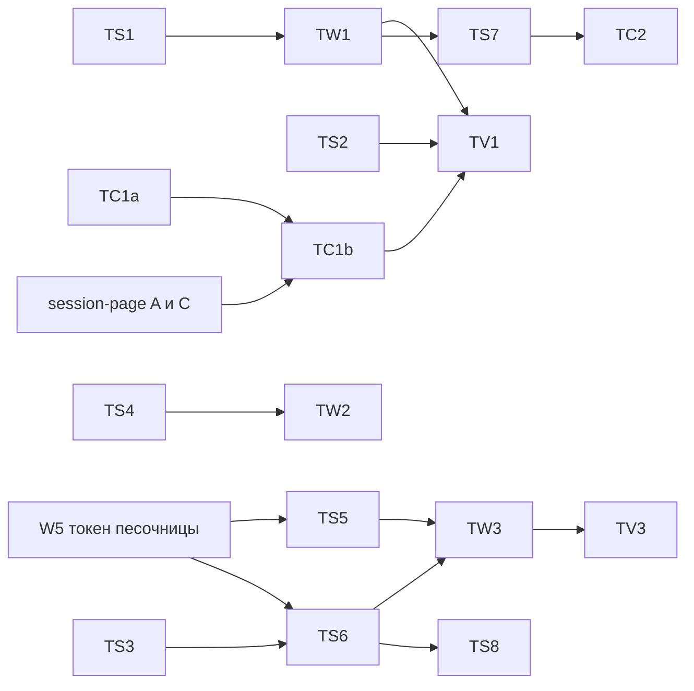

# Трейс работы агента

Владелец: «главное, чтобы был трейс работы агента». План даёт каждой сессии трейс. Это дерево на общей шкале времени: ход, внутри вызовы модели, вызовы инструментов, сабагенты и их ходы, подготовка песочницы, ожидание пользователя. У каждого узла есть длительность, статус, ошибка и детали. Трейс строится для любого harness: встроенный цикл Pi, ACP-агенты в песочнице (Claude Code, Codex, Gemini и другие), свои harness. Цены и стоимость в трейсе не считаем.

Сокращения путей: `P/` это `platform/`, `M/` это `P/apps/main-node/`, `H/` это `P/apps/agent/src/harness/`, `C/` это `P/apps/console/src/`, `CS/` это `C/components/session/`, `V/` это `.claude/skills/verify-agent-console/`.

Главные решения:

1. Трейс хранится в новой таблице `trace_spans`. Её пишут три источника: проектор сырых кадров harness, обёртка раннера (песочница и границы хода), приёмник OTLP (OpenTelemetry самих агентов).
2. Публичный поток событий `/v1/sessions/:id/events` не меняем. Трейс отдаёт отдельный маршрут `GET /v1/oma/sessions/:id/trace`.
3. Первая волна даёт трейс встроенного цикла Pi без OTel: проектор, таблица, маршрут, вкладка «Трейс», проверки в скилле.
4. OTel агентов приходит третьей волной, после токена сессии песочницы (W5).

## 1. Модель трейса

### 1.1 Трейс и спаны

Трейс равен сессии. `trace_id` сессии это первые 16 байт sha256 от id сессии в hex (32 знака), поэтому он одинаков во всех ходах, в экспорте и в `TRACEPARENT` для агента. Корень трейса это сама сессия, отдельной строки для неё нет.

| Вид (`kind`) | Подпись в консоли | Родитель | Начало и конец |
|---|---|---|---|
| `turn` | Ход | нет (верхний уровень) или `subagent` | начало первой попытки `start()` раннера; конец `session.status_idle`, `status_terminated` или `session.error` с `exhausted`. Ход потока: `session.thread_status_running` и `_idle` |
| `sandbox` | Песочница | `turn` | вызов `start()` раннера целиком, по попытке на строку |
| `sandbox_phase` | Выдача VM, Рабочая папка, Входы сессии, Старт VM, Пакеты окружения | `sandbox` | обёртки функций раннера и хук LiteBox |
| `harness_start` | Запуск агента | `turn` | ACP: процесс, `initialize`, `session/new` или `resume`, восстановление состояния |
| `acp_prompt` | Ход агента ACP | `turn` | пара `span.model_request_*` от `AcpTranslator` |
| `agent_step` | Шаг агента | `acp_prompt` | спан агента из OTel, например `claude_code.interaction` |
| `model_call` | Вызов модели | `turn`, `agent_step` или `subagent` | `span.model_request_start` и `_end` или OTel `chat`, `claude_code.llm_request` |
| `tool_call` | имя инструмента | тот же, что у вызовов модели хода | `agent.tool_use` (`mcp_`, `custom_`) и результат |
| `tool_wait` | Ожидание вас | `tool_call` | `agent.tool_use` с `evaluated_permission: ask` и `user.tool_confirmation` |
| `tool_exec` | Выполнение | `tool_call` | старт исполнения и результат |
| `subagent` | Сабагент «имя» | `tool_call`, породивший поток, иначе `turn` | `session.thread_created` и закрытие потока |
| `outcome_eval` | Оценка результата | `turn` | `span.outcome_evaluation_start` и `_end` |
| `compaction` | Сжатие контекста | `turn` или `agent_step` | `span.compaction_summarize_*` или событие OTel `compaction` |
| `retry_wait` | Пауза перед повтором | `turn` | `session.error` с `retrying` и начало следующей попытки |
| `hook` | Хук | `tool_call` или `agent_step` | OTel `claude_code.hook` |
| `event` | Ошибка, Предупреждение, Подключение MCP | любой | мгновенный узел, начало равно концу |

Инструменты и вызовы модели стоят рядом, на одном уровне под ходом. Так устроены `claude_code.interaction` и спаны GenAI (`execute_tool` рядом с `chat` под `invoke_agent`). Ожидание подтверждения может выйти за конец хода. Ход 1 заканчивается `requires_action`, подтверждение и результат приходят в ходе 2, а `tool_call` остаётся в ходе 1.

### 1.2 Поля спана

```ts
type TraceSpanKind = "turn" | "sandbox" | "sandbox_phase" | "harness_start" | "acp_prompt"
  | "agent_step" | "model_call" | "tool_call" | "tool_wait" | "tool_exec" | "subagent"
  | "outcome_eval" | "compaction" | "retry_wait" | "hook" | "event";
type TraceSource = "events" | "runner" | "otel" | "rollout";

interface TraceSpan {
  span_id: string;               // 16 hex
  parent_span_id: string | null;
  turn_id: string | null;        // id первого события, принятого в исполнение хода
  thread_id: string;             // "sthr_primary" или поток сабагента
  kind: TraceSpanKind;
  name: string;                  // ключ фазы, модель, имя инструмента, имя агента
  sources: TraceSource[];        // после слияния может быть два
  precision: "measured" | "by_events";
  start_ms: number;
  end_ms: number | null;         // null: узел ещё идёт
  status: "running" | "ok" | "error" | "denied" | "interrupted" | "cancelled" | "waiting";
  error: { type: string | null; message: string | null; retry_status?: "retrying" | "exhausted" } | null;
  harness: string | null;        // pi, ai-sdk, claude-acp, codex-acp...
  model: string | null;
  usage: { input: number; output: number; cache_read: number; cache_write: number } | null;
  ttft_ms: number | null;
  finish_reason: string | null;
  tool: { name: string; call_id: string; kind: "builtin" | "mcp" | "custom"; mcp_server: string | null } | null;
  primary_event_id: string | null; // событие для клика: tool_use, model_request_start, user.message
  event_ids: string[];           // все события узла, первое ввод, последнее результат
  attrs: Record<string, string | number | boolean>; // прочее, не больше 8 КБ JSON
  updated_at: number;
}
```

Аргументы и результат инструмента в спан не копируются. Консоль берёт их из событий `primary_event_id` (`agent.tool_use.input`) и последнего id в `event_ids` (`content` результата). Текст ошибки режется до 500 знаков, как в `model_calls`.

### 1.3 Идентификаторы

- `turn_id` равен id первого события, принятого в исполнение (`user.message`, `user.tool_confirmation`, `user.custom_tool_result`). Его знает обёртка раннера (поле `events` у `accept`), и его же можно найти по истории для старых сессий. Ход потока сабагента берёт id своего `session.thread_status_running`.
- `span_id` спана из событий равен первым 8 байтам sha256 от `session_id`, вида и ключа. Ключ это id события начала (`span.model_request_start`, `agent.tool_use`, `session.thread_created`) или `turn_id`. Повторный разбор тех же событий даёт те же id, поэтому запись идемпотентна.
- Спаны из OTel хранят свой `span_id` агента, а исходный `trace_id` агента кладут в `attrs.otel_trace_id`.
- `TRACEPARENT` для процесса агента: `00-<trace_id сессии>-<span_id хода>-01`.

### 1.4 Статусы

`running` у открытого узла. `ok` и `error` по факту. `denied` при `user.tool_confirmation` с `deny` или OTel `decision=reject`. `interrupted` у узла, который остался открытым к закрытию хода или к `user.interrupt`: конец ставится по времени закрытия. `cancelled` у попытки старта, снятой отменой. `waiting` у `tool_wait`, пока подтверждения нет. Узел с ошибкой поднимает до хода только признак `attrs.has_error`, статус хода берётся из `stop_reason`.

### 1.5 Совместимость с gen_ai

Внутри держим свои виды и поля. Соглашения OTel GenAI имеют статус Development (репозиторий `open-telemetry/semantic-conventions-genai`), имена могут поменяться, поэтому соответствие живёт в одном файле `M/src/lib/trace/genai.ts` и применяется при экспорте и при скачивании.

| Вид | Имя при экспорте | `gen_ai.operation.name` | Атрибуты |
|---|---|---|---|
| `turn`, `subagent` | `invoke_agent {агент}`, INTERNAL | `invoke_agent` | `gen_ai.agent.name`, `gen_ai.agent.id`, `gen_ai.conversation.id` равен id сессии |
| `acp_prompt` | `invoke_agent {harness}`, CLIENT | `invoke_agent` | `gen_ai.agent.name` равен id ACP-агента |
| `model_call` | `chat {модель}` | `chat` | `gen_ai.provider.name`, `gen_ai.request.model`, `gen_ai.response.id`, `gen_ai.response.finish_reasons`, `gen_ai.usage.*` |
| `tool_call` | `execute_tool {инструмент}` | `execute_tool` | `gen_ai.tool.name`, `gen_ai.tool.call.id`, `gen_ai.tool.type` |
| остальные | `oma.{вид}` | нет | только `oma.*` |

Токены. У нас `usage` в стиле Anthropic, вход без кэша. По `docs/gen-ai/anthropic.md` соглашений `gen_ai.usage.input_tokens` равен сумме входа, чтения и записи кэша, а кэш отдельно в `gen_ai.usage.cache_read.input_tokens` и `gen_ai.usage.cache_write.input_tokens`. Ошибка: статус ERROR и `error.type`. Наши поля идут как `oma.session.id`, `oma.turn.id`, `oma.thread.id`, `oma.kind`, `oma.precision`, `oma.event_ids`.

## 2. Откуда спаны

### 2.1 Общий проектор кадров

Обёртка `withTraceRecording(runner, recorder)` устроена как `withModelCallRecording` (`M/src/lib/analytics/recording-runner.ts`). Она видит сырые кадры `output` раньше белого списка `OFFICIAL_RUNTIME_EVENT_TYPES` (`P/packages/managed-agents-adapters-runtime/src/index.ts:67-104`, отсев в строке 232). Поэтому ей доступны поля, которые теряет публичный ответ: `model`, `finish_reason`, `error_message`, `provider_response_id`, `span.model_first_token`, `span.compaction_summarize_*`. Кадры сабагентов идут через тот же `output` с `session_thread_id`.

| Кадр | Что делает проектор |
|---|---|
| `start()` раннера (обёртка) | открывает `sandbox`; повтор старта даёт новую строку и `retry_wait` между ними |
| функции раннера `buildSandbox`, `workspaceCheckpoints.materialize` и `attach`, `prepareSandbox` | `sandbox_phase` `acquire`, `restore`, `inputs`; тёплая песочница даёт `sandbox` с `attrs.reused=true` и длительностью около нуля |
| `accept()` раннера | открывает `turn` с `turn_id`, подвешивает к нему открытые `sandbox` этой сессии |
| `span.model_request_start` | открывает `model_call` (у ACP `acp_prompt`) |
| `span.model_first_token` | `ttft_ms` |
| `span.model_request_end` | закрывает вызов: токены, `finish_reason`, ошибка, модель |
| `agent.tool_use`, `agent.mcp_tool_use`, `agent.custom_tool_use` | открывает `tool_call`; при `evaluated_permission: ask` ещё `tool_wait` |
| `user.tool_confirmation` | закрывает `tool_wait`, при `deny` статус `denied` |
| `span.tool_execution_start` (новый, волна 1) | открывает `tool_exec` |
| `agent.tool_result` и аналоги | закрывают `tool_exec` и `tool_call`, `is_error` даёт `error` |
| `session.thread_created` | `subagent` под `tool_call` с `parent_tool_use_id`, иначе под ходом |
| `session.thread_status_running`, `_idle`, `_terminated` | ход потока под `subagent` |
| `span.outcome_evaluation_*`, `span.compaction_summarize_*` | `outcome_eval`, `compaction` |
| `session.error`, `session.warning` | `event`; при `exhausted` ход закрывается с ошибкой |
| `session.status_idle`, `status_terminated`, `user.interrupt` | закрывают ход, открытые потомки получают `interrupted` |

Запись в таблицу пачками раз в 250 мс на сессию, плюс сброс до возврата `accept`. Тогда к моменту `session.status_idle` в потоке все спаны хода уже в базе. Сбой записи не валит ход, он пишется в лог `main-node.trace.record_failed`.

### 2.2 Встроенный цикл Pi

События уже есть, трейс строится проектором без OTel. В установленном `@earendil-works/pi-agent-core` 1.1.0 OTel нет, `pi-telemetry` даёт только контракт без экспортёра. Правки `H/pi-loop.ts` (волна 1, маленькие):

- на `tool_execution_start` слать кадр `span.tool_execution_start {tool_use_id, name}`. Его нет в белом списке, в историю он не попадёт, как сейчас `span.model_first_token` (`H/pi-loop.ts:480-492`);
- в `agent.tool_result` добавить `duration_ms` из `tool_execution_end.durationMs`, в `span.model_request_end` добавить `duration_ms` из `AssistantMessage.durationMs` (типы `pi-agent-core` 1.1.0, `dist/types.d.ts:474-494`). Проектор пишет их в `attrs.harness_duration_ms` для сверки.

Без этих правок трейс Pi тоже работает, но `tool_call` начинается на `message_end`, а не на старте исполнения (`H/pi-loop.ts:415-421`).

Устаревший цикл `ai-sdk` пишет те же типы событий и попадает в трейс тем же проектором.

### 2.3 ACP-агенты: события

`AcpTranslator` даёт одну пару `span.model_request_*` на весь ход (`H/acp-translate.ts:123-132`). Проектор знает harness хода и кладёт эту пару в `acp_prompt`, а не в `model_call`. Так она не спорит с настоящими вызовами модели из OTel. Токены `PromptResponse.usage` остаются на `acp_prompt`.

Правки волны 2 (без OTel):

- `H/acp-translate.ts`: на каждый `tool_call` и `tool_call_update` слать кадр `span.acp_tool_update {tool_call_id, status, at_ms, kind, parent_tool_use_id}`. `parent_tool_use_id` берётся из `_meta.claudeCode.parentToolUseId` (claude-agent-acp, `stampParentToolUseId`). Публичные `agent.tool_use` и `agent.tool_result` не меняются. Проектор открывает `tool_call` по первому кадру и `tool_exec` по `in_progress`, поэтому длительность инструмента перестаёт быть около 1 мс.
- `H/acp-sandbox-loop.ts`: вокруг запуска процесса, `initialize`, открытия сессии и восстановления и снятия нативного состояния слать `span.harness_phase {phase, start_ms, end_ms, error}`. Время сейчас пишется только в stderr (`[acp-init]`, `[acp-runtime] total_ms` в `@openma/common` 0.9.1).
- `P/packages/sandbox-adapter-litebox/src/litebox.ts`: необязательный колбэк `onPhase(name, startMs, endMs, attrs)` для старта VM, закрепления хостов, загрузки CA и установки пакетов. VM стартует лениво внутри первого `exec`, снаружи это время не отделить.
- `M/src/lib/node-managed-session-runner.ts`: `delegateToAgent` передаёт id вызова в `subagents.create`, как `openai-subagents.ts`. Тогда поток сабагента висит под своим `tool_call`.

### 2.4 ACP-агенты: OpenTelemetry агента

Каждый процесс агента получает окружение из плана телеметрии, по образцу `InferenceConfigAdapter.plan()` (`P/packages/harness-inference-adapters`). Токен и `TRACEPARENT` добавляет `H/acp-sandbox-loop.ts` при запуске процесса из нового поля `HarnessContext.trace`. В `_oma.acp.agent.env` токен не кладём: конфигурация агента отдаётся API целиком.

Claude Code (`claude-acp`, claude-agent-acp 0.91.0 закреплён, внутри Claude Code 2.1.300). Адаптер отдаёт своё окружение процессу Claude Code (`acp-agent.ts` тега v0.91.0, строки 10861..10901).

```sh
CLAUDE_CODE_ENABLE_TELEMETRY=1
CLAUDE_CODE_ENHANCED_TELEMETRY_BETA=1
OTEL_TRACES_EXPORTER=otlp
OTEL_LOGS_EXPORTER=otlp
OTEL_METRICS_EXPORTER=none
OTEL_EXPORTER_OTLP_PROTOCOL=http/protobuf
OTEL_EXPORTER_OTLP_ENDPOINT=$SANDBOX_GATEWAY_BASE_URL/v1/oma/otlp
OTEL_EXPORTER_OTLP_HEADERS=x-oma-trace-token=<токен>   # без пробела в значении
OTEL_TRACES_EXPORT_INTERVAL=1000
OTEL_LOGS_EXPORT_INTERVAL=1000
OTEL_RESOURCE_ATTRIBUTES=oma.session_id=<id>,oma.turn_id=<id>
TRACEPARENT=00-<trace_id сессии>-<span_id хода>-01
```

Гейты содержимого `OTEL_LOG_USER_PROMPTS`, `OTEL_LOG_ASSISTANT_RESPONSES`, `OTEL_LOG_TOOL_DETAILS`, `OTEL_LOG_TOOL_CONTENT`, `OTEL_LOG_RAW_API_BODIES` не задаём. В VM лежит токен модели, и вывод `env` попал бы в `tool.output`.

| Спан или событие Claude Code | Наш узел | Статус |
|---|---|---|
| `claude_code.interaction` | `agent_step` под `acp_prompt` | всегда UNSET, итог берём у нас |
| `claude_code.llm_request` | `model_call`: `model`, `input_tokens`, `output_tokens`, `cache_read_tokens`, `cache_creation_tokens`, `ttft_ms`, `stop_reason`, `request_id` | `success`, `status_code`, `error`, `error_class` |
| `claude_code.tool` | `tool_call`, слияние с событием по `tool_use_id` | по детям |
| `claude_code.tool.blocked_on_user` | `tool_wait` | `decision=reject` даёт `denied` |
| `claude_code.tool.execution` | `tool_exec` | `success`, `error`, `error_class` |
| `claude_code.hook` | `hook` | ERROR при сбое |
| спаны подагента (`agent_id`, `parent_agent_id`) | под `tool_call` инструмента Agent или Task | как выше |
| логи `compaction`, `mcp_server_connection` | `compaction`, `event` с `duration_ms` | `success`, `status` |
| логи `api_error`, `api_retries_exhausted` | `error` у `model_call` по `request_id` | |
| лог `api_request` | `model_call` из лога, если трассы беты пропали: конец равен времени записи, начало раньше на `duration_ms` | |

Codex (`codex-acp` v0.16.0). По коду `codex-acp` не вызывает `build_provider` (`src/lib.rs:29`), поэтому секция `[otel]` в `config.toml` через ACP ничего не отправит. Путь: переменная `CODEX_ROLLOUT_TRACE_ROOT=<папка состояния сессии>`. После хода harness запускает в VM `codex debug trace-reduce <бандл>`, читает `state.json` через `sandbox.exec` и шлёт кадр `span.rollout_trace` только со структурными полями: потоки (подагенты), ходы, `inference_calls` с `ExecutionWindow`, `tool_calls`, сжатия. Бандл содержит промпты и вывод терминала, сам бандл на сервер не уходит. Источник `rollout`. Волна 4, сначала короткий опыт.

Gemini CLI. Переменные `GEMINI_TELEMETRY_ENABLED=true`, `GEMINI_TELEMETRY_TARGET=local`, `GEMINI_TELEMETRY_OTLP_ENDPOINT=$SANDBOX_GATEWAY_BASE_URL/v1/oma/otlp`, `GEMINI_TELEMETRY_OTLP_PROTOCOL=http`, `GEMINI_TELEMETRY_OTLP_HEADERS` с токеном, `GEMINI_TELEMETRY_LOG_PROMPTS=false` (по умолчанию `true`), `GEMINI_TELEMETRY_TRACES_ENABLED` не задаём (с `true` в спаны идут `gen_ai.input.messages`). `TRACEPARENT` Gemini не читает по документации, ход находим по времени. Отображение по `gen_ai.operation.name`: `llm_call` в `model_call`, `tool_call` в `tool_call` (`gen_ai.tool.call_id`), `agent_call` в `subagent`, `user_prompt` в `agent_step`, остальное в `attrs`.

Остальные ACP-агенты (OpenCode, MiMo, Hermes, Aider, Kimi, MiniMax, pi-acp) пока дают только события: `acp_prompt` и инструменты. OpenCode и Hermes умеют OTel, но в режиме `acp` это не подтверждено, их подключаем после проверки тем же приёмником.

### 2.5 Свои harness

- Минимум без работы: harness пишет события через `runtime.broadcast` (`H/interface.ts:113-178`), проектор строит ходы, вызовы и инструменты как для Pi.
- Спаны gen_ai внутри процесса main-node: `HarnessContext.trace.tracer` даёт `Tracer` из `@opentelemetry/api` с родителем `turn`. Процессор спанов переводит `ReadableSpan` тем же отображением, что приёмник, и пишет в `trace_spans`. Подходят `@ai-sdk/otel`, экспортёр Mastra, Pydantic AI и другие библиотеки, которые пишут `invoke_agent`, `chat`, `execute_tool`.
- Harness в песочнице шлёт OTLP в приёмник с токеном сессии, как ACP-агенты.
- Отображение по `gen_ai.operation.name`: `chat`, `text_completion`, `generate_content` в `model_call`; `execute_tool` в `tool_call`; `invoke_agent` в `agent_step` или `subagent`, если у него есть родитель-инструмент; остальное в `attrs` родителя.

### 2.6 Приёмник OTLP в main-node

- Пути: `POST /v1/oma/otlp/v1/traces` и `POST /v1/oma/otlp/v1/logs`. Экспортёры дописывают `/v1/traces` к `OTEL_EXPORTER_OTLP_ENDPOINT` сами. Монтировать до `v1.route("/oma/sessions", ...)` в `M/src/modules/node-http.ts`.
- Форматы: `application/json` (http/json, id в hex) и `application/x-protobuf` (http/protobuf), `Content-Encoding: gzip`. Иначе 415. Ответ того же формата, при частичном приёме `partial_success` с `rejected_spans` или `rejected_log_records`. Разбор protobuf: `protobufjs` (7.5.6 уже стоит в `node_modules` транзитивно, сделать прямой зависимостью) и `.proto` из `open-telemetry/opentelemetry-proto` с закреплённым тегом. `@opentelemetry/otlp-transformer` 0.222.0 умеет только кодировать запрос и читать ответ.
- Привязка только по токену сессии песочницы (W5). Токен берётся из `x-oma-trace-token` или `Authorization: Bearer`. Пространство и сессию даёт только токен. `session.id`, `gen_ai.conversation.id` и прочие поля тела привязку не меняют.
- Отказы: нет токена, токен испорчен или просрочен даёт 401. Действующий ключ другого типа (ключ пользователя, ключ пространства, токен без области `trace`) даёт 403. `oma.session_id` в ресурсе не равен сессии токена: 403, ничего не пишется. Сессия в архиве или удалена: 403.
- Лимиты: тело не больше 1 МиБ, после распаковки не больше 8 МиБ (иначе 413); в запросе не больше 2000 спанов и 5000 записей лога; на токен не больше 10 запросов в секунду с запасом 20 (иначе 429 с `Retry-After`); на сессию не больше 50 000 спанов OTel всего и 5000 на ход, лишнее отклоняется через `partial_success`; у спана не больше 64 атрибутов, значение до 1 КБ, имя до 128 знаков, событий спана не больше 16; начало спана в окне от создания сессии минус 1 минута до текущего времени плюс 5 минут.
- Без текстов промптов. Фильтр удаляет атрибуты и события с содержимым: `user_prompt`, `prompt`, `prompt_text`, `response`, `gen_ai.input.messages`, `gen_ai.output.messages`, `gen_ai.system_instructions`, `gen_ai.tool.call.arguments`, `gen_ai.tool.call.result`, `tool_input`, `tool_parameters`, `full_command`, событие `tool.output`, тела `api_request_body` и `api_response_body`. Фильтр отключается только настройкой пространства «Сохранять тексты» (раздел 5), по умолчанию она выключена.
- Ход для спана: родитель из `TRACEPARENT`, если он равен `span_id` хода этой сессии и время спана внутри хода. Иначе ход, в окно которого попадает начало спана, в потоке `sthr_primary`. Корневой спан агента (`agent_step`) встаёт под `acp_prompt` найденного хода, если он есть. Так работает и процесс ACP, который живёт несколько ходов (кэш harness из плана `models-harness-analytics.md`, раздел 2.4, пункт 4).
- Часы VM. Если конец `agent_step` расходится с концом `acp_prompt` больше чем на 200 мс, все спаны этого процесса (ресурс `service.instance.id`) сдвигаются на разницу. Сдвиг пишется в `attrs.clock_shift_ms`.
- Доверие. Спаны OTel пишет процесс в VM, где идёт чужой код. Токен даёт писать только в свою сессию. В консоли у таких узлов подпись «со слов агента». В аналитику и счёт токенов они не идут.
- Сеть. Для окружения «Ограниченный» хост шлюза нужен в разрешённых хостах на порту 80 или 443 (BoxLite 0.9.0 пропускает по имени только эти порты, `docs/runbook-claude-code-sandbox.md`). Тот же адрес нужен для прокси модели.

### 2.7 Как избежать дублей

1. `span_id` спанов из событий детерминирован. Повторная запись и разбор истории не создают копий.
2. Вызов инструмента сливается по `tool.call_id`: строка из OTel даёт время, детей и статус, строка из событий даёт `primary_event_id` и `event_ids`. Ошибка из любого источника побеждает. В ответе одна строка с `sources: ["events","otel"]`.
3. Ход ACP из событий это `acp_prompt`, а не `model_call`, поэтому вызовы модели из OTel его не повторяют. Итог токенов хода считается по `model_call`, если они есть, иначе по `acp_prompt`.
4. Свой harness, который пишет и события, и `chat`: строки сливаются по `provider_response_id` и `gen_ai.response.id`. Если в ходе есть вызовы модели из OTel, вызовы из событий без пары скрываются.
5. Логи OTel не дают новых узлов, кроме `compaction`, `event` и запасного `model_call` из `api_request`. Запасной вызов скрывается, если есть `claude_code.llm_request` с тем же `request_id`.

## 3. Хранение

Решение: таблица `trace_spans`, а не расчёт на лету.

Причины:

1. Спаны OTel не события, их всё равно надо где-то хранить.
2. Поля, которые трейсу нужны, отбрасывает белый список и строгий контракт ответа (`P/packages/managed-agents-api/src/contracts/session-events.ts:516-534`). Добавлять их в публичный поток значит менять контракт формы Anthropic, на котором стоит клиент консоли.
3. Фазы песочницы и время старта инструмента вообще не события.
4. Расчёт на лету читает всю историю при каждом открытии (до 500 страниц по 100 событий) и не даёт курсора для живого обновления.

Старые сессии и ходы без записанных спанов (например, сбой записи) маршрут строит на лету тем же проектором из сохранённой истории с `precision: "by_events"`. Миграции истории не нужно.

Схема живёт по образцу `ensureAnalyticsSchema` (`M/src/lib/analytics/schema.ts`): свой список миграций и своя таблица `trace_schema_migrations`, SQLite и Postgres. На MySQL запись и маршрут выключены, как у аналитики.

```sql
CREATE TABLE IF NOT EXISTS trace_spans (
  workspace_id TEXT NOT NULL,
  session_id TEXT NOT NULL,
  span_id TEXT NOT NULL,
  parent_span_id TEXT,
  turn_id TEXT,
  thread_id TEXT NOT NULL,
  kind TEXT NOT NULL,
  name TEXT NOT NULL,
  source TEXT NOT NULL,            -- events, runner, otel, rollout
  precision TEXT NOT NULL,
  start_ms BIGINT NOT NULL,
  end_ms BIGINT,
  status TEXT NOT NULL,
  error_type TEXT,
  error_message TEXT,
  harness TEXT,
  model TEXT,
  input_tokens BIGINT, output_tokens BIGINT, cache_read_tokens BIGINT, cache_write_tokens BIGINT,
  ttft_ms BIGINT,
  finish_reason TEXT,
  tool_name TEXT,
  tool_call_id TEXT,
  primary_event_id TEXT,
  event_ids TEXT NOT NULL,         -- JSON-массив
  attrs TEXT NOT NULL,             -- JSON, до 8 КБ
  updated_at BIGINT NOT NULL,
  PRIMARY KEY (workspace_id, session_id, span_id)
);
CREATE INDEX IF NOT EXISTS trace_spans_session_updated_idx ON trace_spans (workspace_id, session_id, updated_at);
CREATE INDEX IF NOT EXISTS trace_spans_session_turn_idx ON trace_spans (workspace_id, session_id, turn_id, start_ms);
CREATE INDEX IF NOT EXISTS trace_spans_session_call_idx ON trace_spans (workspace_id, session_id, tool_call_id);
CREATE INDEX IF NOT EXISTS trace_spans_ws_updated_idx ON trace_spans (workspace_id, updated_at);
```

Индексы: первый для курсора живого обновления, второй для подгрузки хода, третий для слияния по вызову, четвёртый для очистки. Запись через `INSERT ... ON CONFLICT (workspace_id, session_id, span_id) DO UPDATE`. Срок хранения `TRACE_RETENTION_DAYS`, по умолчанию 30, очистка раз в сутки. Спаны удаляются вместе с сессией.

Маршрут `GET /v1/oma/sessions/:id/trace` (права как у чтения сессии):

```json
{
  "trace_id": "4bf92f3577b34da6a3ce929d0e0e4736",
  "session_id": "sesn_01...",
  "spans": [],
  "loaded_turn_ids": ["evt_..."],
  "cursor": 1792150000123,
  "truncated": false
}
```

- без параметров: все `turn` и `subagent` и полные поддеревья последних 5 ходов;
- `?turn_id=<id>`: поддерево одного хода (консоль грузит при раскрытии);
- `?after=<cursor>`: все спаны с `updated_at` не меньше курсора, клиент сливает по `span_id`;
- не больше 5000 спанов в ответе, иначе `truncated: true`;
- слияние из раздела 2.7, сдвиг часов и привязка сирот по времени делаются при чтении, в `M/src/lib/trace/merge.ts`.

`GET /v1/oma/sessions/:id/trace/otlp.json` отдаёт весь трейс одним `ExportTraceServiceRequest` в JSON по отображению 1.5. Это кнопка «Скачать трейс».

## 4. Вид в консоли

### 4.1 Место на странице

Страница сессии переделывается по [session-page.md](session-page.md): слева колонка разговора с поиском и мини-картой, справа инспектор 480 px. Водопад в инспектор не помещается. Поэтому над лентой стоит переключатель «Разговор» и «Трейс», параметр адреса `?view=trace`, клавиша T. В режиме «Трейс» колонка разговора целиком занята трейсом. Шапка и инспектор остаются, вкладка «События» инспектора показывает выбранное событие.

### 4.2 Дерево и водопад

- Строка 24 px. Слева дерево (не уже 240 px): шеврон, иконка вида, подпись, статус, серым модель или аргумент инструмента (`toolInputPreview` из `C/lib/session-stats.ts`). В середине полоса на общей шкале. Справа колонка «Длительность» 72 px (`formatShortDurationRu`).
- Цвет полосы по виду: ход `--color-ink-300`, вызов модели `--color-sky-300` (как сегменты мини-карты), инструмент `--color-emerald-300`, сабагент `--color-brand-300`, песочница и запуск агента `--color-ink-400`, ожидание и пауза перед повтором `--color-amber-300`. Ошибка любого вида: полоса `--ddc-dot-danger`, подпись `--ddc-danger-text`. Отклонено и прервано: `--ddc-dot-neutral`. Выбранная строка `--ddc-selected-bg` и рамка `--ddc-ring`.
- Открытый узел тянется до текущего времени, правый край штрихом.
- Узел по событиям помечен «≈», узел из OTel подписью «со слов агента» в деталях.
- Сабагент вложен веткой под вызовом инструмента, внутри его ходы со своими вызовами. Кнопка «Открыть поток» переключает ленту на поток (`activeThreadId` страницы).
- Простой длиннее 60 с сжимается в зазор 6 px, как в мини-карте (`compressedScale` из `CS/TranscriptMinimap.tsx` как образец, своя функция в `C/lib/trace-tree.ts`).
- Свой список с окном видимых строк (фиксированная высота строки), новых зависимостей нет. Старая «Хронология» зависала на длинных ходах без этого.

### 4.3 Выбор и детали

Клик по строке:

1. выделяет строку и открывает панель деталей внизу колонки трейса (40 % высоты);
2. вызывает `onSelectEvent(span.primary_event_id, "trace")`. Адрес получает `?event=<id>`, вкладка «События» инспектора выделяет строку и показывает JSON (раздел 7 session-page.md);
3. кнопка «В разговоре» в деталях ставит `?view=conversation` и повторяет выбор, лента прокручивает блок к центру.

Детали по виду: время начала (`formatEventDateTimeRu` с миллисекундами), длительность, статус, текст ошибки. Вызов модели: модель, токены вход, выход, кэш, TTFT, причина остановки. Инструмент: ввод из `agent.tool_use` (`CodeBlock`), результат через `formatToolOutput` (`C/lib/tool-output.ts`), ожидание и выполнение отдельно. Песочница: фазы, образ, пакеты, `reused`. Узел OTel: таблица `attrs`. Внизу «Копировать ID» и источник.

### 4.4 Свёртка, фильтр, поиск, масштаб

- Свёртка: по шеврону, «Свернуть всё» и «Развернуть всё», клавиши `[` и `]` для всех, `o` и `p` для текущего узла (как в Jaeger UI). По умолчанию раскрыт последний ход, старые свёрнуты, ветки сабагентов свёрнуты.
- Фильтр: чипы «Ход», «Модель», «Инструмент», «Сабагент», «Песочница», «Ожидание» и переключатель «Только ошибки». Предки найденных узлов остаются приглушёнными.
- Поиск «Найти в трейсе»: имя, инструмент, модель, `span_id`, id события, текст ошибки. Счётчик «3/12», Enter и Shift Enter, найденный узел раскрывает предков и прокручивается.
- Масштаб: «Мельче», «Крупнее», выделение участка мышью на шкале, «Весь ход» по выбранному ходу.
- Клавиши ↑ ↓ двигают выбор, ← → сворачивают и раскрывают, Enter выбирает. Дерево `role="treegrid"`, у строк `aria-level`, `aria-expanded`, `aria-selected`.

### 4.5 Живое обновление

Пока сессия `running` или есть открытые узлы, консоль раз в секунду запрашивает `?after=<cursor>`. Событие живого потока `span.*`, `agent.tool_*`, `session.status_*`, `session.thread_*` вызывает внеочередной запрос с задержкой 250 мс. Открытые полосы растут по таймеру 250 мс. Переключатель «Следить за ходом» держит в виду последнюю строку, пока пользователь не прокрутил сам. После `session.status_idle` опрос останавливается.

### 4.6 Узкий экран 390 px

Список без водопада: подпись и длительность, полоса доли от хода под подписью. Детали нижним листом, как инспектор. Горизонтальной прокрутки нет.

### 4.7 Связь со страницей сессии, «Хронология» и «Траектория»

- Единицы A, B, C из session-page.md уже идут (неотслеживаемые `CS/SessionHeader.tsx`, `CS/TranscriptMinimap.tsx`, `CS/inspector/`, `C/lib/session-stats.ts`). Трейс не меняет их файлы до слияния. После слияния правки точечные: значение `"trace"` в `SelectionSource` (`C/lib/session-stats.ts`), переключатель в `C/pages/SessionDetail.tsx`, пункт меню в `CS/SessionHeader.tsx`.
- Пункт 2 раздела 9 session-page.md (модель, причина и текст ошибки вызова модели) трейс закрывает в деталях узла без правки публичного контракта. JSON события во вкладке «События» остаётся без этих полей.
- «Хронология»: вкладку убирает единица A. Файлы `C/components/timeline/*` уже ни откуда не импортируются, их удаляет единица трейса TC1b.
- «Траектория»: маршрут `GET /v1/oma/sessions/:id/trajectory` читает старую таблицу `session_events`, для сессий консоли он, вероятно, пуст (не проверено). Пункт «Траектория» в меню «⋮» заменяем на «Скачать трейс» (OTLP JSON). `TrajectoryViewerModal` со страницы убираем, маршрут остаётся в API для оценок.
- Проверка `run.ui_timeline` в скилле переходит в `run.ui_trace`.

## 5. Экспорт во внешние системы

Вторым шагом, по желанию, волна 4.

- Настройка пространства «Экспорт трейсов»: включено, адрес OTLP/HTTP, протокол (`http/protobuf` или `http/json`), заголовки (секрет, шифр `secrets.cipherFor("trace.export")`, в ответах API маскируется), «Сохранять тексты» (выключено). Таблица `trace_settings`, маршруты `GET` и `PUT /v1/oma/trace/settings` для админа пространства.
- Отправка с сервера, не из VM. После закрытия хода спаны хода переводятся по 1.5 и уходят одним запросом на `<адрес>/v1/traces`. Повтор три раза с паузой 2, 4, 8 с при 429 и 5xx. Состояние в таблице `trace_exports (workspace_id, session_id, turn_id, status, attempts, last_error, exported_at)`.
- Пресеты: Langfuse `https://<хост>/api/public/otel`, заголовок `Authorization: Basic base64(<public key>:<secret key>)`, только HTTP; Phoenix `http://<хост>:6006/v1/traces`; Jaeger `http://<хост>:4318/v1/traces`.
- Один `trace_id` на сессию, поэтому ходы сессии во внешней системе лежат одним трейсом. `gen_ai.conversation.id` равен id сессии.
- Встраивать чужой интерфейс не будем. Phoenix под Elastic License 2.0 нельзя отдавать клиентам как сервис. Внешние системы только принимают экспорт.

## 6. Проверка без настоящей модели

Скилл `verify-agent-console`, режим `fake`. Все проверки жёсткие: несовпадение даёт «провал». «Не проверено» только при отсутствии условия среды (нет сети до npm для Claude Code), с причиной.

Набор волны 1, новый сценарий `V/scripts/journey-trace.mjs` (`journey.sh --scenario trace`). Агент на встроенном цикле, сообщение `VERIFY_AGENT_RUN nonce=<n>` с `Команда: echo VERIFY_OK_<n>` и строкой `Пауза: 1500` (новое в `fake-model.mjs`: задержка ответа на первом запросе). Фейковая модель отвечает двумя запросами: `tool_use` bash, затем текст.

| id | Условие |
|---|---|
| `trace.api_shape` | `GET /v1/oma/sessions/:id/trace` даёт 200, `trace_id` из 32 hex, у каждого спана `span_id` из 16 hex, каждый `parent_span_id` есть в ответе или равен null у хода |
| `trace.turn_tree` | ровно один `turn` с `turn_id` равным id `user.message`; прямо под ним не меньше одного `sandbox`, ровно 2 `model_call` и ровно 1 `tool_call` с `tool.name = bash` |
| `trace.order` | конец `sandbox` не позже начала первого вызова модели; вызов 1 кончается не позже начала bash; bash кончается не позже начала вызова 2; вызов 2 кончается не позже конца хода; всё в пределах 5 мс |
| `trace.durations` | длительность каждого вызова модели равна разности `processed_at` его `span.model_request_end` и `_start` из `/events` в пределах 50 мс; bash равен разности `agent.tool_result` и `agent.tool_use` в пределах 50 мс; конец хода равен `processed_at` `session.status_idle` в пределах 50 мс |
| `trace.event_links` | `primary_event_id` вызовов модели равны id `span.model_request_start`, у bash равен id `agent.tool_use`, последний id в `event_ids` bash равен id `agent.tool_result` |
| `trace.model_fields` | у обоих вызовов `model` равна модели агента, вход 10 и выход 5 (числа фейковой модели), `finish_reason` первого `tool_use`, второго `end_turn` |
| `trace.live` | во время паузы фейковой модели вкладка «Трейс» показывает узел «Вызов модели» со статусом «идёт», после ответа он закрыт без перезагрузки страницы |
| `trace.ui_rows` | на вкладке видны строки «Ход», две «Вызов модели» и «bash» в этом порядке, скриншот и ARIA-снимок |
| `trace.ui_click_event` | клик по строке bash ставит в адрес `event=<id agent.tool_use>`, во вкладке «События» эта строка `aria-selected`; «В разговоре» прокручивает к блоку с `data-event-id` этого вызова |
| `trace.tool_error` | второй ход с `Команда: false`: узел bash со статусом `error` и красной подписью (`--ddc-danger-text`) |
| `trace.phone` | 390 px, нет горизонтальной прокрутки, детали открываются нижним листом |

Набор волны 3, OTLP. Новый клиент `V/scripts/otlp-client.mjs` на официальных экспортёрах `@opentelemetry/exporter-trace-otlp-proto` и `-http` (0.222.0, есть в `node_modules`). Токен выдаёт `M/scripts/mint-sandbox-token.ts` на секрете прогона, скрипт отказывает при `NODE_ENV=production`.

| id | Условие |
|---|---|
| `otlp.accept_proto` | клиент шлёт `invoke_agent` с детьми `chat` и `execute_tool` (известные имена, `gen_ai.*`, длительности 300, 120, 40 мс) с токеном сессии: 200, спаны в дереве под ходом, длительности совпадают до 1 мс, источник `otel` |
| `otlp.accept_json` | тот же набор по http/json даёт тот же результат |
| `otlp.merge` | `execute_tool` с `gen_ai.tool.call.id`, равным id `agent.tool_use` из сессии, даёт одну строку с `sources` events и otel |
| `otlp.reject_no_token` | без токена 401, число спанов сессии не изменилось |
| `otlp.reject_foreign` | токен сессии B и `oma.session_id` сессии A: 403; ключ пользователя: 403; просроченный токен: 401; трейс A не изменился |
| `otlp.limits` | тело 2 МиБ даёт 413; 40 запросов за секунду дают 429 с `Retry-After` |
| `otlp.no_content` | атрибуты `gen_ai.input.messages` и `user_prompt` с маркером `SECRET_<n>` отправлены; в ответе маршрута и в базе прогона маркера нет |

Claude Code в VM, сценарий `claude-code` (фейковая модель, окружение с `@agentclientprotocol/claude-agent-acp`):

| id | Условие |
|---|---|
| `cc.otel_spans` | после хода в трейсе есть `agent_step` под `acp_prompt` хода, не меньше одного `model_call` с источником `otel`, `tool_call` Write и Read со слиянием по `tool_use_id` и длительностью больше 0 |
| `cc.bash_denied` | вызов Bash имеет статус `denied` или `error` (фейковая модель ждёт отказ) |
| `cc.traceparent` | родитель `agent_step` равен ходу из `TRACEPARENT`; иначе «внимание» с пометкой «привязка по времени» |
| `cc.no_prompt_text` | ни один атрибут трейса не содержит `VERIFY_CLAUDE_CODE` |
| `cc.harness_phases` | под ходом есть `harness_start` с фазами процесса и открытия сессии (волна 2) |

## 7. Единицы работы

Файлы единиц не пересекаются. Чужие файлы только импортируются. Перед стартом единица смотрит `git status --short` своих файлов. Файлы, которые сейчас правят другие работы (`M/src/modules/node-managed.ts`, `node-http.ts`, `H/acp-translate.ts`, `litebox.ts`, файлы скилла), трогают только единицы подключения после коммита этих правок.

Внешние зависимости:

- страница сессии (session-page.md): A и C для TC1b, B для прокрутки ленты при выборе с `source: "trace"`;
- W5, токен сессии песочницы. В документах репозитория W5 не описана, здесь берём описание из `models-harness-analytics.md`, раздел 2.4, пункт 2 и единица S2 (`M/src/lib/sandbox-inference-token.ts`). От W5 нужны выпуск и проверка токена с областями (`inference`, `trace`) и допуск в `P/packages/auth/src/index.ts` на путях `/v1/oma/otlp/*`;
- `SANDBOX_GATEWAY_BASE_URL` из единицы SW того же плана.

| Единица | Кто | Волна | Что | Зависит от | Оценка |
|---|---|---|---|---|---|
| TS1 | Opus | 1 | модель, проектор, таблица, маршрут, обёртка раннера | нет | 1,5 дня |
| TS2 | Codex | 1 | кадры Pi: старт инструмента и длительности | нет | 0,5 дня |
| TC1a | Sonnet | 1 | вкладка «Трейс» на фикстуре | контракт раздела 3 | 2 дня |
| TW1 | Opus | 1 | подключение TS1 в main-node | TS1, коммит чужих правок | 0,5 дня |
| TC1b | Sonnet | 1 | встройка в страницу сессии, удаление «Хронологии», «Скачать трейс» | TC1a, A, C | 0,5 дня |
| TV1 | Opus | 1 | проверки волны 1 в скилле | TW1, TS2, TC1b | 1 день |
| TS3 | Opus | 2 | кадры ACP: инструменты, фазы запуска, сабагенты Claude Code | коммит `acp-translate.ts` | 1 день |
| TS4 | Codex | 2 | фазы LiteBox, id вызова для сабагента | коммит `litebox.ts` | 1 день |
| TW2 | Opus | 2 | подключение фаз LiteBox | TS4, TW1 | 0,25 дня |
| TS5 | Opus | 3 | приёмник OTLP, отображение, лимиты, фильтр | W5, TS1 | 2 дня |
| TS6 | Codex | 3 | планы телеметрии агентов, `HarnessContext.trace` | TS3, W5 | 1,5 дня |
| TW3 | Opus | 3 | подключение приёмника и контекста трейса | TS5, TS6, SW | 0,5 дня |
| TV3 | Opus | 3 | проверки OTLP и Claude Code | TW3 | 1,5 дня |
| TS7 | Codex | 4 | экспорт и настройки | TW1 | 1,5 дня |
| TC2 | Sonnet | 4 | страница «Экспорт трейсов» | TS7 | 1 день |
| TS8 | Codex | 4 | опыт с бандлом Codex | TS6 | 1,5 дня |



Волны по календарю: волна 1 около 3 дней (TS1, TS2, TC1a параллельно, потом TW1 и TC1b, потом TV1), волна 2 около 2 дней, волна 3 около 4 дней после W5, волна 4 около 3 дней. Волна 2 может идти параллельно с концом волны 1.

### TS1. Модель, проектор, хранение, маршрут (сервер, Opus)

Файлы, все новые: `M/src/lib/trace/types.ts`, `ids.ts`, `projector.ts`, `store.ts`, `recorder.ts`, `merge.ts`, `routes.ts`, `genai.ts`, `index.ts`; тесты `M/test/trace-projector.test.ts`, `trace-store.test.ts`, `trace-store.postgres.test.ts`, `trace-recorder.test.ts`, `trace-merge.test.ts`, `trace-routes.test.ts`, `trace-genai.test.ts`; фикстуры `M/test/_fixtures/trace/pi-turn-frames.json`, `pi-turn-trace.json`.

Что сделать: разделы 1, 2.1, 2.7, 3. `createTraceProjector()` с методом `push(frame)`, чистый, без базы. `withTraceRecording(runner, recorder)` и `decorateRunnerDependencies(deps, recorder)` для фаз песочницы. `buildTraceRoutes({sql, history})`, разбор на лету из `loadSessionRuntimeHistory` через `encodeRuntimeHistoryEvent`.

Приёмка: кадры хода Pi из фикстуры дают дерево из раздела 6 (`trace.turn_tree`, `trace.order`); повторная подача тех же кадров не меняет число строк; разбор на лету и запись дают одинаковые `span_id`; `user.interrupt` закрывает открытые узлы со статусом `interrupted`; `deny` даёт `denied`; сабагент встаёт под вызов по `parent_tool_use_id`; отображение gen_ai считает вход Anthropic с кэшем; тесты на SQLite и Postgres зелёные.

### TS2. Кадры Pi (Codex)

Файлы: `H/pi-loop.ts`, `P/apps/agent/tests/pi-loop.test.ts`, новый `M/test/trace-pi-frames.test.ts`.

Что сделать: раздел 2.2. Приёмка: кадр `span.tool_execution_start` выходит до `agent.tool_result`; `duration_ms` есть в `agent.tool_result` и `span.model_request_end`; новый кадр не попадает в `/events`, а `agent.tool_result` с лишним полем записывается как раньше.

### TC1a. Вкладка «Трейс» (консоль, Sonnet)

Файлы, все новые: `C/lib/trace-api.ts`, `C/lib/trace-tree.ts` и тесты к ним; `CS/trace/TraceView.tsx`, `TraceToolbar.tsx`, `TraceWaterfall.tsx`, `TraceDetails.tsx`, `trace-text.ts`, `trace.css` и тесты `*.test.tsx`; фикстура `C/mocks/trace-pi-turn.json` (копия `pi-turn-trace.json` из TS1 или по контракту раздела 3).

Что сделать: разделы 4.2..4.6. `TraceView` принимает `sessionId`, `events`, `selection`, `onSelectEvent`, `onShowInTranscript`, `running`. Приёмка: дерево, порядок и вложенность на фикстуре; свёртка и клавиши; фильтр и поиск с раскрытием предков; клик вызывает `onSelectEvent(id, "trace")`; опрос `after` идёт только при `running`; 10 000 строк рисуются окном; тесты и `tsc` зелёные, скриншоты 1280 и 390.

### TW1. Подключение волны 1 (сервер, Opus)

Файлы: `M/src/modules/node-managed.ts` (обёртка раннера и зависимостей), `M/src/modules/node-http.ts` (маршруты трейса до `/oma/sessions`), новый `M/test/managed-session-trace.test.ts`. Приёмка: через HTTP ход Pi с фейковой моделью даёт трейс из раздела 6, весь `test-slot pnpm test` в `M/` зелёный.

### TC1b. Встройка в страницу (консоль, Sonnet)

Файлы: `C/pages/SessionDetail.tsx`, `C/pages/SessionDetail.layout.test.tsx`, `C/lib/session-stats.ts` (только `"trace"` в `SelectionSource`), `CS/SessionHeader.tsx` и его тест (пункт «Скачать трейс» вместо «Траектория»), удаление `C/components/timeline/`. Приёмка: `?view=trace` открывает трейс, T переключает, «В разговоре» прокручивает блок, `?event=` из трейса выделяет строку «Событий».

### TV1. Проверки волны 1 (скилл, Opus)

Файлы: новые `V/features/session-trace.md`, `V/scripts/journey-trace.mjs`; правка `V/scripts/fake-model.mjs` (строка `Пауза: <мс>`), `V/scripts/journey.sh`, `V/SKILL.md`, `V/features/README.md`, `V/features/sessions-and-agent-run.md`, `V/scripts/journey-env-to-agent.mjs` (`run.ui_timeline` в `run.ui_trace`). Приёмка: цепочка `launch, doctor, seed-user, journey --scenario trace, cleanup` даёт «ПРОЙДЕН», старые проверки не ослаблены.

### TS3. Кадры ACP (Opus)

Файлы: `H/acp-translate.ts`, `H/acp-sandbox-loop.ts`, новые `P/apps/agent/tests/acp-translate-trace.test.ts`, `acp-sandbox-trace.test.ts`. Что сделать: раздел 2.3, первые два пункта. Сначала проверить, что id `agent.tool_use` у транслятора равен `toolCallId`. Приёмка: на записанных кадрах ACP длительность инструмента равна интервалу от первого `tool_call` до терминального обновления; обновления с `_meta.claudeCode.parentToolUseId` дают вложенные вызовы; публичные события не изменились (`M/test/acp-translate-failed-tool.test.ts` зелёный).

### TS4. Фазы LiteBox и сабагенты (Codex)

Файлы: `P/packages/sandbox-adapter-litebox/src/litebox.ts`, новый `P/packages/sandbox-adapter-litebox/test/litebox-phases.test.ts`, `M/src/lib/node-managed-session-runner.ts` (только `delegateToAgent`), новый `M/test/managed-subagent-tool-link.test.ts`. Приёмка: колбэк получает фазы старта VM и установки пакетов с длительностью; поток из `delegateToAgent` несёт `parent_tool_use_id`.

### TW2. Подключение фаз (Opus)

Файлы: `M/src/modules/node-managed.ts`. Колбэк `onPhase` LiteBox пишет `sandbox_phase` через рекордер.

### TS5. Приёмник OTLP (Opus)

Файлы, все новые: `M/src/lib/trace/otlp-receiver.ts`, `otlp-decode.ts`, `otlp-proto/` (`.proto` с тегом и сгенерированный модуль), `otel-mapping.ts`, `ingest-limits.ts`, `content-filter.ts`; `M/scripts/mint-sandbox-token.ts`; тесты `M/test/trace-otlp-receiver.test.ts`, `trace-otel-mapping.test.ts` (фикстуры спанов `claude_code.*`, Gemini, gen_ai), `trace-otlp-limits.test.ts`; правка `P/packages/auth/src/index.ts` и `P/packages/auth/test/auth.test.ts` (путь `/v1/oma/otlp/*`) после W5. Что сделать: разделы 2.4 (таблица), 2.5, 2.6. Приёмка: проверки `otlp.*` раздела 6 как тесты.

### TS6. Планы телеметрии агентов (Codex)

Файлы: новые `P/packages/harness-inference-adapters/src/telemetry/index.ts`, `claude.ts`, `gemini.ts`, `codex.ts` и тесты; `H/interface.ts` (`HarnessContext.trace`), `H/acp-sandbox-loop.ts` (окружение и файлы плана при запуске процесса). Приёмка: процесс Claude Code получает набор из 2.4 и не получает гейтов содержимого; токен не попадает в `_oma.acp.agent.env` и в ответ API агента; Gemini получает `GEMINI_TELEMETRY_LOG_PROMPTS=false`.

### TW3. Подключение OTel (Opus)

Файлы: `M/src/modules/node-http.ts` (приёмник), `M/src/modules/node-managed.ts` (обёртка `buildHarnessContext`: `trace` с `traceparent`, адресом и токеном), `M/src/config.ts` (`TRACE_INGEST_*`, `TRACE_RETENTION_DAYS`).

### TV3. Проверки OTel (Opus)

Файлы: новый `V/scripts/otlp-client.mjs`; правка `V/scripts/journey-trace.mjs`, `V/scripts/journey-claude-code.mjs`, `V/features/session-trace.md`, `V/features/claude-code-sandbox.md`. Приёмка: проверки `otlp.*` и `cc.*` раздела 6.

### TS7, TC2, TS8. Экспорт и бандл Codex (волна 4)

TS7 (Codex): новые `M/src/lib/trace/otlp-export.ts`, `settings-store.ts`, `settings-routes.ts` и тесты; приёмка на фейковом приёмнике OTLP: ход уходит одним запросом, повтор при 503, заголовки не видны в `GET`. TC2 (Sonnet): новая `C/pages/IntegrationsTraceExport.tsx` с тестом, пункт меню в разделе интеграций. TS8 (Codex): опыт с `CODEX_ROLLOUT_TRACE_ROOT` в VM, затем `span.rollout_trace` и отображение.

## 8. Не подтверждено

- Реальный экспорт OTLP из VM LiteBox под claude-agent-acp 0.91.0 никто не запускал.
- Читает ли Claude Code 2.1.300 под адаптером `TRACEPARENT` (по документации читает в режиме SDK).
- Не мешает ли экспорту `CLAUDE_CODE_DISABLE_NONESSENTIAL_TRAFFIC=1`, который ставит адаптер `harness-inference-adapters/src/adapters/claude.ts`.
- Успевает ли Claude Code сбросить буфер при закрытии процесса после хода. Если нет, нужна пауза перед `dispose`.
- Разбирает ли Claude Code `OTEL_EXPORTER_OTLP_HEADERS` со значением без пробела (`x-oma-trace-token=...`) так же, как с `Authorization=Bearer ...`.
- Создаётся ли `claude_code.tool.execution` при отказе в разрешении.
- Синхронизирует ли BoxLite часы гостя с хостом.
- Равен ли id `agent.tool_use` у `AcpTranslator` значению `toolCallId` ACP.
- Принимает ли запись истории лишнее поле `duration_ms` у `agent.tool_result` (проверяет тест TS2).
- Какие поля, кроме контракта, остаются в колонке `document` таблицы `managed_session_events` для разбора старых сессий.
- Работает ли маршрут траектории для сессий консоли.
- Gemini CLI: отдаёт ли спаны при `GEMINI_TELEMETRY_TRACES_ENABLED` не равном `true`, формат `GEMINI_TELEMETRY_OTLP_HEADERS`, дописывает ли он `/v1/traces` к адресу при `http`, работает ли телеметрия в режиме `--acp`.
- Codex: есть ли бинарник `codex` в образе VM для `trace-reduce`, нет ли текстов в `state.json`.
- OpenCode и Hermes: OTel в режиме `acp`.
- W5: описания единицы в репозитории нет; области токена и допуск путей берём как требование.
- Langfuse: какой атрибут группирует трейсы в сессию; Phoenix: нужен ли заголовок проекта.
