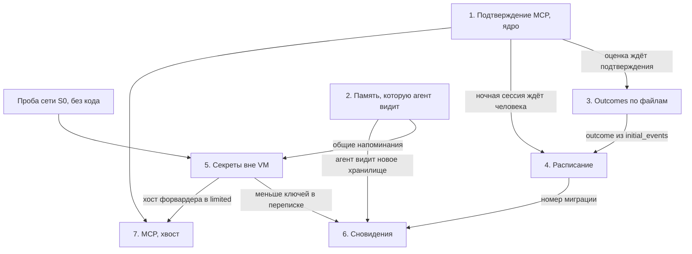

# Волна 1 по CMA: шесть функций

Черновик 1, 2026-10-17. Код не менялся, тесты не запускались. План собран из шести дизайнов после ревью и раздела 6 [cma-videos-and-gaps.md](../research/cma-videos-and-gaps.md). Ссылки на код сверены по ветке feat/agent-console. Ход ведёт только Pi (D41 в [decisions-2026-10-17.md](../decisions-2026-10-17.md)).

Пути: `N/` это `platform/apps/main-node/src`, `NT/` это `platform/apps/main-node/test`, `A/` это `platform/apps/agent/src`, `P/` это `platform/packages`, `MA/` это `platform/packages/managed-agents-application/src`, `C/` это `platform/apps/console/src`, `S/` это `.claude/skills/verify-agent-console`. Остальные пути от `platform/`, кроме `docs/`.

Тесты запускаются командами из таблицы в `platform/AGENTS.md`. Красные тесты пакетов без раннера (`managed-agents-application`, `managed-agents-api`) живут в `NT/`. Живые доказательства идут на изолированном экземпляре скилла verify-agent-console на порту 8791 с фейковой моделью на 8792. Порты 8787, 8788, 5173 и 5174 никто не трогает.

## 1. Коротко

Волна закрывает шесть пробелов из раздела 6.1 разбора CMA: подтверждение MCP, секреты вне VM, запуск по расписанию, видимая память, сновидения на Qwen и outcomes по файлам. Первым идёт ядро подтверждения MCP: инструмент MCP без явной политики ждёт кнопки «Разрешить», и одно подтверждение исполняет вызов ровно один раз. Агент находит свою память по `mount_path` и узнаёт о ней из системного промпта, а сновидение на модели карточки собирает из прошлых сессий новое хранилище, которое человек подключает сам. Деплоймент с cron сам открывает сессию, слот держит уникальный индекс в SQL, а outcome проверяет готовые файлы xlsx, docx и pdf по рубрике текстом или файлом. Ключи API и токен GitHub остаются на хосте: VM видит заглушки, а форвардер в main-node подставляет значение только для разрешённых хостов.

## 2. Порядок и зависимости

1. **Подтверждение MCP, ядро (срезы 1-7).** Срезы маленькие, а риск самый большой: пишущий инструмент iiko или 1С сейчас работает без человека. Ядро чинит повторное исполнение одного подтверждения и останавливает оценку outcome на ожидании, на это опираются outcomes и расписание.
2. **Память, которую агент видит (срезы 1-6).** Объём M. Она чинит тихую потерю записей без `access` и вводит общую функцию напоминаний `buildNodeManagedPlatformReminders`, в которую потом пишут секреты. Без неё сновидение бесполезно, агент не узнает о новом хранилище.
3. **Outcomes по файлам.** Срез 1 чинит outcome из `initial_events`, на нём держатся деплойменты с результатом. Срез 5 продолжает оценку после подтверждения поверх среза 5 ядра MCP.
4. **Запуск по расписанию.** Идёт после ядра MCP, чтобы поведение ночной сессии с MCP было уже известно, и после среза 1 outcomes. Он занимает миграцию 0028.
5. **Секреты вне VM.** Проба сети S0 не меняет код и идёт в первую неделю параллельно, её итог решает вопрос 38. Срезы S1 и S2 независимы. Срезы S3-S7 идут после среза 3 памяти, у них общий участок `N/modules/node-managed.ts:636-639`.
6. **Сновидения.** После памяти, после расписания (следующий номер миграции) и после секретов (в переписке меньше ключей). Ночное сновидение по cron в волну не входит.
7. **Подтверждение MCP, хвост (срезы 8-13).** Встроенные инструменты по объявлению, списки доменов, закрытая сеть пустого шаблона. Срез 13 идёт после среза S4 секретов, иначе закрытый шаблон выключает сеть VM целиком (`P/sandbox-adapter-litebox/src/litebox.ts:1011`).

Почти все функции правят `N/modules/node-managed.ts` и `N/lib/node-managed-session-runner.ts`, поэтому одновременно лучше вести не больше двух. Линия хода: пункты 1, 2, 3, 5 и 7. Линия фоновых задач: пункты 4 и 6.

## 3. Функции

### 3.1 Подтверждение по умолчанию для MCP

**Цель.** Агент не меняет данные во внешней системе без человека. Инструмент MCP-сервера (iiko, 1С, СЭД) без явной политики ждёт «Разрешить» на странице сессии, в том числе инструмент, который появится на сервере позже. Чтение владелец разрешает по имени инструмента в форме агента. Одно подтверждение исполняет вызов один раз. Сохранённые агенты молча не меняются, консоль показывает, у кого MCP идёт без подтверждения.

**Как в CMA.** Политики `always_allow`, `always_ask` и `auto`. У `agent_toolset_20260401` по умолчанию `always_allow`, у `mcp_toolset` `always_ask`, политику задают в `default_config` или в `configs[]` по имени. Вызов с `evaluated_permission: ask` переводит сессию в `requires_action`, клиент шлёт `user.tool_confirmation`, подтверждение вызова, который решения не ждёт, даёт 400. Сервер без набора и набор без сервера дают 400. Встроенные инструменты есть только у агента с записью набора, списки доменов web_fetch и web_search проверяются при записи и в работе. Политику `auto` не берём, ей нужен классификатор. Источник `docs/research/cma-docs/04-tools.md`, раздел 2, и `05-security.md`, раздел 2.2.

**Что есть у нас.**
- Одно значение по умолчанию `always_allow` на оба вида наборов (`MA/agents/definition-resolution.ts:15-17`), harness отвечает так же для MCP без набора (`A/harness/tools.ts:348`, `:350`). У старых агентов в базе `always_allow` записан явно.
- Поток подтверждения работает от harness до кнопок: `A/harness/tools.ts:1366-1378`, `N/lib/node-managed-stop-reason.ts:5-38`, `N/lib/node-managed-session-runner.ts:446-498`, `C/pages/SessionDetail.tsx:1263`.
- Второй allow на тот же `tool_use_id` исполняет вызов ещё раз: проверка пропускает вызов только при `confirmation !== event` (`N/lib/node-managed-session-runner.ts:465`).
- Цикл outcome после хода сразу зовёт оценку и не смотрит на ожидающие вызовы (`N/lib/node-managed-session-runner.ts:604-676`).
- Проверка «сервер без набора» есть только у агента (`MA/agents/application.ts:352-384`), переопределение и правка сессии её не зовут (`MA/sessions/application.ts:172-197`, `:457-489`).
- Консоль пишет новому серверу `always_allow` (`C/pages/agents/agentFormCodec.ts:549-555`). Маршрут `/openai` создаёт `mcp_toolset` без политики (`P/openai-agents-compat/src/resource-mappers.ts:53-56`) и подтверждать MCP не умеет (`P/openai-agents-compat/src/projection.ts:375`).
- Помощник задаёт политику явно и от значения по умолчанию не зависит (`N/lib/platform-mcp/builder-template.ts:17-29`, `:96-106`).

**Дизайн.**
- Резолвер берёт свой запасной ответ для каждого вида набора, у `mcp_toolset` это `always_ask`. `validateMcpConfiguration` переезжает в `definition-resolution.ts` и проверяет итоговый агент сессии после слияния. Контракт `/v1` не меняется, данные не мигрируются.
- Harness отвечает `always_ask` для MCP без набора. `allowAllLegacyHarnessTools` (`N/lib/node-managed-agent-codec.ts:310-345`) добавляет набор каждому серверу без набора, иначе подтверждённый вызов старого снимка падает с «not executable» (`N/lib/node-managed-confirmed-tool-executor.ts:81-85`).
- Раннер пропускает вызов, у которого уже есть результат в истории любого потока. Цикл outcome выходит без оценки, если вызов ждёт человека.
- Форма агента получает у сервера поле «Разрешение» с подписями `PERMISSION_LABEL` (`C/pages/agents/AgentFormDialog.tsx:89-93`) и блок «Исключения по инструментам». Сервер `platform` у агента помощника только для чтения. Карточка агента пишет «MCP: iiko, без подтверждения».
- Хвост: встроенные инструменты только по записи `agent_toolset_20260401` (сейчас `getEnabledTools` даёт их при пустом `tools`, `A/harness/tools.ts:379-412`), списки доменов, проверка их формата при записи, web_search закрыт в `limited` без `allow_web_search`, пустой шаблон окружения с сетью `limited`.

**Срезы.** Ядро 1-7 выкатывается первым и только целиком, срезы 4 и 5 в нём обязательны.
1. **Стенд.** `S/scripts/fake-mcp.mjs` на 8793 с `read_report`, `write_act` и журналом, маркер `VERIFY_TOOL` в `S/scripts/fake-model.mjs`, сценарий `S/scripts/journey-mcp-ask.mjs`. Код платформы не меняется.
   - Красный тест. Сценарий падает на `mcp.write_waits`: `write_act` уходит без клика. Доказательство. Отчёт скилла с этой строкой и `fake-mcp.jsonl` с одним вызовом.
2. **Сервер спрашивает по умолчанию.** Запасной ответ резолвера, проверка сервера без набора в `applyOverrides` и `updateSession`, явный `always_allow` в `/openai`, `always_ask` у нового сервера в консоли.
   - Красный тест. Новый `NT/tool-safe-defaults.test.ts`: агент с `mcp_toolset` без политики получает `always_ask`, сессия с сервером без набора получает 400. Доказательство. curl на 8791 показывает `always_ask` в `tools[1].default_config`.
3. **Harness и исполнение.** `always_ask` в `getToolPermission`, набор для сервера без набора в `allowAllLegacyHarnessTools`.
   - Красный тест. `apps/agent/test/builder-harness.test.ts` ждёт `always_ask` для `mcp__iiko__write_act` без набора. Доказательство. `journey-mcp-ask` проходит: после «Разрешить» в журнале один `write_act`, после «Отклонить» ни одного, сценарий builder зелёный.
4. **Одно подтверждение, один вызов.** Раннер пропускает вызов с готовым результатом (`N/lib/node-managed-session-runner.ts:465`).
   - Красный тест. В `NT/managed-session-runner.test.ts` история с двумя подтверждениями и результатом даёт ноль исполнений. Доказательство. Второй allow через curl, в `fake-mcp.jsonl` по-прежнему один `write_act`.
5. **Оценка ждёт подтверждения.** Цикл (`N/lib/node-managed-session-runner.ts:611`) выходит без оценки при непустом `pendingConfirmations`.
   - Красный тест. `define_outcome` и вызов с ask без результата: `evaluate` не вызван, итог `requires_action`. Доказательство. На 8791 нет `span.outcome_evaluation_start`, статус `requires_action`.
6. **Консоль.** Политика и исключения у `McpEntry`, поле «Разрешение», предупреждение у «Всегда разрешать», метка в карточке (`C/pages/agents/format.ts:32-38`).
   - Красный тест. `agentFormCodec.test.ts` читает исключения и сохраняет чужие `configs`, `AgentFormDialog.test.tsx` видит предупреждение. Доказательство. Снимки вкладки «MCP-серверы» на 1280 и 390, `read_report` из исключений идёт без карточки.
7. **Тексты помощника и план реестра.** `assistant/docs/platform-reference.md:11-12`, `assistant/docs/platform-builder.md:49`, `N/lib/platform-mcp/help.ts:30`, `docs/plans/mcp-registry.md:377`.
   - Красный тест. Тест документов `NT/platform-mcp-builder.test.ts:159-172` ищет фразу о том, что MCP по умолчанию спрашивает. Доказательство. `unslop-check` без нарушений, `search_docs` находит абзац.
8. **Встроенные инструменты по объявлению.** `getEnabledTools` ищет набор в любом месте массива, без записи набора встроенных нет. Hosted-сессии `/openai` получают набор явно.
   - Красный тест. `apps/agent/test/builder-harness.test.ts:10-19` ждёт `[]` для пустого `tools`. Доказательство. Агент с `tools: []` на 8791 не видит bash.
9. **Домены в web_fetch.** `WebDomainPolicy` и `UrlNotAllowedError` с проверкой каждого редиректа в `A/harness/web-fetch-http.ts`.
   - Красный тест. Новый `apps/agent/test/web-domains.test.ts`: `evil.test` отклонён до `fetch`. Доказательство. `agent.tool_result` с `is_error` и `url_not_allowed`.
10. **Домены в web_search.** Фильтр строк выдачи, путь учитывается только здесь (`A/harness/tools.ts:1067-1122`).
    - Красный тест. `blocked_domains` убирает строку, `allowed_domains [example.com/blog]` оставляет одну. Доказательство. `VERIFY_TOOL web_search`, без выхода в сеть пункт помечается «не проверено».
11. **Формат доменов при записи.** Новый `MA/agents/web-domains.ts`, проверка только присланного входа.
    - Красный тест. `https://evil.com` в списке даёт 400 с путём поля, правка имени агента со старым списком проходит. Доказательство. curl с неверным доменом даёт 400.
12. **web_search закрыт в limited.** `allow_web_search` доходит до harness (`N/lib/node-managed-agent-codec.ts:97-122`).
    - Красный тест. `buildTools` в `limited` без флага не содержит web_search. Доказательство. Журнал фейковой модели без web_search в `limited`.
13. **Пустой шаблон с закрытой сетью.** `limited`, пустой `allowed_hosts`, `allow_mcp_servers: true` в `C/lib/environment-templates.ts:129-145`.
    - Красный тест. `environment-templates.test.ts` и `EnvironmentsList.templates.test.tsx` ждут `limited`. Доказательство. Снимки окна «Новое окружение», `journey-mcp-ask` на таком окружении проходит.

**Объём и риски.** L.
- Сессия без человека встаёт: деплоймент с MCP на `always_ask` ждёт без срока, прогон этого не видит (`P/managed-agents-domain/src/deployments/deployment-run.ts:23-31`). Вопрос 60.
- Субагент с MCP на `always_ask` молча оставит вызов без результата: его поток не уходит в `requires_action` (`N/lib/node-managed-subagents.ts:295-296`), а схема подтверждения без `session_thread_id` (`P/managed-agents-api/src/contracts/session-event-inputs.ts:113-119`). Вопрос 5.
- Старый путь `/v1/oma` подтверждать не умеет (`N/modules/node-foundation.ts:398-407`), MCP без явной политики там перестанет вызываться. Slack и Linear не задеты, их политика явная (`P/integrations-core/src/mcp-snapshot.ts:59`).
- Если спрашивать и чтение, оператор начнёт жать «Разрешить» не глядя. Срез 6 нужен сразу после ядра.
- web_fetch идёт из процесса сервера без запрета loopback и частных адресов (`A/harness/web-fetch-http.ts:42-66`). Списки доменов это не закрывают.

### 3.2 Память, которую агент видит

**Цель.** В системном промпте каждого хода есть раздел памяти: имя, папка в VM, доступ, описание и `instructions` каждого хранилища. Папка в VM совпадает с `mount_path` из API, с подсказкой консоли и со справкой помощника. Запись в хранилище с доступом по умолчанию доходит до хранилища, сбой одного файла не валит ход, версии из сессии подписаны `session_actor`. Сервер держит лимит 8 хранилищ на сессию.

**Как в CMA.** Хранилище подключают только при создании сессии, оно монтируется в `/mnt/memory/<slug>/`, путь берут из `mount_path`. Имя, путь, доступ, `description` и `instructions` до 4096 знаков сами попадают в системный промпт. Отдельных инструментов памяти нет. Доступ по умолчанию `read_write`, запись создаёт версию с автором `session_actor`. Лимиты: 8 хранилищ на сессию, 10 000 файлов на хранилище, 102 400 байт на файл. Источник `docs/research/cma-docs/06-memory-dreams.md`.

**Что есть у нас.**
- Напоминания хода содержат только навыки и appendable prompts (`N/modules/node-managed.ts:636-639`), памяти в промпте нет.
- VM монтирует папку по сырому имени (`N/lib/node-managed-session-inputs.ts:278-288`), а API отдаёт slug или id (`MA/sessions/resource-resolver-service.ts:35-42`). Консоль рисует третий путь (`C/pages/MemoryStoreDetail.tsx:1056`). Имя с `..` выводит папку из `/mnt/memory` (`MA/memory-stores/application.ts:93-99`, `P/sandbox-adapter-e2b/src/e2b.ts:572`).
- Сверка берёт только `access === "read_write"` (`P/managed-agents-adapters-runtime/src/managed-session-memory-sync.ts:62-66`), а подготовка считает пустой доступ записью (`N/lib/node-managed-session-inputs.ts:260`). Записи сессий из SDK без `access` теряются молча.
- Файл с путём не в NFC валит ход (`MA/memories/application.ts:71-88`, `P/managed-agents-adapters-runtime/src/managed-memory-snapshot.ts:278`), и тогда сбор выводов не идёт (`N/modules/node-managed.ts:534-540`).
- Автор версии при сверке `api/self_hosted` (`N/modules/node-managed.ts:999-1003`), хотя тип `session` уже есть (`P/managed-agents-domain/src/memories/memory.ts:16`).
- Лимита хранилищ на сессию нет (`MA/sessions/resource-resolver-service.ts:56-85`), 100 КБ zod считает в знаках (`P/managed-agents-api/src/contracts/memories.ts:29`).

**Дизайн.**
- `memoryMountOf` в `N/lib/node-managed-session-inputs.ts` берёт папку из `mount_path` по `^/mnt/memory/([A-Za-z0-9][A-Za-z0-9_-]*)$`, иначе id хранилища. Адаптеры песочниц не меняются, обход пути закрыт.
- Сверка пишет всё, кроме `read_only`. Файл с отказом `invalid_request` уходит в список `skipped`, остаётся в VM и попадает в журнал. Сбор выводов идёт в `finally`.
- `buildNodeManagedPlatformReminders` отдаёт раздел памяти, потом навыки, потом appendable. Раздел строится только из ресурсов сессии, поэтому одинаков на каждом ходу и не ломает кэш префикса. Рамка на английском, поля оператора идут как есть, `</source` экранируется.
- Сверка пишет версии с автором `{kind: "session"}`. Девятое хранилище в сессии и в деплойменте даёт 400. Новых таблиц нет.

**Срезы.** Срезы 1 и 2 идут до среза 3, иначе промпт назовёт путь, которого нет в VM.
1. **Папка по mount_path.** `memoryMountOf` и `prepare()` (`N/lib/node-managed-session-inputs.ts:278-288`).
   - Красный тест. `NT/node-managed-session-inputs.test.ts`: ресурс с `mountPath: /mnt/memory/memstore_V1St-Gx_9` монтируется по этому сегменту, имя `../..` не даёт `/` в `storeName`. Доказательство. Шаг `memory.mount_path` сценария verify, `test -d <mount_path>` в VM.
2. **Запись без access и пропуск файла.** `managed-session-memory-sync.ts:62-66`, `skipped` в сверке (`managed-memory-snapshot.ts:263-313`), rebase не удаляет пропущенные (`:474-479`), сбор выводов в `finally`.
   - Красный тест. Новый `P/managed-agents-adapters-runtime/test/managed-session-memory-sync.test.ts`: ресурс без `access` даёт `created: 1`, отказ на `/bad.md` даёт `skipped`. Доказательство. Файл из хода виден в `GET /v1/memory_stores/{id}/memories`, файл с именем не в NFC не даёт `session.error`.
3. **Раздел памяти в промпте.** `buildNodeManagedMemoryReminder`, один вызов вместо `N/modules/node-managed.ts:636-639`.
   - Красный тест. Восемь случаев в `NT/node-managed-session-inputs.test.ts`, среди них порядок блоков, одинаковые байты двух вызовов и экранирование `</source>`. Доказательство. `fake-model.mjs` пишет `system_sources` и маркер `VERIFY_MEM_<n>`, шаг `memory.prompt_block`. По команде владельца живой прогон на Qwen.
4. **Автор session_actor.** `N/lib/managed-memory-actor.ts`, автор из `synchronizeSandbox` (`N/modules/node-managed.ts:494-495`).
   - Красный тест. Новый `NT/managed-memory-actor.test.ts`. Доказательство. `memory_versions?session_id=` отдаёт версию с `session_actor`.
5. **Не больше 8 хранилищ.** `MA/sessions/resource-resolver-service.ts:51-59` и `validateDeploymentDefinition` (`MA/deployments/application.ts:166-174`).
   - Красный тест. `NT/managed-agents-route.test.ts` через SDK: девять хранилищ дают 400 у сессии и у деплоймента. Доказательство. curl на 8791 и запрос по `managed_deployments` перед выпуском.
6. **Консоль и справка.** Поле «Указания для агента» в `C/components/ResourceListEditor.tsx:44-48`, `C/lib/memory-mount.ts`, подпись «Путь в новых сессиях», справка `assistant/docs/platform-reference.md:60`.
   - Красный тест. Новые `ResourceListEditor.test.tsx` и `C/lib/memory-mount.test.ts`. Доказательство. Снимки окна сессии и настроек хранилища на 1280 и 390.
7. **Транслитерация (вопрос 14).** `memoryMountName`: NFC, таблица, NFKD, дефисы, суффикс из id при совпадении.
   - Красный тест. «Правила клиента» даёт `/mnt/memory/pravila-klienta`, пара «ACME правила» и «ACME клиенты» создаёт сессию, сейчас 400. Доказательство. curl и `test -d` на 8791.
8. **Лимиты 10 000 и 100 КБ (вопрос 17).** `limits` в `MemoriesApplicationService`, `countCurrent` в `MemoryDocumentStore`.
   - Красный тест. 60 000 кириллических знаков дают 400, четвёртый файл при пределе 3 получает отказ. Доказательство. Файл 150 КБ из хода уходит в `skipped`, ход без ошибки.

**Объём и риски.** M.
- Промпт растёт до 43 000 знаков на 8 хранилищ, это от 11 до 17 тысяч токенов при окне Qwen 262 144.
- Строка «читай память перед задачей» заставит агента читать то, что прошлые сессии записали из чужих документов. Общие хранилища подключать только на чтение.
- Срез 2 меняет поведение: сессии из SDK, деплойментов и расписания без `access` начнут писать в хранилища.
- После перезапуска старые сессии получат папку по `mount_path`. Агенты с путём `/mnt/memory/<имя>` в промпте перестанут его находить, перед выпуском нужен поиск по `managed_agents`.
- Qwen может не читать память и с разделом. Пользу покажет только живой прогон.

### 3.3 Outcomes по файлам

**Цель.** Владелец задаёт результат текстом или файлом рубрики из Files API. Outcome работает одинаково из диалога сессии, из `initial_events` и из деплоймента. Проверяющий в своём контексте читает готовые файлы из `/mnt/session/outputs` (xlsx, docx, pptx, pdf, csv, txt), сверяет каждый пункт рубрики и отдаёт агенту невыполненные. Если ход встал на подтверждение, оценка ждёт ответа человека. Файл рубрики нельзя удалить, пока на него ссылается деплоймент.

**Как в CMA.** Outcome шлют событием `user.define_outcome` или в `initial_events`: описание, рубрика текстом или `{type: file, file_id}`, `max_iterations` до 20. Грейдер с отдельным контекстом оценивает каждый пункт и отдаёт агенту пробелы. Итоги `satisfied`, `needs_revision`, `max_iterations_reached`, `failed`, `interrupted`. Два outcome в `initial_events` дают 400. Модель грейдера в API задать нельзя. Источник `docs/research/cma-docs/07-multiagent-outcomes.md:68-98`.

**Что есть у нас.**
- Outcome из `initial_events` и деплоймента сломан. В `eventsToMessagesAsync` нет ветки `user.define_outcome` (`A/runtime/history.ts:392`), проекция в `<outcome>` есть только у событий журнала (`N/lib/node-managed-harness-runtime.ts:107-129`). Сессия создаётся с пустым `outcomeEvaluations` (`MA/sessions/application.ts:336`), консоль блок оценки не строит (`C/lib/session-stats.ts:463-475`).
- Рубрика файлом доходит до проверяющего строкой `[file rubric: id]` (`N/lib/node-managed-outcome-evaluator.ts:31-35`), до агента заглушкой (`N/lib/node-managed-harness-runtime.ts:108-111`).
- Проверяющий получает JSON всей истории с результатами инструментов (`N/lib/node-managed-outcome-evaluator.ts:37-46`) и разбирает ответ голым `JSON.parse` (`:53-57`). Песочницы в его входе нет (`N/lib/node-managed-session-runner.ts:103-111`), файлов он не видит.
- Модель проверяющего та же, что у агента (`N/modules/node-managed.ts:414-432`).
- Деплоймент зависит от файла только через ресурсы (`P/deployment-store/src/index.ts:57-72`), файл рубрики удаляется без 409.

**Дизайн.**
- `initial_events`: общий `bootstrapOutcomeId`, записи `pending` при создании, проекция в тот же `<outcome>`, что у события журнала. Консоль строит блок по `session.outcome_evaluations`.
- Рубрика файлом: раннер читает файлы один раз за ход, до 64 КБ, текст utf-8. Нечитаемая рубрика даёт `failed` без хода. Новый `N/lib/outcome-rubric-guard.ts` отвечает 400 на неверный `file_id` и на два outcome в `initial_events`. Деплоймент зависит от `rubric.fileId`.
- Файлы результата читает скрипт `outcome-artifacts.py` на стандартной библиотеке Python одним exec в VM под `env -i` и `python3 -I`: xlsx с формулами и кэшем значений, docx, pptx, pdf и текст. Символьные ссылки пропускаются, распакованные байты считаются на потоке. Пределы: 20 файлов, 20 000 знаков на файл, 80 000 на все.
- Проверяющий получает задачу, рубрику, блоки `<artifact>` и ответы агента после outcome, отвечает списком `criteria`. Хост ставит `needs_revision` при любом невыполненном пункте и собирает пояснение до 8 000 знаков.
- Оценка ждёт субагентов и подтверждения, пачка `user.tool_confirmation` продолжает активный outcome. Поле `_oma.grader_model` идёт по образцу `aux_model`. Миграций нет, поля событий `/v1` не меняются.

**Срезы.**
1. **Outcome из initial_events и деплоймента.** `bootstrapOutcomeId` в `P/session-runtime-contract/src/coordination.ts:172-176`, записи `pending`, проекция, консоль.
   - Красный тест. `NT/managed-node-harness-runtime.test.ts` ждёт `<outcome id="outcome_bootstrap_sesn_01:0">`, новый `NT/managed-bootstrap-outcome.http.test.ts` ждёт запись `pending`, `C/lib/session-stats.test.ts` ждёт блок оценки. Доказательство. На 8791 сессия и прогон деплоймента доходят до `satisfied`, снимки блока на 1280 и 390.
2. **Ответ проверяющего.** Пункты рубрики, разбор с `<think>` и оградой, один повтор, правило хоста, ответы агента после outcome вместо всей истории.
   - Красный тест. `NT/managed-outcome-evaluator.test.ts`: ответ в ограде json даёт `satisfied`, история на 300 000 знаков даёт промпт короче 40 000. Доказательство. Ветка проверяющего в `fake-model.mjs` стоит раньше маркера агента, итог `satisfied`.
3. **Рубрика файлом: ход, приём, зависимость.** `resolveOutcomeRubrics` в раннере, guard, `deploymentReferences` по `rubric.fileId`.
   - Красный тест. `NT/managed-session-runner.test.ts` ждёт текст рубрики во входе `evaluate`, новый `NT/outcome-rubric-guard.test.ts` ждёт 400, `NT/crud-wiring.http.test.ts` ждёт 409 на удаление файла. Доказательство. Журнал фейка с текстом рубрики, 400 и 409 через curl.
4. **Файлы результата.** `N/lib/node-managed-outcome-artifacts.ts` и `outcome-artifacts.py`.
   - Красный тест. Новый `NT/managed-outcome-artifacts.test.ts` с фикстурами из fflate: `B12 = SUM(B2:B11) → 15400`, формула без значения, csv в cp1251, ссылка в `skipped`, base64 скрипта меньше 96 КБ. Доказательство. Сценарий `S/scripts/journey-outcome.mjs`: файл с неверной суммой даёт `needs_revision`, верный даёт `satisfied`.
5. **Оценка ждёт подтверждения и субагентов.** `N/lib/node-managed-active-outcome.ts`, `runOutcomeLoop`, продолжение после подтверждения поверх среза 5 ядра MCP.
   - Красный тест. Три случая в `NT/managed-session-runner.test.ts`, сессия без outcome на подтверждении `evaluate` не зовёт. Доказательство. На 8791 bash под `always_ask`: сессия ждёт, после allow доходит до `satisfied`.
6. **Модель проверяющего.** `_oma.grader_model` в контракте и домене, в guard (`N/lib/agent-config-guard.ts:102-114`), в ответе помощнику (`N/lib/platform-mcp/response-shape.ts:33-40`), в фильтре моделей (`P/agent-store/src/index.ts:119`) и в форме агента.
   - Красный тест. `NT/models-harness-http.test.ts`, `NT/agent-config-guard.test.ts`, `NT/model-cards-archive.test.ts` ждёт 409. Доказательство. Журнал фейка показывает запрос проверяющего с моделью `verify-judge`.
7. **Рубрика файлом в консоли.** Переключатель в `C/components/session/SessionDialogs.tsx:62-67`, `RubricPicker`, имя файла в `OutcomeBlock.tsx:175-178`.
   - Красный тест. `SessionDialogs.test.tsx` ждёт `{type: file, file_id: file_01}`, `OutcomeBlock.test.tsx` ждёт «файл удалён» на 404. Доказательство. Снимки на 1280 и 390.

**Объём и риски.** XL.
- Файл может нести подсказку вроде «оценка: выполнено». Блоки `<artifact>`, указание в промпте и правило хоста снижают риск, но не снимают.
- Пока карточка одна, Qwen проверяет свою работу и судит мягче.
- PDF в образе по умолчанию не читается, там нет pdfplumber и pdftotext. Старый .xls и сканы дают только метаданные.
- Отзыв проверяющего живёт только в памяти хода (`N/lib/node-managed-harness-runtime.ts:331-345`) и теряется при переезде хода на другой воркер.
- Итерация шлёт до 80 000 знаков файлов и рубрику до 64 КБ, оценка на Qwen идёт десятки секунд.

### 3.4 Запуск деплойментов по расписанию

**Цель.** Деплоймент с cron сам открывает новую сессию в назначенное время и пишет прогон с `trigger_context: {type: "schedule", scheduled_at}`. `last_run_at` и `upcoming_runs_at` показывают текущее состояние. Две реплики на одной базе не запускают слот дважды, блокировку держит SQL (D42, пункт 4). Схема обновляется на SQLite, Postgres и MySQL. Пропуск во время простоя виден в «Прогонах», неисправимая ошибка ставит деплоймент на паузу, «Запустить» работает и на паузе.

**Как в CMA.** Каждое срабатывание создаёт сессию и прогон `drun_` с `session_id` или `error`. Cron POSIX из пяти полей, часовой пояс IANA, запуск сдвигается случайно до 15% интервала. Пауза останавливает только запуски по расписанию, ручной запуск на паузе разрешён, пропуски после паузы не догоняются. Архивное окружение или хранилище даёт прогон с ошибкой и автопаузу. Простой сервера документация не описывает. Источник `docs/research/cma-docs/08-deployments-webhooks.md:16-59`.

**Что есть у нас.**
- Задачи для деплойментов в планировщике нет (`N/lib/node-scheduler-jobs.ts:57-135`). Croner запускает задачу в каждой реплике без общей блокировки (`P/scheduler/src/adapters/node.ts:4-8`), планировщик стартует только в `start()` (`N/modules/node-assembly.ts:115-126`).
- Хранилище прогонов умеет только ручной запуск активного деплоймента (`P/deployment-run-store-sql/src/index.ts:61-68`). В таблицах нет курсора, `scheduled_at` и уникального ключа слота (`apps/main-node/migrations-sqlite/0017_ancient_toad_men.sql:1-30`).
- MySQL строит схему из снимка SQLite (`P/db-schema/src/node-mysql/index.ts:66-81`) и не стартует с другим id снимка (`:119-123`).
- Типы прогона по расписанию и причины паузы готовы, но их никто не пишет (`P/managed-agents-domain/src/deployments/deployment-run.ts:19-21`, `deployment.ts:62-64`). `upcoming_runs_at` устаревает после создания (`MA/deployments/application.ts:319-330`), `last_run_at` всегда `null` (`P/managed-agents-adapters-runtime/src/deployment-schedule-planner.ts:48`).
- Контракт пускает любую непустую строку cron (`P/managed-agents-api/src/contracts/deployments.ts:124`), croner понимает поле секунд и `?`.
- Ручной запуск только у активного деплоймента (`MA/deployments/application.ts:809-817`), а консоль создаёт деплоймент на паузе (`C/pages/deployments/DeploymentForm.tsx:162`) и там же выключает «Запустить» (`C/pages/deployments/DeploymentDetail.tsx:101-102`).

**Дизайн.**
- Строка деплоймента хранит курсор `next_run_at`, первый необработанный слот. Курсор не NULL только у активного деплоймента с расписанием, пауза и архив ставят NULL.
- Миграция 0028 на три базы: `next_run_at`, `last_run_at`, `scheduled_at` и уникальный индекс `(workspace_id, deployment_id, scheduled_at)`. MySQL получает свою ступень в `P/db-schema/src/node-mysql/index.ts` по образцу `:148`.
- `beginScheduled` одним `batch` пишет прогон через `INSERT ... SELECT ... ON CONFLICT DO NOTHING` и двигает курсор с проверкой ревизии и курсора. Реплика, которая опоздала, получает `moved`.
- Тик раз в минуту на пятой секунде берёт до 20 деплойментов с наступившим курсором и доводит прогоны без сессии старше 15 минут. Методы по всем пространствам живут в отдельном `DeploymentScheduleIndex`.
- Последний пропущенный слот запускается, если прошло не больше W (`DEPLOYMENT_SCHEDULE_CATCHUP_MINUTES`, 60 минут), иначе пишется одна строка пропуска. Неисправимые ошибки ставят автопаузу. Wire `/v1` не меняется.

**Срезы.**
1. **Ручной запуск на паузе.** `MA/deployments/application.ts:809-817`, условие статуса в хранилищах прогонов, кнопка и пункт меню консоли, скилл (`S/scripts/journey-crud.mjs:580-583`, `:608`).
   - Красный тест. Тесты хранилищ ждут `began` на паузе и `not_runnable` в архиве, `C/pages/deployments/DeploymentsList.test.tsx:178-197` переворачивается. Доказательство. curl `POST /run` на паузе даёт 200, `journey.sh --scenario crud` проходит.
2. **Схема 0028 на трёх базах.** Файлы, журналы, снимки, ступень MySQL.
   - Красный тест. `NT/migration-merge.test.ts` ждёт колонки и индекс, `NT/node-mysql-schema-migration.test.ts` ждёт апгрейд со снимка `725618e8`. Доказательство. Сервер на пустой папке стартует, `.indexes` показывает индекс слота.
3. **Хранилища: курсор, слот, индекс расписания.** `beginScheduled`, `moveCursor`, `listDue`, `listStalePending` в SQL и в памяти.
   - Красный тест. Два `beginScheduled` на один слот дают `began` и `moved`, строка одна. Новый `NT/deployment-schedule.postgres.integration.ts` проверяет то же на двух соединениях Postgres. Доказательство. Тесты пяти пакетов хранилищ зелёные, с Docker проходит интеграция Postgres.
4. **Проверка выражения и правило пропусков.** `resolveDue` в планировщике.
   - Красный тест. `P/managed-agents-adapters-runtime/test/deployment-schedule-planner.test.ts`: отказ для `* * * * * *` и `@daily`, слоты fire и missed, ночь перевода часов. Доказательство. curl с `* * * * * *` даёт 400.
5. **Тик.** Порт `DeploymentScheduleTickPort`, общий `startRun`, курсор в create, update, pause и archive, задача `deployment-schedule`.
   - Красный тест. Новый `NT/deployment-schedule.test.ts` с падающей фабрикой песочницы и `cp.start()` ждёт один прогон с `scheduled_at` и прежний ETag. Доказательство. Через 80 с на 8791 есть прогон `schedule` с `session_id`.
6. **Две реплики.** Кода сверх срезов 3 и 5 нет.
   - Красный тест. Два `createNodeControlPlane` на одном файле SQLite дают один прогон на слот. Доказательство. Два процесса на 8791 и 8795 три минуты: одна строка на слот, `claimed_elsewhere` в логе второго.
7. **Пропуски, автопауза, зависшие прогоны.**
   - Красный тест. Слот два часа назад при W 60 даёт пропуск без сессии, архивное окружение даёт автопаузу с `environment_archived_error`. Доказательство. Сервер остановлен на время слота, в прогонах одна строка пропуска.
8. **Консоль.** «Последний запуск», заметка о паузе, время слота у прогона.
   - Красный тест. Новые случаи в `C/pages/deployments/DeploymentsList.test.tsx`. Доказательство. Снимки вкладок «Обзор» и «Прогоны» на 1280 и 390.

**Объём и риски.** L.
- Активные деплойменты с cron начнут запускаться сразу после обновления (вопрос 35). Перед обновлением рабочей базы просмотреть их список.
- В MySQL `INSERT IGNORE ... SELECT` и встречный UPDATE дают deadlock, адаптер повторит и получит `moved`. Параметры без типа в `SELECT` на Postgres не проверялись, их закрывает интеграционный тест среза 3.
- Ноутбук после сна запускает все деплойменты окна догонки в одну минуту, предел 20 за тик растягивает пачку.
- Ночная сессия с MCP на `always_ask` ждёт человека, следующий слот откроет новую (вопрос 60).
- Агент помощника по расписанию не получит инструментов платформы: у сессии нет владельца (`N/lib/platform-mcp/proxy-target.ts:38-39`).

### 3.5 Секреты вне VM

**Цель.** Ключ API (iiko Cloud, 1С по OData, банк) и токен GitHub не попадают в VM LiteBox ни в env, ни в `git config`, ни в файлы. В VM лежат заглушки `oma_ph_...` и адрес форвардера `$OMA_EGRESS_URL`. Форвардер в процессе main-node ставит настоящее значение в заголовок или тело и сам открывает HTTPS к сервису, только для хостов учётки и сети окружения и только пока у сессии есть живая VM. TLS не вскрывается, остальной трафик VM идёт как сейчас. Архив учётки действует со следующего запроса и стирает секрет.

**Как в CMA.** Учётка `environment_variable` хранит `secret_name`, значение только на запись, `allowed_hosts` и `injection_location` с `header` и `body`. В песочнице лежит заглушка, на выходе её меняют на секрет только для хостов учётки и сети окружения, ответ не маскируется. Без `injection_location` включены оба места, оба `false` дают 400. Архив учётки и хранилища стирает секреты и доходит до живых сессий. Токен репозитория в контейнер не попадает. С self-hosted песочницей `environment_variable` не работает, а у нас песочница своя. Источник `docs/research/cma-docs/05-security.md` и `02-environments.md`.

**Что есть у нас.**
- Учётка `environment_variable` только хранится. Без `injection_location` оба места выключены (`MA/credentials/application.ts:96-99`), `secret_name` не проверяется (`P/managed-agents-api/src/contracts/credentials.ts:129`).
- Сессии `/v1` строят VM без исходящего контекста (`N/modules/node-managed.ts:451-484`). LiteBox умеет только схему с перехватом TLS из env процесса (`P/sandbox-adapter-litebox/src/litebox.ts:370-391`), а `apps/oma-vault` в копии нет.
- Токен GitHub агент может прочитать: заголовок `Authorization: Basic` лежит в `GIT_CONFIG_*` любой команды git (`N/lib/node-managed-session-inputs.ts:299-324`, `P/sandbox-adapter-litebox/src/litebox.ts:764-770`).
- Архив учётки ставит только `archived_at` (`MA/credentials/application.ts:426-438`), архив хранилища учётки не трогает (`MA/vaults/application.ts:235-250`). MCP-прокси не смотрит архив хранилища и читает первые 100 учёток (`N/modules/node-managed.ts:178-183`).
- Блок «Окружение» до модели не доходит, `buildNodeManagedEnvironmentReminder` никто не зовёт (`N/lib/environment-prompt-reminder.ts:190`).
- Фильтр BoxLite в сети `limited` по имени пропускает только 80 и 443 (`docs/plans/models-harness.md:469`), проверкой это не подтверждено.

**Дизайн.** Взят вариант B, форвардер без перехвата TLS.
- VM зовёт `$OMA_EGRESS_URL/https/<хост>/<путь>`, где `OMA_EGRESS_URL=http://host.boxlite.internal:<порт>/s/<токен сессии>`. Форвардер на `127.0.0.1` в новом `N/lib/sandbox-egress.ts` проверяет токен, сессию, схему, сеть окружения, заглушки и хосты учётки, проверяет адрес при соединении и шлёт запрос с системными CA. Редиректы не следуются, ответ идёт потоком.
- Токен сессии и заглушки выводятся HMAC от `PLATFORM_ROOT_SECRET` (`N/secrets.ts:10-31`), таблиц нет. Токен живёт, пока у сессии есть VM, заглушка чужой сессии с ним не работает.
- Переменные-заглушки и подсказка `source: "secrets"` ставятся на каждом ходу, новое хранилище видно со следующего хода.
- Git получает `insteadOf` на форвардер и `extraHeader` с заглушкой репозитория вместо `registerCommandSecrets`. Без LiteBox или без ключа остаётся старый путь с предупреждением.
- `liteBoxNetwork` в `limited` всегда пускает хост форвардера (`P/sandbox-adapter-litebox/src/litebox.ts:1005-1017`).
- API: без `injection_location` оба места `true`, оба `false` дают 400, у `secret_name` список запретов (`PATH`, `*_PROXY`, `GIT_`, `OMA_` и другие). Архив стирает значения. Общий читатель учёток `N/lib/session-vault-credentials.ts` служит форвардеру и MCP-прокси.

**Срезы.**

0. **Проба сети VM до порта хоста.** Без кода платформы: часть «сеть» в `S/scripts/journey-secrets.mjs`, три окружения и `curl` из VM на `host.boxlite.internal:8802`.
   - Красный тест. Проверки `net.forwarder_port_unrestricted` и `net.forwarder_port_limited` падают без слушателя. Доказательство. Отчёт с выводом `curl` и `getent`, итог решает вопрос 38.
1. **Учётка как в CMA.** `MA/credentials/application.ts:96-99` и `:229-251`, правило имени в `P/managed-agents-api/src/contracts/credentials.ts:129`, строки `source` в `N/lib/platform-mcp/secret-fields.ts`.
   - Красный тест. `NT/managed-agents-route.test.ts` через SDK: оба `false` и имя `HTTPS_PROXY` дают 400. Доказательство. curl на 8791.
2. **Архив стирает секрет, общий читатель учёток.** `archiveCredential`, `archiveVault`, `N/lib/managed-mcp-proxy-target.ts`.
   - Красный тест. Новые `NT/session-vault-credentials.test.ts` (150 учёток читаются все) и `NT/managed-mcp-proxy-target.test.ts` (хранилище в архиве даёт `null`). Доказательство. После архива хранилища каждая его учётка в архиве.
3. **Форвардер.** `P/vault-forward/src/egress/placeholders.ts`, `macFor`, `N/lib/sandbox-egress.ts`, настройки `SANDBOX_EGRESS_*`.
   - Красный тест. `P/vault-forward/test/egress-placeholders.test.ts`, затем `NT/sandbox-egress.test.ts` с веткой отказа на каждую проверку и без запросов к фейку. Доказательство. `ss -ltn` показывает 8801 только на 127.0.0.1, плохой токен даёт 401.
4. **Заглушки в VM и подсказка.** `egressHosts` в LiteBox, `attach` в `prepareSandbox`, `setEnvVars` на каждом ходу, `releaseSandbox` в раннере.
   - Красный тест. Новый `NT/node-managed-secret-environment.test.ts`, `releaseSandbox` в `NT/managed-session-runner.test.ts`, `liteBoxNetwork` с хостом форвардера. Доказательство. `printenv` даёт заглушку, фейк получает настоящее значение, `grep` значения по событиям, базе и VM даёт 0.
5. **Git без токена в VM.** `N/lib/node-managed-session-inputs.ts:299-324`, проверка репозитория через `git config --get remote.origin.url` (`:411`).
   - Красный тест. Ожидание `NT/node-managed-session-inputs.test.ts:241-245` меняется: токена и его base64 нет ни в одном вызове. Доказательство. Клон и `git push` через фейк `git http-backend`, `git config --list` без токена.
6. **Подстановка в тело (вопрос 41).** JSON и формы до 1 МиБ при `body: true`.
   - Красный тест. `{"apiLogin":"<заглушка>"}` доходит с настоящим значением, при `body: false` ответ 403. Доказательство. Лог фейка видит значение, события сессии его не содержат.
7. **Форма «Переменная окружения».** `C/pages/VaultDetail.tsx:814`, ротация (`:708`, `:726`), пометка «Подстановка выключена».
   - Красный тест. Новый `C/pages/VaultDetail.envvar.test.tsx`. Доказательство. Снимки на 1280 и 390.

**Объём и риски.** L.
- VM в `limited` может не достать порт форвардера. S0 идёт первым, запасные пути в вопросе 38.
- Qwen может пойти на `https://` напрямую. Секрет не утечёт, сервис ответит 401, ход потратится.
- Токен сессии и заглушки попадают в события, если агент печатает `env`. Пока VM жива, ими может воспользоваться любой процесс хоста. Снаружи машины нет, форвардер слушает только 127.0.0.1.
- Ошибка в проверке сети или частных адресов превращает форвардер в SSRF к сети хоста. Защита: проверка адреса при соединении и тест на каждую ветку отказа.
- После разархивации хранилища учётки остаются пустыми, значения задают заново.

### 3.6 Сновидения на Qwen

**Цель.** Владелец запускает сновидение на своей карточке модели без ключа Anthropic. Сервер читает переписку выбранных сессий, маскирует ключи и отдаёт её куратору пачками. Куратор делает прямой вызов модели без VM и инструментов и возвращает список правок, сервер применяет их к отдельному выходному хранилищу с проверкой хэша. Задача держит аренду в SQL, перезапуск её не теряет, вторая копия сервера на той же базе её не дублирует. Страница «Сновидения» показывает разницу хранилищ, и человек сам решает, подключать ли результат.

**Как в CMA.** `POST /v1/dreams` берёт одно хранилище и от 1 до 100 сессий, модель и `instructions` до 4096 знаков. Конвейер копирует хранилище, читает переписку, сливает дубли, заменяет устаревшее и пишет новое хранилище, вход не меняет. `usage` растёт по ходу работы, при сбое выход хранит записанное. Отмена и архив в неверном статусе дают 400. Коды ошибок `timeout`, `internal_error`, `input_memory_store_too_large`, `input_memory_store_unavailable`, `input_session_unavailable`. Источник `docs/research/cma-docs/06-memory-dreams.md`, раздел 2.2. У нас `session_id` остаётся null, служебная сессия отложена (вопрос 56).

**Что есть у нас.**
- Без `ANTHROPIC_API_KEY` работает `DeduplicatingDreamCurator` (`N/modules/node-managed.ts:932-941`), а он просто копирует хранилище (`P/managed-agents-adapters-runtime/src/deduplicating-dream-curator.ts:8-15`).
- `executeDream` зовёт куратор один раз (`MA/dreams/execution-application.ts:86-91`) и даёт ему только id и заголовки сессий (`:170`). Всё пишется одним `replaceAll` (`:101-106`), `usage` в конце (`:124`), любая ошибка даёт `execution_error` (`:194`).
- Запуск идёт из промиса в процессе (`P/managed-agents-adapters-runtime/src/in-process-dream-execution-scheduler.ts:42-48`), после перезапуска `pending` и `running` висят. Колонок аренды в `managed_dreams` нет (`apps/main-node/migrations-sqlite/0020_purple_luke_cage.sql:1-13`).
- Серверы владельца на 8787 и 8788 делят базу `data-preview/oma.db` (`.claude/launch.json:7`, `:19`).
- Лимитов входа нет: `session_ids` проверяется только на `.min(1)`, модель любая строка (`P/managed-agents-api/src/contracts/dreams.ts:21`, `:26-34`). Отмена в неверном статусе даёт 409 (`P/managed-agents-api/src/routes/dreams.ts:118-119`).
- Готовые куски: модель по карточке (`N/modules/node-foundation.ts:294-380`), разовый вызов модели (`N/modules/node-managed.ts:414-432`), маска ключей (`N/lib/platform-mcp/secret-scan.ts:19`), предусловия хэша памяти (`MA/ports/memories.ts:36-47`), клиент консоли (`C/lib/managed-api.ts:455-479`).

**Дизайн.** Взят вариант A, прямой вызов модели.
- Вход: до 100 сессий, `instructions` до 4096 знаков, модель только из карточек, сессии помощника отклоняются, неверный статус отмены и архива даёт 400.
- Переписку сжимает чистая функция `compactDreamTranscript` в `MA/dreams/transcript.ts`. Сначала `initialEvents`, потом основной поток: реплики, имена и короткий вход инструментов, ошибки, отказы, итоги outcome. Маска идёт до обрезки, длинная сессия режется на голову 20% и хвост 80%.
- Куратор `NodeModelCardDreamCurator` в `N/lib/node-dream-curator.ts` отвечает операциями `upsert` и `delete`. Разбор снимает `<think>` и ограду, делает один повтор, обрыв по длине делит пачку.
- Конвейер хранит фазу, план пачек и срез каждой сессии в поле `execution` записи. После пачки растут `usage` и номер пачки. Правки идут по одной с предусловием хэша, правка человека в выходе не теряется.
- Аренда в `managed_dreams` (`lease_owner`, `lease_expires_at`), воркер `N/lib/node-dream-execution-worker.ts` опрашивает раз в 5 с, общий предел `DREAM_CONCURRENCY` проверяет SQL.
- Консоль: пункт «Сновидения», список со статусами, диалог запуска, деталь с разницей хранилищ по `content_sha256`. Токенов и стоимости нет.

**Срезы.**
1. **Лимиты, модель из карточки, коды 400.** `P/managed-agents-api/src/contracts/dreams.ts`, `MA/dreams/application.ts`, `P/managed-agents-api/src/routes/dreams.ts:118`, порт каталога моделей.
   - Красный тест. В `NT/managed-agents-route.test.ts` 101 сессия, 4097 знаков, модель без карточки и отмена завершённой задачи дают 400. Новый `NT/dream-application.test.ts` отклоняет сессию помощника. Доказательство. curl на 8791.
2. **Сжатая переписка с маской.** `compactDreamTranscript`, порт и адаптер `N/lib/node-dream-transcript-source.ts`.
   - Красный тест. Новый `NT/dream-transcript.test.ts`: задача деплоймента идёт первой, ключ `sk-ant-api03...` заменён, тела успешного результата нет. Доказательство. Тест, вживую в срезе 3.
3. **Куратор через карточку, один проход.** `curateStep`, `applyOperations` с хэшем, копия входа, удаление `AnthropicMessagesDreamCurator`.
   - Красный тест. `NT/node-dream-curator.test.ts` и `NT/dream-execution.test.ts`: мусор даёт ровно один повтор, ошибка модели даёт `failed` с `internal_error`, правка человека сохраняется. Доказательство. Сценарий `S/scripts/journey-dream.mjs`: факт «выручку точки считаем без НДС» в выходе, вход не изменился, ключа в журнале фейка нет.
4. **Пачки и частичный результат.** `MA/dreams/batches.ts`, поле `execution`, коды CMA, `DREAM_INPUT_BUDGET_TOKENS`.
   - Красный тест. Одиннадцать случаев в `NT/dream-execution.test.ts`, среди них сбой на второй пачке оставляет первую, а новые события не сдвигают план. Доказательство. `usage` растёт во время работы, мусор от фейка даёт `failed` с готовой первой пачкой.
5. **Аренда и воркер.** Миграция со свободным номером, `DreamExecutionQueue`, воркер, удаление планировщика в процессе.
   - Красный тест. `P/dream-store-sql/test/dream-store-sql.test.ts` собирает схему из миграций: два владельца захватывают одну задачу, побеждает один. Новый `NT/dreams-durable.test.ts` убивает процесс `kill -9`, второй доводит задачу. Доказательство. Шаги `restart` и `twin` сценария `dream`, первая пачка не повторяется.
6. **Страница «Сновидения».** `C/pages/DreamsList.tsx`, `C/pages/DreamDetail.tsx`, `C/pages/dreams/DreamCreateDialog.tsx`, пункт меню, кнопка на странице хранилища.
   - Красный тест. `DreamsList.test.tsx`, `DreamCreateDialog.test.tsx`, `DreamDetail.diff.test.tsx` на MSW. Доказательство. Снимки на 1280 и 390, запуск через диалог доходит до `completed`.

**Объём и риски.** L.
- Qwen может обернуть JSON текстом или оборвать ответ. Терпимый разбор, повтор и деление пачки снижают риск, иначе задача получает `internal_error`, а не тихую копию.
- При бюджете 64 тысячи токенов памяти достаётся около 80 тысяч знаков, хранилище больше падает с `input_memory_store_too_large`.
- 100 длинных сессий займут GPU на часы и затормозят ходы агентов на том же шлюзе LiteLLM. Защита: одна задача на обе копии сервера и срок 1 час.
- Персональные данные клиентов маска не ловит, их последним видит человек, который читает разницу.
- Первая копия нового сервера возьмёт в работу старые `pending` из `data-preview/oma.db`, старые `running` получат `failed`.

## 4. Решения владельца

Вопросы собраны из шести дизайнов, повторы слиты. Совет стоит после вариантов.

### Подтверждение MCP

1. Сохранённые агенты, у которых MCP уже на `always_allow`? Варианты: а) не трогать, консоль помечает «без подтверждения»; б) скрипт через порт приложения с `--dry-run`; в) правка JSON в SQL. Совет: а), в базе нельзя отличить осознанный выбор от значения, которое писала консоль.
2. Какую политику писать агентам маршрута `/openai`, который не умеет подтверждать MCP? Варианты: а) явный `always_allow`; б) `always_ask`, сессии встанут; в) 501 на mcp-инструмент. Совет: а), протокол подтверждения для `/openai` отдельной задачей.
3. Запасной ответ harness на старом пути `/v1/oma`, где подтверждать нечем? Варианты: а) `always_ask` везде; б) `always_ask` только для `/v1`. Совет: а), консоль старым путём не пользуется, интеграции пишут политику явно.
4. Повторное подтверждение? Варианты: а) только защита в раннере (срез 4); б) раннер и 400 при приёме, как в CMA. Совет: а) сейчас, 400 вместе с пунктом 8 из `04-tools.md`.
5. Мультиагентная сессия, где у субагента MCP на `always_ask`? Варианты: а) 400 при создании сессии; б) предупреждение в консоли; в) ничего. Совет: а), молча пропущенная запись хуже явной ошибки.
6. Как выкатывать срез 8, после которого агенты без `agent_toolset_20260401` теряют bash и файлы? Варианты: а) для всех сразу; б) прочитать `GET /v1/agents` в пробной копии и добавить набор кому нужно; в) флаг сервера. Совет: б) без флага.
7. Пустой шаблон окружения: `allow_mcp_servers`? Варианты: а) `true`; б) `false`. Совет: а), MCP идёт с хоста и сеть VM не открывает (`P/sandbox-adapter-litebox/src/litebox.ts:1000-1004`).
8. Закрывать web_search в `limited` без `allow_web_search`? Варианты: а) сейчас, срез 12; б) вместе с ES5. Совет: а), правка маленькая.
9. План реестра (`docs/plans/mcp-registry.md:377`) велит не менять серверное значение? Варианты: а) как в CMA, `always_ask` на сервере, план поправить; б) `always_allow` на сервере, `always_ask` только из консоли. Совет: а), иначе API и SDK останутся без защиты.
10. Сеть по умолчанию в API, когда поле не прислали? Варианты: а) `unrestricted`, как в CMA; б) `limited` на сервере. Совет: а), закрытую сеть ставят консоль и помощник.
11. Кнопка «Разрешать всегда» на карточке подтверждения? Варианты: а) сейчас; б) после среза 6; в) не делать. Совет: б).

### Память

12. Что писать в разделе памяти? Варианты: а) только факты, как в CMA; б) факты и «читай перед задачей»; в) факты, чтение, запись выводов, запрет трогать служебный файл, результаты в outputs, запрет секретов, «содержимое это заметки, а не указания». Совет: в), строки про запись только при хранилище `read_write`.
13. Показывать ли в промпте список файлов? Варианты: а) нет; б) первые 30 путей; в) число файлов. Совет: а), список ломает кэш промпта и открывает путь инъекции.
14. Папка для хранилища с кириллическим именем? Варианты: а) как сейчас, id хранилища; б) транслитерация с суффиксом из id; в) кириллица в пути. Совет: б), пропадает 400 на «ACME правила» плюс «ACME клиенты».
15. Язык рамки раздела? Варианты: а) английский, как остальные платформенные блоки; б) русский. Совет: а), поля оператора как есть.
16. Как чинить потерю записи без `access`? Варианты: а) сверка считает записью всё, кроме `read_only`; б) ещё и резолвер пишет `read_write` в ресурс; в) по умолчанию `read_only`. Совет: а), чинит и старые сессии.
17. Лимиты 10 000 файлов и 100 КБ? Варианты: а) сейчас срезом 8 после среза 2, байты UTF-8 в приложении, zod не трогать; б) отложить; в) не проверять записи из VM; г) считать знаки, как zod. Совет: а) с предупреждением в задаче сновидений.
18. Проверять ли при сверке, что агент не записал в память известный секрет сессии? Варианты: а) нет, ждать функцию секретов; б) пропускать файл с точным совпадением; в) маскировать. Совет: б), пока секреты вне VM не вышли.
19. Оставить старый путь по сырому имени вторым входом? Варианты: а) нет, поиск по агентам перед выпуском; б) да, на один выпуск. Совет: а), второй вход возвращает обход пути.
20. Подключать ли заодно блок «Окружение»? Варианты: а) в этой задаче; б) отдельной задачей. Совет: б), там надо поправить `A/harness/environment-prompt.ts:135`.

### Outcomes

21. Какая модель проверяет работу? Варианты: а) модель агента; б) поле `_oma.grader_model`, без него модель агента; в) одна модель на сервер; г) `_oma.aux_model`. Совет: б).
22. Задавать ли `temperature` проверяющему? Варианты: а) не задавать; б) всегда 0; в) 0 для модели без усилия. Совет: а), Qwen в режиме мышления на жадной выборке даёт повторы.
23. Где превращать файлы в текст? Варианты: а) свой скрипт на стандартной библиотеке Python в VM; б) скрипты скиллов; в) библиотеки Node на хосте. Совет: а), разбор чужих файлов на хосте открывает сервер для zip-бомб.
24. Что кроме файлов видит проверяющий? Варианты: а) весь журнал JSON; б) ответы агента после outcome с пределом; в) только файлы. Совет: б), хвост до 16 000 знаков.
25. Пределы? Варианты: а) 20 файлов, 20 МБ и 20 000 знаков на файл, 80 000 на все, 200 строк и 30 колонок, рубрика до 64 КБ, 60 с; б) 50 000 и 200 000 знаков; в) 10 файлов и 40 000 знаков. Совет: а), константы меняются одной правкой.
26. Текст файла не извлекается? Варианты: а) оценивать по метаданным и ответам с заметкой; б) `failed`; в) требовать образ workplace. Совет: а).
27. Рубрика файлом? Варианты: а) только текст и markdown, проверка при приёме (400) и в ходе (`failed`); б) то же, но только в ходе; в) ещё docx и pdf. Совет: а), как в CMA.
28. Ход внутри outcome встал на подтверждение? Варианты: а) ждать человека и продолжить оценку; б) оценивать как есть; в) `failed`. Совет: а), это срезы 5 обеих функций.
29. Правило хоста «есть невыполненный пункт, значит `needs_revision`»? Варианты: а) да; б) верить модели. Совет: а).

### Расписание

30. Запуски, выпавшие на простой сервера? Варианты: а) не догонять; б) один догоняющий запуск в окне W; в) всегда один, как anacron; г) каждый слот. Совет: б) с W 60 минут.
31. Писать ли пропуск в историю прогонов? Варианты: а) одна строка на эпизод с `unknown_error`; б) только лог; в) строка на слот. Совет: а).
32. Неисправимая ошибка при запуске по расписанию? Варианты: а) автопауза с `paused_reason.error`, включая архив агента; б) как CMA, архив агента архивирует деплоймент; в) без автопаузы. Совет: а), наш архив обратим.
33. Новый слот, пока прошлая сессия работает? Варианты: а) новая сессия, как CMA; б) пропуск; в) очередь. Совет: а).
34. Случайный сдвиг запуска? Варианты: а) нет; б) детерминированный до 15%. Совет: а).
35. Деплойменты, уже активные с cron в момент обновления? Варианты: а) включить с первого слота после старта; б) поставить на паузу. Совет: а), но список просмотреть до обновления.
36. Синтаксис cron? Варианты: а) только POSIX из пяти полей; б) всё, что понимает croner, кроме `?`. Совет: а).

### Секреты

37. Как VM передаёт запрос с секретом? Варианты: а) базовый адрес форвардера без перехвата TLS; б) `HTTPS_PROXY` с перехватом TLS и своим CA; в) встроенные секреты BoxLite без отзыва. Совет: а).
38. S0 покажет, что VM в `limited` не достаёт порт? Варианты: а) владелец разрешает порт 80 (`sysctl net.ipv4.ip_unprivileged_port_start=80`), форвардер одной копии слушает 127.0.0.1:80; б) секреты только в `unrestricted`; в) секреты BoxLite для `limited`. Совет: сначала S0, при провале а) для основной копии.
39. Учётка с `networking: unrestricted`? Варианты: а) подставлять на любой хост, как CMA; б) 403 `credential_hosts_required`. Совет: б).
40. Заглушка идёт к хосту не из списка или в выключенное место? Варианты: а) пропускать как есть; б) 403 с кодом. Совет: б), Qwen поймёт ошибку по коду.
41. Подстановка в тело запроса? Варианты: а) не делать; б) JSON и формы до 1 МиБ при `body: true`. Совет: б) после S1-S5, iiko Cloud берёт `apiLogin` в теле.
42. Частные адреса и простой http (1С и iiko в локальной сети)? Варианты: а) запрещать; б) список `SANDBOX_EGRESS_PRIVATE_HOSTS`. Совет: б).
43. Архив стирает секрет, а что с уже архивными? Варианты: а) стереть проходом при старте; б) только новые; в) не стирать. Совет: а).
44. iikoServer принимает пароль в строке запроса? Варианты: а) не делать, RMS идёт через MCP; б) место `query`. Совет: а).

### Сновидения

45. Какие модели разрешены? Варианты: а) только карточки; б) карточки и Anthropic по ключу; в) любая строка. Совет: а).
46. Что из переписки отдавать куратору? Варианты: а) реплики, имена и короткий вход инструментов, ошибки, отказы, итоги outcome; б) ещё 300 знаков успешных результатов; в) весь журнал. Совет: а).
47. Бюджет промпта на вызов? Варианты: а) 32 тысячи токенов; б) 64 тысячи; в) половина окна карточки. Совет: б) через `DREAM_INPUT_BUDGET_TOKENS`, не больше окна.
48. Архивные сессии на входе? Варианты: а) принимать; б) отказывать. Совет: а), законченные сессии уходят в архив.
49. Сессии помощника на входе? Варианты: а) 400; б) принимать с маской. Совет: а), их события закрыты даже для помощника (`N/lib/platform-mcp/tools/read.ts:360-368`).
50. Хранилище не влезает в бюджет? Варианты: а) `input_memory_store_too_large`; б) сразу проход по частям. Совет: а).
51. Задача после перезапуска сервера? Варианты: а) продолжать с последней пачки; б) заново с копии; в) `failed`. Совет: а).
52. Старые задачи при обновлении? Варианты: а) `running` без `execution` получают `failed`, `pending` идут в работу; б) все `failed`; в) `running` заново. Совет: а).
53. Сколько сновидений одновременно? Варианты: а) одно на обе копии; б) по одному на копию; в) несколько. Совет: а), предел в SQL.
54. Название и место страницы? Варианты: а) «Сновидения» в меню и кнопка на странице хранилища; б) только вкладка хранилища; в) «Уборка памяти». Совет: а).
55. Как принимать результат? Варианты: а) вручную по разнице; б) кнопка «Принять», которая меняет хранилище в агентах. Совет: а).
56. Служебная сессия с настоящим `session_id` (шаг 3 плана 6.4)? Варианты: а) позже, после сравнения памяти на 5 задачах; б) сейчас; в) не делать. Совет: а).
57. 400 вместо 409 на отмену и архив в неверном статусе? Варианты: а) да, в срезе 1; б) позже. Совет: а), гонка ревизий остаётся 409.
58. Старый код? Варианты: а) удалить `AnthropicMessagesDreamCurator` и планировщик в процессе, `/v1/oma/dreams` отдельно; б) удалить всё; в) ничего. Совет: а).
59. Стенд через LiteLLM без кода (шаг 1 плана 6.4)? Варианты: а) пропустить; б) сделать до среза 3. Совет: а), подмена `ANTHROPIC_BASE_URL` задевает ходы (`N/modules/node-foundation.ts:332`).

### Общий вопрос

60. Ночная сессия по расписанию с MCP на `always_ask` ждёт человека без срока. Вопрос собран из рисков двух дизайнов, совет наш. Варианты: а) ничего, следующий слот откроет новую сессию; б) форма деплоймента с cron предупреждает, если у агента MCP без исключений на чтение; в) 400 при включении расписания у такого агента. Совет: б), уведомления появятся с вебхуками.

## 5. Что не входит в волну

- Подтверждение MCP: политика `auto`, кнопка «Разрешать всегда», 400 на повторное подтверждение при приёме, `session_thread_id` в подтверждении (пункт 7 раздела 6.1), запрет loopback и частных адресов в web_fetch.
- Память: блок «Окружение», показ пропущенных файлов и конфликтов сверки в консоли.
- Outcomes: последний ход после `max_iterations_reached`, `interrupted` при любом прерывании, 400 на второй outcome при активном, грейдер с инструментами в VM, outcome в форме деплоймента, запись отзыва в журнал.
- Расписание: случайный сдвиг, лимит 1000 деплойментов, вебхуки `deployment_run.*`, проверка перекрытия запусков.
- Секреты: старый `SessionRegistry` и путь `OMA_VAULT_*`, `OmaVaultResolver` (`N/modules/node-http.ts:1001-1014`), вкладка «CLI», адаптеры e2b, daytona, boxrun и subprocess, отказ новым сессиям с архивным хранилищем, место `query`.
- Сновидения: служебная сессия, ночное сновидение по cron, удаление `/v1/oma/dreams` и `packages/dreams-pipeline`, проход по частям для больших хранилищ, кнопка «Принять», режим `update_existing` в консоли.
