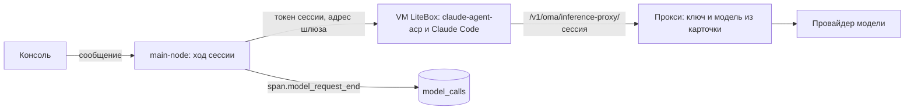
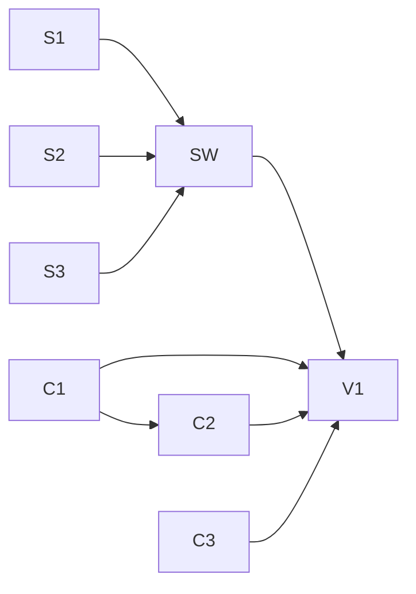

# Выбор модели, harness и аналитика в конструкторе агентов

Черновик 1, 2026-10-16. Статус: план, код не менялся.

Запрос владельца: у агента должен быть выбор модели и выбор harness, и должна быть аналитика как в CMA. Остальное пока не трогаем.

Ориентир интерфейса: [cma-ui-reference.md](../cma-ui-reference.md), разделы 3 (карточка агента), 4 (страница сессии) и 6 (аналитика). Вид остаётся DDC, тексты на русском.

Обозначения путей:

- `P/...` от `/home/vnkjd/orca/projects/ai-native-backoffice-v3/platform`;
- `S/...` от `/home/vnkjd/orca/projects/ai-native-backoffice-v3/.claude/skills/verify-agent-console`.

## 0. Коротко

1. **Один список моделей.** Новый маршрут `GET /v1/oma/model_options` отдаёт консоли все модели, которые можно выбрать: карточки моделей рабочего пространства и встроенные модели Anthropic, если на сервере задан `ANTHROPIC_API_KEY`. У каждой модели есть контекст, цена, уровни усилия, поддержка быстрой скорости и список совместимых harness.
2. **Форма агента.** В разделе «Основное» по порядку: название, harness, модель с усилием рядом (как в CMA), скорость, описание, системный промпт. Несовместимые с harness модели видны, но выбрать их нельзя, рядом причина.
3. **Harness в форме.** Два готовых варианта: «Встроенный цикл» (Pi, по умолчанию) и «Claude Code в песочнице» (`acp-sandbox` + `claude-agent-acp`). Другие ACP-агенты, для которых в коде есть адаптер модели (Codex, Gemini, OpenCode, Kimi, pi-acp), показываем в группе «Не проверено». `ai-sdk` (устарел) и `acp-proxy` (нет на Node) не предлагаем.
4. **Совместимость задаёт сервер.** Правило одно: протокол модели должен входить в протоколы harness. Консоль выключает несовместимое, сервер отклоняет его при создании и изменении агента через `/v1/agents`.
5. **Claude Code ходит в модель через прокси сервера.** Ключ модели не попадает ни в песочницу, ни в конфиг агента. Процесс в песочнице получает адрес `/v1/oma/inference-proxy/<сессия>` и короткий токен этой сессии. Прокси подставляет ключ и модель из карточки. Ключи в `_oma.acp.agent.env` сервер больше не принимает.
6. **Ключ модели.** Остаётся в карточке модели, зашифрован AES-GCM (метка `model.cards.keys` от `PLATFORM_ROOT_SECRET`). Без `PLATFORM_ROOT_SECRET` сервер ключ не принимает, открытым текстом он больше не хранится. Маршрут `GET /v1/oma/model_cards/:id/key` закрываем. Ссылку «карточка → учётные данные хранилища секретов» откладываем (раздел 1.4).
7. **Аналитика на таблице фактов.** Новая таблица `model_calls`: одна строка на вызов модели (для ACP одна строка на ход). Её заполняет сервер в момент события `span.model_request_end`, стоимость считается сразу и хранится в миллионных долях доллара. Агрегация JSON событий при каждом открытии страницы отвергнута: медленно и модель в событии не гарантирована.
8. **Цена.** Из карточки (`pi_config.cost`, новые поля в форме карточки), иначе из каталога Pi, иначе «цена не задана». Доллары за 1 млн токенов, как в каталоге Pi.
9. **Меню «Аналитика».** Три раздела: «Использование», «Стоимость», «Журнал запросов». Фильтры: период, агент, модель, harness. Группировка: модель, агент, harness. Плитки, график по дням, таблица, выгрузка CSV. Даты в UTC.
10. **Сессия.** В шапке модель, harness, токены (вход и выход) и стоимость, при наличии бюджета «стоимость / бюджет». Новая вкладка «Тулы»: вызовы, ошибки, p50, время в тулах.
11. **Проверка.** Скилл `verify-agent-console` получает сценарий «модель и усилие сохраняются и доходят до модели, harness Claude Code запускается в VM, аналитика показывает точные токены и стоимость прогона». Все числа сверяются с журналом фейковой модели.

## 1. Модель

### 1.1 Что есть сейчас

- Поле `model` у агента: строка или `{id, effort?, speed?, max_tokens?, provider_options?, inference_geo?}`, где `id` это handle карточки (`card.model_id`), а не id модели у провайдера (`P/packages/api-types/src/types.ts:49-57`).
- Форма агента выбирает модель combobox'ом по `/v1/oma/model_cards` (`P/apps/console/src/pages/agents/AgentFormDialog.tsx:724-768`). Усилия нет, скорость основной модели не редактируется, а при смене модели `buildModelValue` теряет `effort` (`P/apps/console/src/pages/agents/agentFormCodec.ts:361-382`).
- Без карточек моделей в форме нет группы «Модель», агента можно создать только через YAML (строка «внимание» `agent.form_without_model_cards` в скилле проверки).
- Сервер ищет ключ так: карточка по handle, иначе `ANTHROPIC_API_KEY` из окружения, и тогда handle уходит провайдеру как id модели (`P/apps/main-node/src/modules/node-foundation.ts:294-345`).
- `GET /v1/models` уже строится из карточек и знает уровни усилия (`P/packages/managed-agents-adapters-runtime/src/model-card-catalog.ts:86-168`), но не знает цен, провайдера, протокола и встроенных моделей. Его не меняем: это общий с upstream маршрут совместимости с API CMA.

### 1.2 Один список моделей: `GET /v1/oma/model_options`

Новый маршрут в main-node. Источники:

- **Карточки** рабочего пространства, не архивные. Метаданные берутся так же, как в `model-card-catalog.ts`: каталог Pi по `card.model` и провайдеру, иначе `pi_config`.
- **Встроенные** модели: каталог Pi провайдера `anthropic`, только если на сервере задан непустой `ANTHROPIC_API_KEY`. Handle равен id модели в каталоге Pi (например `claude-sonnet-4-6`). Ход такого агента уже работает через запасной путь `resolveNodeModelCreds`. Если карточка с тем же handle есть, побеждает карточка, встроенная модель в списке не дублируется.

Ответ:

```json
{
  "builtin_available": true,
  "data": [
    {
      "handle": "verify-fake",
      "label": "Claude Sonnet 4.6",
      "source": "card",
      "card_id": "mc_...",
      "is_default": true,
      "provider": "anthropic",
      "wire_model": "claude-sonnet-4-6",
      "api": "anthropic-messages",
      "context_window": 200000,
      "max_output_tokens": 64000,
      "effort_levels": ["low", "medium", "high", "max"],
      "speed_fast": true,
      "price": { "input": 3, "output": 15, "cache_read": 0.3, "cache_write": 3.75, "source": "card" },
      "harnesses": ["pi", "claude-acp"]
    }
  ]
}
```

- `api` это протокол Pi (`anthropic-messages`, `openai-completions`, `openai-responses`, `google-generative-ai` и т. п.). Если метаданных нет (своя модель без `pi_config.api`), `api` равен `null`, и модель совместима только со встроенным циклом.
- `speed_fast` истинно только для `anthropic-messages` и `openai-*` (`P/apps/agent/src/harness/pi-provider.ts:233-273`).
- `price` равен `null`, если цены нет ни в карточке, ни в каталоге.
- Порядок: сначала карточка по умолчанию, потом остальные карточки, потом встроенные (новые сверху).

### 1.3 Форма агента

Раздел «Основное» в две колонки, как в CMA: слева название раздела и пояснение, справа поля.

```
Основное                        Название      [ verify-agent           ]
Что это за агент, кто           Harness       [ Встроенный цикл      v ]
ведёт ход и какой моделью                     Платформа сама ведёт ход ...
                                Модель        [ verify-fake          v ] [ Усилие: Высокое v ]
                                              Карточка · Anthropic · 200 тыс. токенов · $3 / $15 за 1 млн
                                Скорость      ( Обычная ) ( Быстрая )
                                Описание      [                        ]
                                Системный промпт [                     ]
```

Выпадающий список моделей:

- две группы: «Карточки моделей» и «Ключ сервера»; поиск по handle и названию;
- строка: название, handle моноширинным шрифтом, бейдж «По умолчанию», ниже серым провайдер, контекст («200 тыс. токенов») и цена («$3 / $15 за 1 млн», или «цена не задана»);
- модель, несовместимая с выбранным harness, видна, но выключена, причина в подсказке: «Claude Code работает только с моделями с API Anthropic»;
- внизу ссылка «Добавить карточку модели» на `/model-cards`.

Поведение:

- **По умолчанию** подставляется карточка `is_default`, иначе первая карточка, иначе первая встроенная модель. Значит, форма работает и без карточек, если есть ключ сервера. Если нет ни карточек, ни ключа, вместо поля предупреждение «Модели не настроены» со ссылкой на карточки.
- **Усилие**: селект рядом с моделью. Пункты «По умолчанию» (поле не задаётся) и только поддерживаемые моделью уровни: «Низкое» (low), «Среднее» (medium), «Высокое» (high), «Очень высокое» (xhigh), «Максимальное» (max). Если у модели нет уровней, селект выключен с подсказкой «Модель не поддерживает усилие».
- **Смена модели** сохраняет усилие и скорость, если новая модель их поддерживает. Иначе сбрасывает их, и под полем видно «Усилие сброшено: модель его не поддерживает».
- **Скорость**: «Обычная» и «Быстрая», видна только если `speed_fast` и harness встроенный.
- **Вспомогательная модель** (для `aux_model`) берётся из того же списка, только для встроенного цикла.
- В режиме YAML/JSON всё как сейчас. Форма читает и пишет `model.effort` и `model.speed`, остальные поля объекта `model` (`max_tokens`, `provider_options`) сохраняет как есть.

### 1.4 Своя модель через карточку

Страница «Карточки моделей» (`P/apps/console/src/pages/ModelCardsList.tsx`) остаётся, добавляется немного:

- **Anthropic.** Провайдер `anthropic`, модель у провайдера (`claude-sonnet-4-6`), ключ. `base_url` пустой или свой шлюз Anthropic. Проверка ключа при создании уже работает (`P/packages/http-routes/src/model-cards/index.ts:53-56`).
- **OpenAI-совместимый шлюз (LiteLLM, vLLM, Ollama).** Новый пресет «OpenAI-совместимый шлюз» в списке провайдеров: провайдер `openai-compatible`, `base_url` вида `http://litellm:4000/v1`, модель равна имени модели или алиасу в LiteLLM, ключ равен виртуальному ключу LiteLLM. Pi ходит по протоколу `openai-completions` (`P/apps/agent/src/harness/pi-provider.ts:313-362`). Такая модель подходит только встроенному циклу. Сквозь LiteLLM путь не проверялся (раздел 7).
- **Свой провайдер** с `pi_config.api`: как сейчас, через поле JSON.
- **Цена.** Новый блок «Цена за 1 млн токенов, USD»: вход, выход, чтение кэша, запись кэша. Пишется в `pi_config.cost` (`{input, output, cacheRead, cacheWrite}`), то есть в формат, который каталог уже понимает (`model-card-catalog.ts:103, 117`). Если поля пустые, под ними видно цену из каталога Pi («По каталогу: $3 / $15») или «Цена не задана: стоимость не посчитается».
- **Ключ.** Подпись поля: «Ключ хранится на сервере в зашифрованном виде и больше не показывается». Сервер:
  - не принимает ключ, если не задан `PLATFORM_ROOT_SECRET` (ответ 400 «Задайте PLATFORM_ROOT_SECRET: без него ключ хранился бы открытым текстом»). Сейчас в этом случае ключ пишется как есть (`node-foundation.ts:150-155`);
  - закрывает `GET /v1/oma/model_cards/:id/key` (404). Консоль его не вызывает, main-node берёт ключ из сервиса напрямую.

  Почему не хранилище секретов (vault). Учётные данные хранилищ в OpenMA привязаны к адресу MCP-сервера, и для ссылки «карточка → учётные данные» пришлось бы менять общие с upstream схемы хранилищ и карточек. Шифрование в карточке уже такое же, как в хранилищах. Ссылку на хранилище делаем отдельной задачей, если владелец попросит.

### 1.5 Проверка на сервере

Проверка (guard) стоит перед маршрутами создания и изменения агента `/v1/agents` (`P/apps/main-node/src/modules/node-http.ts:338`). Общий с upstream код валидации (`P/packages/managed-agents-api/src/contracts/agents.ts`) не меняем. Guard проверяет итоговый конфиг: для изменения он читает текущего агента и накладывает тело запроса.

- Handle модели есть в `model_options` (карточка или встроенная). Иначе 400 «Модель «x» не найдена: добавьте карточку модели».
- `effort` входит в `effort_levels` модели.
- `speed: fast` только при `speed_fast` и встроенном цикле.
- `harness` пустой, `default`, `pi` или `acp-sandbox`. `ai-sdk` принимается, только если агент уже был с ним и harness не меняется.
- Для `acp-sandbox`: задан `acp.agent.command`, агент есть в каталоге harness, протокол модели совместим (раздел 2.3).
- В `_oma.acp.agent.env` нет имён, похожих на секрет (`KEY`, `TOKEN`, `SECRET`, `PASSWORD` в любом регистре). Ответ: «Ключи в env не кладите: модель подключается через карточку».
- При изменении агента модель и совместимость проверяются, только если менялись `model` или `harness`. Иначе старые агенты с удалённой карточкой нельзя было бы даже переименовать.

Ошибка в формате managed API: `{"type":"error","error":{"type":"invalid_request_error","message":"..."}}`, текст по-русски, консоль показывает его в блоке ошибки окна.

Legacy `/v1/oma/agents` консоль не использует, его не трогаем.

### 1.6 Где видна модель

- **Карточка агента** (`P/apps/console/src/pages/AgentDetail.tsx:171`, регион «Свойства агента»): строка «Модель»: название, handle, «Усилие: высокое», «Быстрая», источник («Карточка» или «Ключ сервера»). Новая строка «Harness». Ссылка «Аналитика агента» ведёт на `/analytics/usage?agent_id=<id>`.
- **Шапка сессии** (`P/apps/console/src/pages/SessionDetail.tsx`, ряд бейджей около строки 968): бейджи «Модель» и «Harness» рядом с агентом и окружением. Значения берутся из снимка агента в сессии, то есть показывают то, с чем сессия реально запущена.

## 2. Harness

### 2.1 Варианты

| В форме | Что пишется в агента | Модели | Что умеет | Статус |
|---|---|---|---|---|
| Встроенный цикл | `_oma.harness` не задан | любая из `model_options` | инструменты платформы, навыки, MCP, мультиагентность, усилие, скорость | готов, по умолчанию |
| Claude Code в песочнице | `_oma.harness: acp-sandbox`, `_oma.acp.agent: {id: claude-acp, command: claude-agent-acp}` | протокол `anthropic-messages` | свои инструменты Claude Code внутри VM окружения | делаем в этом плане |
| Codex в песочнице | `acp-sandbox`, `{id: codex-acp, command: codex-acp}` | `openai-responses` | свои инструменты Codex | не проверено |
| Gemini CLI в песочнице | `acp-sandbox`, `{id: gemini, command: gemini, args: [--acp]}` | `gemini` | свои | не проверено |
| OpenCode, Kimi, pi-acp | `acp-sandbox`, команды из `P/packages/acp-runtime/src/known-agents.ts` | `openai-chat` | свои | не проверено |

- Список ACP-агентов берётся из `known-agents.ts`, но в форму попадают только те, для кого есть адаптер модели в `P/packages/harness-inference-adapters/src/adapters` (claude, codex, gemini, opencode, kimi, pi). Остальным (aider, mimo, mcode, hermes) ключ пришлось бы класть в `env`, а это мы запрещаем.
- `ai-sdk` в форме не предлагается. Если агент уже с ним, поле показывает «AI SDK (устарел)» и предлагает перейти на встроенный цикл.
- `acp-proxy` (Claude Code на ноутбуке через мост) на Node не работает, см. [runbook-claude-code-harness.md](../runbook-claude-code-harness.md). Не предлагаем.

### 2.2 Поле «Harness» в форме

Селект с описанием под ним. Тексты:

- **Встроенный цикл.** «Платформа сама ведёт ход: вызывает модель, инструменты, навыки и MCP-серверы. Подходит любая модель из списка.»
- **Claude Code в песочнице.** «Ход выполняет Claude Code внутри VM окружения. Нужны модель с API Anthropic и окружение с пакетом npm `@agentclientprotocol/claude-agent-acp`. Инструменты, навыки и MCP платформы не используются: у Claude Code свои.»
- **Не проверено (группа).** «Агент запускается так же, как Claude Code, но на нашем сервере этот путь не проверялся.»

Что меняется в форме при выборе ACP-агента:

- список моделей фильтруется по протоколу, несовместимые выключены с причиной;
- усилие и скорость скрыты: в ACP они не передаются;
- вкладки «Инструменты» и «MCP-серверы» показывают пояснение «Для Claude Code не используются» вместо полей; значения не стираются, при возврате на встроенный цикл они на месте;
- под полем подсказка про окружение: «В окружении сессии должен стоять пакет npm `@agentclientprotocol/claude-agent-acp`» и ссылка на «Окружения». Это предупреждение, а не запрет: пакет может быть в своём образе VM.
- Если сервер не готов к ACP (нет `PLATFORM_ROOT_SECRET` или адреса шлюза, раздел 2.4), вариант выключен с причиной из `GET /v1/oma/harnesses`.

### 2.3 Совместимость

Правило: протокол модели (`api` из `model_options`) входит в протоколы harness.

| Harness | Протоколы |
|---|---|
| Встроенный цикл | любые, включая `null` |
| Claude Code (`claude-acp`) | `anthropic-messages` |
| Codex (`codex-acp`) | `openai-responses` |
| Gemini (`gemini`) | `google-generative-ai` |
| OpenCode, Kimi, pi-acp | `openai-completions` |

Соответствие имён протоколов Pi и адаптеров (`openai-chat` у адаптеров равен `openai-completions` у Pi, `gemini` равен `google-generative-ai`) живёт в одном месте, в каталоге harness на сервере.

Каталог отдаёт `GET /v1/oma/harnesses`:

```json
{
  "data": [
    { "id": "pi", "runtime_harness": null, "acp_agent": null, "status": "ready",
      "protocols": ["*"], "supports": { "effort": true, "speed": true, "platform_tools": true } },
    { "id": "claude-acp", "runtime_harness": "acp-sandbox",
      "acp_agent": { "id": "claude-acp", "command": "claude-agent-acp", "args": [] },
      "status": "ready", "protocols": ["anthropic-messages"],
      "supports": { "effort": false, "speed": false, "platform_tools": false },
      "requires": { "packages": [{ "manager": "npm", "name": "@agentclientprotocol/claude-agent-acp" }] } },
    { "id": "codex-acp", "status": "experimental", "...": "..." }
  ]
}
```

`status` равен `unavailable` с полем `reason`, если серверу чего-то не хватает. Консоль и guard (раздел 1.5) пользуются одним и тем же каталогом.

### 2.4 Что нужно серверу для Claude Code в песочнице

Сейчас путь `acp-sandbox` на managed-маршруте консоли, скорее всего, не работает. Что исправить:

1. **Пустое сообщение пользователя.** `buildHarnessContext` передаёт `userMessage` с пустым `content` (`P/apps/main-node/src/modules/node-managed.ts:627`), и `acp-sandbox` отвечает ошибкой «empty turn» (`P/apps/agent/src/harness/acp-sandbox-loop.ts:92-95`). Нужно собрать сообщение из `acceptedEvents` хода (все `user.message`, текстовые блоки по порядку). Встроенному циклу это не мешает: он читает историю.
2. **Модель через прокси.** На main-node уже есть `/v1/oma/inference-proxy/:sessionId/*` (`node-http.ts:416`), он берёт ключ из карточки модели агента сессии (`node-managed.ts:274-306`). Не хватает трёх вещей:
   - **токен сессии для песочницы.** Новый запечатанный токен `{workspace, session, exp}` (шифр `secrets.cipherFor("managed.sandbox-inference")`, срок 12 ч). Он годится только для пути прокси своей сессии. Новый тип учётных данных `sandbox_inference` в `P/packages/auth/src/index.ts` разрешён только на `isHostedInferenceProxyPath`. Прокси сверяет сессию токена с сессией в пути, сейчас такой проверки нет (`P/apps/main-node/src/lib/http-inference-proxy.ts`);
   - **адрес сервера, видимый из VM.** Новая настройка `SANDBOX_GATEWAY_BASE_URL` (иначе `PUBLIC_BASE_URL`). `127.0.0.1` из VM указывает на саму VM;
   - **контекст `hostedInference`** для хода (`P/apps/agent/src/harness/interface.ts:316`): адрес шлюза, токен, провайдер и протокол карточки. Тогда `acp-sandbox-loop.ts:152-184` сам выставит Claude Code `ANTHROPIC_BASE_URL`, `ANTHROPIC_AUTH_TOKEN` и `ANTHROPIC_MODEL` через адаптер `P/packages/harness-inference-adapters/src/adapters/claude.ts` и уберёт `ANTHROPIC_API_KEY`.
3. **Подмена модели в прокси.** Адаптер ставит Claude Code в `ANTHROPIC_MODEL` handle агента (`acp-sandbox-loop.ts:139`), а прокси пересылает тело без изменений. Провайдер получил бы `verify-fake` вместо `claude-sonnet-4-6`. Прокси меняет поле `model` в JSON-теле на `wire_model` карточки. Заодно все служебные вызовы Claude Code (лёгкая модель для заголовков) идут в ту же модель и попадают в учёт.
4. **Жизнь процесса ACP.** Сейчас на каждый ход создаётся новый harness (`node-managed.ts:585`), а старый не закрывается (`P/apps/main-node/src/lib/node-managed-session-runner.ts:514, 559`). Процесс Claude Code прошлого хода висит до таймаута простоя 30 минут, а новый ход начинает разговор заново. Нужен кэш harness на сессию: тот же экземпляр для той же сессии и той же конфигурации, закрытие при смене конфигурации, при вытеснении (не больше 50 записей) и при завершении сессии. Так же устроен legacy-путь (`P/packages/session-runtime/src/machine.ts:241-248`).
5. **Установка в песочницу.** Harness ничего не ставит. Claude Code ставится пакетом окружения: npm `@agentclientprotocol/claude-agent-acp` (незакоммиченная правка другого workflow, `P/packages/sandbox/src/environment-setup.ts:112-113`, LiteBox `npm install -g`). Нужна сеть до реестра npm при подготовке и до `SANDBOX_GATEWAY_BASE_URL` во время хода. Для сети «Ограниченный» адрес шлюза надо добавить в разрешённые хосты, консоль окружения подсказывает это для Claude Code. Свой образ через `SANDBOX_IMAGE` тоже подходит.
6. **Ключи не в env.** Guard (раздел 1.5) не пускает секреты в `_oma.acp.agent.env`. Сейчас `env` агента отдаётся в API без маскировки (`P/packages/managed-agents-api/src/contracts/agent-response-components.ts:169`), поэтому лучше, чтобы ключей там не было вовсе.
7. **Учёт.** `AcpTranslator` уже шлёт `span.model_request_end` с токенами из ответа ACP на ход (`P/apps/agent/src/harness/acp-translate.ts:291-316`). Факт пишется так же, как для встроенного цикла (раздел 3.7), но одна строка равна одному ходу, а не одному вызову модели.



### 2.5 Как harness виден

- Карточка агента: строка «Harness» («Встроенный цикл», «Claude Code в песочнице»).
- Шапка сессии: бейдж harness рядом с моделью.
- Аналитика: фильтр и группировка по harness, колонка в журнале запросов.
- Ключ harness в фактах и фильтрах: `pi` (не задан, `default`, `pi`), `ai-sdk`, или id ACP-агента (`claude-acp`, `codex-acp` и т. д.).

## 3. Аналитика

### 3.1 Меню и страницы

Новая группа меню «Аналитика» после «Управляемые агенты» (`P/apps/console/src/components/AppSidebar.tsx:28-60`, функция `useNavGroups`):

- «Использование», `/analytics/usage`;
- «Стоимость», `/analytics/cost`;
- «Журнал запросов», `/analytics/logs`.

Сверху каждой страницы одна строка: «Данные появляются после завершения вызова модели. Даты в UTC.»

### 3.2 Общие фильтры

Одна строка чипов, как в CMA (`P/apps/console/src/components/FilterChip.tsx`, `FacetedFilter.tsx`):

- **Период.** «Сегодня», «7 дней», «30 дней» (по умолчанию), «90 дней», свой диапазон. Не больше 92 дней.
- **Агент**, **Модель**, **Harness:** множественный выбор из значений, которые есть за период (`GET /v1/oma/analytics/facets`).
- **Группировать по.** «Модели» (по умолчанию), «Агенту», «Harness», «Без группировки». На журнале этого чипа нет.

Все фильтры живут в адресной строке (`?from=&to=&agent_id=&model=&harness=&group_by=`), поэтому ссылки «Аналитика агента» и «Все запросы сессии» сразу открывают нужный срез.

### 3.3 Использование

- Плитки: «Токены на входе», «Токены на выходе», «Кэш: чтение / запись», «Запросы к модели» (под числом «из них ошибок: N»).
- График «Токены по дням»: столбцы по дням, сложенные по группе, легенда с цветом группы. Высота столбца равна входу плюс выход. Подсказка при наведении: день, группа, вход, выход, кэш, запросы.
- Переключатель «График / Таблица». Таблица: группа, запросы, ошибки, вход, выход, кэш, доля.
- Кнопка «Скачать CSV»: те же данные с сервера (`format=csv`).
- Пустое состояние: «За период нет вызовов модели. Запустите сессию агента.»

### 3.4 Стоимость

- Плитки: «Общая стоимость», «Стоимость токенов», «Запросы без цены» (с подсказкой «Задайте цену в карточке модели»). В CMA есть ещё веб-поиск, выполнение кода и время сессий; у нас этих данных нет, плитки не показываем (раздел 3.11).
- График «Стоимость по дням», сложенный по группе. Таблица и CSV как на «Использовании».
- Суммы в долларах: до $1 четыре знака после запятой, дальше два.

### 3.5 Журнал запросов

- Таблица (`P/apps/console/src/components/DataTable.tsx`): время, статус («Успешно» или «Ошибка» с текстом в подсказке), сессия (ссылка), агент, модель, harness, вход, выход, кэш, задержка, стоимость, скорость. ID вызова моноширинным шрифтом с копированием.
- Новые сверху, по 50 строк, кнопка «Показать ещё» (курсор).
- Дополнительные фильтры: «Статус» и «Сессия» (приходит из ссылки в шапке сессии).
- «Скачать CSV»: до 10 000 строк по текущим фильтрам.

### 3.6 Сессия: шапка и вкладка «Тулы»

**Шапка** (`SessionDetail.tsx`, рядом с `SessionDurationBadge`):

- бейджи «Модель» и «Harness» (раздел 1.6);
- «Токены: 1,2 тыс. / 300» (вход / выход), в подсказке кэш и число вызовов;
- «$0,0081», а если у сессии задан бюджет (`budget.max_list_cost`, `P/packages/managed-agents-api/src/contracts/sessions.ts:110-125`), то «$0,0081 / $1,00»;
- клик по токенам или стоимости открывает журнал запросов этой сессии.

Данные: `GET /v1/oma/analytics/sessions/:id`, перезапрос после каждого хода (смена статуса на «Ожидает»).

**Вкладка «Тулы»** рядом с «Разговор» и «Хронология» (`SessionDetail.tsx:1058`). Считается в браузере по событиям сессии, которые уже загружены, по образцу `P/apps/console/src/components/timeline/derive.ts`:

- таблица: тул, разрешение (из `evaluated_permission`), вызовы, ошибки, p50 длительности (между `agent.tool_use` и `agent.tool_result`);
- кольцо «выполнено, ошибки, отклонено, прервано» (прервано: `tool_use` без результата при завершённом ходе);
- «Время в тулах: всего, выполнение, ожидание вас» (ожидание: от `tool_use` с разрешением «спросить» до подтверждения пользователя).

Для Claude Code вкладка показывает инструменты Claude Code из тех же событий `agent.tool_use`.

### 3.7 Откуда данные: таблица фактов `model_calls`

Почему не агрегация событий на лету. События лежат в `managed_session_events` как текст JSON (`P/packages/db-schema/src/cf-auth/managed-agents.ts:518`), индексы только в рамках одной сессии. Отчёт за 30 дней читал бы и разбирал JSON всех событий рабочего пространства. Модель в событии не гарантирована: публичная схема события её не знает, а сохраняется ли она в документе, не проверено. Поэтому пишем отдельные строки фактов, когда событие происходит.

Таблица `model_calls` (SQLite и Postgres, одна миграция `0028_model_calls` в обоих каталогах):

| Колонка | Тип | Что это |
|---|---|---|
| `workspace_id` | text | рабочее пространство |
| `id` | text | id события `span.model_request_end` |
| `session_id` | text | сессия |
| `agent_id`, `agent_version` | text, int | агент из снимка сессии |
| `harness` | text | `pi`, `ai-sdk`, `claude-acp`, ... |
| `model` | text | handle модели агента |
| `provider`, `wire_model` | text | из карточки, для встроенной `anthropic` и id модели |
| `source` | text | `card`, `builtin`, `unknown` |
| `effort`, `speed` | text | из модели агента |
| `started_at`, `ended_at` | int, мс | начало берётся из `span.model_request_start` |
| `day` | text | `YYYY-MM-DD` по UTC от `ended_at` |
| `latency_ms` | int | `ended_at - started_at` |
| `input_tokens`, `output_tokens`, `cache_read_tokens`, `cache_write_tokens` | int | из `model_usage` события |
| `is_error`, `finish_reason`, `error_message` | int, text, text | текст ошибки до 200 знаков |
| `cost_usd_micros` | int, null | стоимость в миллионных долях доллара, `null` без цены |
| `price_source` | text | `card`, `catalog`, `none` |

Первичный ключ `(workspace_id, id)`, вставка с пропуском повтора, поэтому повторная запись того же события не удваивает счёт. Индексы: `(workspace_id, day, model)`, `(workspace_id, ended_at, id)`, `(workspace_id, session_id)`.

Где пишется: в `ManagedNodeHarnessRuntime.broadcast` (`P/apps/main-node/src/lib/node-managed-harness-runtime.ts:297`). Он видит исходное событие со всеми полями до того, как домен их отбросит. Runtime запоминает время каждого `span.model_request_start`, а на `span.model_request_end` отдаёт факт в приёмник. Контекст (агент, версия, модель, harness) передаёт runner (`P/apps/main-node/src/lib/node-managed-session-runner.ts:428`) и такой же код для подагентов (`P/apps/main-node/src/lib/node-managed-subagents.ts:275`). Ошибка записи факта не роняет ход: пишется предупреждение в лог.

Попутно чиним `session.usage`: счётчик создаётся заново на каждом ходе (`node-managed-harness-runtime.ts:281`), и в сессии остаётся только последний ход. Счётчик начинаем со значения из сессии, и `GET /v1/sessions/:id` отдаёт сумму за сессию.

### 3.8 Цены

- Порядок: `pi_config.cost` карточки, затем каталог Pi по провайдеру и `wire_model` (для встроенных по id модели), иначе цены нет.
- Цены в каталоге Pi в долларах за 1 млн токенов (`cost: {input, output, cacheRead, cacheWrite}`). Поэтому стоимость в миллионных долях доллара считается без деления: `вход × цена входа + выход × цена выхода + кэш чтения × цена + кэш записи × цена`, с округлением до целого на строке. Пример: 20 токенов входа по $3 и 10 выхода по $15 дают 60 + 150 = 210, то есть $0,00021.
- Цена фиксируется в момент вызова. Смена цены в карточке не переписывает прошлые строки, как в настоящем биллинге.
- Валюта одна, доллар.

### 3.9 API аналитики

Все маршруты под `/v1/oma/analytics`, доступ как у остальных `/v1/oma/*` (пользователь рабочего пространства или ключ API). Даты `from` и `to` включительно, формат `YYYY-MM-DD`, по UTC.

- `GET /usage?from&to&agent_id&model&harness&group_by&format`

  ```json
  {
    "from": "2026-09-17", "to": "2026-10-16", "group_by": "model", "currency": "USD",
    "totals": { "requests": 12, "errors": 1, "input_tokens": 1200, "output_tokens": 300,
                "cache_read_tokens": 0, "cache_write_tokens": 0,
                "cost_usd_micros": 8100, "unpriced_requests": 0 },
    "groups": [ { "key": "verify-fake", "requests": 12, "input_tokens": 1200, "output_tokens": 300,
                  "cache_read_tokens": 0, "cache_write_tokens": 0, "cost_usd_micros": 8100 } ],
    "series": [ { "day": "2026-10-16", "key": "verify-fake", "requests": 12, "input_tokens": 1200,
                  "output_tokens": 300, "cache_read_tokens": 0, "cache_write_tokens": 0,
                  "cost_usd_micros": 8100 } ],
    "latest_ended_at": "2026-10-16T09:12:03.120Z"
  }
  ```

  Один маршрут кормит и «Использование», и «Стоимость». Фильтры с несколькими значениями через запятую.
- `GET /model_calls?from&to&agent_id&model&harness&session_id&status&limit&cursor&format`: `{"data":[...строки таблицы фактов...], "next_cursor": "..."}`. `limit` до 200, по умолчанию 50. Курсор непрозрачный, по `(ended_at, id)`.
- `GET /sessions/:id`: итоги сессии (те же поля, что `totals`) плюс `models`, `harness` и `budget_usd_micros` (или `null`).
- `GET /facets?from&to`: агенты (id и имя), модели и harness, у которых есть строки за период.

`format=csv` отдаёт `text/csv` с заголовком на английском (имена полей), числа без форматирования.

### 3.10 Скорость на SQLite и Postgres

- В запросах нет разбора JSON и функций дат: день хранится готовой строкой, поэтому один и тот же SQL работает в обеих базах через общий клиент `sql` main-node.
- Отчёт за период: `WHERE workspace_id = ? AND day BETWEEN ? AND ? ... GROUP BY day, <группа>` по индексу `(workspace_id, day, model)`. Журнал: курсор по индексу `(workspace_id, ended_at, id)`, без `OFFSET`.
- Запись: одна вставка на вызов модели, в фоне от хода.
- Ожидание по объёму: десятки тысяч строк в месяц на стенде. Скрипт замера `P/apps/main-node/scripts/analytics-bench.ts` заполняет SQLite 200 000 строк и проверяет, что отчёт за 30 дней с группировкой укладывается в 300 мс. Скрипт ручной, в обычные тесты не входит (ноутбук владельца).
- Если когда-нибудь станет медленно: дневная таблица итогов, которую обновляет та же вставка. Сейчас не делаем.
- MySQL: таблицу не добавляем. На MySQL запись фактов выключена, маршруты аналитики отвечают 501.

### 3.11 Что сознательно не делаем

- Страницы «Кэширование» и «Лимиты» из CMA.
- Стоимость веб-поиска, выполнения кода и времени песочницы. `usage_events` на Node не пишется, `cost-attribution-*` в копию не перенесены.
- Хранение тел запросов к модели (на Node `/llm-calls` отвечает 501).
- Остановку сессии по бюджету: бюджет только показываем.
- Учёт в самом прокси (точные вызовы Claude Code, а не ход целиком).
- Перенос старых сессий в `model_calls`: аналитика начинается с выкатки.
- Фильтры по рабочему пространству и ключу API.

## 4. Единицы работы

Правила:

- У каждого файла один владелец. Новые файлы указаны явно. Файлы, которые сейчас правят другие workflow (`AgentFormDialog.tsx`, `SessionDetail.tsx`, `node-http.ts`, `node-managed.ts`, файлы скилла), берём в работу только после того, как их правки закоммичены.
- Серверные библиотеки (S1, S2, S3) не трогают `node-http.ts` и `node-managed.ts`. Всё подключение делает одна единица SW.
- Консоль пишет по контрактам из разделов 1.2, 2.3 и 3.9 и проверяет их на подставных ответах. Изменение контракта сначала вносится в этот файл.
- Тесты и сборки только через `test-slot`: `cd P/apps/main-node && test-slot pnpm test` и `test-slot pnpm typecheck`, `cd P/apps/console && test-slot pnpm test` и `test-slot pnpm typecheck`. Без watch. Сначала падающий тест, потом код.
- Каждая правка консоли проверяется скриншотами 1280 и 390 px, без горизонтальной прокрутки страницы.

| id | Владелец | Модель | Что | Зависит от |
|---|---|---|---|---|
| S1 | server | Opus | каталог моделей и harness, цены, guard агента и карточек | нет |
| S2 | server | Opus | Claude Code в песочнице: токен, сообщение хода, прокси, кэш harness | нет |
| S3 | server | Opus | таблица `model_calls`, запись фактов, API аналитики, `session.usage` | нет |
| SW | server | Opus | подключение S1, S2, S3 в main-node и сквозные тесты сервера | S1, S2, S3 |
| C1 | console | Sonnet | форма агента: модель, усилие, скорость, harness; карточка агента; цена в карточке модели | нет |
| C2 | console | Sonnet | сессия: модель, harness, токены и стоимость в шапке, вкладка «Тулы» | C1 |
| C3 | console | Sonnet | меню «Аналитика»: три страницы | нет |
| V1 | skill | Opus | новые проверки в `verify-agent-console` | SW, C1, C2, C3 |

### S1. Каталог моделей и harness, guard (server)

Файлы (все новые):

- `P/apps/main-node/src/lib/model-options.ts`, `P/apps/main-node/src/lib/model-pricing.ts`, `P/apps/main-node/src/lib/harness-catalog.ts`, `P/apps/main-node/src/lib/agent-config-guard.ts`, `P/apps/main-node/src/lib/catalog-routes.ts`;
- `P/apps/main-node/test/model-options.test.ts`, `model-pricing.test.ts`, `harness-catalog.test.ts`, `agent-config-guard.test.ts`, `catalog-routes.test.ts`.

Что сделать:

- `listModelOptions(deps)`: карточки и встроенные модели по разделу 1.2. Зависимости передаются параметрами: чтение карточек, наличие ключа сервера, готовность ACP. Метаданные Pi через `findPiCatalogModel` и `builtinProviders` (как в `model-card-catalog.ts`), уровни усилия через `getSupportedThinkingLevels`.
- `resolveModelPrice(card | builtin)`: порядок из раздела 3.8, ответ `{input, output, cache_read, cache_write, source} | null`.
- `harnessCatalog(deps)`: таблицы 2.1 и 2.3, статусы `ready`, `experimental`, `unavailable` с причиной.
- `agentConfigGuard(deps)`: Hono middleware для создания и изменения агента по разделу 1.5.
- `modelCardGuards(deps)`: ключ без `PLATFORM_ROOT_SECRET` даёт 400, `GET /:id/key` даёт 404.
- `buildCatalogRoutes(deps)`: `GET /model_options`, `GET /harnesses`.

Критерии приёмки:

- встроенные модели есть только при непустом ключе сервера; карточка с тем же handle скрывает встроенную;
- уровни усилия и `speed_fast` совпадают с каталогом Pi для 3 моделей (Anthropic, OpenAI, своя с `pi_config`);
- цена: из карточки, из каталога, `null`; источник указан верно;
- совместимость: карточка Anthropic даёт `["pi","claude-acp"]`, `openai-compatible` даёт `["pi"]`, своя без `api` даёт `["pi"]`;
- guard отклоняет: неизвестный handle, неподдерживаемое усилие, `fast` с ACP, несовместимый протокол, `acp-sandbox` без команды, секрет в `env`, неизвестный harness; пропускает строковую модель, старого агента с `ai-sdk` без смены harness, изменение имени у агента с удалённой карточкой;
- `test-slot pnpm test` и `test-slot pnpm typecheck` в `P/apps/main-node` зелёные.

### S2. Claude Code в песочнице: библиотека (server)

Файлы:

- новые `P/apps/main-node/src/lib/sandbox-inference-token.ts`, `P/apps/main-node/src/lib/acp-sandbox-turn.ts`;
- правка `P/apps/main-node/src/lib/http-inference-proxy.ts`;
- правка `P/packages/auth/src/index.ts` и `P/packages/auth/test/auth.test.ts`;
- новые `P/apps/main-node/test/sandbox-inference-token.test.ts`, `acp-sandbox-turn.test.ts`, `http-inference-proxy.test.ts`.

Что сделать:

- токен песочницы: выпуск и проверка (раздел 2.4, пункт 2), функция `resolveSandboxInferenceBearer` для `resolveBearerToken`;
- тип учётных данных `sandbox_inference` в auth: разрешён только на пути прокси;
- прокси: сессия токена равна сессии в пути, иначе 403; поле `model` в JSON-теле меняется на `wire_model` карточки; потоковый ответ идёт без буферизации;
- `toAcpTurnUserMessage(acceptedEvents)`: сообщение хода из событий `user.message`;
- `buildSandboxHostedInference({gatewayBaseUrl, token, card})`: объект `hostedInference` для контекста хода, протокол и `protocolEndpoints` через `P/packages/harness-inference-adapters/src/endpoint-catalog.ts`;
- `SessionHarnessCache`: harness на сессию по разделу 2.4, пункт 4, с `dispose` при смене конфигурации, вытеснении и `forget(sessionId)`.

Критерии приёмки:

- токен чужой сессии, просроченный и испорченный отклоняются; токен не открывает никакой другой маршрут `/v1/*`;
- прокси подменяет модель и пересылает поток SSE фейкового сервера без потерь;
- из двух `user.message` с текстом и картинкой собирается одно сообщение с текстом по порядку;
- кэш отдаёт тот же экземпляр для той же сессии и конфигурации и вызывает `dispose` при вытеснении;
- тесты и typecheck в `P/apps/main-node` и `P/packages/auth` зелёные.

### S3. Факты использования и API аналитики (server)

Файлы:

- новые `P/apps/main-node/migrations-sqlite/0028_model_calls.sql` и `P/apps/main-node/migrations/0028_model_calls.sql` с записями в их `meta/` (журнал и снимок, правила в `P/apps/main-node/migrations/README.md`);
- новые `P/packages/db-schema/src/cf-auth/model-calls.ts`, `P/packages/db-schema/src/node-pg/cf-auth-model-calls.ts` и строки экспорта в их `index.ts`;
- новые `P/apps/main-node/src/lib/analytics/model-call-store.ts`, `model-call-recorder.ts`, `analytics-routes.ts`, `csv.ts`;
- правка `P/apps/main-node/src/lib/node-managed-harness-runtime.ts`, `node-harness-usage.ts`, `node-managed-session-runner.ts`, `node-managed-subagents.ts`;
- новые `P/apps/main-node/test/analytics-model-calls.test.ts`, `analytics-model-calls.postgres.test.ts` (через `vitest.postgres.config.ts`), `managed-harness-usage.test.ts`, скрипт `P/apps/main-node/scripts/analytics-bench.ts`.

Что сделать:

- таблица и индексы по разделу 3.7;
- `ModelCallSink`: необязательная зависимость runner и runtime; контекст хода (агент, версия, модель, harness, усилие, скорость); цена через переданную функцию `resolvePrice`, без импорта S1;
- маршруты раздела 3.9 через `buildAnalyticsRoutes({sql, ...})`;
- `session.usage` копится за всю сессию;
- на MySQL приёмник и маршруты выключены.

Критерии приёмки:

- два хода по два вызова дают 4 строки; повтор того же события строку не добавляет;
- итоги, группы по модели, агенту и harness и ряды по дням совпадают с вручную посчитанными на наборе из 3 дней, 2 агентов и 2 моделей;
- стоимость 210 микродолларов на примере из раздела 3.8; строка без цены попадает в `unpriced_requests`;
- курсор журнала не теряет и не повторяет строки при одинаковом `ended_at`;
- тот же набор проходит на Postgres;
- `session.usage` после двух ходов равен сумме;
- тесты и typecheck зелёные; замер даёт меньше 300 мс (результат в описании изменения).

### SW. Подключение и сквозные тесты сервера (server)

Файлы:

- правка `P/apps/main-node/src/modules/node-http.ts`: маршруты `/v1/oma/model_options`, `/v1/oma/harnesses`, `/v1/oma/analytics`, guard на `/v1/agents`, guard карточек на `/v1/oma/model_cards`, токен песочницы в `resolveBearerToken`;
- правка `P/apps/main-node/src/modules/node-managed.ts`: сообщение хода, `hostedInference` для `acp-sandbox`, кэш harness вместо `resolveHarness` на каждый ход, `ModelCallSink` и `resolvePrice` в runner;
- правка `P/apps/main-node/src/config.ts`: `SANDBOX_GATEWAY_BASE_URL`;
- новые `P/apps/main-node/test/managed-model-harness-analytics.test.ts`, `P/apps/main-node/test/managed-acp-sandbox.test.ts`.

Что сделать: подключить S1, S2 и S3 без новой логики в этих файлах.

Критерии приёмки:

- через HTTP: агент с карточкой фейковой модели создаётся, ход идёт в `base_url` карточки с её ключом и `wire_model`; `GET /v1/oma/analytics/usage` и `/sessions/:id` отдают токены и стоимость этого хода; guard отвечает 400 на случаи из S1;
- managed-путь с поддельным ACP-агентом на `LocalSubprocess`: агент получает текст сообщения, в его окружении `ANTHROPIC_BASE_URL` указывает на прокси, есть токен, нет `ANTHROPIC_API_KEY`; второй ход идёт в тот же процесс; факт хода записан;
- весь `test-slot pnpm test` в `P/apps/main-node` зелёный, старые тесты не ослаблены;
- `S/scripts/doctor.sh` на свежем экземпляре проходит.

### C1. Форма агента и карточки моделей (console)

Файлы:

- правка `P/apps/console/src/pages/agents/AgentFormDialog.tsx`, `agentFormCodec.ts`, `agentFormCodec.test.ts`, `AgentFormDialog.test.tsx`;
- новые `P/apps/console/src/pages/agents/ModelPicker.tsx`, `HarnessPicker.tsx`, `harness-text.ts`, `model-format.ts`, `model-format.test.ts`, `HarnessPicker.test.tsx`;
- новый `P/apps/console/src/lib/catalog-api.ts`;
- правка `P/apps/console/src/pages/AgentDetail.tsx`, `P/apps/console/src/pages/ModelCardsList.tsx`.

Что сделать: разделы 1.3, 1.4 (пресет «OpenAI-совместимый шлюз», блок цены, подпись ключа), 1.6 (карточка агента), 2.2. Строки интерфейса в `harness-text.ts` и в самих компонентах, `i18n` не трогать (им владеет C3). Удалить неиспользуемый `AGENT_HARNESS_HINT` из `agentFormCodec.ts`.

Критерии приёмки:

- кодек: усилие сохраняется при смене на модель с тем же уровнем и сбрасывается на модели без него; Claude Code пишет `_oma.harness` и `_oma.acp.agent`, возврат на встроенный цикл их убирает, остальной `_oma` цел; YAML туда и обратно не теряет `effort`, `speed`, `max_tokens`;
- без карточек, но со встроенными моделями агент создаётся из формы;
- несовместимая модель выключена, причина читается в подсказке и в ARIA;
- в карточке агента видны модель, усилие и harness;
- в форме карточки модели цена сохраняется в `pi_config.cost`;
- тесты и typecheck консоли зелёные, скриншоты 1280 и 390.

### C2. Сессия: шапка и вкладка «Тулы» (console)

Файлы:

- правка `P/apps/console/src/pages/SessionDetail.tsx`;
- новые `P/apps/console/src/components/session/SessionUsageBadges.tsx`, `P/apps/console/src/components/session/ToolsPanel.tsx`, `P/apps/console/src/lib/tool-stats.ts`, `P/apps/console/src/lib/tool-stats.test.ts`, `P/apps/console/src/lib/session-usage-api.ts`, `P/apps/console/src/components/session/SessionUsageBadges.test.tsx`.

Что сделать: раздел 3.6 и бейджи модели и harness из раздела 1.6. Подписи harness берутся из `harness-text.ts` (C1), поэтому C2 идёт после C1.

Критерии приёмки:

- `tool-stats` на наборе событий даёт верные вызовы, ошибки, p50, прерванные и ожидание подтверждения;
- шапка показывает токены и стоимость из подставного ответа `/sessions/:id`, «/ бюджет» только при бюджете, без цены пишет «цена не задана»;
- клик по токенам ведёт на `/analytics/logs?session_id=...`;
- тесты и typecheck зелёные, скриншоты 1280 и 390.

### C3. Раздел «Аналитика» (console)

Файлы:

- правка `P/apps/console/src/main.tsx`, `P/apps/console/src/components/AppSidebar.tsx`, `AppSidebar.linear.test.tsx`, `CommandPalette.tsx`, `nav-icons.ts`, `P/apps/console/src/i18n/ru.ts`, `en.ts`, `zh-CN.ts`, `types.ts`;
- новые `P/apps/console/src/pages/analytics/UsagePage.tsx`, `CostPage.tsx`, `RequestLogPage.tsx`, `AnalyticsFilters.tsx`, `AnalyticsTiles.tsx`, `StackedBarChart.tsx`, `analytics-text.ts`, `analytics-format.ts` и тесты к ним;
- новый `P/apps/console/src/lib/analytics-api.ts`.

Что сделать: разделы 3.1 до 3.5. График рисуется своим SVG на токенах DDC, новых зависимостей нет. Цвета групп стабильны: одна и та же модель одного цвета на всех страницах.

Критерии приёмки:

- в меню группа «Аналитика» с тремя пунктами; тест порядка групп обновлён;
- фильтры читаются из адреса и пишутся в него; ссылка с `agent_id` открывает отфильтрованную страницу;
- плитки, график, таблица и журнал совпадают с подставным ответом API; формат денег и тысяч по-русски;
- «Показать ещё» добавляет следующую страницу журнала по `next_cursor`;
- пустое состояние и ошибка загрузки показаны;
- тесты и typecheck зелёные, скриншоты 1280 и 390 без горизонтальной прокрутки.

### V1. Новые проверки в verify-agent-console (skill)

Файлы:

- правка `S/SKILL.md`, `S/features/README.md`, `S/features/agents.md`, `S/features/sessions-and-agent-run.md`;
- новые `S/features/models-and-harness.md`, `S/features/analytics.md`;
- правка `S/scripts/fake-model.mjs`, `S/scripts/journey.sh`, `S/scripts/launch.sh`;
- новые `S/scripts/journey-models-analytics.mjs`, `S/scripts/journey-claude-code.mjs`. Шапка `fake-model.mjs` уже ссылается на `journey-claude-code.mjs`, а файла нет: перед стартом выяснить, не пишет ли его другой workflow, и взять его работу за основу.

Что сделать:

- фейковая модель пишет в журнал `thinking`, `output_config` и поле `model` запроса; токены в ответе заданы и известны сценарию;
- `launch.sh` задаёт `SANDBOX_GATEWAY_BASE_URL` с адресом хоста, видимым из VM LiteBox, и слушает на нём; в `doctor.sh` проверка, что адрес отвечает из VM, если включён сценарий Claude Code;
- сценарий «модели и аналитика» (встроенный цикл, режим fake):
  - `model.options_list`: в форме «Новый агент» видны карточка `verify-fake` с ценой и встроенная `claude-sonnet-4-6` с пометкой «Ключ сервера»;
  - `model.effort_saved`: выбрано усилие «Высокое», `GET /v1/agents/:id` отдаёт `model.id = verify-fake` и усилие high;
  - `model.effort_applied`: в журнале фейковой модели запрос хода с `model = claude-sonnet-4-6`, хэш ключа равен хэшу ключа карточки (не ключа сервера), поле усилия или thinking присутствует;
  - `harness.incompatible_disabled`: карточка `verify-oai` (`openai-compatible`) выключена при выборе Claude Code; тот же агент через API получает 400;
  - `analytics.usage_tokens`: на «Использовании» с фильтром по агенту плитки входа и выхода равны сумме токенов из журнала фейковой модели; то же в `/v1/oma/analytics/usage`;
  - `analytics.cost`: при цене карточки $3 и $15 стоимость равна расчёту по журналу (в микродолларах через API, в долларах на странице);
  - `analytics.logs` и `analytics.csv`: строк в журнале запросов сессии столько же, сколько запросов к фейковой модели, задержка больше нуля; CSV содержит те же строки;
  - `session.header_metrics`: токены и стоимость в шапке сессии равны `/analytics/sessions/:id`;
  - `session.tools_tab`: на вкладке «Тулы» bash: 1 вызов, 0 ошибок;
  - `analytics.phone`: страницы аналитики на 390 px без горизонтальной прокрутки;
- сценарий «Claude Code» (режим fake, сеть до npm нужна при подготовке окружения):
  - `harness.saved`: в форме выбран «Claude Code в песочнице», в API `_oma.harness = acp-sandbox` и `_oma.acp.agent.command = claude-agent-acp`, в карточке агента строка «Harness»;
  - `harness.claude_code_run`: окружение с пакетом `@agentclientprotocol/claude-agent-acp`, сообщение с маркером `VERIFY_CLAUDE_CODE`; в журнале фейковой модели запросы с user-agent Claude Code, ключ карточки, `model` равен `wire_model`; в событиях `agent.tool_use` Write и Read, ответ `VERIFY_CC_DONE_<nonce>`; в шапке бейдж Claude Code;
  - `harness.claude_code_tokens`: в аналитике есть строка хода Claude Code; если токены равны нулю, строка «внимание» (ACP-агент не прислал usage), а не провал;
  - без сети до npm сценарий пишет «не проверено» с причиной;
- обновить число миграций в `SKILL.md` (станет 29), статус и список строк «внимание»: `agent.form_without_model_cards` уходит, если ключ сервера задан.

Критерии приёмки:

- полная цепочка `launch → doctor → seed-user → journey → cleanup` даёт «ПРОЙДЕН» на коде после SW, C1, C2, C3, каждая новая проверка со скриншотом и сверкой через API или журнал;
- проверки не ослаблены, старые 77 проверок проходят;
- прогон Claude Code либо «проверено», либо «не проверено» с точной причиной.

## 5. Порядок и зависимости



1. Сначала коммитятся текущие правки других workflow в общих файлах (раздел 4, правила).
2. Параллельно: S1, S2, S3, C1, C3.
3. После C1: C2. После S1, S2, S3: SW.
4. После SW и всей консоли: V1, затем выкатка на стенд и прогон скилла владельцем стенда.

Если надо быстрее показать владельцу: S1, S3, SW (без S2), C1, C3 дают выбор модели, harness в форме и аналитику для встроенного цикла. Claude Code (S2 и его часть SW) догоняет следом.

## 6. Риски

- **Чужие незакоммиченные правки** в `AgentFormDialog.tsx`, `SessionDetail.tsx`, `node-http.ts`, `node-managed.ts`, `node-foundation.ts`, `environment-setup.ts`, `litebox.ts` и файлах скилла. Без коммита будут конфликты и неверная база для тестов.
- **VM не достучится до сервера.** Нужен адрес хоста, видимый из LiteBox, и сервер должен слушать на нём. Для сети «Ограниченный» адрес надо разрешить. Как BoxLite отдаёт адрес хоста, не проверено.
- **Установка Claude Code в VM.** Пакет `@agentclientprotocol/claude-agent-acp` большой, нужен интернет, образ `node:22-bookworm`. Нужен ли отдельный бинарник `claude`, не проверено. Версию пакета надо закрепить.
- **Claude Code и наш прокси.** Заголовки beta, `count_tokens`, потоковый ответ, служебные вызовы, отключение телеметрии: на фейковой модели часть этого не видна.
- **Токены Claude Code.** Если `claude-agent-acp` не отдаёт usage в ответе на ход, строки Claude Code в аналитике будут с нулями. Лечится учётом в прокси, это вне плана.
- **ACP считается по ходам.** Одна строка на ход, задержка равна длительности хода. Журнал запросов для Claude Code грубее, чем для встроенного цикла.
- **MCP и навыки в Claude Code.** На Node `mcpProxy` не передаётся, MCP-серверы агента Claude Code не видит. В форме это сказано, но это ограничение.
- **Цены.** Каталог Pi может отставать от прайса, для LiteLLM цена каталога может не совпадать с договором, быстрая скорость у Anthropic дороже, а каталог этого, скорее всего, не знает. Учёт кэша у разных провайдеров разный (у Anthropic вход без кэша, у OpenAI с кэшем), возможен двойной счёт кэша. Источник цены виден в журнале.
- **Факты пишутся вне транзакции события.** При падении процесса строка может потеряться; при повторе хода новый вызов модели честно считается ещё раз.
- **Guard может сломать старые сценарии.** Агенты с моделью без карточки и без ключа сервера больше не создаются; скилл в режиме fake опирается на ключ сервера. Изменение без смены модели и harness проходит.
- **`PLATFORM_ROOT_SECRET` обязателен для ключей карточек.** Стенды без него перестанут принимать ключи. Закрытие `GET /:id/key` может задеть внешнего потребителя, о котором мы не знаем.
- **Старые ключи в `_oma.acp.agent.env`** у уже созданных агентов по-прежнему видны в API. Маскировку ответа не делаем (общий код upstream).
- **Даты в UTC.** Для Алматы (UTC+5) граница суток сдвинута на 5 часов; на страницах это сказано.
- **Рост таблицы.** Срок хранения не задан.
- **Нагрузка на ноутбук.** Прогон Claude Code в VM тяжелее обычного; скилл идёт через `nice` и `vac_wait_cool`, но время прогона вырастет.

## 7. Что останется непроверенным без настоящего ключа

Фейковая модель проверяет проводку: выбор и сохранение модели и harness, путь до `base_url` и ключа карточки, подмену модели в прокси, запуск Claude Code в VM, запись фактов, арифметику токенов и стоимости, интерфейс. Не проверяется:

- принимает ли настоящий провайдер параметры усилия для выбранной модели, и как работает `speed: fast`;
- Claude Code против настоящего API Anthropic через наш прокси (заголовки, beta, кэш промпта, служебные вызовы);
- настоящие числа токенов и кэша и совпадение стоимости со счётом провайдера;
- карточка `openai-compatible` через LiteLLM (вызов инструментов по `openai-completions`, ответы шлюза);
- Codex, Gemini, OpenCode, Kimi и pi-acp в песочнице;
- проверка ключа при создании карточки Anthropic (probe) на настоящем ключе;
- реальные задержки и поведение под нагрузкой.

Для этого нужен режим `real` скилла (`VERIFY_MODEL_MODE=real`), который тратит деньги и требует согласия владельца на чтение ключа из `.env`.
