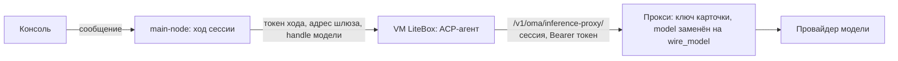
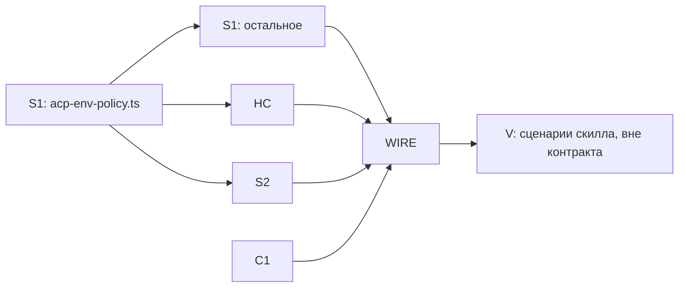

# Модели и harness: контракт сервера и консоли

> **2026-10-17.** Остался только harness Pi, решение D41 в [decisions-2026-10-17.md](../decisions-2026-10-17.md). Разделы про каталог harness, ACP-агентов, карточки harness, прокси модели для VM и `ai-sdk` больше не действуют, их код удалён. Рецепты `runbook-claude-code-sandbox.md` и `runbook-claude-code-harness.md` тоже удалены. Части про модели, `model_options` и усилие в силе.

Черновик 1, 2026-10-16. Только чтение кода, код не менялся, тесты не запускались.

Входы:

- разделы 1 и 2 плана [models-harness-analytics.md](models-harness-analytics.md) и его единицы S1, S2, C1;
- работа W4, которая уже запускает Claude Code в VM LiteBox: `A/harness/acp-*`, `N/src/modules/node-managed.ts`, `N/src/lib/*`, сценарий `S/scripts/journey-claude-code.mjs`, рецепт `S/features/claude-code-sandbox.md`, `runbook-claude-code-sandbox.md` (удалён 2026-10-17);
- создание таблицы кодом из раздела 4 [analytics.md](analytics.md).

Документ заменяет разделы 1 и 2 плана, его единицы S1, S2, C1 и часть SW про модель и harness. Цены, стоимость и бюджет сюда не входят, владелец просил их не учитывать. В `model_options` нет поля цены, форма карточки модели не меняется.

Обозначения путей от корня репозитория `/home/vnkjd/orca/projects/ai-native-backoffice-v3`:

- `P/` это `platform/packages`;
- `N/` это `platform/apps/main-node`;
- `A/` это `platform/apps/agent/src`;
- `C/` это `platform/apps/console/src`;
- `S/` это `.claude/skills/verify-agent-console`.

## 0. Коротко

1. `GET /v1/oma/model_options` отдаёт все модели для выбора: карточки рабочего пространства и встроенные модели Anthropic, если на сервере задан ключ. У модели есть уровни усилия и поддержка быстрой скорости по каталогу Pi, протоколы, которые умеет прокси, и список совместимых harness.
2. `GET /v1/oma/harnesses` отдаёт каталог: встроенный цикл, Claude Code в песочнице, экспериментальные ACP-агенты из `known-agents.ts` с адаптером модели и свои harness рабочего пространства.
3. Свой harness задаёт карточка, устроенная как карточка модели: название, ID, команда, аргументы, пакеты npm и pip, протоколы модели, разрешённые имена переменных окружения. Значений переменных в карточке нет. Статус карточки «Не проверено». API `/v1/oma/harness_cards`, таблицу `harness_cards` код создаёт при первом обращении.
4. Guard перед `POST /v1/agents` и `POST /v1/agents/:id` отклоняет неизвестную модель, неизвестный harness, несовместимый протокол, неподдерживаемые усилие и скорость, секреты в `_oma.acp.agent.env`.
5. ACP-агенты в VM ходят в модель через `/v1/oma/inference-proxy/:session` с коротким токеном своей сессии (`sandbox_inference`). Прокси подставляет ключ карточки и меняет `model` на `wire_model`. Ключа модели в VM нет. Сейчас W4 кладёт ключ в VM из хранилища, раздел 5.7 описывает замену.
6. Консоль: в форме агента раздел «Основное» (название, Harness, модель и усилие рядом, скорость, описание, промпт), несовместимые варианты выключены с причиной. В карточке агента строка «Harness». Новая страница «Harness» в меню после «Карточек моделей».
7. Пять единиц без общих файлов: S1 (каталог и guard), HC (карточки harness), S2 (токен и прокси), C1 (консоль), WIRE (подключение). WIRE идёт последней.

## 1. Что W4 уже сделал для Claude Code в VM

Claude Code уже выполняет ход внутри VM LiteBox. Прогон `20261016-041100` сценария `claude-code` прошёл: 33 проверки, два хода, фейковая модель на хосте. Сверка с разделом 2.4 плана:

| Пункт 2.4 | Состояние | Как сделано или что мешает |
|---|---|---|
| 1. Пустое сообщение хода | сделано | `harnessUserMessage` в `N/src/lib/node-managed-harness-user-message.ts`, вызов в `buildHarnessContext` (`N/src/modules/node-managed.ts:641`). Текстовые блоки всех `user.message` хода идут по порядку. Без текста берётся описание `user.define_outcome`. Ход `acp-sandbox` совсем без текста падает с понятной ошибкой. Картинки и документы не переносятся. |
| 2. Модель через прокси | не сделано | Ключ попадает в VM открытым текстом. `applyVaultEnvironment` (`N/src/lib/node-managed-vault-env.ts`, вызов в `prepareSandbox`, `node-managed.ts:477`) берёт из хранилищ сессии учётные данные «переменная окружения» (`ANTHROPIC_API_KEY` или `CLAUDE_CODE_OAUTH_TOKEN`) и задаёт их окружением песочницы, только для `acp-sandbox`. Claude Code ходит по `ANTHROPIC_BASE_URL` из `_oma.acp.agent.env` или в api.anthropic.com. Маршрут `/v1/oma/inference-proxy` есть (`N/src/modules/node-http.ts:416`), но токена песочницы, адреса шлюза и `hostedInference` в контексте хода нет. |
| 3. Подмена модели в прокси | не сделано | `forwardHostedInferenceRequest` пересылает тело как есть. Ещё `resolveNodeInferenceUpstream` (`node-managed.ts:277`) не отдаёт `protocolEndpoints`, поэтому путь адаптера `anthropic/v1/messages` ушёл бы на `<base_url>/anthropic/v1/messages`. |
| 4. Жизнь процесса ACP | сделано иначе | Кэша harness на сессию нет. `runHarnessForTurn` (`N/src/lib/node-managed-harness-turn.ts`) после хода вызывает `dispose("shutdown")`. Процесс закрывается, ACP-сессия и чекпойнт остаются в VM. Следующий ход поднимает новый `claude-agent-acp` и возобновляет сессию (`mode=resume` или `load`). BoxLite 0.9.0 не доставляет сигналы потоковому exec, поэтому адаптер LiteBox сначала закрывает stdin. Каждый ход заново запускает процесс. |
| 5. Установка в песочницу | сделано | npm-пакет окружения `@agentclientprotocol/claude-agent-acp@0.91.0` ставится `npm install -g` при каждом старте VM, от 23 до 30 с. Нужен `LITEBOX_DISK_SIZE_GB=4`, иначе ENOSPC. Процесс в VM запускает `spawnDuplexProcess` (`P/sandbox-adapter-litebox/src/litebox.ts`). |
| 6. Ключи не в env агента | частично | Сценарий проверяет, что ключа нет в `_oma.acp.agent.env` (`cc.agent_no_secret`). Guard нет, API примет агента с ключом в env. |
| 7. Учёт | вне контракта | `AcpTranslator` шлёт `span.model_request_end` на ход. Строки фактов пишет волна аналитики (`N/src/lib/analytics/recording-runner.ts`), ключ harness там равен `acp.agent.id`. |

Ещё W4 сделал: `is_error: true` у отклонённого инструмента (`A/harness/acp-translate.ts`), переменные хранилища только для `acp-sandbox`, адрес хоста из VM `host.boxlite.internal`. gvproxy BoxLite пересылает этот адрес на `127.0.0.1` хоста, W4 проверил это на фейковой модели.

Что из этого берёт контракт:

- сообщение хода, установку пакетом окружения и процесс на один ход оставляем как есть;
- кэш harness на сессию из плана не делаем. Процесс на ход работает и проверен, а токену песочницы тогда хватает срока одного хода;
- ключ из хранилища в VM заменяем прокси (раздел 5);
- guard добавляем (раздел 4).

В runbook строка «Не проверено» раздела «Статус» ещё называет второй ход, хотя раздел 6 и прогон его проверили. WIRE поправит это при обновлении runbook.

## 2. Модели: `GET /v1/oma/model_options`

### 2.1 Источники

- Карточки рабочего пространства без `archived_at`. Метаданные Pi ищутся так же, как в `resolvePiModel` (`P/managed-agents-adapters-runtime/src/model-card-catalog.ts:99-130`): `findPiCatalogModel(card.model)`, затем модели провайдера из `builtinProviders()`, затем `pi_config` с полем `api`. Функция там не экспортирована, S1 повторяет её в своём файле.
- Встроенные модели: каталог Pi провайдера `anthropic`, только если на сервере задан непустой `ANTHROPIC_API_KEY` (`config.model.apiKey`). Handle равен id модели в каталоге, например `claude-sonnet-4-6`. Если карточка с тем же handle есть, встроенная модель не показывается. Ход такой модели уже идёт через запасной путь `resolveNodeModelCreds` (`N/src/modules/node-foundation.ts:332-343`).

### 2.2 Ответ

```json
{
  "builtin_available": true,
  "data": [
    {
      "handle": "verify-fake",
      "label": "Claude Sonnet 4.6",
      "source": "card",
      "card_id": "mc_01J...",
      "is_default": true,
      "provider": "anthropic",
      "wire_model": "claude-sonnet-4-6",
      "api": "anthropic-messages",
      "protocols": ["anthropic-messages"],
      "context_window": 200000,
      "max_output_tokens": 64000,
      "effort_levels": ["low", "medium", "high", "max"],
      "speed_fast": true,
      "harnesses": ["pi", "claude-acp"]
    },
    {
      "handle": "claude-sonnet-4-6",
      "label": "Claude Sonnet 4.6",
      "source": "builtin",
      "card_id": null,
      "is_default": false,
      "provider": "anthropic",
      "wire_model": "claude-sonnet-4-6",
      "api": "anthropic-messages",
      "protocols": ["anthropic-messages"],
      "context_window": 200000,
      "max_output_tokens": 64000,
      "effort_levels": ["low", "medium", "high", "max"],
      "speed_fast": true,
      "harnesses": ["pi", "claude-acp"]
    }
  ]
}
```

Без карточек и без ключа сервера ответ `{"builtin_available": false, "data": []}`.

### 2.3 Поля

- `api`: протокол Pi или `null`. Консоль и guard берут его только для скорости.
- `protocols`: протоколы, которые прокси умеет для этой модели. Их считает `resolveProtocolEndpointsFromModelCard({providerId: provider, baseUrl: base_url})` из `@open-managed-agents/inference-proxy`. Провайдер `anthropic` даёт `anthropic-messages`, `openai` даёт `openai-chat` и `openai-responses`, `deepseek` даёт `openai-chat` и `anthropic-messages`, `google` даёт `gemini`. Другой провайдер даёт пустой список, такую модель берёт только встроенный цикл. У встроенных моделей `["anthropic-messages"]`.
- `effort_levels`: пересечение `getSupportedThinkingLevels(model)` с `low`, `medium`, `high`, `xhigh`, `max`, если у модели Pi `reasoning: true`. Иначе пустой список. Уровней Pi `minimal` и `off` в API агента нет, их не отдаём.
- `speed_fast`: истинно, если `api` равен `anthropic-messages`, `openai-completions`, `openai-responses` или `openai-codex-responses` (`A/harness/pi-provider.ts:233-273`).
- `context_window`, `max_output_tokens`: из модели Pi или `null`.
- `harnesses`: id записей каталога (раздел 3), с которыми модель совместима по протоколу (раздел 3.3). Статус записи здесь не учитывается.
- Порядок: карточка по умолчанию, другие карточки (новые сверху), встроенные в порядке каталога Pi.
- Ключ модели в ответ не попадает.

`GET /v1/models` (общий с upstream маршрут CMA) не меняется.

## 3. Harness

### 3.1 Каталог `GET /v1/oma/harnesses`

Встроенные записи:

| id | Подпись в консоли | `_oma.harness` | Команда в VM | Протоколы модели | Статус |
|---|---|---|---|---|---|
| `pi` | Встроенный цикл | не задан | нет | любые, и пустой список тоже | `ready` |
| `claude-acp` | Claude Code в песочнице | `acp-sandbox` | обёртка `sh -c` из раздела 3.4, затем `claude-agent-acp` | `anthropic-messages` | `ready` |
| `codex-acp` | Codex в песочнице | `acp-sandbox` | `codex-acp` | `openai-responses` | `unverified` |
| `gemini` | Gemini CLI в песочнице | `acp-sandbox` | `gemini --acp` | `gemini` | `unverified` |
| `opencode` | OpenCode в песочнице | `acp-sandbox` | `opencode acp` | `openai-chat` | `unverified` |
| `kimi-code` | Kimi Code в песочнице | `acp-sandbox` | `kimi acp` | `openai-chat` | `unverified` |
| `pi-acp` | Pi через ACP в песочнице | `acp-sandbox` | `pi-acp` | `openai-chat` | `unverified` |

- Команды, подписи и подсказки установки S1 берёт из `OMA_OVERLAY_AGENTS` (`P/acp-runtime/src/known-agents.ts`, импорт `@open-managed-agents/acp-runtime/known-agents`).
- Протоколы повторяют `supportedProtocols` адаптеров в `P/harness-inference-adapters/src/adapters/*.ts`. main-node не зависит от этого пакета, поэтому таблица протоколов живёт в `harness-catalog.ts` со ссылкой на файлы адаптеров.
- ACP-агенты без адаптера модели (`aider`, `mimo`, `mcode`, `hermes`) в каталог не попадают: им ключ пришлось бы класть в env.
- `ai-sdk` (устарел) и `acp-proxy` (на Node не работает) в каталоге нет, guard разбирает их отдельно (раздел 4.3).

Ответ:

```json
{
  "data": [
    {
      "id": "pi",
      "source": "builtin",
      "label": "Pi agent-core",
      "status": "ready",
      "reason": null,
      "runtime_harness": null,
      "protocols": ["*"],
      "supports": { "effort": true, "speed": true, "platform_tools": true, "mcp": true },
      "acp": null,
      "install": { "npm": [], "pip": [] },
      "install_hint": null,
      "allowed_env": null,
      "card_id": null
    },
    {
      "id": "claude-acp",
      "source": "builtin",
      "label": "Claude Agent",
      "status": "ready",
      "reason": null,
      "runtime_harness": "acp-sandbox",
      "protocols": ["anthropic-messages"],
      "supports": { "effort": false, "speed": false, "platform_tools": false, "mcp": false },
      "acp": { "agent": { "id": "claude-acp", "command": "sh", "args": ["-c", "..."], "cwd": "/mnt/session/outputs", "env": { "...": "..." } }, "per_turn_timeout_ms": 600000 },
      "install": { "npm": ["@agentclientprotocol/claude-agent-acp@0.91.0"], "pip": [] },
      "install_hint": "npm install -g @agentclientprotocol/claude-agent-acp",
      "allowed_env": null,
      "card_id": null
    },
    {
      "id": "aider-local",
      "source": "card",
      "label": "Aider через ACP",
      "status": "unverified",
      "reason": null,
      "runtime_harness": "acp-sandbox",
      "protocols": ["openai-chat"],
      "supports": { "effort": false, "speed": false, "platform_tools": false, "mcp": false },
      "acp": { "agent": { "id": "aider-local", "command": "aider-acp", "args": [], "cwd": "/mnt/session/outputs" } },
      "install": { "npm": [], "pip": ["aider-chat==0.86.1"] },
      "install_hint": null,
      "allowed_env": ["AIDER_AUTO_COMMITS"],
      "card_id": "hcard_V1StGXR8Z5jdHi6B"
    }
  ]
}
```

- `label` у встроенных записей английский, из `known-agents.ts`. Русские подписи консоль берёт из `harness-text.ts` (раздел 6.8). У карточки `label` равен её названию.
- Порядок: `pi`, `claude-acp`, другие встроенные по таблице, затем карточки (новые сверху).
- Удалённые карточки в каталог не попадают.

### 3.2 Статус и причины

- `ready`: путь проверен на нашем сервере.
- `unverified`: агент запускается так же, как Claude Code, но на нашем сервере этот путь не проверялся. У всех карточек этот статус.
- `unavailable`: серверу чего-то не хватает, в `reason` текст для человека. Причины одинаковы для всех ACP-записей, сервер проверяет их по порядку:
  1. нет `PLATFORM_ROOT_SECRET`: «Сервер не выпустит токен песочницы: задайте PLATFORM_ROOT_SECRET»;
  2. песочница не запускает процессы ACP, то есть `SANDBOX_PROVIDER` не из `litebox`, `boxlite`, `e2b`, `sprites` (у их адаптеров есть `spawnDuplexProcess`): «Песочница этого сервера не запускает ACP-агентов»;
  3. пусты и `SANDBOX_GATEWAY_BASE_URL`, и `PUBLIC_BASE_URL`: «VM не знает адрес сервера: задайте SANDBOX_GATEWAY_BASE_URL».

У `pi` статус всегда `ready`.

### 3.3 Совместимость

Правило одно. Запись с протоколами `["*"]` берёт любую модель. ACP-запись берёт модель, если её `protocols` пересекаются с протоколами записи. Протоколом хода сервер берёт первый протокол записи, который есть у модели.

Имена протоколов единые для модели, harness и прокси: `anthropic-messages`, `openai-chat`, `openai-responses`, `gemini` (тип `InferenceWireProtocol` из `@open-managed-agents/inference-proxy`). Имена Pi (`openai-completions`, `google-generative-ai`) живут только в поле `api` модели.

Текст причины несовместимости собирают guard и консоль по одному образцу: «Claude Code в песочнице работает только с моделями с протоколом anthropic-messages, у модели verify-oai: openai-chat».

### 3.4 Как harness записывается в агента

- Встроенный цикл: `_oma.harness` не задан (или `default`, или `pi`), `_oma.acp` не задан.
- ACP: `_oma.harness: acp-sandbox` и блок `_oma.acp` из поля `acp` записи каталога, `_oma.acp.agent.id` равен id записи. Консоль пишет блок при выборе harness. Если id не меняется, консоль сохраняет блок агента как есть, со своей обёрткой и своими переменными.

Блок `claude-acp` повторяет проверенный рецепт W4 (runbook, раздел 3):

```json
{
  "agent": {
    "id": "claude-acp",
    "command": "sh",
    "args": ["-c", "mkdir -p \"$CLAUDE_CONFIG_DIR\" && printf '%s' \"$OMA_CLAUDE_SETTINGS\" > \"$CLAUDE_CONFIG_DIR/settings.json\" && exec claude-agent-acp"],
    "cwd": "/mnt/session/outputs",
    "env": {
      "CLAUDE_CODE_DISABLE_NONESSENTIAL_TRAFFIC": "1",
      "OMA_CLAUDE_SETTINGS": "{\"permissions\":{\"allow\":[\"Read\",\"Write\",\"Edit\"]}}"
    }
  },
  "per_turn_timeout_ms": 600000
}
```

Обёртка нужна ради разрешений. `acp-sandbox` не отвечает на запросы разрешений ACP, и без списка `permissions.allow` Claude Code отклоняет каждый `Write` и `Edit`. Адаптер Claude пишет в тот же `settings.json` поле `model`, обёртка перезаписывает файл. Модель от этого не теряется, её задаёт переменная `ANTHROPIC_MODEL` (раздел 5.4).

Блок другой встроенной записи: `{"agent": {"id": "<id>", "command": "<команда>", "args": [...], "cwd": "/mnt/session/outputs"}}`. Блок карточки: `{"agent": {"id": "<harness_id>", "command", "args", "cwd"}}` из полей карточки. Значения переменных из `allowed_env` пользователь задаёт в YAML агента.

Ключ harness (`harnessKeyOf` в S1): `pi` для пустого значения, `default` и `pi`; `ai-sdk`; `acp-proxy`; для `acp-sandbox` значение `_oma.acp.agent.id`. Аналитика считает так же (`N/src/lib/analytics/call-context.ts:11`).

### 3.5 Карточка своего harness

| Поле | Тип | Правило |
|---|---|---|
| `id` | строка | выдаёт сервер: `hcard_` и 16 знаков nanoid |
| `harness_id` | строка | `^[a-z][a-z0-9-]{1,39}$`, уникален в рабочем пространстве вместе с удалёнными карточками, не меняется после создания |
| `name` | строка | от 1 до 80 знаков после обрезки пробелов |
| `command` | строка | имя программы `^[A-Za-z0-9._+-]+$` или абсолютный путь без пробелов, до 200 знаков |
| `args` | массив строк | до 32 штук, каждая до 2000 знаков, без символа NUL |
| `cwd` | строка или `null` | абсолютный путь. По умолчанию `/mnt/session/outputs`, тогда файлы агента видны в «Файлах сессии» |
| `install` | `{"npm": [...], "pip": [...]}` | до 20 пакетов на менеджер; имя с версией, не начинается с дефиса, без URL, `git+` и пробелов |
| `protocols` | массив строк | непустое подмножество `anthropic-messages`, `openai-chat`, `openai-responses` без повторов |
| `allowed_env` | массив строк | до 32 имён `^[A-Za-z_][A-Za-z0-9_]*$` без повторов; имя не похоже на секрет и не из списка сервера (раздел 4.4) |
| `status` | строка | всегда `unverified` |
| `created_at`, `updated_at`, `archived_at` | ISO 8601 или `null` | время сервера |

Зарезервированные `harness_id`: `pi`, `default`, `ai-sdk`, `acp`, `acp-sandbox`, `acp-proxy`, все `id` и `aliases` из `OMA_OVERLAY_AGENTS`, а ещё имена из `matches` адаптеров: `claude-code`, `codex`, `codex-cli`, `codex-acp-bridge`, `gemini-cli`, `kimi-code-acp`, `dsh-acp`, `deepseek-harness-acp`. Иначе адаптер модели или профиль состояния ACP сработал бы по совпадению id (`P/harness-inference-adapters/src/match.ts`, `P/acp-runtime/src/native-state.ts`).

- Неизвестное поле в теле запроса даёт 400. Так запрос с `env` и значениями не пройдёт молча.
- Протокола `gemini` в карточке нет. Агент с ним прислал бы токен заголовком `x-goog-api-key`, а auth прокси читает токен только из `authorization` и `x-api-key` (`extractHostedInferenceProxyToken` в `P/inference-proxy/src/index.ts`). Встроенная запись `gemini` обходит это своим заголовком `GEMINI_CLI_CUSTOM_HEADERS` в адаптере.
- Пакеты карточка не ставит. Консоль показывает их у поля Harness как требование к окружению. Пока проверку имён HC пишет сам. Когда волна окружений добавит `P/sandbox/src/package-names.ts` (EX2 в [environments.md](environments.md)), проверка перейдёт на него.
- Команда карточки работает в VM от root, как скрипт установки пакетов окружения. Карточку создаёт участник рабочего пространства, доверие к ней такое же, как к окружению.

### 3.6 API `/v1/oma/harness_cards`

Доступ как у других `/v1/oma/*`: пользователь рабочего пространства или ключ API. Токен песочницы сюда не пропускает auth (раздел 5.2).

- `GET /?q=&include_archived=&limit=&cursor=`: `{"data": [...], "next_cursor": "..."}`. Новые сверху (`created_at DESC, id DESC`), `limit` от 1 до 100, по умолчанию 50. `q` ищет подстроку в `name` и `harness_id` без учёта регистра. Курсор непрозрачный, по `(created_at, id)`, без `OFFSET`.
- `POST /`: создать, ответ 201 и карточка.
- `GET /:id`: карточка, удалённая тоже. 404, если её нет.
- `POST /:id`: изменить переданные поля, ответ 200 и карточка. `harness_id` менять нельзя, попытка даёт 400.
- `DELETE /:id`: пометить удалённой (`archived_at`), ответ `{"type": "harness_card_deleted", "id": "hcard_..."}`. Агенты с этим harness продолжают работать, потому что блок `_oma.acp` хранит копию команды, а ход берёт протоколы из удалённой карточки (раздел 5.8). Новых агентов и смену модели на удалённой карточке guard не пропустит.

Ошибки: `{"error": "<текст по-русски>", "field": "<поле>"}`. 400 при проверке, 404 без карточки, 409 при занятом `harness_id` («Harness с ID «aider-local» уже есть»). На MySQL маршруты отвечают 501 «Свои harness на MySQL не поддерживаются», каталог идёт без карточек.

Тело создания:

```json
{
  "name": "Aider через ACP",
  "harness_id": "aider-local",
  "command": "aider-acp",
  "args": [],
  "cwd": "/mnt/session/outputs",
  "install": { "npm": [], "pip": ["aider-chat==0.86.1"] },
  "protocols": ["openai-chat"],
  "allowed_env": ["AIDER_AUTO_COMMITS"]
}
```

Поле `created_by` (`c.get("user_id")` или `null` для ключа API) хранится в таблице, в ответ не попадает.

### 3.7 Таблица `harness_cards`

Таблицу создаёт код при первом обращении, как в разделе 4 [analytics.md](analytics.md). `ensureHarnessCardSchema(sql)` в `N/src/lib/harness-cards/schema.ts`:

1. создаёт таблицу шагов `harness_card_schema_migrations (id TEXT PRIMARY KEY, applied_at BIGINT NOT NULL)`;
2. выполняет шаги из `HARNESS_CARD_MIGRATIONS`, которых нет в таблице, и пишет их `id` с `ON CONFLICT (id) DO NOTHING`;
3. запоминает результат на `SqlClient` в `WeakMap`, при ошибке запись удаляется и следующий вызов пробует снова.

```sql
-- шаг 0001_harness_cards
CREATE TABLE IF NOT EXISTS harness_cards (
  workspace_id TEXT NOT NULL,
  id TEXT NOT NULL,
  harness_id TEXT NOT NULL,
  name TEXT NOT NULL,
  command TEXT NOT NULL,
  args_json TEXT NOT NULL,
  cwd TEXT,
  install_json TEXT NOT NULL,
  protocols_json TEXT NOT NULL,
  allowed_env_json TEXT NOT NULL,
  status TEXT NOT NULL,
  created_by TEXT,
  created_at BIGINT NOT NULL,
  updated_at BIGINT NOT NULL,
  archived_at BIGINT,
  PRIMARY KEY (workspace_id, id)
);
CREATE UNIQUE INDEX IF NOT EXISTS harness_cards_ws_harness_uq ON harness_cards (workspace_id, harness_id);
CREATE INDEX IF NOT EXISTS harness_cards_ws_created_idx ON harness_cards (workspace_id, created_at, id);
```

- Поля `*_json` хранят JSON текстом. Код разбирает их сам, в SQL нет функций JSON, один и тот же текст работает в SQLite и Postgres.
- Правила SQL из раздела 4.7 analytics.md: плейсхолдеры `?`, `Number()` при чтении `BIGINT`, без `? IS NULL OR col = ?`, курсор без `OFFSET`.
- Поиск `q`: `LOWER(name) LIKE ? OR LOWER(harness_id) LIKE ?` с экранированием `%` и `_`.
- Нарушение уникального индекса превращается в 409, даже если два запроса прошли предварительную проверку одновременно.

## 4. Guard на `/v1/agents`

### 4.1 Где стоит

Hono middleware `agentConfigGuard(deps)` из `N/src/lib/agent-config-guard.ts`. WIRE ставит его в `node-http.ts` перед `v1.route("/agents", ...)` (сейчас строка 338) на `POST /agents` и `POST /agents/:agentId`. Путь `/agents/:id/archive` guard пропускает. Общий с upstream код в `P/managed-agents-api` не меняется.

Guard читает тело через `c.req.json()`. Hono кэширует разобранное тело, и маршрут читает его второй раз без ошибки, это проверяет тест S1. Тело, которое не разбирается как JSON, guard пропускает: маршрут сам ответит 400.

Зависимости:

```ts
interface AgentConfigGuardDeps {
  catalog(workspaceId: string): Promise<{ models: ModelOption[]; harnesses: HarnessEntry[] }>;
  loadAgent(workspaceId: string, agentId: string): Promise<{
    model: string | { id: string; effort?: string; speed?: string };
    _oma?: { harness?: string | null; acp?: { agent?: { id?: string; command?: string; env?: Record<string, string | null> } } | null };
  } | null>;
}
```

### 4.2 Итоговая конфигурация

- Создание: тело как есть.
- Изменение: guard читает текущего агента (`loadAgent`) и накладывает тело так же, как `patchOpenMa` (`P/managed-agents-application/src/agents/application.ts:273`). `model` берётся из тела, если поле есть. `_oma.harness` и `_oma.acp` заменяются целиком, если ключ есть в теле, `null` удаляет значение. Если агента нет, guard пропускает запрос, маршрут ответит 404.
- При изменении guard проверяет модель и harness, только если в теле есть `model`, `_oma.harness` или `_oma.acp`. Иначе старый агент с удалённой карточкой нельзя было бы даже переименовать.
- Тело, которое возвращает сохранённые значения без правок, guard тоже пропускает. Форма и режим YAML консоли шлют `model` и весь `_oma` при каждом сохранении. Guard сравнивает с сохранённым агентом handle модели, усилие, быструю скорость, `_oma.harness`, а у `_oma.acp.agent` id, команду и строковые значения env. Если всё совпало, сохранение не меняет ничего из того, что проверяет guard.

### 4.3 Проверки

Guard идёт по списку и отвечает на первое нарушение. Ответ 400 в формате managed API: `{"type":"error","error":{"type":"invalid_request_error","message":"..."}}`, текст по-русски.

| # | Условие | Текст |
|---|---|---|
| 1 | `_oma.harness` равен `acp-proxy` | «acp-proxy на этом сервере не работает. Выберите harness из GET /v1/oma/harnesses» |
| 2 | `_oma.harness` равен `ai-sdk` при создании или при смене harness | «Harness ai-sdk устарел. Выберите встроенный цикл или ACP-агента из каталога» |
| 3 | другое значение `_oma.harness`, кроме пустого, `default`, `pi`, `acp-sandbox` | «Неизвестный harness «x»» |
| 4 | `acp-sandbox` без `_oma.acp.agent.command` | «Для acp-sandbox задайте _oma.acp.agent.command» |
| 5 | `acp-sandbox`, а `_oma.acp.agent.id` пуст или его нет в каталоге | «Harness «x» не найден. Выберите вариант из GET /v1/oma/harnesses» |
| 6 | запись каталога `unavailable` | «Harness «Claude Code в песочнице» недоступен: <reason>» |
| 7 | handle модели нет в `model_options` | «Модель «x» не найдена. Добавьте карточку модели или задайте на сервере ANTHROPIC_API_KEY» |
| 8 | протоколы модели и harness не пересекаются | «Модель «x» не подходит для «Claude Code в песочнице»: нужен протокол anthropic-messages, у модели openai-chat». Если у модели протоколов нет: «у модели нет протокола, который понимает прокси» |
| 9 | ACP и задан `model.effort` | «Claude Code в песочнице не принимает усилие: уберите model.effort» |
| 10 | ACP и `model.speed` равен `fast` | «Claude Code в песочнице не принимает скорость: уберите model.speed» |
| 11 | `model.effort` не входит в `effort_levels` | «Модель «x» не поддерживает усилие «max». Допустимо: low, medium, high». При пустом списке: «Модель «x» не поддерживает усилие» |
| 12 | `model.speed` равен `fast`, а `speed_fast` ложно | «Модель «x» не поддерживает быструю скорость» |
| 13 | нарушения env из раздела 4.4, только для `acp-sandbox` | текст по виду нарушения, раздел 4.4 |

- Подпись harness в тексте: русская подпись для встроенных записей (те же строки, что в `harness-text.ts`, S1 держит свою копию четырёх подписей), название карточки для своих.
- Модель строкой (`"model": "verify-fake"`) проверяется так же, как объект.
- `speed: standard` проходит всегда.
- `_oma.aux_model` guard не проверяет.

### 4.4 Политика переменных окружения: `acp-env-policy.ts`

Файл `N/src/lib/acp-env-policy.ts` пишет S1 первым шагом. HC и S2 только импортируют его. Содержимое:

```ts
import { MODEL_PROVIDER_SECRET_ENV_KEYS } from "@open-managed-agents/inference-proxy";
import type { InferenceWireProtocol } from "@open-managed-agents/inference-proxy";

export const INFERENCE_PROTOCOLS: readonly InferenceWireProtocol[] =
  ["anthropic-messages", "openai-chat", "openai-responses", "gemini"];
export const CARD_PROTOCOLS: readonly InferenceWireProtocol[] =
  ["anthropic-messages", "openai-chat", "openai-responses"];

/** Переменные, которые задаёт сервер для модели ACP-агента. */
export const SERVER_INFERENCE_ENV_NAMES: ReadonlySet<string> = new Set([
  "ANTHROPIC_BASE_URL", "ANTHROPIC_AUTH_TOKEN", "ANTHROPIC_API_KEY", "ANTHROPIC_MODEL",
  "ANTHROPIC_DEFAULT_OPUS_MODEL", "ANTHROPIC_DEFAULT_SONNET_MODEL", "ANTHROPIC_DEFAULT_HAIKU_MODEL",
  "CLAUDE_CODE_SUBAGENT_MODEL",
  "OPENAI_BASE_URL", "OPENAI_API_KEY", "OPENAI_MODEL",
  "GOOGLE_GEMINI_BASE_URL", "GEMINI_API_KEY", "GEMINI_MODEL", "GEMINI_CLI_CUSTOM_HEADERS",
  "HOSTED_INFERENCE_URL", "HOSTED_INFERENCE_TOKEN",
  "OMA_INFERENCE_PROTOCOL", "OMA_INFERENCE_BASE_URL", "OMA_INFERENCE_TOKEN", "OMA_MODEL",
]);

/** Ключи провайдеров модели: их не бывает ни в env агента, ни в VM. */
export const MODEL_KEY_ENV_NAMES: ReadonlySet<string> = new Set([
  ...MODEL_PROVIDER_SECRET_ENV_KEYS, "ANTHROPIC_AUTH_TOKEN", "CLAUDE_CODE_OAUTH_TOKEN",
]);

export function isSecretLikeEnvName(name: string): boolean; // /(KEY|TOKEN|SECRET|PASSWORD|PASSWD|CREDENTIAL|PRIVATE)/i
export function isSecretLikeEnvValue(value: string): boolean; // начало sk-, AIza, ghp_, gho_, github_pat_, glpat-, xoxb-, xoxp-, xoxa-, AKIA или вид JWT eyJ...\.eyJ
export type AcpEnvProblem = {
  name: string;
  kind: "bad_name" | "server_name" | "secret_name" | "secret_value" | "not_allowed";
};
/** allowed: имена из карточки harness или null для встроенных записей. */
export function checkAcpEnv(
  env: Record<string, string | null> | undefined,
  allowed: readonly string[] | null,
): AcpEnvProblem[];
```

Порядок проверки имени: `bad_name`, `server_name`, `secret_name`, `not_allowed`, затем значение `secret_value`. Значение `null` (удаление переменной) проверяется только по имени.

Тексты guard:

- `bad_name`: «Имя переменной «x» недопустимо: латиница, цифры и подчёркивание»;
- `server_name`: «Переменную «ANTHROPIC_BASE_URL» задаёт сервер, уберите её из env агента»;
- `secret_name`: «Переменная «GITHUB_TOKEN» похожа на секрет. Ключи в env агента не кладите: модель подключается через прокси сервера»;
- `secret_value`: «Значение переменной «X» похоже на ключ. Уберите его из env агента»;
- `not_allowed`: «Harness «Aider через ACP» не разрешает переменную «Y». Разрешены: A, B».

`CLAUDE_CODE_DISABLE_NONESSENTIAL_TRAFFIC` и `OMA_CLAUDE_SETTINGS` из рецепта W4 проходят. `ANTHROPIC_BASE_URL` в env агента из сценария W4 теперь получит `server_name`, сценарий меняется (раздел 9).

## 5. Модель для ACP через прокси

### 5.1 Схема



### 5.2 Токен песочницы `sandbox_inference`

- Выпуск: `issueSandboxInferenceToken({cipher, workspaceId, sessionId, ttlMs, now})` в `N/src/lib/sandbox-inference-token.ts`. Токен это `oma_sbx_` и base64url от шифротекста JSON `{"v":1,"ws":"...","ses":"...","exp":<мс>}`. Шифр `secrets.cipherFor("managed.sandbox-inference")`.
- Срок: таймаут хода агента (`_oma.acp.per_turn_timeout_ms`, по умолчанию 300 000 мс) плюс 15 минут, не больше 6 часов. WIRE выпускает токен на каждый ход, процесс тоже живёт один ход (раздел 1).
- Проверка: `resolveSandboxInferenceBearer({cipher, token, now})` возвращает `ApiKeyResolution` или `null`. Токен без префикса `oma_sbx_` даёт `null` без расшифровки, и цепочка `resolveBearerToken` в `node-http.ts` идёт дальше: токен Work, ключ API. Испорченный и просроченный токены дают `null`, auth ответит 401.
- Учётные данные: новый вариант `ApiKeyResolution.credential` в `P/auth/src/index.ts`: `{type: "sandbox_inference", sessionId: string, expiresAt: string}`. `allowsApiKeyRequest` пускает его только на `/v1/oma/inference-proxy/<сессия токена>` и глубже, с любым транспортом (bearer или `x-api-key`). Сессия из пути сравнивается после `decodeURIComponent`. Любой другой путь, включая прокси чужой сессии, получает 403.
- Прокси ещё раз сверяет `auth_credential.sessionId` с `:sessionId` и отвечает 403 при расхождении.
- Workspace-ключ API на пути прокси работает как сейчас. В VM он не попадает.

### 5.3 Адрес шлюза

- Новая настройка `SANDBOX_GATEWAY_BASE_URL` в `N/src/config.ts`, значение `http` или `https` без пути. Без неё сервер берёт `PUBLIC_BASE_URL`. `127.0.0.1` из VM ведёт в саму VM.
- Локально с LiteBox: `http://host.boxlite.internal:<порт main-node>`. gvproxy пересылает этот адрес на `127.0.0.1` хоста, W4 проверил это на фейковой модели.
- Сеть «Ограниченный»: хост шлюза надо добавить в разрешённые. Фильтр BoxLite 0.9.0 пропускает по имени только порты 80 и 443, шлюз на другом порту из такой сети недоступен.

### 5.4 Встроенные ACP-записи: `hostedInference`

WIRE передаёт в `ctx.env.hostedInference` (`A/harness/interface.ts:316`) результат `buildSandboxHostedInference` из S2:

```ts
{
  gatewayBaseUrl: "http://host.boxlite.internal:8795",
  sessionsToken: "oma_sbx_...",
  model: { providerId: "anthropic", baseUrl: null, protocolEndpoints: [/* из endpoint-catalog */] },
}
```

Остальное уже есть в `A/harness/acp-sandbox-loop.ts:153-183`. Адаптер Claude (`P/harness-inference-adapters/src/adapters/claude.ts`) ставит `ANTHROPIC_BASE_URL` на прокси с сегментом `anthropic`, `ANTHROPIC_AUTH_TOKEN` равен токену, `ANTHROPIC_MODEL` и модели по умолчанию равны handle агента, `ANTHROPIC_API_KEY` удаляется из env запуска. У встроенной модели `providerId` равен `anthropic`, `baseUrl` равен `ANTHROPIC_BASE_URL` сервера или `null`.

### 5.5 Свои ACP-агенты: переменные

Адаптера модели у карточки нет. WIRE не передаёт `hostedInference`, а добавляет в `ctx.agent.acp.agent.env` переменные от `cardInferenceEnv` (S2) поверх значений агента. Протокол хода: первый из `card.protocols`, который есть у модели.

| Переменная | Значение |
|---|---|
| `OMA_INFERENCE_PROTOCOL` | выбранный протокол |
| `OMA_INFERENCE_BASE_URL` | `<шлюз>/v1/oma/inference-proxy/<сессия>/<сегмент>`, сегмент `anthropic` или `openai/v1` |
| `OMA_INFERENCE_TOKEN` | токен песочницы |
| `OMA_MODEL` | handle модели агента, прокси заменит его на `wire_model` |
| `ANTHROPIC_BASE_URL`, `ANTHROPIC_AUTH_TOKEN`, `ANTHROPIC_MODEL` | для `anthropic-messages`: адрес, токен, handle |
| `OPENAI_BASE_URL`, `OPENAI_API_KEY`, `OPENAI_MODEL` | для `openai-chat` и `openai-responses`: адрес, токен, handle |

Сегменты берутся из `INFERENCE_PROTOCOL_PROXY_PATH` (`P/inference-proxy/src/protocol-types.ts:13`). В `OPENAI_API_KEY` лежит короткий токен сессии, а не ключ провайдера.

### 5.6 Прокси: `N/src/lib/http-inference-proxy.ts`

- Сессия токена `sandbox_inference` равна `:sessionId`, иначе 403 `{"error":"forbidden"}`.
- `protocolEndpoints` апстрима: из `resolveUpstream`, иначе `resolveProtocolEndpointsFromModelCard({providerId: provider ?? "anthropic", baseUrl: baseURL ?? null})`. Тогда `forwardHostedInferenceRequest` срезает сегмент протокола: `anthropic/v1/messages` уходит на `<base_url>/v1/messages`.
- Подмена модели. JSON-тело с полем `model` строкой получает `model = wireModel` для `anthropic-messages`, `openai-chat` и `openai-responses`. Так же обрабатываются `/v1/messages/count_tokens` и служебные вызовы Claude Code с лёгкой моделью: все они идут в модель карточки. Для `gemini` заменяется сегмент `models/<имя>:` в пути. Тело не JSON и тело без `model` уходят как есть.
- Ответ, в том числе поток SSE, идёт без буферизации, как сейчас.
- Ключ ставит `applyUpstreamCredentialsForProtocol`, входящие заголовки с ключами срезаются, как сейчас.
- Токен песочницы проходит только на вызовы модели (`isSandboxInferenceCall`): `POST anthropic/v1/messages` и `anthropic/v1/messages/count_tokens`, `POST openai/v1/chat/completions`, `openai/v1/responses`, `openai/v1/responses/compact` и `openai/v1/responses/input_tokens`, `POST gemini/<версия>/models/<модель>:generateContent`, `:streamGenerateContent` и `:countTokens`, а ещё `GET` списка моделей и одной модели. На файлы, пакетные запросы, дообучение, сохранённые ответы и любой `DELETE` прокси отвечает 403 и к провайдеру не идёт. Ключ API рабочего пространства открывает прокси целиком, как раньше.

### 5.7 Замена ключа из хранилища

Сейчас W4 кладёт ключ модели в VM (раздел 1, пункт 2). Замена:

1. S2 добавляет в `applyVaultEnvironment` параметр `skipModelKeys: boolean`, по умолчанию `false`. При `true` имена из `MODEL_KEY_ENV_NAMES` и `SERVER_INFERENCE_ENV_NAMES` в песочницу не попадают, сервер пишет предупреждение `main-node.vault_env.model_key_skipped` с именем без значения. Фильтр нужен в main-node, потому что LiteBox запускает процесс с окружением песочницы, поверх которого лежит env запуска (`litebox.ts:219`). Адаптер удаляет `ANTHROPIC_API_KEY` только из env запуска, и значение из хранилища осталось бы в процессе.
2. WIRE передаёт `skipModelKeys: true` и на каждом ходе ACP передаёт `hostedInference` или переменные карточки. До WIRE поведение W4 не меняется.
3. Ход ACP без готового прокси падает с ошибкой «ACP-агенту нужен прокси модели: <reason из раздела 3.2>». Запасного пути с ключом в VM нет.
4. Guard не пускает ключи в `_oma.acp.agent.env` (раздел 4.4).
5. Другие переменные хранилища, например `GITHUB_TOKEN`, по-прежнему попадают в VM открытым текстом, как в W4. Это ограничение остаётся.
6. Токен подписки `CLAUDE_CODE_OAUTH_TOKEN` до Claude Code больше не доходит. Прокси шлёт ключ карточки заголовком `x-api-key`, а работу токена подписки через прокси никто не проверял. Режим real сценария переходит на карточку модели с ключом API. Подписка через прокси возможна отдельной задачей.
7. WIRE обновляет runbook, скилл проверки переделывает сценарий (раздел 9).
8. Ход ACP убирает имена из `MODEL_KEY_ENV_NAMES` из `_oma.acp.agent.env` агента сессии (`acpTurnAgent` в `N/src/lib/models-harness-wiring.ts`). Guard проверяет только новые сохранения, а снимок агента, сохранённый до guard, может нести `CLAUDE_CODE_OAUTH_TOKEN` или ключ провайдера. Адаптеры встроенных записей убирают не все такие имена, а карточка передала бы их как есть. Без таких имён конфигурация хода не меняется, и чекпойнт ACP-сессии остаётся действительным.

### 5.8 Что сервер делает на ходе ACP (WIRE)

В `buildHarnessContext` для `agent.harness === "acp-sandbox"`:

1. Готовность из раздела 3.2. Нет готовности: ошибка из пункта 3 раздела 5.7.
2. Запись по `acp.agent.id`: встроенная запись с адаптером (таблица 3.1) или карточка рабочего пространства, удалённая тоже (`findByHarnessId`). Нет ни того, ни другого: ошибка «Harness «x» не поддерживается: для него нет адаптера модели и нет карточки».
3. Протокол хода по разделу 3.3 и модели агента. Пересечения нет: ошибка «Модель «x» не подходит для harness «y»».
4. Токен на ход (раздел 5.2).
5. Встроенная запись: `env.hostedInference` (раздел 5.4). Карточка: переменные из раздела 5.5 в `agent.acp.agent.env`.

Ошибка любого шага роняет ход, а не сессию. Текст уходит в `session.error`, его видно в консоли.

## 6. Консоль

Вид DDC (`C/styles/ddc-tokens.css`), тексты по-русски, строки интерфейса в `harness-text.ts` и в самих компонентах. Файлы `i18n` не трогаем.

### 6.1 Раздел «Основное» формы агента

```
Основное   Название      [ verify-agent                              ]
           Harness       [ Встроенный цикл                         v ]
                         Платформа сама ведёт ход: вызывает модель, ...
           Модель        [ verify-fake               v ] [ Усилие: Высокое v ]
                         Карточка · Anthropic · 200 тыс. токенов
           Скорость      ( Обычная ) ( Быстрая )
           Описание      [                                           ]
           Системный промпт
                         [                                           ]
```

Ниже без изменений: вспомогательная модель со своей скоростью, идентификаторы добавляемых промптов, метаданные. При ACP вспомогательная модель скрыта, её значение сохраняется.

### 6.2 Поле Harness

- Свой селект на `Popover` и `Command` (`C/components/ui/popover.tsx`, `command.tsx`). `Combobox` не подходит, потому что листает страницы одного адреса и не умеет групп и выключенных пунктов.
- Группы: «Готово» (`ready`), «Не проверено» (встроенные `unverified`), «Свои» (карточки). Пункт: подпись, ID моноширинным шрифтом, чип «Не проверено» у непроверенных.
- Запись `unavailable` выключена, причина в подсказке и в `aria-describedby`.
- Запись без единой совместимой модели выключена: «Нет подходящих моделей: нужна модель с протоколом anthropic-messages».
- Под полем описание выбранного варианта (раздел 6.8). Для ACP ниже требование к окружению: «В окружении сессии должны стоять пакеты: npm @agentclientprotocol/claude-agent-acp@0.91.0» и ссылка «Окружения». Это предупреждение, а не запрет, пакет может стоять в своём образе VM.
- Внизу списка ссылка «Добавить свой harness» на `/harnesses`.
- Агент с `ai-sdk`: поле показывает «AI SDK (устарел)», выбрать его заново нельзя.

### 6.3 Модель

- Тот же вид селекта, группы «Карточки моделей» и «Ключ сервера», поиск по handle и названию. Данные из `GET /v1/oma/model_options`.
- Строка: название, handle моноширинным шрифтом, бейдж «По умолчанию». Ниже серым источник, провайдер и контекст: «Карточка · Anthropic · 200 тыс. токенов». Цен нет.
- Модель, несовместимая с выбранным harness, видна, но выключена, причина в подсказке и `aria-describedby` (образец в разделе 3.3).
- Внизу ссылка «Добавить карточку модели» на `/model-cards`.
- По умолчанию форма берёт совместимую карточку `is_default`, иначе первую совместимую карточку, иначе первую совместимую встроенную модель. Значит, форма работает и без карточек, если на сервере есть ключ. Нет ни одной модели: предупреждение «Модели не настроены. Добавьте карточку модели или задайте на сервере ANTHROPIC_API_KEY» со ссылкой на карточки.
- Если новый harness не подходит к текущей модели, форма берёт первую совместимую по тому же правилу и пишет под полем «Модель заменена: verify-oai не работает с Claude Code в песочнице».
- Родители формы (`AgentsList.tsx`, `AgentDetail.tsx`) передают `modelCards` как сейчас. Форма этот проп больше не читает, список моделей грузит сама. `AgentsList.tsx` C1 не трогает.

### 6.4 Усилие и скорость

- Селект «Усилие» справа от модели: «По умолчанию» (поле не задаётся) и уровни модели: «Низкое» (low), «Среднее» (medium), «Высокое» (high), «Очень высокое» (xhigh), «Максимальное» (max). У модели без уровней селект выключен с подсказкой «Модель не поддерживает усилие».
- «Скорость»: переключатель «Обычная» и «Быстрая». Виден при `speed_fast` и встроенном цикле.
- Смена модели сохраняет усилие и скорость, если новая модель их поддерживает. Иначе форма сбрасывает их и пишет под полем «Усилие сброшено: модель его не поддерживает».
- При ACP усилие и скорость скрыты, форма убирает `model.effort` и `model.speed`, под моделью строка «Усилие и скорость ACP-агенту не передаются».
- Остальные поля объекта `model` (`max_tokens`, `provider_options`) форма сохраняет как есть. Режимы YAML и JSON работают как сейчас.

### 6.5 Вкладки при ACP

- «Инструменты»: пояснение вместо полей. Для Claude Code: «Claude Code работает своими инструментами: Read, Write, Edit, Bash и другими. Разрешения задаёт список permissions.allow в переменной OMA_CLAUDE_SETTINGS, править её можно в режиме YAML. Настройки этой вкладки сохраняются, но в ходе не применяются.» Для другой ACP-записи: «<Подпись> работает своими инструментами. Настройки этой вкладки сохраняются, но в ходе не применяются.»
- «MCP-серверы»: «MCP-серверы агента до <Подпись> не доходят: на этом сервере у ACP-агентов нет шлюза MCP. Настройки сохраняются, но в ходе не применяются.»
- Значения вкладок форма не стирает. При возврате на встроенный цикл они на месте.
- Под «Системным промптом» при ACP: «ACP-агент пока не получает системный промпт» (раздел 9).

### 6.6 Карточка агента: `C/pages/AgentDetail.tsx`

- «Модель»: название, handle моноширинным шрифтом, «Усилие: высокое», «Быстрая», источник («Карточка» или «Ключ сервера»).
- Новая строка «Harness»: подпись из каталога, чип «Не проверено» у непроверенных, «Удалён» у удалённой карточки, «Не найден» для id не из каталога.
- Данные из `model_options` и `harnesses`. Пока они грузятся или при ошибке, строки показывают сырые значения из агента.

### 6.7 Страница «Harness»

- Маршрут `/harnesses`, крошка «Harness». Пункт меню «Harness» в группе «Конфигурация» сразу после «Карточек моделей». Описание пункта, маршрута, значка и загрузки страницы лежит в `C/pages/harnesses/harness-nav.ts`, WIRE подключает его в `main.tsx` и `AppSidebar.tsx` так же, как `analytics-nav.ts`.
- Шапка «Harness», под ней строка: «Программа, которая ведёт ход агента. Встроенные варианты есть всегда, свой harness запускается в VM окружения по протоколу ACP.» Кнопка «Новый harness».
- Блок «Встроенные», только чтение: название, ID, протоколы, статус («Готово», «Не проверено», «Недоступно» с причиной в подсказке).
- Блок «Свои», таблица `DataTable`: название, ID моноширинным шрифтом с копированием, команда с аргументами (обрезка с подсказкой), протоколы чипами, пакеты чипами («pip aider-chat==0.86.1»), статус чипом «Не проверено», дата создания. В меню строки «Изменить» и «Удалить».
- Пустой блок «Свои»: «Своих harness нет. Добавьте ACP-агента, которого нет среди встроенных.»
- Окно «Новый harness» и «Harness «X»» (правка):
  - «Название»;
  - «ID», подсказка «Латиница, цифры и дефис. Так harness записывается в агента». При правке поле только для чтения;
  - «Команда», подсказка «Имя программы в VM или абсолютный путь. Программа говорит по ACP через stdin и stdout»;
  - «Аргументы», по одному в строке;
  - «Рабочая папка», по умолчанию `/mnt/session/outputs`;
  - «Пакеты npm» и «Пакеты pip», по одному в строке, подсказка «Harness сам ничего не ставит. Добавьте эти пакеты в окружение сессии»;
  - «Протоколы модели»: флажки «Anthropic Messages», «OpenAI Chat Completions», «OpenAI Responses», хотя бы один;
  - «Переменные окружения»: имена по одному в строке, подсказка «Только имена. Значения задаются в агенте. Ключи сюда не кладите: модель подключается через прокси сервера»;
  - статус чипом «Не проверено»;
  - кнопки «Создать» или «Сохранить» и «Отмена». Ошибку сервера окно показывает у поля из `field` или над кнопками.
- Удаление через `ConfirmDialog`: «Удалить harness «X»? Новых агентов на нём создать будет нельзя. Агенты, которые его уже используют, продолжат работать.»
- Скриншоты 1280 и 390 px, без горизонтальной прокрутки страницы.

### 6.8 Тексты: `C/pages/agents/harness-text.ts`

| id или группа | Подпись | Описание под полем |
|---|---|---|
| `pi` | Встроенный цикл | Платформа сама ведёт ход: вызывает модель, инструменты, навыки и MCP-серверы. Подходит любая модель из списка. |
| `claude-acp` | Claude Code в песочнице | Ход выполняет Claude Code внутри VM окружения. Модель подключается через прокси сервера, ключа в VM нет. Инструменты, навыки и MCP-серверы платформы не используются. |
| `codex-acp`, `gemini`, `opencode`, `kimi-code`, `pi-acp` | Codex в песочнице, Gemini CLI в песочнице, OpenCode в песочнице, Kimi Code в песочнице, Pi через ACP в песочнице | Агент запускается так же, как Claude Code, но на нашем сервере этот путь не проверялся. |
| карточка | название карточки | Свой ACP-агент из карточки. Запускается в VM окружения командой <команда>. Не проверено. |
| `ai-sdk` | AI SDK (устарел) | Старый harness. Выберите встроенный цикл. |

Подписи протоколов: `anthropic-messages` «Anthropic Messages», `openai-chat` «OpenAI Chat Completions», `openai-responses` «OpenAI Responses», `gemini` «Gemini API».

## 7. Единицы работы

Правила:

- У каждого файла один владелец, пересечений между единицами нет. Новые файлы указаны явно.
- Не трогать файлы других волн: `C/pages/SessionDetail.tsx`, `C/components/session/*`, `C/lib/session-stats.ts`, `C/pages/analytics/*`, `C/components/analytics/*`, `C/lib/analytics-api.ts`, `N/src/lib/analytics/*`, `N/src/lib/trace/*`, `A/harness/pi-loop.ts`, `images/*`, `P/sandbox/*`, `environment-prompt.ts`. Нужная правка там описывается в отчёте единицы.
- `node-http.ts`, `node-managed.ts`, `config.ts`, `main.tsx`, `AppSidebar.tsx` правит только WIRE, точечно и добавочно. Перед каждой правкой WIRE перечитывает файл: их же правят волны аналитики, трейса и окружений.
- Строгий TDD: сначала падающий тест, потом код. Тесты и сборка только через `test-slot`, бинарники из `node_modules`, без watch и dev-серверов, тяжёлые процессы по одному:
  - `cd N && test-slot ./node_modules/.bin/vitest run --maxWorkers=2 <файлы>`, затем `test-slot ./node_modules/.bin/tsc --noEmit`;
  - то же в `platform/apps/console` и для пакета `P/auth`.
- Коммиты делает координатор. Единицы не запускают `git commit`, `git add`, `git reset`, `git stash`, `git checkout`.
- Тексты интерфейса и документов по правилам unslop, проверка `node scripts/unslop-check.mjs <файлы>`.
- Значения из `platform/.env` не читать.
- Консоль пишет по контрактам разделов 2, 3 и 6 и проверяет их на подставных ответах. Изменение контракта сначала вносится в этот файл.

| id | Исполнитель | Что | Зависит от |
|---|---|---|---|
| S1 | Opus | `acp-env-policy.ts`, `model_options`, каталог harness, guard агента | нет |
| HC | Codex | таблица, хранилище, проверка и API карточек harness | `acp-env-policy.ts` из S1 (первый шаг S1) |
| S2 | Opus | токен песочницы, прокси, `hostedInference`, переменные карточки, фильтр хранилища, auth | `acp-env-policy.ts` из S1 |
| C1 | Sonnet | форма агента, карточка агента, страница «Harness», клиенты API | контракт этого файла |
| WIRE | Opus | подключение всего в main-node и консоль, сквозные тесты, runbook | S1, HC, S2, C1 |

### S1. Каталог и guard (server, Opus)

Файлы, все новые:

- `N/src/lib/acp-env-policy.ts` (первым шагом, раздел 4.4) и `N/test/acp-env-policy.test.ts`;
- `N/src/lib/model-options.ts` и `N/test/model-options.test.ts`;
- `N/src/lib/harness-catalog.ts` и `N/test/harness-catalog.test.ts`;
- `N/src/lib/agent-config-guard.ts` и `N/test/agent-config-guard.test.ts`;
- `N/src/lib/catalog-routes.ts` и `N/test/catalog-routes.test.ts`.

Что сделать:

- `listModelOptions(deps, workspaceId, harnesses)` по разделу 2. Зависимости параметрами: `listCards(workspaceId)` (форма `ModelCardService.list`), `serverKey: {available, baseUrl}`.
- `BUILTIN_HARNESSES`, `cardToHarnessEntry(card)`, `listHarnesses(deps, workspaceId)`, `harnessKeyOf(config)`, `compatibility(entry, option)` по разделу 3. Зависимости: `listHarnessCards?(workspaceId)` (только активные карточки; структурный тип `CatalogHarnessCard` объявлен здесь, импорта из HC нет), `readiness: {rootSecret, gatewayBaseUrl, sandboxProvider}`.
- `agentConfigGuard(deps)` по разделу 4.
- `buildModelOptionsRoutes(deps)` и `buildHarnessCatalogRoutes(deps)`: по одному `GET /`, WIRE монтирует их на `/oma/model_options` и `/oma/harnesses`.

Первый падающий тест: `checkAcpEnv({ANTHROPIC_API_KEY: "x"}, null)` возвращает `server_name`, а `checkAcpEnv({GITHUB_TOKEN: "x"}, null)` возвращает `secret_name`.

Приёмка:

- встроенные модели есть только при непустом ключе сервера; карточка с тем же handle скрывает встроенную;
- уровни усилия и `speed_fast` совпадают с каталогом Pi для трёх карточек: Anthropic, OpenAI и своей с `pi_config.api`;
- протоколы: карточка `anthropic` даёт `["anthropic-messages"]` и `harnesses` с `claude-acp`; `deepseek` даёт два протокола и `claude-acp` с `opencode`; `openrouter` даёт пустой список и только `pi`;
- каталог: статусы `ready` и `unverified` по таблице 3.1; без `PLATFORM_ROOT_SECRET`, с песочницей `daytona` и без адреса шлюза ACP-записи `unavailable` с текстами 3.2; карточки идут после встроенных;
- guard отклоняет каждый случай таблицы 4.3 своим текстом и пропускает: модель строкой, старого агента с `ai-sdk` без смены harness, переименование агента с удалённой карточкой, рецепт W4 из раздела 3.4;
- маршрут после guard получает то же тело (тест с настоящим `buildAgentRoutes` или с подставным обработчиком, который читает `c.req.json()`);
- тесты и `tsc --noEmit` в `N` зелёные.

### HC. Карточки своих harness (server, Codex)

Файлы, все новые:

- `N/src/lib/harness-cards/types.ts`, `schema.ts`, `validation.ts`, `store.ts`, `routes.ts`, `index.ts`;
- `N/test/harness-cards-schema.test.ts`, `harness-cards-validation.test.ts`, `harness-cards-store.test.ts`, `harness-cards-routes.test.ts`, `harness-cards.postgres.test.ts` (по образцу `analytics-model-calls.postgres.test.ts`: `it.skipIf(!process.env.OMA_TEST_POSTGRES_URL)`).

Что сделать:

- `ensureHarnessCardSchema(sql)` и DDL раздела 3.7;
- `validateHarnessCardInput(body, {mode: "create" | "update"})` по таблице 3.5; список зарезервированных id из `OMA_OVERLAY_AGENTS` и раздела 3.5; имена переменных через `isSecretLikeEnvName` и `SERVER_INFERENCE_ENV_NAMES` из `acp-env-policy.ts`;
- `createHarnessCardStore(sql, {now, ids})`: `list`, `listActive(workspaceId)`, `get`, `findByHarnessId` (с удалёнными), `create`, `update`, `archive`;
- `buildHarnessCardRoutes({store})` по разделу 3.6, `created_by` из `c.get("user_id")`.

Первый падающий тест: `validateHarnessCardInput({... harness_id: "claude-acp"})` даёт ошибку поля `harness_id` с текстом «ID «claude-acp» занят встроенным harness».

Приёмка:

- схема создаётся дважды без ошибки, шаг пишется один раз;
- проверка отклоняет: зарезервированный и плохой `harness_id`, пустые протоколы, `gemini`, пакет `--index-url=x` и `git+https://x`, имя переменной `OPENAI_API_KEY` и `MY_TOKEN`, неизвестное поле `env`, смену `harness_id` при правке;
- CRUD через маршруты на SQLite в памяти: 201, список с курсором без потерь и повторов при одинаковом `created_at`, `q`, 404, 409 на повтор `harness_id` (и на удалённый тоже), удаление скрывает карточку из `listActive` и списка, `GET /:id` её отдаёт;
- тот же набор на Postgres, если задан `OMA_TEST_POSTGRES_URL`;
- тесты и `tsc --noEmit` в `N` зелёные.

### S2. Токен песочницы и прокси (server, Opus)

Файлы:

- новые `N/src/lib/sandbox-inference-token.ts` и `N/test/sandbox-inference-token.test.ts`;
- новые `N/src/lib/sandbox-hosted-inference.ts` и `N/test/sandbox-hosted-inference.test.ts`;
- правка `N/src/lib/http-inference-proxy.ts`, новый `N/test/http-inference-proxy.test.ts`;
- правка `N/src/lib/node-managed-vault-env.ts` и `N/test/managed-session-vault-env.test.ts`;
- правка `P/auth/src/index.ts` и `P/auth/test/auth.test.ts`.

Что сделать:

- `issueSandboxInferenceToken`, `resolveSandboxInferenceBearer`, `sandboxInferenceTokenTtlMs(perTurnTimeoutMs)` по разделу 5.2;
- вариант `sandbox_inference` в `ApiKeyResolution` и правило в `allowsApiKeyRequest`;
- `buildSandboxHostedInference({gatewayBaseUrl, token, upstream: {provider, baseURL}})` по разделу 5.4, `protocolEndpoints` через `resolveProtocolEndpointsFromModelCard`;
- `cardInferenceEnv({gatewayBaseUrl, sessionId, token, protocol, modelHandle})` по разделу 5.5, адрес через `buildHostedInferenceBaseUrl` из `@open-managed-agents/inference-proxy`;
- `selectTurnProtocol(harnessProtocols, modelProtocols)` по разделу 3.3;
- прокси по разделу 5.6;
- `skipModelKeys` в `applyVaultEnvironment` по разделу 5.7, пункт 1.

Первый падающий тест: прокси с подставным `fetcher` получает `POST /ses_1/anthropic/v1/messages` с телом `{"model":"verify-fake",...}` и вызывает `https://fake.test/v1/messages` с `model = claude-sonnet-4-6`.

Приёмка:

- токен своей сессии проходит; чужая сессия, просрочка, испорченный шифротекст, другой шифр и токен без префикса отклоняются;
- auth: `sandbox_inference` проходит только на `/v1/oma/inference-proxy/<своя сессия>/...`; `/v1/agents`, `/v1/oma/harness_cards` и прокси чужой сессии дают 403;
- прокси подменяет `model` для трёх протоколов, не трогает тело без `model`, пересылает поток SSE фейкового апстрима без потерь и не отдаёт апстриму входящий токен;
- `cardInferenceEnv` для `openai-chat` даёт `OPENAI_BASE_URL`, который кончается на `/inference-proxy/ses_1/openai/v1`;
- `applyVaultEnvironment` с `skipModelKeys: true` не задаёт `ANTHROPIC_API_KEY` и `CLAUDE_CODE_OAUTH_TOKEN`, задаёт `GITHUB_TOKEN` и пишет предупреждение без значения; без флага поведение W4 прежнее;
- тесты и `tsc --noEmit` в `N` и `P/auth` зелёные.

### C1. Консоль (console, Sonnet)

Файлы:

- правка `C/pages/agents/AgentFormDialog.tsx`, `C/pages/agents/AgentFormDialog.test.tsx`, `C/pages/agents/agentFormCodec.ts`, `C/pages/agents/agentFormCodec.test.ts`, `C/pages/AgentDetail.tsx`, `C/pages/AgentDetail.linear.test.tsx`;
- новые `C/pages/agents/ModelPicker.tsx`, `ModelPicker.test.tsx`, `HarnessPicker.tsx`, `HarnessPicker.test.tsx`, `harness-text.ts`, `model-format.ts`, `model-format.test.ts`, `agent-harness.ts`, `agent-harness.test.ts` (все в `C/pages/agents/`);
- новые `C/lib/catalog-api.ts`, `C/lib/catalog-api.test.ts`, `C/lib/harness-cards-api.ts`, `C/lib/harness-cards-api.test.ts`;
- новые `C/pages/harnesses/HarnessCardsPage.tsx`, `HarnessCardDialog.tsx`, `harness-card-form.ts`, `harness-card-form.test.ts`, `HarnessCardsPage.test.tsx`, `harness-nav.ts` (все в `C/pages/harnesses/`).

Что сделать: раздел 6. `agent-harness.ts` держит чистые функции: id harness из конфигурации, запись блока `_oma` при смене harness, совместимость и причина, выбор модели по умолчанию. Удалить неиспользуемый `AGENT_HARNESS_HINT` из `agentFormCodec.ts`. `harness-nav.ts` экспортирует путь, подпись, значок lucide и `load` страницы для WIRE.

Первый падающий тест: `agent-harness.test.ts`, смена harness с `pi` на `claude-acp` пишет `_oma.harness = "acp-sandbox"` и блок `acp` из записи каталога, убирает `model.effort` и сохраняет другие ключи `_oma`.

Приёмка:

- кодек: усилие сохраняется при смене на модель с тем же уровнем и сбрасывается на модели без него; ACP пишет `_oma.harness` и `_oma.acp`, возврат на встроенный цикл их убирает, остальной `_oma` цел; тот же id сохраняет свой блок `acp` агента; YAML туда и обратно не теряет `effort`, `speed`, `max_tokens`;
- без карточек, но со встроенными моделями агент создаётся из формы;
- несовместимая модель и недоступный harness выключены, причина читается в подсказке и в ARIA;
- при ACP скрыты усилие, скорость и вспомогательная модель, вкладки «Инструменты» и «MCP-серверы» показывают пояснение, значения на месте после возврата на встроенный цикл;
- в карточке агента видны модель, усилие и harness;
- страница «Harness»: список встроенных и своих, создание с ошибкой поля от сервера, правка без смены ID, удаление с подтверждением;
- тесты и `tsc --noEmit` консоли зелёные, скриншоты формы и страницы на подставных данных при 1280 и 390 px без горизонтальной прокрутки.

### WIRE. Подключение (server и console, Opus)

Файлы:

- правка `N/src/modules/node-http.ts`:
  - маршруты `/oma/model_options`, `/oma/harnesses` (S1) и `/oma/harness_cards` (HC, на MySQL ответ 501);
  - guard S1 перед `v1.route("/agents", ...)`, `loadAgent` через порт агентов `managedPlatform`;
  - `resolveSandboxInferenceBearer` первым в `resolveBearerToken`;
  - готовность для каталога: `PLATFORM_ROOT_SECRET`, адрес шлюза, `SANDBOX_PROVIDER`;
- правка `N/src/modules/node-managed.ts`: шаги раздела 5.8 в `buildHarnessContext`, `skipModelKeys: true` в вызове `applyVaultEnvironment`;
- правка `N/src/config.ts` и `N/test/config.test.ts`: `SANDBOX_GATEWAY_BASE_URL`;
- правка `C/main.tsx`, `C/components/AppSidebar.tsx`, `C/components/AppSidebar.linear.test.tsx`: маршрут и пункт меню из `harness-nav.ts` после «Карточек моделей»;
- правка `platform/.env.example`: закомментированная строка `SANDBOX_GATEWAY_BASE_URL` с пояснением;
- правка `docs/runbook-claude-code-sandbox.md`: разделы «Статус», 1, 2, 3, 4 и 6 по разделу 5.7;
- новые `N/test/models-harness-http.test.ts`, `N/test/managed-acp-sandbox-proxy.test.ts`.

Что сделать: подключить S1, HC, S2 и C1 без новой логики в общих файлах.

Первый падающий тест: `GET /v1/oma/harnesses` на поднятом main-node отвечает 200 и содержит `pi` и `claude-acp`.

Приёмка:

- HTTP: `model_options` с карточкой и ключом сервера; каталог с карточкой; CRUD карточек; guard отвечает 400 на случаи таблицы 4.3; токен песочницы проходит на прокси своей сессии и получает 403 на `/v1/agents` и прокси чужой сессии;
- managed-путь с поддельным ACP-агентом на `LocalSubprocessSandbox` (по образцу `N/test/acp-sandbox-harness.e2e.test.ts`): агент получает текст сообщения; в его окружении `ANTHROPIC_BASE_URL` указывает на прокси, есть `ANTHROPIC_AUTH_TOKEN`, нет `ANTHROPIC_API_KEY`, даже если он лежит в хранилище сессии; запрос агента в прокси доходит до фейкового апстрима с ключом карточки и `wire_model`; агент из карточки получает `OMA_INFERENCE_*`;
- ход ACP без адреса шлюза падает с текстом из раздела 5.7, сессия жива;
- пункт меню «Harness» стоит после «Карточек моделей», тест порядка обновлён;
- весь `vitest run` в `N` и в консоли зелёный, старые тесты не ослаблены, `tsc --noEmit` зелёный;
- `node scripts/unslop-check.mjs docs/runbook-claude-code-sandbox.md` без нарушений.

## 8. Порядок



1. S1 пишет `acp-env-policy.ts` и его тест первым шагом.
2. Параллельно: остальной S1, HC, S2, C1. C1 работает на подставных ответах и от сервера не зависит.
3. После коммита S1, HC, S2 и C1: WIRE.
4. После WIRE: проверка скиллом (раздел 9), затем прогон владельцем стенда.

В console-parity.md правки формы агента (K9) и в environments.md подпись в форме (EK2) ждут коммита C1.

## 9. Риски, непроверенное и что вне контракта

Риски:

- Токен хода лежит в окружении процесса ACP-агента. Его видят инструменты агента и bash в VM. Токен открывает только вызовы модели в прокси своей сессии и живёт таймаут хода плюс 15 минут.
- Шлюз из VM. Локально адрес `host.boxlite.internal` проверен только на фейке. На сервере нужен адрес, видимый из VM. Сеть «Ограниченный» требует хост шлюза в разрешённых и порт 80 или 443.
- Claude Code и наш прокси против настоящего API Anthropic не проверялись: заголовки beta, `count_tokens`, поток, служебные вызовы с лёгкой моделью.
- Токен подписки Claude Code больше не работает (раздел 5.7, пункт 6).
- Старые агенты W4. После WIRE ключ из хранилища до VM не доходит. `ANTHROPIC_BASE_URL` в env агента адаптер перекрывает адресом прокси, а guard не даст сохранить агента с этой переменной при смене модели или harness.
- Каждый ход заново запускает процесс ACP, кэша нет.
- Агент на карточке без собственного возобновления сессии теряет контекст между ходами. Тогда `acp-sandbox` продолжает по истории платформы (`session.warning` с `acp_semantic_recovery`).
- Экспериментальные записи и карточки на нашем сервере не проверялись. Gemini проходит auth прокси только с заголовком из адаптера, этот путь тоже не проверялся.
- MCP-серверы агента до ACP-агента не доходят. Агент с MCP по URL может упасть на старте, это не проверялось.
- Разрешения Claude Code задаёт только список `permissions.allow`. Ответить на запрос разрешения из консоли нельзя.
- На MySQL своих harness нет.

После WIRE, отдельной задачей V (файлы `S/`):

- `launch.sh` задаёт `SANDBOX_GATEWAY_BASE_URL=http://host.boxlite.internal:<VERIFY_PORT>`;
- сценарий `claude-code` создаёт карточку модели с `base_url` фейка вместо ключа в хранилище и выбирает Claude Code в форме, а не в YAML;
- новые проверки: в журнале фейка ключ карточки и `model = wire_model`, в VM нет `ANTHROPIC_API_KEY` (вывод `env` из Bash Claude Code), агент с секретом в env и несовместимая модель получают 400, страница «Harness» создаёт карточку;
- в режиме real `VERIFY_CC_SECRET_NAME=CLAUDE_CODE_OAUTH_TOKEN` больше не поддерживается.

Вне контракта:

- цены, стоимость, бюджет;
- шифрование ключа карточки без `PLATFORM_ROOT_SECRET` и закрытие `GET /v1/oma/model_cards/:id/key` (раздел 1.4 плана);
- аналитика: [analytics.md](analytics.md);
- кэш harness на сессию;
- системный промпт для ACP-агента. `onSessionInit` пишет `/workspace/AGENTS.md`, main-node этот хук не вызывает, а Claude Code читает `CLAUDE.md`. Возможная правка: класть промпт в `$CLAUDE_CONFIG_DIR/CLAUDE.md`, не проверялась;
- шлюз MCP для ACP-агентов, ответы на запросы разрешений из консоли;
- проверка карточки harness прогоном (статус «Готово» у карточки);
- `acp-proxy` (Claude Code на ноутбуке через мост) и legacy `/v1/oma/agents`.
