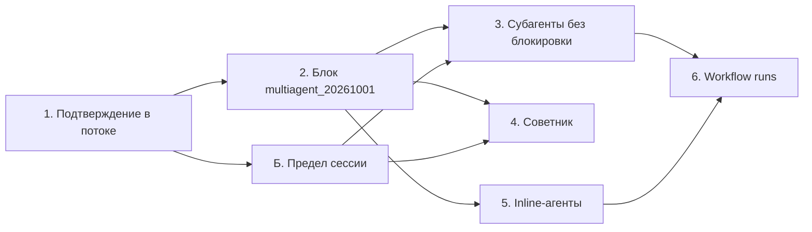

# Мультиагент: субагенты, советник, workflow runs

Черновик 2, 2026-10-18, после ревью (раздел 6). Это только дизайн: код не менялся, тесты не запускались. Порядок шагов утвердил владелец, вопрос 6 он решил 2026-10-18. Факты CMA взяты со страниц multiagent-orchestration, session-threads, workflow-runs и budgets от 2026-10-18 и из разбора [07-multiagent-outcomes.md](../research/cma-docs/07-multiagent-outcomes.md). Ход ведёт только Pi (D41 в [decisions-2026-10-17.md](../decisions-2026-10-17.md)).

Пути: `N/` это `platform/apps/main-node/src`, `NT/` это `platform/apps/main-node/test`, `A/` это `platform/apps/agent/src`, `AT/` это `platform/apps/agent/tests`, `P/` это `platform/packages`, `MA/` это `P/managed-agents-application/src`, `API/` это `P/managed-agents-api/src`, `C/` это `platform/apps/console/src`, `S/` это `.claude/skills/verify-agent-console`, `SDK/` это `platform/node_modules/.pnpm/@anthropic-ai+sdk@0.120.0_zod@4.4.3/node_modules/@anthropic-ai/sdk`.

Ссылки на код сверены чтением файлов 2026-10-18. Метка «по разбору кода» значит, что поведение выведено из кода и вживую не проверялось. Одну вещь проверил скрипт: схема из шага 1 отвечает `unrecognized_keys` на `session_thread_id`. Файлы `MA/agents/application.ts`, `MA/sessions/application.ts`, страница сессии и её вкладки сейчас правят волны CRUD и страницы сессии, номера строк там могут сдвинуться.

Тесты идут командами из `platform/AGENTS.md`, красные тесты пакетов без раннера живут в `NT/`. Живые доказательства идут на экземпляре скилла verify-agent-console (8791, фейковая модель 8792). Новые сценарии берут образец маркера `VERIFY_TOOL` из `S/scripts/fake-model.mjs:87-134`.

## 1. Порядок и зависимости

1. Шаг 1 (подтверждение в потоке субагента) ни от чего не зависит и идёт первым.
2. Шаг 2 (блок `multiagent_20261001`) идёт после шага 1. Шагам 3-6 он даёт общий внутренний вид настроек.
3. Предел сессии (раздел 3.Б) идёт после шага 1 и до шага 3. Без потолка фоновые потоки крутят модель без предела. Цены моделей пределу не нужны, поэтому от шага 2 он не зависит. Он правит раннер, как и шаг 1, и идёт после него. С шагом 2 он может идти параллельно: шаг 2 правит агентов и консоль, Б правит сессии, раннер и Pi.
4. Шаг 3 (субагенты без блокировки) идёт после шагов 1, 2 и Б.
5. Шаги 4 (советник) и 5 (inline-агенты) не зависят друг от друга. Обоим нужен шаг 2. Токены советника идут в предел Б. Шаг 5 берёт инструмент `send_to_agent` из шага 3, а без него работает через блокирующий `general_subagent`.
6. Шаг 6 (workflow runs) идёт последним, условия старта в разделе 3.6.

## 2. Общие факты о ходе

- Очередь исполнений уже знает полосы потоков. Поле `laneId` есть в контракте (`P/session-runtime-contract/src/coordination.ts:23`), пакет событий делится на полосы по `sessionThreadId` (`:183-205`), захват идёт по очереди внутри полосы (`P/session-runtime-sql/src/coordination.ts:503-508`), прерывание отменяет исполнение своей полосы (`N/lib/node-session-execution-worker.ts:126-146`).
- Субагент сейчас работает внутри исполнения основного потока, своей полосы у него нет (`N/lib/node-managed-subagents.ts:89-90`). В конце хода раннер ждёт всех детей (`N/lib/node-managed-session-runner.ts:764-771`).
- В режиме `checkpoint_restore` захват идёт по одному на сессию поперёк полос (`P/session-runtime-sql/src/coordination.ts:459`, `:510-516`), режим включает `N/modules/node-managed.ts:331`.
- Воркер захватывает исполнение без фильтров `sessionId` и `laneId` (`N/lib/node-session-execution-worker.ts:218-223`). Привязки сессии к реплике нет, есть только поля в контракте.
- История Pi знает только `user.message`, мысли, ответы, вызовы и результаты (`A/runtime/history.ts:285-345`). `agent.thread_message_received` она пропускает. В сообщение пользователя его превращает только `childHistory` ребёнка (`N/lib/node-managed-subagents.ts:75-79`).
- На сессию одна VM, дети берут песочницу родителя (`N/lib/node-managed-subagents.ts:274`). Значит, 512 МБ стоит сессия, а не поток, но внутри VM потоки делят эти 512 МБ. Поток упирается в пул исполнений (`OMA_SESSION_EXECUTION_CONCURRENCY`, по умолчанию 8, `N/config.ts:322`) и в пропускную способность шлюза Qwen.
- Документ потока пишется один раз со `status: "idle"` и `usage: null` (`N/lib/node-managed-subagents.ts:165`). У хранилища потоков нет метода правки (`P/session-thread-store-sql/src/index.ts:41-150`). Список потоков не показывает ни работу, ни расход.

## 3. Шаги

### 3.1 Шаг 1. Подтверждение вызова в потоке субагента

**Цель.** Человек жмёт «Разрешить» или «Отклонить» на вызов субагента. Вызов исполняется один раз с инструментами субагента. Результат ложится в поток субагента, субагент продолжает ход, основной поток получает его отчёт.

**Как в CMA.** Запрос из потока субагента дублируется в основной поток с `session_thread_id`. Поток уходит в `session.thread_status_idle` с `requires_action` и `event_ids`. Клиент шлёт `user.tool_confirmation` с одним `tool_use_id`, сервер сам находит поток. Сессия стоит в `requires_action`, если никто не работает и поток ждёт. В SDK 0.120 поле `session_thread_id` есть у записанного события (`SDK/resources/beta/sessions/events.d.ts:1396`), а у параметров отправки его нет (`:1401-1419`).

**Что есть у нас.**
- Схема строгая и поля не знает (`API/contracts/session-event-inputs.ts:112-119`). Скрипт получил `unrecognized_keys: session_thread_id`, маршрут отвечает 400 (`API/routes/session-events.ts:193-200`).
- Консоль шлёт поле (`C/pages/SessionDetail.tsx:991`), поток берёт из события (`C/components/session/ToolConfirmationRequests.tsx:64`).
- Без поля тоже ломается, по разбору кода. Маппер не несёт поток (`API/mappers/session-events.ts:127-133`), у входного типа домена поля нет (`P/managed-agents-domain/src/sessions/event.ts:72-76`), у записанного есть (`:113-118`). Раннер строит ход основного потока (`N/lib/node-managed-session-runner.ts:480-482`), ищет вызов в истории всех потоков (`:504-510`), исполняет его с настройками основного агента (`:533-541`), пишет результат без потока (`:542-555`) и будит основную модель (`:666-671`). Субагент результата не получает.
- Итог сессии считается только по основному потоку (`N/lib/node-managed-session-runner.ts:843-844`). Поток субагента кончается только `end_turn` или `retries_exhausted` (`N/lib/node-managed-subagents.ts:295-297`).
- Волна 1 закрыла случай MCP: сессия с субагентом, у которого MCP на `always_ask`, получает 400 (`MA/sessions/application.ts:307-315`). Встроенные инструменты на `always_ask` и свои инструменты субагента сюда ещё доходят.

**Дизайн.**
- API. Поле `session_thread_id` необязательно в `user.tool_confirmation` и `user.custom_tool_result`. Тип провода свой, по образцу `_oma`, потому что в SDK поля нет. Маппер и домен несут `sessionThreadId`. Без поля сервер берёт поток из вызова, как CMA. Поле с чужим потоком даёт 400 `invalid_request_error`.
- Полоса. Пакет событий раскладывает по полосам любое событие с `sessionThreadId` (`P/session-runtime-contract/src/coordination.ts:190-192`). Раннер держит состояние по сессии (`N/lib/node-managed-session-runner.ts:259`, `:421-425`), и два хода одной сессии затрут друг друга. Как только маппер положит поле в событие, раскладка отправит подтверждение в полосу ребёнка. Поэтому срез 1 правит и раскладку: до шага 3 она кладёт `user.tool_confirmation` и `user.custom_tool_result` в `sthr_primary` при любом поле. Полосы потоков включает срез 1 шага 3.
- Ожидание. Поток субагента с открытым вызовом кончается `requires_action` с `event_ids`. Итог сессии считается по всем незаархивированным потокам (`N/lib/node-managed-stop-reason.ts:29-38`). Блокирующий `call_agent_<id>` возвращает модели текст «The subagent is waiting for a tool confirmation. Its report will arrive as a separate message.», ход основного потока кончается.
- Исполнение. Раннер видит, что вызов принадлежит потоку субагента. Он исполняет вызов с агентом этого потока и пишет результат с его `session_thread_id`. Список ждущих вызовов считается по истории всех потоков. Сейчас он берёт только основной поток (`N/lib/node-managed-session-runner.ts:500`), и из пачки двух подтверждений потока субагента исполнится одно последнее (`:523`).
- Продолжение. `resume` для этого не годится: без нового сообщения он пишет `end_turn` и хода не запускает (`N/lib/node-managed-subagents.ts:363-379`). Нужна ветка «у вызова есть ответ, запусти ход» поверх `startChild`.
- Отчёт. Отчёт субагента идёт в основной поток событием `agent.thread_message_received`. Раннер превращает его в сообщение пользователя для истории основного потока (`N/lib/node-managed-session-runner.ts:482`), как `childHistory` делает для ребёнка: сама история Pi такое событие пропускает. Основная модель просыпается после отчёта.
- Консоль не меняется: она уже шлёт поле и читает итог сессии.

**Срезы.**
1. Схема, маппер, домен, раскладка. Красный тест: новый `NT/managed-session-thread-confirmation.test.ts`, подтверждение с `session_thread_id` даёт 200, с чужим потоком 400; подтверждение с потоком субагента попадает в полосу `sthr_primary`. У параметров SDK 0.120 поля нет, поэтому тест шлёт тело через приведение типа или прямым `fetch`. Доказательство: curl на 8791 с полем отвечает 200.
2. Поток ждёт человека. Красный тест: в `NT/managed-session-runner.test.ts` субагент с bash на `always_ask` даёт сессии `requires_action` с вызовом потока в `event_ids`. Доказательство: в журнале на 8791 есть `session.thread_status_idle` с `requires_action`.
3. Исполнение в потоке субагента. Красный тест: `allow` исполняет вызов один раз с инструментами субагента, результат несёт его поток, субагент продолжает ход без нового сообщения, основной поток получает `agent.thread_message_received`, а фейковая модель видит отчёт в сообщении пользователя. Два подтверждения одной пачки оба исполняются. `deny` кладёт ошибку в поток субагента. Доказательство: сценарий `S/scripts/journey-subagent-confirm.mjs` с маркером `VERIFY_DELEGATE`, клик «Разрешить» в потоке субагента, снимок 1280, события через API.

**Объём.** M. Разбор 07 оценивал правку как одну схему, это неверно.

**Риски.**
- Раннер правят и волна 1, и этот шаг. Срезы идут по одному.
- До шага 3 субагент, который ждёт человека, обрывает блокирующий вызов. Модель получает текст об ожидании, а не отчёт.
- Повтор подтверждения уже защищён проверкой по истории всех потоков (`N/lib/node-managed-session-runner.ts:501`). Тест среза 3 повторяет `allow`.
- Пункт 4 [harness-fixes.md](harness-fixes.md) (смешанный батч с подтверждением) приходит уже здесь: Pi субагента идёт тем же циклом. Срез 3 берёт смешанный батч в потоке субагента.
- Вторую половину пункта 6 harness-fixes срез 3 закрывает частично: отчёт после подтверждения приходит событием `agent.thread_message_received`. Обычный блокирующий вызов получает событие в шаге 3.

### 3.2 Шаг 2. Блок `multiagent_20261001`

**Цель.** API принимает новый блок, как CMA, и дальше принимает `coordinator`. Оба типа сводятся к одному внутреннему виду, ход читает только его.

**Как в CMA.** Блок держит три настройки: `subagents` и `workflows` включены по умолчанию, `advisor` выключен. У `subagents` и `workflows` свои списки `predefined_agents` до 20 разных агентов и флаг `inline_agents`, по умолчанию включённый. Запись списка бывает строкой с id, `{type:"agent", id}`, `{type:"agent", id, version}` и `{type:"self"}`. Ссылка без версии закрепляется при сохранении. Агент со своим блоком в список не входит. `inline_agents: disabled` с пустым списком даёт 400. Включённый советник требует `model` и занимает имя `anthropic.advisor`. Префикс `ant__` у своих инструментов занят. Правка того же типа меняет только присланное: пропуск хранит значение, `null` ставит умолчание, список заменяется целиком, настройка с другим `type` заменяется с умолчаниями. Смена типа заменяет весь блок. Сессия копирует настройки при создании.

**Что есть у нас.**
- Схема знает только `coordinator`, советник там запись списка (`API/contracts/agent-input-components.ts:168-188`). Ответ тоже строго по SDK (`API/contracts/agent-response-components.ts:248`).
- SDK 0.120 и 0.129 из lock-файла знают только `coordinator` (`agents.d.ts:711`, `:727` в 0.120; `:724`, `:740` в 0.129). Правило `P/managed-agents-api/API_LAYER.md:3-5` велит держать провод `/v1` по SDK 0.120. Подъём SDK новый тип не даёт.
- Проверки ростера: 1..20 записей (`MA/agents/application.ts:366-371`), советник (`:376-378`), `self` закрепляется своим id и версией (`:380-390`), агент с блоком даёт 400 (`:417-422`).
- Снимок сессии всегда пишет `coordinator` (`MA/sessions/application.ts:170-173`). Кодек сводит ростер к `callable_agents` (`N/lib/node-managed-agent-codec.ts:230-258`). Делегирование включено при непустом ростере, до 6 детей сразу (`N/openai-subagents.ts:7-12`).
- Агент хранится документом JSON (`P/agent-store-sql/src/index.ts:75-81`), миграция не нужна.
- Консоль пишет `coordinator` (`C/pages/agents/agentFormCodec.ts:734`), форма «Вызываемые агенты» (`C/pages/agents/AgentFormDialog.tsx:1469`).

**Дизайн.**
- Провод. Свой тип `AgentMultiagentBody = coordinator | multiagent_20261001` в `API/contracts/agents.ts`, по образцу `_oma`. Запрос и ответ используют его. Отступление от SDK записать в `API_LAYER.md`.
- Домен. `AgentMultiagent` становится объединением. Новый вид: `subagents` и `workflows` как `{type:"enabled", inlineAgents, predefinedAgents[]}` или `{type:"disabled"}`, `advisor` как `{type:"enabled", model}` или `{type:"disabled"}`.
- Новый модуль `MA/agents/multiagent.ts` держит три функции. `resolveMultiagentInput` проверяет и закрепляет ссылки. `mergeMultiagentUpdate` выполняет правила правки CMA. `effectiveMultiagent(agent)` отдаёт ходу `{subagents, workflows, advisor}`. `coordinator` сводится к `subagents` без inline, выключенным `workflows` и советнику из записи списка.
- Проверки: до 20 разных агентов в каждом списке, `self` в обоих, 400 на агента с блоком, на пустой список при выключенных inline, на советника без `model`, на агента с именем `anthropic.advisor`, на инструмент с префиксом `ant__` при включённых `workflows`.
- Снимок сессии сохраняет тип. Кодек, политика делегирования и `resolveSubagentSession` (`N/modules/node-managed.ts:381-390`) читают только `effectiveMultiagent`.
- Консоль. Раздел «Мультиагент»: список с пунктом «Сам агент», переключатель «Агенты, которых описывает сам агент», выбор «Советник» из карточек моделей, строка про фоновые запуски с пометкой «появятся позже».

**Срезы.**
1. Провод и домен. Красный тест: новый `NT/managed-agents-multiagent-block.test.ts`, блок `{"type":"multiagent_20261001"}` даёт 200 с умолчаниями, восемь случаев 400 из проверок. Доказательство: curl создания и чтения агента на 8791.
2. Правка. Красный тест: в том же файле пропуск хранит советника, `null` сбрасывает, другой `type` настройки заменяет её, смена типа блока заменяет всё. Доказательство: curl правки на 8791.
3. Снимок и вид для хода. Красный тест: новый `NT/managed-session-multiagent-view.test.ts`, сессия хранит тип, `coordinator` и новый тип дают одинаковые `callable_agents`. Доказательство: сценарий шага 1 проходит на агенте нового типа.
4. Консоль. Красный тест: `agentFormCodec.test.ts` читает оба типа и сохраняет чужие поля, `AgentFormDialog.test.tsx` видит выбор советника. Доказательство: снимки раздела на 1280 и 390.

**Объём.** M.

**Риски.**
- Старый бинарник после отката не прочтёт агента нового типа: ответ проверяется строгой схемой. Вопрос 5.
- `MA/agents/application.ts` правит волна CRUD. Срез 1 ждёт её коммита.
- Клиент на SDK 0.120 получит в ответе тип, которого SDK не знает. На TS это не падает, ответ в работе не проверяется.

### 3.Б Предел сессии в токенах и ходах субагентов (до шага 3)

**Решение владельца 2026-10-18 (вопрос 6).** Предел сессии считается в токенах и в ходах субагентов. Денег нет нигде: ни центов, ни цен в карточках, ни сумм в консоли. На пределе ход встаёт с `budget_reached`, консоль пишет простую заметку, что предел исчерпан, и даёт его поднять. Советник и потоки run тратят тот же предел токенов.

**Цель.** Сессия встаёт, когда все её потоки вместе съели предел токенов или субагенты сделали предел ходов. Она встаёт в `idle` с `budget_reached` и продолжает работу после подъёма предела.

**Как в CMA и что берём.** CMA считает бюджет в центах по прайсу моделей, это не берём. Берём механику. Проверка идёт перед каждым запросом к модели, начатый запрос доходит до конца, так что перерасход бывает до одного запроса на поток. Каждый поток встаёт сам и пишет `session.thread_status_idle` с `budget_reached`, затем идут `session.usage` и `session.status_idle` с `budget_reached`. Поток с ждущим вызовом важнее предела: сессия стоит в `requires_action`. На пределе сервер принимает только `user.tool_confirmation`, `user.tool_result`, `user.custom_tool_result` и `user.interrupt`, остальное даёт 400. Новый предел должен быть выше израсходованного, правка продолжает работу.

**Что есть у нас.**
- Поле `budget` в центах принимается и хранится (`API/contracts/sessions.ts:110-125`, `:150`; `MA/sessions/application.ts:356`, `:510`), деплоймент копирует его (`:450-451`). Предел его не читает, поле остаётся как есть.
- У тела сессии нет `_oma`, у агента есть (`API/contracts/agents.ts:198`, `:240`).
- `budget_reached` есть в проводе (`API/contracts/session-events.ts:300`), в домене (`P/managed-agents-domain/src/sessions/event.ts:160`) и в SDK, но его никто не ставит (`N/lib/node-managed-stop-reason.ts:29-38`).
- Pi сообщает токены после каждого запроса (`A/harness/pi-loop.ts:407`, `:471`). Счётчик хода создаётся пустым (`N/lib/node-managed-harness-runtime.ts:254`), проекция заменяет `usage` сессии, а не прибавляет (`MA/session-execution/application.ts:40-42`). У ребёнка свой счётчик (`N/lib/node-managed-subagents.ts:275`). По разбору кода `usage` сессии показывает последний ход последнего потока.
- Владелец 2026-10-16 убрал токены, стоимость и бюджет со страницы сессии ([session-page.md](session-page.md), «Правка 2026-10-16»). Предел этого не меняет: чисел консоль не показывает.

**Дизайн.**
- Мера. Токены: вход и выход всех запросов всех потоков, то есть основного, субагентов, советника, грейдера outcome и потоков run. Ходы: каждый запуск хода дочернего потока, кроме советника и потоков run. У run свой лимит агентов (раздел 3.6). Срабатывает любой из двух пределов.
- Где задаётся. Новое поле `_oma.limits: {max_tokens, max_child_turns}` в теле создания и правки сессии, по образцу `_oma` агента. Отступление от SDK записать в `API_LAYER.md`. Умолчание берётся из `_oma.session_limits` агента, затем из `OMA_SESSION_MAX_TOKENS` и `OMA_SESSION_MAX_CHILD_TURNS`. Деплоймент копирует предел так же, как `budget`. Предел есть у каждой сессии, снять его нельзя, только поднять. Ответ сессии несёт `_oma.limits` с израсходованным, для API и тестов.
- Счётчик. Таблица `oma_session_limits` создаётся кодом через `CREATE TABLE IF NOT EXISTS` и хранит токены и ходы. Каждый `span.model_request_end` любого потока прибавляет токены одним `UPDATE`, каждый `session.thread_status_running` дочернего потока прибавляет ход. Поток советника (`agent_name: anthropic.advisor`) и потоки с `workflow_run_id` ход не прибавляют. Пустую строку заполняет сумма по истории всех потоков (`N/lib/node-harness-usage.ts:90`). Строку видят все полосы и реплики.
- Проверка. Новый метод runtime `beforeModelRequest()`, Pi зовёт его в `streamFn` (`A/harness/pi-loop.ts:164-169`). Ход ребёнка проверяет предел ходов перед `startChild`. Ту же проверку проходят советник и грейдер outcome.
- Как встаёт ход. Исключение из `streamFn` pi-agent-core превращает в ответ с `stopReason: "error"` и строкой (`pi-agent-core/dist/agent.js:357-373`), тип ошибки теряется. Потом pi-loop бросает `ModelError` (`A/harness/pi-loop.ts:105-112`), раннер повторяет ход до трёх раз, если событий агента ещё не было (`N/lib/node-managed-session-runner.ts:629-653`), и кончает `retries_exhausted`. Поэтому проверка ставит в runtime флаг предела. Pi-loop видит флаг до броска, не пишет спан несостоявшегося запроса и бросает свою ошибку, которую `isNonRetryableHarnessError` (`:881-883`) не повторяет. Стоп-причина раннера (`:844`) и потока ребёнка (`N/lib/node-managed-subagents.ts:296`) получает ветку `budget_reached`.
- Приём событий. `sendSessionEvents` (`MA/session-events/application.ts:166`) на пределе отвечает 400 на `user.message` и `user.define_outcome`, называет разрешённые события и подъём предела.
- Подъём. Правка сессии с `_oma.limits`. Предел не выше израсходованного даёт 400. Принятая правка ставит в очередь продолжение для каждой вставшей полосы.
- Консоль. По стоп-причине шапка сессии пишет «Предел работы сессии исчерпан» и показывает кнопку «Поднять предел». Кнопка поднимает оба предела вдвое (вопрос 8). Токенов, денег и графиков консоль не показывает.

**Срезы.**
1. Счётчики. Красный тест: новый `NT/managed-session-limits.test.ts`, два хода, субагент и запрос второй карточки складываются в одну строку токенов, ход субагента прибавляет ход, пустая строка заполняется по истории. Доказательство: curl сессии на 8791 после двух ходов, `_oma.limits` растёт.
2. Предел между запросами. Красный тест: `AT/pi-loop.test.ts` «не шлёт запрос модели после предела и не пишет спан ошибки»; в `NT/managed-session-runner.test.ts` ход встаёт с `budget_reached` без повтора и без `session.error`, порядок событий как в CMA, ребёнок не начинает ход сверх `max_child_turns`. Доказательство: на 8791 сессия с `max_tokens: 1` встаёт с `budget_reached`.
3. События на пределе и подъём. Красный тест: в том же `NT/managed-session-limits.test.ts` `user.message` даёт 400, подтверждение 200, предел не выше израсходованного 400, подъём продолжает ход. Доказательство: цепочка curl на 8791.
4. Консоль. Красный тест: тест шапки видит заметку и кнопку по `budget_reached`, кнопка шлёт правку с удвоенным пределом. Доказательство: снимки 1280 и 390.

**Объём.** M.

**Риски.**
- Число по умолчанию. Ход Qwen из 30 запросов при контексте 50 тысяч токенов съедает около 1,5 млн входных токенов, это оценка, не замер. Умолчание берётся по журналу `span.model_request_end` пробной копии до среза 2.
- Перерасход до одного запроса на поток, как в CMA.
- Шапку правит волна страницы сессии, срез 4 идёт после её коммита.
- `MA/sessions/application.ts` и контракт сессий правит волна CRUD. Срезы 1 и 3 ждут её коммита, как срез 1 шага 2.
- Не проверено, что шлюз LiteLLM для Qwen и фейковая модель 8792 отдают `usage`. Если токенов в ответе нет, счётчик стоит на нуле и держит только предел ходов. Поэтому срез 1 сначала показывает рост токенов на 8791, и только потом срез 2 верит доказательству с `max_tokens: 1`.

### 3.3 Шаг 3. Субагенты без блокировки хода

**Цель.** Основной агент отдаёт задачу и работает дальше. Отчёт приходит отдельным сообщением. Тому же субагенту можно дописать. Один поток прерывается по `session_thread_id`. Пункт 6 [harness-fixes.md](harness-fixes.md) закрывается во второй половине: отчёт субагента приходит в основной поток событием.

**Как в CMA.** Инструменты агента `list_agents` и `send_to_agent`. Задача уходит сразу, отчёт приходит в основной поток как `agent.thread_message_received` с `from_session_thread_id`, `from_agent_name` и `content`. Отправка пишет `agent.thread_message_sent` с `to_session_thread_id`, `to_agent_name` и `content`. Поток живёт до архива и помнит прошлые ходы. Лимит 25 дочерних потоков на сессию, простаивающие считаются, архив освобождает место, основной поток, советник и потоки run не считаются. Уровень один. Сессия `running`, пока работает хоть один поток. `user.interrupt` с потоком закрывает его вызовы ошибкой «Tool execution was interrupted before completion. Please retry.», поток уходит в `end_turn`, отчёта нет. Прерывание простаивающего потока ничего не делает, завершённого даёт 400.

**Что есть у нас.**
- `call_agent_<id>` блокирует ход (`A/harness/tools.ts:1468-1489`): `delegateToAgent` создаёт ребёнка и ждёт без срока (`N/lib/node-managed-session-runner.ts:599-604`). Инструмент есть только при ключе модели (`A/harness/tools.ts:1469`).
- Неблокирующие инструменты уже есть для пути `/openai`: create, send, wait, interrupt, close, resume (`N/openai-subagents.ts:30-70`). Они работают на том же `ManagedNodeSubagents` и включаются только для сессий `/openai` (`N/modules/node-managed.ts:586-592`).
- `agent.thread_message_sent` пишется в основной поток (`N/lib/node-managed-subagents.ts:248-251`), `agent.thread_message_received` в поток ребёнка (`:267-269`). Отчёт возвращается только строкой результата инструмента.
- Лимит 6 одновременно (`N/openai-subagents.ts:11`), счётчик видит только работающих (`N/lib/node-managed-subagents.ts:113-117`), общего потолка нет.
- Раннер держит состояние по сессии (`N/lib/node-managed-session-runner.ts:259`), прерывание рвёт весь ход (`:422-424`). Консоль шлёт прерывание с потоком (`C/pages/SessionDetail.tsx:1025`). Воркер отменяет только исполнение этой полосы, а у ребёнка полосы нет. По разбору кода прерывание одного потока сейчас ничего не делает.

**Дизайн.**
- Инструменты Pi в сессиях `/v1` при включённых `subagents`: `list_agents` (id, имя, описание) и `send_to_agent({agent_id} или {session_thread_id}, message)`. Ответ сразу: `{session_thread_id, status:"running"}`. Совпадение с именем своего инструмента решается приставкой, как `openma_` (`N/modules/node-managed.ts:588-590`). `call_agent_<id>` остаётся синонимом на один выпуск, вопрос 9.
- Полосы. Ход ребёнка идёт своим исполнением на полосе с id его потока. `send_to_agent` пишет `agent.thread_message_sent` и ставит в очередь исполнение полосы ребёнка. Конец хода ребёнка пишет в основной поток `agent.thread_message_received` и ставит в очередь исполнение основной полосы. История основного потока превращает отчёт в сообщение пользователя.
- Раннер держит прерывание и состояние хода по паре «сессия и полоса». Песочница остаётся одна на сессию. Её создание и пересоздание при смене настроек (`start`, `N/lib/node-managed-session-runner.ts:277-393`) идут под замком сессии, иначе две полосы поднимут две VM или одна снесёт VM под другой.
- Реплика. Привязки полос к реплике с VM нет: в контракте есть фильтр `sessionId` (`P/session-runtime-contract/src/coordination.ts:69-78`), но воркер его не передаёт. На ноутбуке реплика одна, и шаг 3 работает на одной реплике. Привязку делает тест двух реплик из D42, до него вторая реплика с полосами не запускается. В режиме `checkpoint_restore` полосы идут по одной, вопрос 10.
- Статус. Сессия `running`, пока работает хоть одна полоса. Сейчас каждое исполнение кончается `session.status_idle` (`N/lib/node-managed-session-runner.ts:842-845`), и полоса ребёнка поставила бы `idle` при работающей основной. Полоса пишет `session.thread_status_idle`, а `session.status_idle` пишет та, что кончает последней. Проверка «других исполнений нет» идёт в той же транзакции, что закрывает исполнение, иначе две полосы, кончая разом, не напишут его обе. Итог считается по всем потокам: сначала `requires_action`, потом `budget_reached`, потом `end_turn`.
- Лимиты. 25 незаархивированных дочерних потоков считаются по хранилищу потоков. Двадцать шестой `send_to_agent` получает текст ошибки. Одновременно работают до `OMA_SUBAGENT_MAX_RUNNING` детей (по умолчанию 2), остальные ждут в своей полосе. Для этого захвату нужно новое условие в `selectCandidate` (`P/session-runtime-sql/src/coordination.ts:476-530`): фильтры захвата число работающих полос не считают. Дочерние полосы и полосы run на реплике занимают не больше `OMA_SESSION_EXECUTION_CONCURRENCY` минус 2 мест. Когда места кончились, воркер захватывает только с `laneId: "sthr_primary"`, фильтр уже есть (`:492`). Иначе дети двух сессий займут все 8 мест, и основной ход третьей встанет в очередь. У ребёнка нет инструментов делегирования, это уже так (`N/lib/node-managed-subagents.ts:191-193`).
- Прерывание. Поток ребёнка отменяет его полосу. Раннер закрывает его вызовы ошибкой CMA, пишет `end_turn` без отчёта. Завершённый поток даёт 400. Прерывание без потока останавливает все полосы.
- Потоки. Хранилище получает метод правки. Статус и токены пишутся в документ потока в начале и в конце хода полосы, архив ставит `terminated`. Токены видит API, консоль их не показывает.
- Предел. Каждая полоса проходит проверку Б по общей строке, запуск хода ребёнка прибавляет ход.
- Консоль. Вкладка «Потоки» показывает статус и имя агента (`C/components/session/inspector/ThreadsTab.tsx:126-131`). Лента основного потока показывает отправку и отчёт карточками. Кнопка прерывания уже шлёт поток.

**Срезы.**
1. Полосы в раннере. Раскладка начинает отправлять подтверждение и результат своего инструмента в полосу потока. Красный тест: новый `NT/managed-session-runner-lanes.test.ts`, две полосы одной сессии идут разом на одной песочнице, прерывание полосы ребёнка не трогает основную. Доказательство: два исполнения с разными полосами в трассе 8791.
2. `send_to_agent` и `list_agents`. Красный тест: в `AT/` инструмент отвечает сразу; в `NT/` ровно один `agent.thread_message_sent` и исполнение полосы ребёнка. Сейчас для `call_agent_*` их два: harness пишет свой с `to_thread_id` равным id вызова (`A/harness/tool-events.ts:71-84`), его надо убрать и у синонима. Доказательство: сценарий `S/scripts/journey-subagents.mjs`, маркер `VERIFY_DELEGATE`, основной агент отвечает пользователю раньше, чем ребёнок кончил.
3. Отчёт. Красный тест: конец хода ребёнка пишет `agent.thread_message_received` и будит основную полосу, фейковая модель видит отчёт в сообщении. Доказательство: порядок событий в сценарии и журнал фейковой модели.
4. Повторное сообщение. Красный тест: второй `send_to_agent` с `session_thread_id` идёт в тот же поток с историей. Доказательство: второй шаг сценария.
5. Прерывание одного потока. Красный тест: воркер и раннер закрывают вызовы ребёнка ошибкой, основная полоса работает. Доказательство: curl прерывания с потоком, снимок вкладки «Потоки».
6. Лимит 25 и один уровень. Красный тест: двадцать шестая отправка даёт ошибку, у ребёнка нет `send_to_agent`. Доказательство: curl списка потоков.
7. Статус и токены потоков, консоль. Красный тест: правка в хранилище потоков, `ThreadsTab.test.tsx` видит статус и не видит токенов. Доказательство: снимки 1280 и 390.

**Объём.** XL.

**Риски.**
- Раннер переходит на состояние по полосам. Это самая большая правка плана.
- Пункт 4 из harness-fixes (смешанный батч с подтверждением) станет чаще: подтверждения придут из многих потоков.
- Пропускная способность Qwen: дети шлют запросы разом. Шаг 6 зависит от этого же замера.
- Память VM. Потоки делят 512 МБ одной VM: несколько bash с разбором PDF или xlsx разом могут исчерпать её изнутри. Поэтому детей разом по умолчанию 2. Срез 2 меряет пик памяти VM на двух детях с разбором файлов, число поднимается по замеру или по `memory_mib` образа.
- Вкладку «Потоки» и ленту правит волна страницы сессии.

### 3.4 Шаг 4. Советник

**Цель.** Основной поток Pi на Qwen посреди хода спрашивает совета у сильной карточки, например Sonnet. Число консультаций на сессию ограничено. Токены советника записаны и входят в предел сессии.

**Как в CMA.** Настройка `advisor: {type:"enabled", model}`, других полей нет. Советоваться может только основной поток, когда решает агент. Модель агента не должна быть сильнее советника, иначе 400. Консультация идёт потоком `anthropic.advisor`. События идут в таком порядке: `session.thread_created`, `session.thread_status_running`, `agent.thread_message_received` с советом, `session.thread_status_idle` с `end_turn`, `session.thread_status_terminated`. `agent.tool_use` нет. Советник получает всю переписку основного потока. Сбой консультации ход не ломает, агент видит общую заметку. Прерывание с потоком советника бросает только консультацию. Потоки советника не входят в лимит 25. Расход идёт по цене советника и входит в бюджет. Лимита числа консультаций у настройки нет.

**Что есть у нас.**
- Запись `{type:"advisor", model}` принимается в ростере (`API/contracts/agent-input-components.ts:182-184`), хранится (`MA/agents/application.ts:376-378`), копируется в сессию (`MA/sessions/application.ts:151-154`). Тип потока знает советника (`P/managed-agents-domain/src/sessions/thread.ts:23`), кодек его пропускает (`N/lib/node-managed-agent-codec.ts:85`, `:263`).
- Во время хода советника никто не зовёт: в `A/harness` слова `advisor` нет, в `N/` только кодек.
- Вторая карточка на сессию уже бывает: `_oma.aux_model` через `resolveNodeManagedAuxiliaryToolModel` (`N/modules/node-managed.ts:562-566`).

**Дизайн.**
- Инструмент `advisor` есть только у основного потока, вход `{question?: string}` до 2000 знаков. Harness пишет `agent.tool_use` и `agent.tool_result`, чтобы история Pi повторялась верно. Это отступление от CMA, вопрос 12. События потока советника идут как в CMA, и совет по CMA приходит в основной поток событием `agent.thread_message_received`. Модель получает совет только результатом инструмента. Превращение отчётов в сообщения пользователя из шагов 1 и 3 пропускает событие с `from_agent_name: anthropic.advisor`, иначе совет попадёт в историю Pi дважды.
- Новый `N/lib/node-managed-advisor.ts`. Он находит карточку по `effectiveMultiagent.advisor.model` и собирает вход: роль советника, переписку основного потока (текст, вызовы, результаты до 2000 знаков каждый, всё до 60% окна карточки) и вопрос. Тела результатов MCP в переписку не идут, только имя инструмента и пометка об ошибке: там данные iiko и 1С. Когда волна 1 сделает `compactDreamTranscript` с маской (cma-wave-1.md, 3.6), сборщик берёт её. Потом зовёт модель через Pi, заводит поток с агентом `{type:"advisor", model}` и пишет события. Совет возвращается результатом инструмента.
- Лимит `_oma.advisor_max_uses` на агенте, по умолчанию 3, не больше 20. Счёт идёт по `session.thread_created` с `agent_name: anthropic.advisor` в истории, таблица не нужна. На лимите инструмент отвечает «Advisor limit for this session is used up. Continue on your own.» без запроса.
- Сбой даёт ответ «The advisor consultation failed. Continue on your own.», ход идёт дальше.
- Когда советоваться. Блок напоминаний в системном промпте, рядом с `buildNodeManagedAppendablePromptReminders` (`N/modules/node-managed.ts:636-638`). Агент спрашивает советника перед выбором подхода к задаче из нескольких шагов, после второй подряд ошибки одного инструмента или повторной одинаковой ошибки и перед тем, как объявить задачу готовой. Harness считает ошибки подряд и ко второй дописывает строку «Consider calling the advisor.», пока лимит не исчерпан. Сервер сам советника не зовёт, вопрос 15.
- Токены. Поток советника получает `span.model_request_end` с `model_usage`. Строка Б прибавляет его токены к пределу сессии. Проверка предела идёт до запроса. Документ потока получает `usage`.
- Пару моделей сервер не проверяет. Он проверяет, что карточка есть и что её модель не совпадает с моделью агента.
- Консоль: выбор «Советник» и число «Консультаций на сессию» в форме, карточка «Совет» в ленте, подпись «Советник» во вкладке «Потоки».

**Срезы.**
1. Инструмент и вызов. Красный тест: новый `NT/managed-session-advisor.test.ts` с фейковым советником, события потока в порядке CMA, совет в результате и ровно один раз в следующем запросе к модели, тел MCP во входе советника нет, у субагента инструмента нет. Доказательство: сценарий `S/scripts/journey-advisor.mjs` с маркером `VERIFY_ADVISOR` и двумя карточками на фейковую модель.
2. Лимит и сбой. Красный тест: четвёртый вызов отвечает про лимит без запроса, ошибка 500 советника даёт заметку и `end_turn`. Доказательство: в журнале фейковой модели три запроса советника.
3. Напоминания. Красный тест: в `AT/` вторая ошибка подряд несёт подсказку, промпт несёт блок при включённом советнике. Доказательство: блок в журнале фейковой модели.
4. Токены. Красный тест: токены советника входят в строку Б и в проверку предела, на пределе консультация не начинается. Доказательство: curl сессии на 8791, `_oma.limits` растёт после консультации.
5. Консоль. Красный тест: тесты вкладки «Потоки» и ленты. Доказательство: снимки 1280 и 390.
6. Живая проверка. Одна сессия на Qwen с советником Sonnet в пробной копии (8788), с разрешения владельца, вопрос 21.

**Объём.** L.

**Риски.**
- Qwen может не звать инструмент. Напоминания и подсказка после ошибки снижают риск, вживую это покажет срез 6.
- Переписка внутренней модели уходит во внешнюю карточку, вопрос 13.
- Поздние консультации длинной сессии дороже, вход растёт с перепиской.

### 3.5 Шаг 5. Inline-агенты

**Цель.** Агент сам описывает помощника при делегировании: имя, описание, системный промпт. Помощник работает в своём потоке с моделью, инструментами, MCP и навыками агента сессии.

**Как в CMA.** Inline-агент не сохраняется. Его поток несёт `agent: {type:"inline", name, description, system}`. Флаг `subagents.inline_agents` включён по умолчанию. Ограничить MCP inline-агента нельзя, для этого inline выключают и перечисляют агентов.

**Что есть у нас.**
- Инструмент `general_subagent` принимает только `task` (`A/harness/tools.ts:1492-1526`). Его включает `_oma.enable_general_subagent` (`N/lib/node-managed-agent-codec.ts:301-303`), и он появляется только при непустом ростере (`N/openai-subagents.ts:11`).
- С ростером вызов падает: `resolveSubagentSession` бросает ошибку для `general` (`N/modules/node-managed.ts:381-385`). Inline-логика уже написана в `defaultSession` (`N/lib/node-managed-subagents.ts:185-195`), но на Node до неё ход не доходит.
- У типа потока нет вида inline (`P/managed-agents-domain/src/sessions/thread.ts:9-23`). Загрузка потока для повторного сообщения отвергает поток, у которого `agent.type` не `agent` (`N/lib/node-managed-subagents.ts:210-212`), так что второе сообщение inline-агенту сейчас упадёт. Проверка MCP на `always_ask` при создании сессии смотрит только на агентов ростера (`MA/sessions/application.ts:307-315`).

**Дизайн.**
- `send_to_agent` принимает `inline: {name, description?, system}`. Без шага 3 те же поля получает `general_subagent`, а `resolveSubagentSession` отдаёт inline в `defaultSession`.
- Поток получает агента `{type:"inline", name, description, system}`. Сессия ребёнка это копия агента сессии с `multiagent: null` и своим промптом. MCP и инструменты идут со своими политиками, `always_ask` работает после шага 1.
- Флаг берётся из `effectiveMultiagent.subagents.inlineAgents`. Старый `_oma.enable_general_subagent: true` значит inline включены, поле читается дальше, вопрос 17.
- Лимит 25, предел ходов Б и один уровень общие с шагом 3. Загрузка потока принимает вид `inline`.
- Секреты. Inline-агент работает в той же VM и с теми же учётками сессии, что агент сессии. Больше, чем у агента сессии, у него нет.
- Консоль: переключатель из шага 2, подпись «Описан агентом» во вкладке «Потоки».

**Срезы.**
1. Вид потока. Красный тест: список потоков отдаёт `agent.type: "inline"` с именем и промптом, второе сообщение тому же inline-потоку доходит. Доказательство: curl потоков на 8791.
2. Запуск. Красный тест: ребёнок получает инструменты агента сессии и свой промпт, при выключенном флаге инструмента нет. Доказательство: маркер `VERIFY_INLINE`, промпт ребёнка в журнале фейковой модели.
3. Старый флаг. Красный тест: тест кодека сводит `enable_general_subagent` к inline. Доказательство: curl агента со старым флагом.

**Объём.** M.

**Риски.**
- Inline-агент получает все пишущие MCP агента сессии. Его промпт пишет модель, и правила владельца из промпта агента сессии до него не доходят. Политики инструментов остаются, поэтому пишущие MCP держат на `always_ask`.
- Qwen пишет слабые промпты для помощников. Подсказки инструмента дают шаблон промпта.
- Шаг 5 идёт после шага 1, поэтому `always_ask` у inline-агента доходит до человека. Если владелец оставит запрет волны 1 (вопрос 2, б), запрет распространяется на агента сессии при включённых inline.

### 3.6 Шаг 6. Workflow runs

**Цель.** Агент запускает фоновую обработку сотен документов и тем временем отвечает пользователю. Сервер ведёт run по фазам, держит лимиты и предел сессии и пишет события `workflow_run.*`.

**Как в CMA.** Агент пишет программу под задачу и запускает run в том же ходе, без вызова API и без шага одобрения. Код программы клиент не видит. Run идёт фазами. В фазе программа запускает агентов параллельно, передаёт ответы дальше и повторяет шаг до проверки. Упавшего агента сервер обычно запускает ещё раз в новом потоке. Состояния run: running, idle (пауза, например на бюджете) и ended. События: `workflow_run.created` (`wrun_`, имя, описание, `phases[]` с `wrph_`), `status_running`, `status_idle`, `phase_started`, `phase_ended` с `phase_started_id`, `status_ended` с `result`, а также `workflow_run.error`. Итоги run: `completed`, `stopped` и `error` с `timeout_error`, `program_error`, `thread_limit_error` или `unknown_error`. Лимиты: 64 потока разом, 1000 агентов за run, 24 часа, 10 открытых run на сессию, имя до 64 знаков, описание до 256. Потоки run несут `workflow_run_id`, не входят в лимит 25, сервер архивирует их сам. Прервать или заархивировать их нельзя. `user.interrupt` run не останавливает. Архив сессии при открытом run может дать 400 `workflow_run_open`. Пока run открыт, оценка outcome не начинается. Бюджет ставит run на паузу. После конца run агент получает ход. Вложенных run нет.

**Что есть у нас.** Ничего: `workflow_run` встречается только в разборе вебхуков GitHub (`P/github/src/webhook/parse.ts:47`, `:517-522`). Основа из прошлых шагов: полосы, потоки, inline-агенты, предел сессии.

**Дизайн, наименьшая полезная версия.**
- Где работает программа. Варианты: а) сервер исполняет план JSON, который агент передаёт инструменту; б) код агента работает в VM и зовёт сервер по `http://host.boxlite.internal:<порт>` с токеном run; в) код агента работает в изоляте JS на сервере. Совет: а), вопрос 18. Код модели не исполняется на хосте. Волна 1 уже даёт VM вход на хост для секретов (`OMA_EGRESS_URL`, [cma-wave-1.md](cma-wave-1.md), 3.5), а план JSON второго входа не добавляет. План закрывает главный случай бэк-офиса: разобрать много файлов и свести итог.
- Вид плана: `{name, description, lifetime_minutes, phases: [...]}`. Фаза `map` несёт `items` (`{glob}` в `/mnt/session` или `{list}`), агента (`{agent_id}` из `workflows.predefined_agents` или `{inline}`), шаблон `prompt` с `{{item}}` и `max_attempts` до 2. Фаза `reduce` несёт агента и шаблон с `{{results}}`. Ответ каждого потока ложится файлом в `/mnt/session/outputs/runs/<wrun>/<фаза>/<n>.md`, `reduce` получает список путей.
- Исполнение. Таблица `oma_workflow_runs` создаётся кодом. Планировщик в процессе ставит в очередь исполнения потоков run на полосах `<wrun>:<n>` с пределом одновременных, повторяет упавший пункт один раз в новом потоке, пишет события CMA и `session.thread_created` с `workflow_run_id`. После конца run он ставит в очередь основную полосу. После перезапуска сервера планировщик поднимает открытые run из таблицы, вместе с проходом по зависшим исполнениям из D42 (пункт 3 ближайшего плана).
- Инструменты основного потока: `start_workflow_run(plan)`, `get_workflow_run(id)` и `stop_workflow_run(id)`. Последний даёт итог `stopped`.
- Правила CMA: оценка outcome ждёт конца run, архив и удаление сессии дают 400 `workflow_run_open`, прерывание run не трогает.
- Инструменты потоков run. В первой версии у них нет MCP и web-инструментов, только инструменты VM. Иначе пишущий MCP на `always_allow` сделает сотни записей без человека по тексту чужих документов. Если у агента фазы bash, write или edit стоят на `always_ask`, старт даёт `workflow_run.error`: сотни подтверждений человеку не нужны.
- Лимиты для одного ноутбука задаются переменными окружения. Потоков разом в одном run 2 (в CMA 64), пока замер не покажет память VM и шлюз. Агентов за run 200 (в CMA 1000). Срок 2 часа по умолчанию, не больше 24. Открытых run на сессию 2 (в CMA 10). Места в пуле делятся по правилу шага 3: дочерним полосам и полосам run на реплике не больше `OMA_SESSION_EXECUTION_CONCURRENCY` минус 2. Run не добавляет VM: его потоки работают в VM сессии и делят её 512 МБ с детьми. Упор идёт в шлюз Qwen, в память и процессор VM и в пул из 8 исполнений. Свободных 5 ГБ хватает примерно на 8 сессий с VM, и run этот счёт не меняет.
- Рост по D42. Postgres даёт двум репликам общую очередь. Потоки run одной сессии остаются на реплике с её VM, поэтому предел на run от второй реплики не растёт, растёт число run разных сессий. S3 и `checkpoint_restore` переносят VM после падения реплики, но режим захвата по одному запрещает параллельные полосы (вопрос 10). Предел на run поднимается, когда шлюз модели держит столько запросов разом без таймаутов, а VM сессии держит столько bash по памяти. Срок run до 24 часов не дотягивает до условия 1 D42 (процессы, которые ждут днями), Temporal для run не нужен.
- Предел. Потоки run тратят тот же предел токенов сессии (раздел 3.Б). Ходы субагентов они не тратят, у run свой лимит агентов. На пределе run уходит в `status_idle`, подъём предела возвращает `status_running`. Предел есть у каждой сессии, поэтому отдельного условия старта нет, вопрос 19 снят.
- Консоль: карточка run в ленте с фазами и счётом «n из m», фильтр потоков по run во вкладке «Потоки».

**Условия старта.** Срезы Б и шаг 3 сделаны и проверены. Шаг 5 сделан, потому что run в основном берёт inline-агентов. Замер шлюза Qwen показал, сколько запросов он держит разом. Есть настоящая задача бэк-офиса от 20 документов с рубрикой, чтобы сравнить run с одним агентом. Статус и токены потоков работают (шаг 3, срез 7).

**Срезы.**
1. План и инструмент без потоков: проверка плана, `created` и `error`. Красный тест: новый `NT/managed-workflow-runs.test.ts`. Доказательство: curl событий на 8791.
2. Фаза `map` с пределом и повтором. Красный тест: 10 пунктов при пределе 2 никогда не дают больше 2 потоков разом, упавший пункт идёт второй раз. Доказательство: сценарий `S/scripts/journey-workflow.mjs` на 10 файлах и пик памяти VM за прогон.
3. Фаза `reduce` и ход агента после конца. Красный тест: `status_ended` с `completed`, затем основная полоса. Доказательство: ответ агента со сводом в сценарии.
4. Лимиты, срок, остановка, архив, ожидание outcome, инструменты потоков. Красный тест: по случаю на каждое правило, у потока run нет MCP, агент фазы с bash на `always_ask` даёт `workflow_run.error`. Доказательство: curl с `workflow_run_open`.
5. Пауза на пределе. Красный тест: `status_idle` на пределе токенов, `status_running` после подъёма. Доказательство: цепочка curl.
6. Консоль. Красный тест: тест карточки run. Доказательство: снимки 1280 и 390.

**Объём.** XL.

**Риски.**
- Инструменты должны выдерживать повтор: run может запустить два потока на один пункт.
- Документы несут текст, который потоки run могут принять за указания. Шаблон промпта помечает содержимое файла как данные, а MCP у потоков run нет.
- Диск VM: ответы сотен потоков ложатся в `outputs`.

## 4. Решения владельца

Совет стоит после вариантов.

1. Как чинить шаг 1? Варианты: а) полный путь: поле, поток, исполнение в потоке субагента (M); б) 400 при создании сессии на любой `always_ask` у субагента (S). Совет: а), иначе консоль показывает кнопки, которые не работают.
2. Снимать ли после шага 1 запрет волны 1 на MCP с `always_ask` у субагента (`MA/sessions/application.ts:307-315`)? Варианты: а) да, отдельным срезом после живой проверки; б) нет. Совет: а).
3. Провод `/v1` отходит от SDK 0.120 ради нового типа (`API_LAYER.md:3-5`). Варианты: а) свой тип сейчас и запись в `API_LAYER.md`; б) ждать SDK с этим типом. Совет: а), в SDK 0.129 типа тоже нет.
4. `workflows` включены по умолчанию, а до шага 6 их нет. Варианты: а) принимать и хранить, инструмента не давать; б) 400 до шага 6; в) хранить как выключенные. Совет: а), консоль пишет «появятся позже».
5. Когда консоль начинает писать новый тип? Варианты: а) в шаге 2; б) после шага 3. Совет: б), до шага 3 `coordinator` покрывает всё, что есть в форме, и откат остаётся безопасным.
6. Решено 2026-10-18. Предел сессии считается в токенах и в ходах субагентов, денег нет нигде: ни центов, ни цен в карточках, ни сумм в консоли. На пределе ход встаёт с `budget_reached`, консоль пишет, что предел исчерпан, и даёт его поднять. Советник и потоки run тратят тот же предел токенов. Поле `budget` в центах хранится и не применяется. Дизайн в разделе 3.Б.
7. Предел по умолчанию, если ни сессия, ни агент его не задали? Варианты: а) `OMA_SESSION_MAX_TOKENS` и `OMA_SESSION_MAX_CHILD_TURNS`, числа по журналу пробной копии; б) без предела. Совет: а), консоль предел не шлёт, а без умолчания фоновые потоки идут без потолка.
8. На сколько кнопка «Поднять предел» поднимает его? Способ поднять решён в вопросе 6. Варианты: а) оба предела вдвое; б) окно с числом. Совет: а), чисел консоль не показывает.
9. Судьба `call_agent_<id>` после шага 3? Варианты: а) убрать сразу; б) синоним `send_to_agent` на один выпуск. Совет: б), промпты сохранённых агентов называют старые инструменты.
10. Режим `checkpoint_restore` и параллельные полосы? Варианты: а) с ним полосы идут по одной; б) переделать захват по одному только для операций с песочницей. Совет: а) сейчас, б) вместе с D42.
11. Сколько детей работают разом в одной сессии? Варианты: а) 2; б) 4; в) 8. Совет: а) через `OMA_SUBAGENT_MAX_RUNNING`, пока замер памяти VM на 512 МБ не покажет больше.
12. Показывать ли вызов советника как `agent.tool_use`? Варианты: а) да, история Pi повторяется без особых случаев; б) прятать, как CMA. Совет: а).
13. Переписка основного потока уходит во внешнюю карточку советника. Варианты: а) разрешить, форма предупреждает; б) только внутренние карточки; в) как а), но без тел результатов MCP. Совет: в), включает владелец агента, данные iiko и 1С наружу не идут.
14. Лимит консультаций по умолчанию? Варианты: а) 3; б) 5; в) без лимита. Совет: а).
15. Звать ли советника сервером при повторной ошибке? Варианты: а) только подсказка в результате; б) сервер зовёт сам. Совет: а), иначе расход идёт без решения модели.
16. Проверять ли пару моделей агента и советника? Варианты: а) нет, только существование карточки; б) таблица рангов карточек. Совет: а).
17. `_oma.enable_general_subagent`? Варианты: а) свести к `subagents.inline_agents` и оставить для чтения; б) убрать из API и формы. Совет: а).
18. Где работает программа workflow? Варианты: а) план JSON на сервере; б) код в VM с обратным вызовом; в) изолят JS на сервере. Совет: а).
19. Снят решением 6: предел есть у каждой сессии, run тратит его же.
20. Лимиты run для ноутбука: 2 потока разом, 200 агентов, 2 часа, 2 открытых run? Варианты: а) так; б) другие числа после замера шлюза. Совет: а) до замера.
21. Живая проверка советника тратит деньги Sonnet. Варианты: а) одна сессия в пробной копии на срез 6 шага 4; б) без живой проверки. Совет: а).

## 5. Что не входит

- Первая половина пункта 6 harness-fixes: `parent_event_id` у результата инструмента.
- Проверка `inference_geo` между агентами списков и проверка хостов MCP агентов списков в сети `limited`.
- Деньги: центы CMA, цены карточек, `list_cost`, цена времени работы и веб-поиска (решение 6).
- Основной поток в списке потоков, как в CMA. Вебхуки потоков и предпросмотр `event_deltas` в потоках.
- Заглушка `redacted` для совета.
- Код программы workflow в VM или в изоляте, вложенные run, 64 потока разом и 1000 агентов.
- Неблокирующие инструменты пути `/openai`: они уже есть и остаются как есть.
- Правки outcomes из разбора 07, пункты 2-4.

## 6. Что исправлено после ревью

Ревью 2026-10-18 сверило ссылки на код чтением файлов: больше 40 ссылок, расхождения только в номерах строк SDK и `ThreadsTab.tsx`, они поправлены. Ниже правки по сути.

1. Вопрос 6 решён владельцем: предел в токенах и ходах субагентов, без денег. Раздел 3.Б переписан, правки дошли до шагов 3, 4, 6, вопросов 7, 8, 19, 20 и раздела 5. Старый совет а) не работал и сам по себе: Qwen без цены, по правилу CMA бюджет на модели без цены даёт 400, и умолчание из вопроса 7 ломало бы каждую сессию на Qwen.
2. Б больше не зависит от шага 2 и идёт после шага 1.
3. Проверка предела в `streamFn` не останавливала ход: pi-agent-core глотает тип ошибки, раннер повторял ход и кончал `retries_exhausted`. Теперь флаг в runtime и своя ошибка без повтора.
4. Шаг 1: раскладка читает `sessionThreadId` у любого события, «не читает» было неверно. Срез 1 правит её явно.
5. Шаг 1: `resume` не продолжает ход ребёнка после ответа на вызов, список ждущих вызовов брался только по основному потоку, а история Pi пропускает `agent.thread_message_received`. Все три места названы в дизайне и в тесте среза 3.
6. Шаг 3: привязки полос к реплике нет, `session.status_idle` пишет каждая полоса, дети двух сессий могли занять весь пул, две полосы могли поднять две VM. Добавлены правила и риск памяти VM, детей разом по умолчанию 2.
7. Шаг 3: для `call_agent_*` пишется два `agent.thread_message_sent`, тест среза 2 ждёт один.
8. Шаг 4: совет попал бы в историю Pi дважды. Тела результатов MCP во вход советника не идут, вопрос 13 получил вариант в).
9. Шаг 5: второе сообщение inline-потоку падало на проверке `agent.type`. Риск про промпт и секреты записан, устаревший риск «до шага 1» поправлен.
10. Шаг 6: у потоков run нет MCP и web, `always_ask` у агента фазы даёт отказ, планировщик поднимает run после перезапуска, 2 потока разом до замера памяти VM.

Открытыми остаются четыре вещи. Числа пределов по умолчанию снимаются с журнала пробной копии до среза 2 раздела 3.Б. Привязка полос к реплике ждёт теста двух реплик из D42. Предел работающих детей на сессию требует нового условия захвата в `P/session-runtime-sql`. Отдаёт ли шлюз Qwen `usage`, не проверено.
