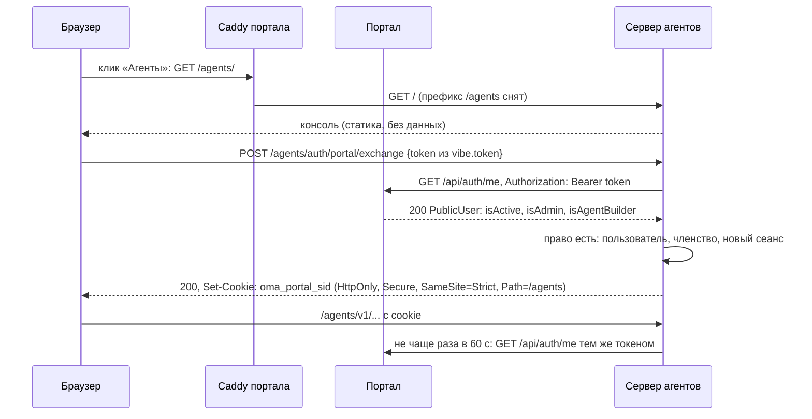

# Конструктор агентов внутри портала: единый вход

Черновик 1, 2026-10-15. Статус: план, код не менялся.

Цель: конструктор агентов (сервер OpenMA `main-node` и его консоль) открывается из портала dco-portal по адресу `https://<портал>/agents`, пункт «Агенты» есть в меню портала, вход и права только через портал (AD), второго логина нет. Конструктор остаётся отдельным приложением со своим процессом, базой и выпуском. Портал меняется маленьким патчем по правилам банка.

Обозначения путей:

- `platform/...` от `/home/vnkjd/orca/projects/ai-native-backoffice-v3/platform`;
- `dco-portal/...` от `/home/vnkjd/orca/projects/dco-portal-передача-2026-10-13/dco-portal` (архив банка, без git).

## 0. Коротко

- **Механизм.** Вариант C (обмен на свой сеанс), но без новой подписи в портале. Пропуском служит действующий токен сеанса портала из `localStorage["vibe.token"]` (тот же origin, консоль конструктора его видит). Консоль один раз отправляет его методом POST на `/agents/auth/portal/exchange`. Сервер агентов проверяет токен вызовом `GET /api/auth/me` портала, проверяет право и выдаёт свою cookie сеанса (HttpOnly, `Path=/agents`). Раз в 60 секунд сервер перепроверяет токен тем же вызовом, поэтому выход из портала, отзыв сеанса, отключение учётки и снятие права закрывают конструктор.
- **Портал:** около 120 строк кода и 40 строк Caddy, около 210 строк тестов. Новой точки входа, нового секрета и нового middleware в портале нет.
- **Сервер агентов и консоль:** около 400 строк сервера, около 300 строк консоли, около 750 строк тестов вместе со сквозным.

## 1. Механизм единого входа

### 1.1 Что дано

Портал (`dco-portal`):

- Вход по AD или локальной учётке. Сервер выдаёт JWT (HS256, `JWT_SECRET`) с `sid` сеанса (`server/src/routes/auth.ts:420-443`). Cookie сеанса нет.
- Клиент хранит токен в `localStorage["vibe.token"]` (`client/src/lib/api.ts:5`) и шлёт заголовок `Authorization: Bearer`.
- Каждый запрос проверяет строку сеанса в `auth_sessions`: отзыв, срок, простой (`server/src/services/auth-sessions.ts:129-138`). Выход, смена пароля, админ и синхронизация AD отзывают сеанс сразу.
- `GET /api/auth/me` отдаёт `PublicUser` с `isActive`, `isAdmin`, `isWorkdayAdmin` (`server/src/routes/auth.ts:352-361`).
- Ограничитель 240 запросов в минуту считается на сотрудника по токену, а не на адрес (`server/src/app.ts:450-475`).

Сервер агентов (`platform/apps/main-node`):

- Вход подключается как компонент `NodeAuth` (`src/auth/node-auth.ts:33-45`): `handler` для `/auth/*`, `resolveSession(headers)`, `findUser`. Компонент выбирает `nodeDefaults` (`src/components.ts:86-89`).
- Проверка на `/v1/*` (`packages/auth/src/index.ts:170-283`) идёт по порядку: API-ключ, Bearer, затем `resolveSession`. `/auth/*` пропускается без проверки.
- Консоль узнаёт пользователя через `GET /auth/get-session` (`apps/console/src/lib/auth.tsx`, `lib/auth-client.ts`).

### 1.2 Сравнение

| | B. Forward auth в Caddy, доверенные заголовки | A. OIDC, портал как провайдер | C. Одноразовый подписанный токен | **C1. Обмен токена портала с проверкой в портале (выбран)** |
|---|---|---|---|---|
| Правки в портале | Новый endpoint, который отвечает заголовками для `copy_headers`. Плюс cookie сеанса портала, иначе обычный переход на `/agents` не проверить: браузер не шлёт Bearer при навигации. Cookie требует защиты от CSRF во всём портале | Сотни строк: discovery, authorize, token, jwks, PKCE, ключи, выход. Либо отдельный IdP (Keycloak и т. п.) | Новый endpoint подписи (около 30 строк), общий секрет или пара ключей | Нет нового кода входа. Только право `is_agent_builder`, пункт меню и маршрут в Caddy |
| Правки в сервере агентов | Свой `NodeAuth`, который верит заголовкам | Мало: `signIn.oidc` уже есть | Свой маршрут обмена, таблица `jti` | Свой `NodeAuth` с обменом и перепроверкой |
| Подделка личности | Главный риск. Любой, кто достучался до сервера агентов мимо Caddy, ставит `X-Portal-User` и становится кем угодно. Нужна строгая изоляция сети и чистка входящих заголовков | Нет, подпись IdP | Нет, если секрет не утёк. Утечка секрета даёт вход за любого | Нет. Сервер ничему из запроса не верит, кроме ответа портала на его собственный вызов |
| Доступ только из сети прокси | Обязателен | Не нужен | Не нужен | Не нужен для безопасности, но сервер всё равно закрыт от внешней сети |
| Срок жизни | На каждый запрос | Токены IdP | Пропуск 60 с, дальше свой сеанс без связи с порталом | Свой сеанс, токен портала перепроверяется раз в 60 с |
| Выход из портала | Сразу, проверка на каждом запросе | Нужен back-channel logout | **Не закрывает** конструктор до конца его сеанса | Закрывает: сразу в открытой вкладке (событие `storage`) и не позже 60 с для любого запроса |
| Нагрузка на портал | Вызов на каждый запрос конструктора. Опросы и поток событий консоли съедают предел 240 в минуту того же сотрудника и ломают ему сам портал | Нет | Нет | Один вызов на загрузку страницы и не больше одного в минуту на активный сеанс |

**Почему C1.** Это самый маленький патч портала: в нём нет кода входа, ключей и секретов, только флаг права. Выход и отзыв работают через таблицу сеансов портала, которую банк уже поддерживает. A остаётся целевым вариантом на будущее: спека [08-iam-tenancy.md](../components/08-iam-tenancy.md) рассчитана на внешний OIDC-провайдер. Если банк поставит IdP (Keycloak, ADFS), конструктор переключается на `signIn.oidc` без правок портала.

### 1.3 Как это работает



1. Пункт меню делает полную загрузку страницы `/agents/`. Caddy отдаёт её серверу агентов, статика консоли открыта всем (в ней нет данных).
2. Консоль при каждой загрузке страницы читает `localStorage["vibe.token"]`.
   - Токена нет: переход на `/` портала, портал сам покажет вход.
   - Токен есть: `POST /agents/auth/portal/exchange` с токеном в теле запроса (не в URL: не попадёт в журналы и Referer).
3. Сервер вызывает `GET <портал>/api/auth/me` с этим токеном.
   - 200, `isActive` и (`isAdmin` или `isAgentBuilder`): создаёт или обновляет пользователя и членство, создаёт новый сеанс и ставит cookie. Старый сеанс этой вкладки удаляется.
   - 200 без права: 403, cookie нет, консоль показывает «Нет доступа».
   - 401: 401, консоль уводит в портал.
   - Сеть, 5xx, 429: 503 «Портал недоступен, повторите».
4. Дальше консоль ходит в `/agents/v1/*` с cookie. `resolveSession` раз в 60 с повторяет вызов `/api/auth/me` токеном, который лежит в памяти процесса рядом с сеансом.
5. Выход:
   - портал при выходе отзывает сеанс (`routes/auth.ts:341-350`) и стирает `vibe.token`;
   - открытая вкладка конструктора получает событие `storage`, удаляет свой сеанс и уходит в портал;
   - любой другой запрос с той же cookie не позже чем через 60 с получит 401 от перепроверки.
   Если в той же вкладке браузера вошёл другой сотрудник, `vibe.token` меняется, и консоль делает обмен заново.

### 1.4 Безопасность

- **Подделка заголовков.** Доверенных заголовков нет. Сервер агентов не читает `X-Portal-*`, `X-Forwarded-User` и т. п. Личность берётся только из ответа портала на вызов, который сервер делает сам. Сквозной тест шлёт такие заголовки и ждёт 401.
- **Обход прокси.** Прямой запрос к серверу агентов без cookie получает 401, а для обмена нужен действующий токен портала. Сеть всё равно закрыта: в схеме с контейнером `front` у сервера агентов нет опубликованного порта, в схеме с Caddy на хосте порт слушает только `127.0.0.1`.
- **Подпись.** Новых ключей нет. Подпись JWT портала проверяет сам портал, и `JWT_SECRET` не покидает портал.
- **Срок жизни.**
  - Сеанс конструктора: простой 30 минут, не дольше 12 часов, перепроверка токена раз в 60 с.
  - Токен портала живёт не дольше своего сеанса: 24 часа, простой 8 часов (`runtime-settings/registry.ts:66-90`). Перепроверка продлевает простой портала не чаще раза в минуту, и это верно: сотрудник работает.
  - Портал недоступен: сеанс конструктора живёт ещё 60 с, потом 401.
  - Сервер агентов перезапустился: сеансы в памяти пропали, и консоль молча делает обмен заново.
- **Выход.** Описан в п. 1.3, шаг 5. Задержка не больше 60 с, в тесте 2 с.
- **CSRF.**
  - Cookie `SameSite=Strict`.
  - Обмен и выход проверяют `Origin` (точное совпадение с `PORTAL_ORIGIN`) и `content-type: application/json`.
  - Для всех изменяющих запросов `/v1/*` с cookie сервер в режиме портала тоже проверяет `Origin`.
- **Общий origin.** Это главный риск, и его задаёт само требование «тот же домен». Скрипт под `/agents` читает `localStorage` портала, а скрипт портала читает `localStorage` конструктора. XSS в конструкторе равен XSS в портале. Что делаем:
  - строгая CSP на `/agents` в Caddy (`script-src 'self'`, без inline);
  - встроенный скрипт темы в `apps/console/index.html:51-57` выносим в файл;
  - консоль не рендерит сырой HTML: `rehype-raw` и `dangerouslySetInnerHTML` не найдены, держать так и проверить контрактным тестом;
  - security-review консоли перед выкаткой.
- **Токен портала на сервере агентов.** Хранится только в памяти процесса рядом с сеансом и пропадает с ним. Не пишется в базу, журналы, ответы и песочницы. Ключ сеанса в памяти: sha256 от значения cookie. Тест проверяет, что журнал сервера не содержит токена. По сравнению с общим origin это не новая поверхность: кто управляет ответами `/agents`, тот и так читает `vibe.token` в браузере.
- **Ключи API.** API-ключ проверяется раньше cookie, а членство его владельца проверяется только при использовании (`packages/auth/src/index.ts:158`). Если сотрудник потерял право в портале, его ключ работал бы, пока он сам не зайдёт в конструктор. Поэтому в режиме портала выпуск ключей (`POST /v1/oma/api_keys`, `POST /v1/oma/me/cli-tokens`) и статический `API_KEY` выключены. Токены окружений и песочниц (`oma_env_`, Bearer работ) остаются: это не вход людей.

## 2. Пользователи и права

### 2.1 Кто видит пункт «Агенты»

Новое право портала `users.is_agent_builder`, по образцу `is_workday_admin`. Его выдаёт админ портала в «Админ-панель → Пользователи», там же, где «Доступ к рабочему времени».

Пункт видят админы портала (`isAdmin`) и сотрудники с `isAgentBuilder`. Это то же правило, что для «Рабочего времени» (`client/src/components/Sidebar.tsx:316-319`). Решает не меню, а сервер агентов: он сам проверяет `isActive && (isAdmin || isAgentBuilder)` по ответу `/api/auth/me`.

### 2.2 Роли

| Портал | Конструктор (`membership.role`) | Что даёт |
|---|---|---|
| `isAdmin` | `admin` | Всё, что `member`. Плюс просмотр участников и приглашений, но в режиме портала состав всё равно задаёт портал |
| `isAgentBuilder` без `isAdmin` | `member` | Агенты, окружения, хранилища секретов, сессии в общем workspace |
| нет права или учётка выключена | членства нет | 403 |
| `owner` | никому | Workspace принадлежит банку, а не человеку. Роли меняет только портал |

Роль пересчитывается при каждой перепроверке (раз в 60 с), а потеря права удаляет членство. Сейчас роли в конструкторе проверяются только в `packages/http-routes/src/tenants/members.ts`, поэтому разница между `admin` и `member` пока почти не видна. Это нормально для первой версии. Названия в спеке 08 (`admin`, `agent_builder`) ложатся на эту пару без переименования данных.

### 2.3 Один workspace на банк

Один общий workspace: `PORTAL_TENANT_ID=tn_bank`, имя из `PORTAL_TENANT_NAME` («Банк»). Сервер создаёт его при старте (`INSERT ... ON CONFLICT DO NOTHING`). Все строители видят всех агентов банка. Деление по подразделениям позже: портал знает подразделение (`department` в `PublicUser`), и его можно превратить в workspace без правок портала.

В режиме портала запрещены (ответ 403 `managed_by_portal`):

- новый workspace: `POST /v1/oma/tenants`;
- приглашения: `/v1/oma/tenants/:id/invitations*`, `/v1/oma/tenants/invitations/accept`;
- смена роли и удаление участника: `PATCH|DELETE /v1/oma/tenants/:id/members/:userId`;
- выпуск ключей: `POST /v1/oma/api_keys`, `POST /v1/oma/me/cli-tokens`.

Личные workspace «<имя>'s workspace» не создаются: в режиме портала `ensureTenantForUser` (`modules/node-http.ts:285`) добавляет членство в банковский workspace вместо `ensureTenantSqlite`.

### 2.4 Первый вход

1. Обмен прошёл, право есть.
2. `user_id = pu_<id портала>`: стабильный и не зависит от почты. Сотрудник AD сохраняет свои данные при смене почты или ФИО.
3. Запись в новую таблицу `portal_user (id, portal_id, username, full_name, email, department, last_seen_at)` в основной базе сервера агентов. Её читает `findUser` для списка участников.
4. `membership (pu_<id>, tn_bank, role)` с ролью по таблице выше: `INSERT ... ON CONFLICT DO UPDATE SET role`.
5. Сеанс и cookie. Пароль, почта и better-auth не участвуют. База `auth.db` в режиме портала не создаётся.

## 3. Правки в портале

Отдельной точки проверки не нужно: сервер агентов зовёт существующий `GET /api/auth/me`, который после миграции 38 отдаёт `isAgentBuilder`. Новый middleware в портале тоже не нужен: у портала нет API конструктора.

| Файл | Что | Строк |
|---|---|---|
| `server/src/db/migrations.ts` (после версии 37, строки 1982-1989) | Миграция 38 «доступ к разделу Агенты»: `addColumn(db, "users", "is_agent_builder", "INTEGER NOT NULL DEFAULT 0")`. Только добавляет, повтор безопасен, `REFERENCES` нет. В `schema.sql` и `applyBaseSchema` не добавлять | +8 |
| `server/src/types/index.ts` | `UserRow.is_agent_builder: number`, `PublicUser.isAgentBuilder: boolean` | +2 |
| `server/src/routes/auth.ts:56-94` | `toPublicUser`: `isAgentBuilder: !!row.is_agent_builder`. Сразу появляется в `/api/auth/me` и `/api/admin/users` | +1 |
| `server/src/routes/admin-settings.ts:351-521` | `isAgentBuilder` в схеме zod (`.strict`), в UPDATE внутри `writeTx("admin.user-flags")`, в `rolesChanged` (событие `auth:refresh` обновит меню у сотрудника сразу), аудит `role.agents_access.set` | +18 |
| `client/src/lib/types/users.ts:44` | `isAgentBuilder?: boolean` | +1 |
| `client/src/lib/api.ts:5` | Комментарий у `AUTH_STORAGE_ITEM`: ключ читает раздел `/agents`, переименование ломает вход в него | +2 |
| `client/src/components/Sidebar.tsx` | `requires?: "workday" \| "agents"`, поле `external?: true`. Пункт `{ to: "/agents/", label: "Агенты", icon: <Bot/>, requires: "agents", external: true }`. Фильтр в строках 316-319: `\|\| (it.requires === "agents" && isAgentBuilder)`. В `Item` (183-288) для `external` ставится `<NavLink reloadDocument>`: полная загрузка, иначе SPA портала покажет NotFound (`App.tsx:250`). `reloadDocument` есть в установленном react-router 7.18.4 | +14 |
| `client/src/pages/admin/users/UserRow.tsx:20,158-166`, `UsersTable.tsx:100`, `AdminUsersPage.tsx:50` | Переключатель «Агенты» рядом с «Рабочим временем», колонка, тип патча | +16 |
| `deploy/Caddyfile.front` | Блок `/agents` до общего `handle` (ниже) | +22 |
| `deploy/Caddyfile.multi` | Тот же блок в сайте `:47352`, апстрим `127.0.0.1:47354` | +22 |
| `deploy/README.md:137-150` | Порт 47354 (loopback, раздел «Агенты») и короткий раздел про маршрут | +15 |
| `server/test/schema.test.ts:77` | `toBe(37)` → `toBe(38)` | 1 изм. |
| `server/test/agents-access.test.ts` (новый) | Миграция, `/api/auth/me` отдаёт флаг, `PUT /api/admin/users/:id` ставит и снимает флаг, аудит, `auth:refresh`, не-админ получает 403 | ~90 |
| `client/test/nav-agents.test.tsx` (новый, образец `nav-ai-sections.test.tsx`) | Пункт виден админу и строителю, скрыт остальным, ссылка с полной загрузкой на `/agents/` | ~70 |
| `client/test/admin-user-agents-toggle.test.tsx` (новый) | Переключатель шлёт `{ isAgentBuilder }` | ~50 |

Блок Caddy (`Caddyfile.front`, перед `handle {` общего маршрута):

```caddyfile
	# Раздел «Агенты»: отдельное приложение в сети portal. Вход оно проверяет
	# само через /api/auth/me портала, доверенных заголовков нет.
	redir /agents /agents/ 308
	handle_path /agents/* {
		header {
			Content-Security-Policy "default-src 'self'; script-src 'self'; style-src 'self' 'unsafe-inline'; img-src 'self' data: blob:; font-src 'self' data:; connect-src 'self'; frame-ancestors 'none'; base-uri 'self'; form-action 'self'"
			X-Content-Type-Options nosniff
			Referrer-Policy strict-origin-when-cross-origin
		}
		reverse_proxy dco-agents:8787 {
			lb_try_duration 5s
			lb_try_interval 250ms
			import dco_transport
		}
	}
```

- `handle_path` снимает префикс: сервер агентов видит `/v1/...`, `/auth/...`, `/assets/...`. Поток событий (SSE) Caddy пропускает без буфера сам.
- Если контейнер агентов не запущен, `/agents` отвечает 502, остальной портал не задет: имя апстрима разрешается при запросе.
- `docker-compose.multi.yml` банка не меняется. Контейнер агентов из нашего compose подключается к внешней сети `vibe-crm-portal_portal` с алиасом `dco-agents`.
- В однопроцессном `docker-compose.yml` прокси нет, раздела `/agents` там не будет.

**Необязательно, второй шаг (+12 строк, +30 строк теста).** Логин портала возвращает на страницу из `location.state.from` через SPA-переход (`client/src/pages/Login.tsx:110-120`), поэтому вернуть сотрудника на `/agents/...` после входа нельзя. В первой версии сотрудник без сеанса попадает на главную портала и нажимает «Агенты» ещё раз. Улучшение: маршрут `/go/agents/*` в `client/src/App.tsx`, который делает `window.location.replace("/agents/...")`. Консоль уводит на `/go/agents/<путь>`, портал после входа возвращает туда же.

**Правила банка.**

- Комментарии в настоящем времени, только «почему», шапка `@author G.D.V.`, без длинного тире.
- Скан из `CLAUDE.md` §13 ищет `агент` с маленькой буквы:
  - «Агенты» в меню и переключателе скан проходит;
  - в коде только латиница (`is_agent_builder`, `role.agents_access.set`);
  - в комментариях и имени миграции слова «агент» с маленькой буквы нет.
  Согласование названия с банком: вопрос 1.
- Ворота приёмки: `npm run typecheck`, `npm run build`, `npm run test:server` (Node 22, в контейнере), `npm run test:client`, скан §13, `caddy validate` обоих Caddyfile (его же гоняет `deploy/rollout.sh:171-189`).

**Объём портала:** около 120 строк кода, 44 строки Caddy, 15 строк документации, около 210 строк тестов.

## 4. Правки в сервере агентов и консоли

Порядок: консоль сейчас активно меняется в ветке `feat/agent-console` (много незакоммиченных правок в `platform/apps/console`). Правки консоли из этого плана делать после её слияния, иначе будут конфликты.

### 4.1 Сервер (`platform/apps/main-node`, `platform/packages`)

| Файл | Что | Строк |
|---|---|---|
| `apps/main-node/src/config.ts:41-54, 255-263` | `auth.mode: "better-auth" \| "portal"` и блок `auth.portal`. Проверки при старте: в режиме портала нельзя `AUTH_DISABLED`, `API_KEY`, `GOOGLE_*`, `GITHUB_*`; `PORTAL_ORIGIN` только https, кроме localhost | +50 |
| `apps/main-node/src/auth/portal-auth.ts` (новый) | `createPortalAuthComponent()`: `NodeAuth` и `ensureMembership(userId)`. Описание ниже | ~230 |
| `apps/main-node/src/auth/portal-client.ts` (новый) | Вызов `GET /api/auth/me`: тайм-аут 3 с, без редиректов, ответ разобран схемой zod. Итог: `ok(user)`, `invalid` (401, 404), `unavailable` (сеть, 5xx, 429) | ~60 |
| `packages/schema/src/index.ts` (рядом с `applyTenantSchema`, 223-250) | `applyPortalUserSchema(sql)`: таблица `portal_user` | +15 |
| `apps/main-node/src/components.ts:86-89` | `config.auth.mode === "portal"` → `createPortalAuthComponent(...)` вместо better-auth | +6 |
| `apps/main-node/src/modules/node-http.ts` | После `v1.use("*", authMw)` (строка 295) защита режима портала: запрет маршрутов из п. 2.3 и проверка `Origin` для изменяющих запросов с cookie. `ensureTenantForUser` (строка 285) в режиме портала вызывает `auth.ensureMembership` | +35 |
| `apps/main-node/test/portal-auth.test.ts`, `config.test.ts` | Тесты из п. 5.2 | ~330 |

Новые переменные окружения:

| Переменная | Пример | Зачем |
|---|---|---|
| `AUTH_MODE` | `portal` | Новый режим. Без неё всё как раньше |
| `PORTAL_ORIGIN` | `https://printmon.bsbnb.kz:47352` | Проверка `Origin`, адрес возврата в портал |
| `PORTAL_ME_URL` | `${PORTAL_ORIGIN}/api/auth/me` | Куда сервер ходит проверять токен. Через тот же Caddy: сервер для портала обычный клиент, сокеты портала ему не нужны |
| `PORTAL_MOUNT_PATH` | `/agents` | `Path` у cookie |
| `PORTAL_TENANT_ID`, `PORTAL_TENANT_NAME` | `tn_bank`, `Банк` | Общий workspace |
| `PORTAL_RECHECK_SECONDS` | `60` | Как часто перепроверять токен |
| `PORTAL_IDLE_MINUTES` | `30` | Простой сеанса конструктора |
| `PORTAL_OUTAGE_GRACE_SECONDS` | `60` | Сколько ждать недоступный портал |
| `NODE_EXTRA_CA_CERTS` | `/certs/bank-ca.pem` | Доверие к сертификату портала |
| `PUBLIC_BASE_URL` | `https://<портал>/agents` | Ссылки, которые сервер строит сам |

`GATEWAY_ORIGIN` остаётся внутренним адресом (`http://dco-agents:8787`): песочницы ходят к серверу не через портал.

Почему `/api/auth/me` вызывается через Caddy, а не через сокеты `/run/dco/web-*.sock`. Портал доверяет `X-Forwarded-For` только с unix-сокета (`TRUST_PROXY=unix`, `server/src/app.ts:130-155`). Сервер агентов с доступом к сокетам мог бы подделать адрес и обойти предел попыток входа портала. Сервер агентов запускает песочницы, и давать ему такие права незачем.

`portal-auth.ts`, контракт:

- `POST /auth/portal/exchange`, тело `{ "token": "<jwt>" }`, не больше 8 КБ.
  - Проверки: `Origin` равен `PORTAL_ORIGIN`, тип `application/json`.
  - Ответы: 200 `{ user }` и `Set-Cookie: oma_portal_sid=<32 случайных байта>; HttpOnly; Secure; SameSite=Strict; Path=/agents`; 401 `portal_session_invalid`; 403 `no_access`; 503 `portal_unavailable`.
  - Каждый обмен создаёт новый идентификатор сеанса, старый из cookie удаляется: так закрыта фиксация сеанса.
- `GET /auth/get-session`: `{ session: { id, userId, expiresAt }, user: { id, name, email, image: null, emailVerified: true, createdAt, updatedAt } }` или `null`. Это формат better-auth, поэтому `authClient.useSession()` консоли работает без замены. Значение cookie в ответ не попадает.
- `POST /auth/sign-out`: удаляет сеанс и стирает cookie. Проверяет `Origin`.
- Всё остальное под `/auth/*`: 404.
- `resolveSession(headers)`:
  1. найти сеанс по sha256 значения cookie;
  2. простой истёк: удалить;
  3. прошло `RECHECK` с прошлой проверки: вызвать портал, одновременные вызовы одного сеанса склеены в один;
  4. `ok` с правом: обновить `portal_user` и роль;
  5. `invalid` или нет права: удалить сеанс, а при потере права и членство;
  6. `unavailable`: держать сеанс до `RECHECK + GRACE` от последней удачной проверки.
- `findUser(id)`: из `portal_user`. `signInMethods`: `{ emailPassword: false, oidc: [] }`, поэтому `/auth-info` честно говорит, что своих способов входа нет.
- Хранилище сеансов в памяти процесса, уборка раз в 5 минут, не больше 20 сеансов на сотрудника. Это верно, пока сервер агентов работает одним процессом (`standalone`). Для нескольких процессов нужна таблица сеансов, токен в ней шифровать ключом от `PLATFORM_ROOT_SECRET`.
- Журнал: операция, `user_id`, итог. Токен и cookie никогда.

### 4.2 Консоль (`platform/apps/console`)

Консоль собирается отдельной сборкой под портал: `VITE_BASE=/agents/ VITE_AUTH_MODE=portal`. Обычная сборка не меняется.

| Файл | Что | Строк |
|---|---|---|
| `vite.config.ts` | `base: process.env.VITE_BASE ?? "/"`, прокси dev-сервера под базой | +6 |
| `src/lib/base.ts` (новый) | `BASE_PATH` из `import.meta.env.BASE_URL`, `withBase(path)` | +15 |
| `src/main.tsx:259-268` | `createBrowserRouter(routes, { basename })`. В режиме портала нет маршрутов `login` (с формой), `join`, `cli/login`. Внутренняя страница списка агентов `/agents` станет `/agents/agents`, это допустимо | +10 |
| `src/lib/api.ts:1,104-112` | `BASE = BASE_PATH`. В режиме портала 401 на `/v1/*` → один обмен (общий для всех запросов) и один повтор | +30 |
| `src/lib/auth-client.ts` | `basePath: withBase("/auth")` | +1 |
| `src/lib/portal-session.ts` (новый) | Чтение `localStorage[VITE_PORTAL_TOKEN_KEY ?? "vibe.token"]`, обмен, разбор 401/403/503, слушатель `storage` (токен стёрт: выход и в портал; токен сменился: новый обмен), переход в портал | ~100 |
| `src/lib/auth.tsx` | В режиме портала обмен при загрузке страницы до `useSession` | +15 |
| `src/components/AppShell.tsx:55` | Вместо `<Navigate to="/login">`: экран «Входим через портал», затем обмен или экран ошибки | +10 |
| `src/pages/Login.tsx` | В режиме портала без формы: сразу обмен или переход в портал | +10 |
| `src/pages/PortalNoAccess.tsx` (новый) | «Нет доступа к разделу Агенты. Доступ выдаёт администратор портала», кнопка «Вернуться в портал». Отдельно экран «Портал недоступен» с повтором | ~60 |
| `src/components/UserProfile.tsx:53` | «Выйти» → «Вернуться в портал». Выход один, в портале | +8 |
| `src/components/AppSidebar.tsx` | Ссылка «Портал» вверху: конструктор выглядит частью портала | +8 |
| `src/pages/WorkspaceMembers.tsx`, страница ключей API, выбор и создание workspace | В режиме портала только чтение, подпись «Состав и роли задаёт портал» | ~30 |
| Абсолютные пути, около 20 мест | `withBase()`: `UserProfile.tsx:54`, `ConnectRuntime.tsx:82-114`, `CliLogin.tsx:144-214`, `WorkspaceMembers.tsx:230,532`, `Login.tsx:308`, `lib/branding.ts:114`, `components/SkillSources.tsx:72`, `integrations/api/request.ts:15`, `integrations/pages/*Wizard.tsx` (адреса возврата), `pages/session-detail/Panels.tsx:237` (ссылка скачивания, работает по cookie) | ~30 |
| `index.html:50-57` | Скрипт темы в `public/theme.js` (под CSP без inline), убрать `preconnect` к `challenges.cloudflare.com` | ~10 |
| Тесты | П. 5.3 | ~200 |

Ключ `theme` в `localStorage` у портала и консоли общий, значения совпадают (`light`, `dark`, без ключа: системная, `dco-portal/client/src/components/ThemeToggle.tsx`, `console/src/lib/theme.ts`). Тема переключается сразу в обоих. Остальные ключи не пересекаются: у консоли `oma_*`, `oma-*`, у портала `vibe.*`, `dco.*`.

**Объём сервера и консоли:** сервер около 400 строк, консоль около 300 строк, тесты около 530 строк и сквозной около 220.

## 5. Как проверить

Каждую ручную проверку превращаем в тест, который можно повторить.

### 5.1 Портал (vitest, `dco-portal/server/test`, `client/test`)

- Миграция 38 на пустой базе и повторно: колонка есть, `CODE_SCHEMA_VERSION = 38`.
- `GET /api/auth/me` отдаёт `isAgentBuilder` (false по умолчанию).
- `PUT /api/admin/users/:id { isAgentBuilder: true }` от админа: флаг, запись аудита `role.agents_access.set`, событие `auth:refresh`. От не-админа: 403. Лишнее поле: 400 (`.strict`).
- Меню: админ и строитель видят «Агенты», обычный сотрудник нет. Ссылка ведёт на `/agents/` с полной загрузкой.
- Переключатель в «Пользователях» шлёт `{ isAgentBuilder }`.

### 5.2 Сервер агентов (vitest, `platform/apps/main-node/test/portal-auth.test.ts`)

Поддельный портал: маленький HTTP-сервер в тесте отвечает на `/api/auth/me` по таблице токенов. Часы подменяются.

1. Обмен с токеном строителя: 200, cookie `HttpOnly`, `SameSite=Strict`, `Path=/agents`. `get-session` отдаёт ФИО из портала. `/v1/oma/me`: workspace `tn_bank`, роль `member`.
2. Админ портала: роль `admin`. Флаг снят, а `isAdmin` остался: роль меняется на следующей перепроверке.
3. Токен без права: 403 и cookie нет. Учётка `isActive=false`: 403. Неизвестный токен: 401.
4. Чужой `Origin` или нет `Origin`: 403 на обмен, выход и изменяющий `/v1/*` с cookie.
5. Портал начал отвечать 401 на токен: через `RECHECK` запрос получает 401, сеанс удалён.
6. Право снято: через `RECHECK` 401, членство удалено, `GET /v1/oma/tenants/tn_bank/members` его не показывает.
7. Портал недоступен: в пределах `GRACE` запросы проходят, после него 401. Ответ 429 считается недоступностью, а не выходом.
8. Простой больше `IDLE`: 401.
9. Заголовки `X-Portal-User`, `X-Forwarded-User`, `Remote-User` без cookie: 401.
10. В режиме портала `POST /v1/oma/api_keys`, `POST /v1/oma/tenants`, приглашения, `PATCH` и `DELETE` участника: 403 `managed_by_portal`.
11. Новый пользователь не получает личный workspace: у него одно членство, в `tn_bank`.
12. Журнал сервера за весь тест не содержит ни токена, ни значения cookie.
13. Конфиг: `AUTH_MODE=portal` вместе с `AUTH_DISABLED`, `API_KEY`, `GOOGLE_CLIENT_ID` или с http-адресом не на localhost даёт ошибку при старте.

### 5.3 Консоль (vitest)

- `withBase` и `basename`: ссылки и запросы идут под `/agents`.
- Контрактный тест `base-path.contract.test.ts`: в `src/**` нет строк `"/v1/`, `"/auth`, `location.href = "/` вне `lib/api.ts` и `lib/base.ts`. Ловит забытый абсолютный путь.
- `portal-session`: нет токена → переход на `/`; есть токен → POST обмена с токеном в теле, не в URL; 403 → экран «Нет доступа»; 503 → экран повтора; событие `storage` со стёртым токеном → выход и переход; со сменённым → новый обмен.
- `api.ts`: 401 на `/v1/*` → один обмен на все параллельные запросы и один повтор, второй 401 → уход в портал.
- Нет сырого HTML в рендере Markdown (контрактный тест на `rehype-raw` и `dangerouslySetInnerHTML`).

### 5.4 Сквозной сценарий (Playwright)

Файлы: `platform/test/e2e/portal-sso.spec.ts`, `platform/playwright.portal-sso.config.ts`, стенд `platform/scripts/portal-sso-stack.sh up|down` (п. 7). На стенде `PORTAL_RECHECK_SECONDS=2`. AD локально нет, поэтому сотрудники локальные. Сеанс у них тот же (JWT плюс строка `auth_sessions`), что у AD.

1. **Строитель.** Входит в портал → в меню есть «Агенты» → клик → адрес `/agents/...`. За весь путь на `/agents` нет поля пароля. В профиле конструктора ФИО из портала. Создаёт агента, тот виден в списке.
2. **Сотрудник без права.** Пункта «Агенты» в меню нет. Прямая ссылка `/agents/` показывает «Нет доступа». `fetch("/agents/v1/agents")` из его вкладки даёт 401. Cookie `oma_portal_sid` не появилась.
3. **Выход.** У строителя две вкладки: портал и конструктор. Выход в портале → вкладка конструктора за 1 с уходит в портал (событие `storage`). Запрос с сохранённой cookie из отдельного контекста через 3 с получает 401.
4. **Снятие права.** Админ снимает право у строителя. Через 3 с конструктор строителя показывает «Нет доступа», а пункт меню у него исчезает без перезагрузки (`auth:refresh`).
5. **Подделка.** Запрос на `/agents/v1/agents` с `X-Portal-User: <id админа>` без cookie: 401. Прямой запрос к серверу агентов мимо Caddy без cookie: 401.
6. **Скриншоты** 1280 и 390 пикселей: портал с пунктом «Агенты», конструктор в режиме портала, «Нет доступа».
7. `caddy validate` для `Caddyfile.front` и `Caddyfile.multi` из рабочей копии портала (сертификаты подставные, во временном каталоге).

## 6. Работа с порталом без git

Архив банка не трогаем, он остаётся эталоном. Рабочая копия с git лежит рядом и вне нашего репозитория: код банка не должен попасть в наш git.

```sh
SRC="/home/vnkjd/orca/projects/dco-portal-передача-2026-10-13/dco-portal"
WORK=/home/vnkjd/orca/projects/dco-portal-work
rsync -a --exclude node_modules --exclude dist --exclude .understand-anything "$SRC/" "$WORK/"
cd "$WORK"
git init -b base && git add -A && git commit -m "Передача 13.10.2026"
git tag base-2026-10-13
git switch -c agents-access
# правки, тесты, скан §13
```

- `.gitignore` архива уже исключает `.env`, базу и сертификаты. Перед первым коммитом проверить `git status`: в базовом коммите не должно быть `.env*`, `server/data`, `server/certs`.
- Патч для банка: `git diff base-2026-10-13 > /home/vnkjd/orca/projects/dco-portal-patches/0001-agents-access.patch` и `git diff --name-only base-2026-10-13 > .../0001-files.txt`. Так требует `ПЕРЕДАЧА.md:49-51`. Отдаём `git diff`, а не `format-patch`, чтобы к банку не ушли сообщения коммитов.
- Перед выдачей проверить, что патч ложится на чистый архив: копия `$SRC` во временный каталог, затем `git apply --check`.
- Новый архив от банка: коммит в ветку `base`, тег `base-<дата>`, затем `git rebase base` для `agents-access`.
- `CLAUDE.md`, `docs/` и `.claude/` архива во внутренние правки не попадают: патч их не трогает.

## 7. Локальный запуск для разработки

Состав: портал (Node 22), сервер агентов (Node 24) и Postgres из [runbook-local.md](../runbook-local.md), Caddy в контейнере с `tls internal`. Ноутбук греется: тяжёлые шаги через `nice -n 15`, смотреть `cat /proc/loadavg`.

| Что | Адрес |
|---|---|
| Вход для браузера (Caddy) | `https://localhost:8443` |
| Портал, сервер | `http://127.0.0.1:47352` |
| Портал, клиент Vite с HMR | `http://127.0.0.1:5173` |
| Сервер агентов | `http://127.0.0.1:8787` |
| Консоль агентов, Vite с HMR (по желанию) | `http://127.0.0.1:5174/agents/` |
| Postgres | `127.0.0.1:55432` |

1. **Портал** (рабочая копия из п. 6):

   ```sh
   cd /home/vnkjd/orca/projects/dco-portal-work
   eval "$(fnm env)"; fnm use 22
   npm run install:all
   cp server/.env.example server/.env
   # вписать JWT_SECRET (openssl rand -hex 32), ADMIN_INITIAL_PASSWORD (сгенерировать),
   # TRUST_PROXY=loopback, PORTAL_ROLE=all; AD_URL пусто: только локальные учётки
   npm run dev:server     # 47352
   npm run dev:client     # 5173, /api проксируется на 47352
   ```

2. **Сотрудники.** Скрипт `platform/scripts/portal-sso-seed.sh` входит в портал локальным admin и через `POST /api/admin/users`, `/users/:id/password`, `PUT /users/:id` заводит `builder` (с правом) и `plain` (без права). Пароли генерируются и пишутся в `/home/vnkjd/orca/projects/dco-portal-work/.env.e2e` (вне git), в чат не выводятся.

3. **Сервер агентов** (рецепт [runbook-local.md](../runbook-local.md), разделы 0-4, плюс переменные):

   ```sh
   eval "$(fnm env)"; fnm use 24
   cd /home/vnkjd/orca/projects/ai-native-backoffice-v3/platform
   VITE_BASE=/agents/ VITE_AUTH_MODE=portal pnpm --filter console build
   AUTH_MODE=portal PORTAL_ORIGIN=https://localhost:8443 \
   PORTAL_ME_URL=http://127.0.0.1:47352/api/auth/me \
   PORTAL_RECHECK_SECONDS=5 PUBLIC_BASE_URL=https://localhost:8443/agents \
   CONSOLE_DIR=apps/console/dist pnpm --filter main-node start
   ```

   Локально `PORTAL_ME_URL` идёт в портал напрямую по http, чтобы не возиться с доверием к `tls internal`. На стенде адрес идёт через Caddy по https.

4. **Caddy** (`platform/deploy/portal/Caddyfile.dev`):

   ```caddyfile
   https://localhost:8443 {
   	tls internal
   	redir /agents /agents/ 308
   	handle_path /agents/* {
   		reverse_proxy 127.0.0.1:8787
   	}
   	handle {
   		reverse_proxy 127.0.0.1:5173
   	}
   }
   ```

   ```sh
   docker run -d --name portal-sso-caddy --network host \
     -v /home/vnkjd/orca/projects/ai-native-backoffice-v3/platform/deploy/portal/Caddyfile.dev:/etc/caddy/Caddyfile:ro \
     caddy:2-alpine
   ```

   Для HMR консоли: запустить `VITE_BASE=/agents/ VITE_AUTH_MODE=portal pnpm --filter console dev --port 5174`. В Caddy `/agents/v1/*`, `/agents/auth*`, `/agents/branding/*` вести на 8787 со снятием префикса, остальное `/agents/*` на 5174 без снятия (Vite сам работает под `base`).

5. **Всё одной командой:** `platform/scripts/portal-sso-stack.sh up` поднимает пункты 1-4 в фоне, ждёт `/api/health` и `/health`, засевает сотрудников. `down` всё останавливает, база Postgres остаётся. Этот же скрипт готовит стенд для сквозного теста из п. 5.4.

## 8. Риски

1. **Общий origin.** XSS в конструкторе даёт токен портала, и наоборот. Защита: CSP на `/agents`, без inline-скриптов, без сырого HTML, security-review консоли до выкатки. Риск задан требованием «тот же домен», от выбора механизма он не зависит.
2. **Зависимость от внутренностей портала:** ключ `vibe.token` и поля `/api/auth/me`. Защита: имя ключа в настройке, комментарий в `client/src/lib/api.ts` портала, сквозной тест на каждую новую передачу кода от банка.
3. **Токен портала в памяти сервера агентов** до 30 минут простоя. Защита: только память, проверка журналов тестом, токен не уходит в песочницы.
4. **Задержка отзыва до 60 с** для запросов без открытой вкладки. Настраивается `PORTAL_RECHECK_SECONDS`, цена: один вызов портала на активного сотрудника за период.
5. **Сеансы в памяти одного процесса.** При масштабировании сервера агентов нужна таблица сеансов.
6. **Префикс `/agents`.** Около 20 абсолютных путей в консоли. Пропущенный путь даст битую ссылку. Защита: контрактный тест из п. 5.3 и сквозной обход страниц.
7. **Расхождение со спекой 08.** Спека ждёт OIDC-провайдер. Этот план временный мост: при появлении IdP переход на вариант A, портал менять не нужно.

Не проверял, закрыть тестами при реализации:

- что Vite с `base` переписывает `/logo.svg` в `index.html`;
- имя сети `vibe-crm-portal_portal` на стенде (`docker network ls`);
- что имя хоста портала разрешается из контейнера агентов (иначе `extra_hosts: <имя>:host-gateway`);
- порядок `handle_path` и `handle @calls` после `caddy adapt`;
- совместимость `authClient.useSession()` с ответом `get-session` (тест в п. 5.3).

## 9. Порядок работ

1. Рабочая копия портала с базовым коммитом (п. 6).
2. Сервер агентов: конфиг, `portal-auth`, защита маршрутов, тесты 5.2. Красный тест, потом код.
3. Портал: миграция 38, флаг, меню, админка, Caddy, тесты 5.1, ворота приёмки банка, скан §13.
4. Консоль после слияния `feat/agent-console`: база `/agents`, режим портала, экраны, тесты 5.3.
5. Стенд `portal-sso-stack.sh` и сквозной сценарий 5.4 со скриншотами.
6. Патч банку: diff, список файлов, короткая записка для разработчиков банка (что делает маршрут и почему нет доверенных заголовков).
